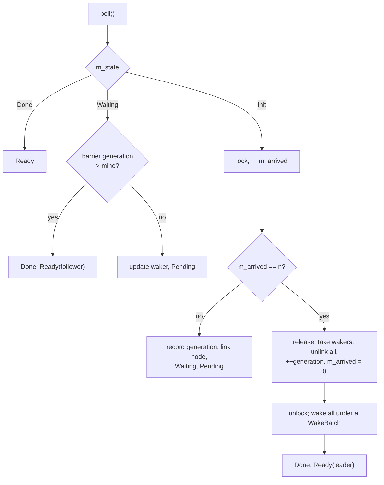

# Barrier

`coro::Barrier` makes a fixed number of tasks wait for each other. Each task awaits
`wait()`; the last of the `n` to arrive releases all of them, and the barrier is ready for
the next round. It is the async counterpart of `std::barrier` and of tokio's
`sync::Barrier`: a waiting task suspends and frees its worker instead of blocking a thread.

```cpp
#include <coro/sync/barrier.h>

coro::Barrier barrier(n);

// In each of the n tasks:
step_one(part);
co_await barrier.wait();   // every task has finished step_one
step_two(part);
```

---

## Motivation

A computation split into `n` parts often has phases: every part of phase one must be done
before any part of phase two starts, because phase two reads what phase one wrote. Today
the only way to express that in coro is to end the tasks and spawn new ones for the next
phase, which costs a set of spawns and a full join per phase. When each part takes tens of
microseconds that overhead is larger than the work.

A barrier keeps the same `n` tasks for the whole computation. Between phases each task
suspends at the barrier, its worker runs something else or parks, and the last arrival
wakes them all.

[`parallel()`](parallel.md) keeps its parts in step the same way, but with a
[Team](team.md): each part gets a ranked member, whose destructor tells the others that
the part has ended, and collectives that combine values as well as wait.

---

## API

```cpp
namespace coro {

class BarrierWaitResult {
public:
    /// True for exactly one task per round: the one whose arrival released the others.
    bool is_leader() const noexcept;
};

class Barrier {
public:
    /// `n` tasks per round; n >= 1.
    explicit Barrier(std::size_t n);
    ~Barrier();

    // Not copyable or movable: the futures hold a pointer to it.
    Barrier(const Barrier&)            = delete;
    Barrier& operator=(const Barrier&) = delete;

    /// One arrival. Resolves when the n-th task of this round has arrived.
    [[nodiscard]] BarrierWaitFuture wait() noexcept;
};

} // namespace coro
```

`BarrierWaitFuture` is a hand-written future with `OutputType = BarrierWaitResult`.

The leader flag lets one task do the work that falls between two phases, such as
resetting a shared counter, without a second barrier:

```cpp
if ((co_await barrier.wait()).is_leader())
    totals.reset();
co_await barrier.wait();   // everyone sees the reset
```

---

## Semantics

- **An arrival counts at the first poll, not at `wait()`.** `wait()` only builds the
  future; it has no side effects, as for every coro future. A future that is never
  polled never arrives.
- **One future, one arrival.** Polling the same future again, before or after the release,
  doesn't count again.
- **The last arrival is the leader and doesn't suspend.** Its first poll finds the count
  complete, releases the others and returns ready at once. The leader carries straight on
  into the next phase on the worker it is already on.
- **Rounds.** A release starts a new round with a count of zero. A task that arrives for
  round two while some round-one waiters haven't yet run is counted in round two; the
  round-one waiters still resolve, because each future remembers the round it arrived in.
- **`n == 1`.** Every arrival is the leader and returns ready at once.
- **A dropped waiter stays counted.** If a future that has arrived is dropped before the
  release (its task was cancelled, or it lost a `select()`), its arrival is not taken
  back. Its waker is removed so the release doesn't wake a task that has moved on. This is
  what `std::barrier` and tokio do. See [Open questions](#open-questions) for the
  alternative.

!!! danger "WARNING: a part that stops arriving hangs the rest"
    A barrier has no way to know that one of its `n` tasks has ended. If a task returns
    or throws instead of arriving, every other task waits at the barrier for good. Code
    that builds its own fork/join on a `Barrier` must cancel the rest when one fails. A
    [Team](team.md) member breaks its team when it's destroyed, so the others fail
    instead of waiting.

---

## Design

### State

```cpp
class Barrier {
    detail::Mutex  m_mutex;
    std::size_t    m_n;
    std::size_t    m_arrived    = 0;   // arrivals in the current round
    std::uint64_t  m_generation = 0;   // round number; bumped by each release
    detail::IntrusiveList<WaitNode> m_waiters;  // suspended arrivals of this round
};

class BarrierWaitFuture {
    Barrier*      m_barrier;
    enum { Init, Waiting, Done } m_state = Init;
    std::uint64_t m_generation;        // round this future arrived in
    WaitNode      m_node;              // intrusive list hook + Rc<Waker>
};
```

The waiter list is intrusive, as in the channels: each suspended future links its own node
into the barrier, so a wait allocates nothing. Like every future registered in a list, the
future is not moved after its first poll; it lives in the awaiting coroutine's frame.

### Poll



A follower that wakes reads the barrier's generation under the lock. Its release is
proven by the generation being past the one it arrived in, not by having been woken, so
a spurious wake just registers the waker again.

### Release

The leader moves each waiter's `Rc<Waker>` into a small inline buffer (it spills to the
heap only for large `n`), unlinks the nodes, bumps the generation and resets the count,
all under the lock. It wakes the waiters after unlocking, as `Event::set()` does, inside a
[`WakeBatch`](work_stealing_executor.md#batched-wakes-wakebatch):

```cpp
detail::WakeBatch batch;     // stack local inside poll(): never spans a suspension
for (auto& waker : to_wake)
    waker->wake();
// ~WakeBatch: on WorkStealingExecutor, one injection-queue push and up to
// n - 1 parked workers woken at once. On other executors it does nothing and
// each wake() above enqueued as usual.
```

Without the batch, `n - 1` wakes from one worker would wake one parked worker, and the rest
would follow one at a time down the chain described in
[Passing the wake on](work_stealing_executor.md#passing-the-wake-on). For short phases
that ramp-up is most of the phase.

The woken tasks don't go into the leader's [LIFO slot](work_stealing_executor.md#lifo-slot):
the leader is about to run its own next phase, and the point is to spread the others
across workers.

### Races

!!! danger "WARNING: the leader takes the wakers out under the lock"
    A dropped waiter's destructor unlinks its node under the same lock. If the leader
    walked the list after unlocking, it could read a node whose future had just been
    destroyed. Taking the wakers out and unlinking every node before unlocking means a
    destructor that runs afterwards finds its node already unlinked and does nothing.

- **A waiter dropped after the release but before it is polled.** Its waker has already
  been taken and may still fire. Waking a task that has moved on or finished is harmless
  (the scheduling state machine ignores it); the task is polled once and finds nothing to
  do.
- **An arrival for the next round during the leader's wakes.** It sees `m_arrived == 0`
  and the new generation, so it waits for round two, as intended. The round-one waiters
  are already out of the list.
- **Registration and release.** A follower records its generation and links its node in
  the same critical section as its increment, so a release can't run between the two.

### Lifetime

The barrier must outlive every future that has polled it. The usual layout is a local in
a coroutine that spawns the parts inside a scope. Cancelled children
are drained before the scope's frame is freed (see
[Coroutine Frame Lifetime](coroutine_scope.md)), so their futures are destroyed before the
barrier. Destroying a barrier with waiters still linked is a bug, caught by a debug
assertion.

### Executors

`Barrier` uses only a waker and `detail::Mutex`, so it works on every executor, Pico
included. The `WakeBatch` does nothing outside `WorkStealingExecutor`. On a single
thread the parts run one after another up to the barrier, then the next phase begins.

---

## Comparison

| | `coro::Barrier` | `tokio::sync::Barrier` | `std::barrier` |
|---|---|---|---|
| Waiting | suspends the task | suspends the task | blocks the thread |
| Leader | `is_leader()` | `is_leader()` | completion function |
| Reusable | yes | yes | yes |
| Dropped waiter | stays counted | stays counted | n/a (`arrive` is irreversible) |
| Leave for good | not yet ([open question](#open-questions)) | no | `arrive_and_drop()` |
| Release wakes | batched | one at a time | `notify_all` |

---

## Placement

`include/coro/sync/barrier.h`, header-only apart from anything that must stay out of line
for Pico. It sits with `Event` and the channels under `sync/`
(see [Module Structure](module_structure.md)).

---

## Tests

`test/sync/test_barrier.cpp`:

- `n == 1`: every wait is ready on its first poll and is the leader.
- `n` tasks on `CurrentThreadExecutor`: none passes until all have arrived; exactly one
  leader.
- Several rounds in a row: the leader count equals the round count; no task passes a
  round early.
- A fast task arriving for round two before slow round-one waiters have run: both rounds
  complete correctly.
- A waiter dropped after arriving: the round still releases with `n` arrivals, and the
  dropped task is not woken.
- A waiter polled twice before the release counts once.
- A stress test on `WorkStealingExecutor`: `n` = worker count, thousands of rounds, each
  part checks that every other part has finished the previous round.
- With a test hook on `WorkStealingExecutor`: a release with `k` parked workers wakes
  `min(n - 1, k)` of them from one call.

---

## Open questions

**Take back an arrival when its future is dropped?** It would let a cancelled task drop
out of a round cleanly. It also means a round can lose an arrival it had counted, and it
doesn't help the case that matters (a part that ends without arriving). Matching
`std::barrier` and tokio is the simpler rule.

**`arrive_and_drop()`.** `std::barrier` lets a participant leave for good, reducing `n`
for later rounds. It would let a part that finishes early stop taking part. Not needed so far; add it if
a use turns up. `Barrier` is the only place a group may change
size: a [Team](team.md) has ranks, and its size is fixed (see
[Team: Decisions](team.md#decisions)).

**A completion function.** `std::barrier` runs one in the last arriving thread before
anyone is released, for serial work between phases that every part must see. Here that is
two waits and `is_leader()`, as in the example above. A completion function would save a
round of wakes but would run inside `poll()`, where it must not await. Leave it out unless
the double wait shows up in a trace.
