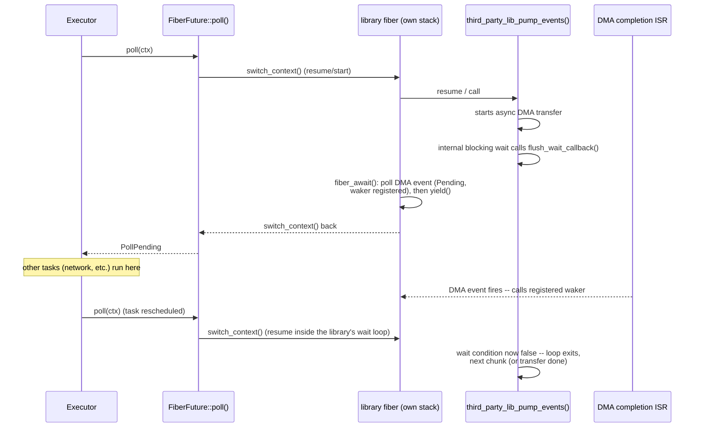

# Fiber — cooperative stackful execution contexts

A fiber is a cooperative, stackful execution context that can suspend from
*anywhere in its call stack* — not just at a `co_await` expression — and be
resumed later exactly where it left off.

`spawn_fiber()`, `FiberHandle<T>`, `FiberFuture<T>` and `fiber_await()` live in
`include/coro/task/fiber.h` and `src/task/fiber.cpp`. They run on three
`switch_context()` backends (`include/coro/detail/fiber_context.h`): `ucontext`
with `mprotect`-guarded stacks on POSIX (`src/detail/fiber_context_posix.cpp`),
Win32 fibers on Windows (`src/detail/fiber_context_windows.cpp`), and
hand-written ARMv6-M assembly on Pico (`src/detail/fiber_context_pico.S`). See
[Header layout](#header-layout).

---

## Motivation

`Coro<T>` is a stackless coroutine: the compiler only inserts a suspension
point at each `co_await` in the coroutine's own body. That's fine as long as
you own the whole call stack down to the blocking operation. It breaks down
the moment a third-party C library sits in between — its blocking wait loop
is buried several ordinary (non-coroutine) stack frames deep, and there is no
`co_await` anywhere inside it to hook into.

A typical case is a Pico (RP2040) application driving a DMA-based peripheral
through a third-party C GUI/display library. Getting a truly async,
DMA-driven transfer out of that library requires suspending *inside* its own
event-pump entry point — inside an internal spin loop that blocks until the
DMA completes, several frames below any application code — and resuming
exactly there once the DMA finishes, while every other coro task keeps making
progress in the meantime. `Coro<T>` cannot do this: there is no `co_await`
point inside the library's C code for the compiler to have generated a
suspension for.

`spawn_blocking` (see [spawn_blocking.md](spawn_blocking.md)) solves the
adjacent problem — "call a blocking function without stalling the
executor" — on desktop, by running the callable on a dedicated OS thread.
That doesn't help here for two reasons:

- **No OS thread pool exists on bare metal.** The Pico target has no threads
  to spawn at all.
- **Some libraries assume single-thread affinity.** A library whose global
  state is not internally synchronized and is documented as
  single-threaded-only can't be driven from `spawn_blocking`'s pool, which
  hands work to whichever thread happens to be idle, with no guaranteed
  affinity across calls.

The same shape of problem comes up on desktop too, independent of any MCU
constraint: running a blocking, callback-driven library cooperatively on the
executor's own thread rather than paying for a full OS thread or fighting its
single-thread-affinity assumptions. That's why fibers are a portable coro
primitive rather than a bare-metal-only mechanism.

---

## Prior art

| Approach | Mechanism | Portable? |
|---|---|---|
| POSIX `ucontext.h` (`getcontext`/`makecontext`/`swapcontext`) | OS-provided context save/restore | POSIX only |
| Boost.Context, `libaco`, Ruby `Fiber`, Win32 Fiber API | Hand-written per-ISA assembly register/stack swap | Yes, with per-arch backends |
| FreeRTOS / ChibiOS Cortex-M0 ports | Hand-written ARMv6-M assembly context switch (for preemptive scheduling, but the register save/restore mechanics are identical for a purely cooperative switch) | Reference implementation for the exact target this project cares about |

This is a well-trodden technique with directly adaptable reference
implementations, particularly for Cortex-M0+ (RP2040), whose AAPCS calling
convention only requires saving `r4`–`r11` and `sp` across a switch
(`r0`–`r3`/`r12` are caller-saved scratch; `lr`/`pc` fall out of the return
sequence).

!!! note "FreeRTOS's lead on Cortex-M mechanics"
    For low-level ARMv6-M questions (stack-pointer banking, register
    save/restore conventions, interrupt-masking needs, and similar) the Pico
    backend follows FreeRTOS's Cortex-M0 port, which has had this class of
    problem hardened across years of production use on real hardware. It
    deviates only where coro's constraints differ from an RTOS's, and each
    deviation is called out in this document next to the design point it
    affects.

---

## Design

### `FiberContext` — the low-level primitive

One stackful execution context: a dedicated stack buffer plus enough saved
register state to resume execution in it later. A single operation —
symmetric context transfer, not an asymmetric function call:

```
switch_context(FiberContext* from, FiberContext* to)
```

Saves the currently-running context's callee-saved registers and stack
pointer into `from`, loads `to`'s saved registers and stack pointer, and
resumes wherever `to` last left off. Before resuming `to`, checks the saved
`sp` against `to`'s precomputed `[stack_base, stack_base + stack_size)`
range and fails clean (assert/abort in debug, best-effort trap in release)
if it's outside that range — see "Stack overflow detection" below.

!!! note "Interrupts firing mid-switch"
    Considered and not believed to need masking: the `sp` transfer is a
    single instruction (atomic w.r.t. interrupts), and at every point in the
    sequence the live `sp` points into a currently-valid stack region, so an
    interrupt landing anywhere just pushes/pops its own frame normally
    (given adequate ISR-nesting headroom, as above). Unlike an RTOS's
    PendSV-based switch, no shared scheduler state is touched here that an
    ISR could race against — because this design is cooperative, not
    preemptive. `PendSV` exists to let an RTOS switch a task *out from under
    it*, asynchronously, at a moment the running code never chose (a timer
    tick, an IRQ waking a higher-priority task); deferring the actual
    save/restore to one serialized, lowest-priority exception is what makes
    that safe against racing another interrupt trying to do the same thing.
    `switch_context()` here is only ever called synchronously, by code
    explicitly choosing to yield (`fiber_await()`/`fiber_yield()`) — nothing
    external ever forces a switch at a moment a fiber didn't ask for, so
    there's no shared, concurrently-mutated scheduler state for an ISR to
    race in the first place.

Each architecture has its own backend, as `runtime/` selects an `Executor`
implementation per platform:

- **ARMv6-M (RP2040 / Cortex-M0+, `CORO_PICO`)** — hand-written assembly,
  saving/restoring `r4`–`r11` and `sp` only.
- **POSIX desktop (x86-64 / ARM64)** — `ucontext.h`
  (`makecontext`/`swapcontext`).
- **Windows** — Win32 fibers (`CreateFiberEx`/`SwitchToFiber`); see
  [Windows backend](#windows-backend).

!!! tip "PERF: hand-rolled POSIX switch"
    `swapcontext()` saves and restores the full signal mask, a syscall per
    switch. A hand-rolled per-ISA backend could replace it if that overhead
    ever matters.

### `FiberFuture<T>` — a fiber is just another `Future`, internally

A fiber is not a new scheduling concept: it's a `Future<T>` whose `poll()` is
a context switch instead of resumed compiler-generated coroutine state. It
reuses `Task`/`Executor`/`Waker` machinery unchanged — the executor polls it
like any other task's future.

This isn't the type users spawn directly (see "`spawn_fiber()`" below): a
fiber suspended mid-switch sits inside foreign, non-coroutine call frames
with no safe unwind point, so cancelling it there could corrupt whatever
state the callee was in. `FiberFuture<T>` stays internal — the only place
it's ever constructed is inside `spawn_fiber()` itself, as the root future of
a freshly spawned task. That's why `spawn_fiber()` is the sole entry point: a
fiber can't exist without a task to own it, so spawning the task and creating
the fiber are the same act. `spawn_fiber()` hands back a `FiberHandle<T>`
rather than the bare future — see below for how that closes off cancellation.

```cpp
template<typename T>
class FiberFuture {
public:
    using OutputType = T;

    explicit FiberFuture(std::function<T()> entry, size_t stack_size);

    detail::PollResult<T> poll(detail::Context& ctx);

private:
    // ... FiberContext m_caller_ctx, m_fiber_ctx; entry/result/exception storage ...
};
```

`stack_size` has no default here or on `spawn_fiber()` (below) — see "Stack
allocation and sizing": the Pico backend has no safe universal default, so
every call site passes one explicitly on both backends.

The trampoline invokes the entry callable in a `try`/`catch`, storing the
result or `std::current_exception()` into `FiberFuture`'s own state (as the
blocking task does for `spawn_blocking`) before switching back to
the caller. `poll()` returns `PollError`/`PollReady` from that stored state
like any other `Future` — an uncaught exception needs no special handling.

The only place that ever switches *into* a fiber is `poll()`, just as the
only place that resumes an ordinary `Coro<T>` is its `poll()`. Once running,
a fiber body calls `fiber_yield()`/`fiber_await()` for the same reason
coroutine code uses `co_yield`/`co_await` — but as ordinary function calls
rather than compiler-recognized keywords, so they work from *any* function,
including one written by a third-party library with no idea coro exists.
That's the whole point of a fiber. It's also why the plumbing is harder: the
compiler generates nothing to carry state across the suspension point, so it
has to happen by hand.

`switch_context()` takes no arguments, but `poll(Context&)` needs to hand the
fiber a `Context&` (to register a waker before yielding, see below), and
`fiber_yield()`/`fiber_await()` need to know which two `FiberContext`s to
switch between — from wherever they're called, since a fiber body can be many
frames deep inside third-party code. Neither fits an ordinary parameter:
there's no call frame connecting "whoever polled the fiber" to "wherever
inside it wants to yield." Thread-locals fix this the same way
`task/context.cpp`'s `t_current_coro` already exposes "the currently running
task" to code that isn't lexically inside it: `poll()` stashes what the fiber
side needs immediately before each switch, saving the previous values, and
restores them immediately after — the save/restore is what lets fibers nest
and interleave correctly:

```cpp
detail::PollResult<T> FiberFuture<T>::poll(detail::Context& ctx) {
    // ... stash ctx and this fiber's two FiberContexts into thread-locals,
    // saving the previous values (see fiber.h for the exact variables) ...

    switch_context(&m_caller_ctx, &m_fiber_ctx);   // resume (or start) the fiber

    // ... restore the saved values ...

    if (!m_finished) return detail::PollPending;
    if (m_exception) return detail::PollError(m_exception);
    return std::move(m_result);
}
```

A fiber body waiting on something needs to do two things: poll it, and if
it's not ready, hand control back to the caller so the executor can keep
making progress elsewhere, then resume polling once woken. `fiber_yield()`
is the "hand control back" half — it reads the thread-local `FiberContext`s
to know who to switch back to:

```cpp
void fiber_yield() {
    if (!t_current_fiber_ctx) throw std::logic_error("fiber_yield() called outside a fiber");
    switch_context(t_current_fiber_running_ctx, t_current_fiber_caller_ctx);
}
```

`fiber_await()` is `fiber_yield()` plus the polling loop around it. It needs
`ctx` to actually call `poll()` on the thing being awaited, which is exactly
what's sitting in the thread-local from the code above. Because both pieces
it needs — `ctx` and the two `FiberContext`s — are already reachable via
thread-local from anywhere in the fiber's call stack, `fiber_await()` can be
written once, generically, for any `Future`, and reused by every fiber body:

```cpp
// fiber_yield() is deliberately internal (coro::detail), not part of the
// public API: it's a bare context switch with no contract that anything
// will ever wake the fiber back up. fiber_await() is the only sanctioned
// way for a fiber body to suspend, since it always pairs a yield with a
// waker registration on the future being awaited first. Exposing the bare
// yield publicly would invite a fiber body to suspend without registering
// any waker at all, wedging it permanently.
template<Future F>
typename F::OutputType fiber_await(F future) {
    if (!detail::t_current_fiber_ctx) throw std::logic_error("fiber_await() called outside a fiber");
    for (;;) {
        auto r = future.poll(*detail::t_current_fiber_ctx);
        if (r.isDropped()) throw TaskCancelled{};
        if (!r.isPending()) { r.rethrowIfError(); return std::move(r).value(); }
        detail::fiber_yield();   // hand control back; resumes here once woken + re-polled
    }
}
```

There's no parallel "explicit handle" API alongside the thread-local one.
An explicit handle would need to be passed down as a function parameter to
reach the point that wants to yield. But the code doing the yielding is
often inside a third-party library whose call signatures coro doesn't
control, so there's nowhere to add that parameter. The thread-local is
required regardless, so a handle-based alternative would just be a second,
more limited way to do the same thing.

`fiber_await()` is what a fiber body calls to wait on anything coro already
represents as a `Future` (an `IsrEvent`, a channel receive, `sleep_for`, ...)
— the fiber-land `co_await`, and what makes the wakeup event-driven rather
than polled on a fixed cadence. Like `co_await`, it rethrows the future's
exception, and throws `TaskCancelled` for a future that reports `PollDropped`
(a handle to a task somebody else cancelled), whatever its output type.

### Thread-locals and worker migration

A fiber is an ordinary spawned task, so under `WorkStealingExecutor` it can be
polled on a different worker thread each time. Its stack moves with it. That
conflicts with an assumption compilers make about thread-locals: a function
runs on one thread from entry to exit, so the address of a thread-local can be
computed once and reused for the rest of the function, including across calls
to opaque functions. A fiber function that reads a thread-local, suspends, is
resumed on another worker and reads the same thread-local again may therefore
read the *previous* worker's copy.

So no thread-local of the fiber bridge is visible in a header. The current
fiber's state (`FiberFrame`: the polling task's `Context`, the fiber's own
`FiberContext` and its caller's) and the trampoline's start argument are
thread-locals in `src/task/fiber.cpp` (plain globals under `CORO_PICO`),
reachable only through out-of-line, `noinline` functions: `enter_fiber()`,
`leave_fiber()`, `current_fiber_context()` and `fiber_start_arg()`. Code on a
fiber's stack has no thread-local address to cache: each call computes it on
the thread that is running.

| Site | Runs on | Reads the current fiber after a switch? | Exposed? |
|---|---|---|---|
| `FiberFuture<T>::poll()` | the worker's own stack | Yes, `leave_fiber()` restores the saved frame, but `switch_context()` returns to `poll()` on the same thread that called it | No |
| `fiber_yield()` | the fiber's stack | No, it reads the frame before switching and nothing after | No |
| `trampoline()` | the fiber's stack | No, it calls `fiber_start_arg()` once on first entry | No |
| `fiber_await()` | the fiber's stack | Yes, `current_fiber_context()` after every `fiber_yield()`: a fresh call, on the thread now running | No |

A header-visible `extern thread_local`, read directly by `fiber_await()`,
could be cached across `fiber_yield()` and so poll with the previous worker's
`Context`. MSVC caches thread-local addresses within a function unless built
with `/GT`, a flag every program that includes `fiber.h` would need.

Boost.Fiber has the same exposure (its `work_stealing` and `shared_work`
algorithms migrate fibers between threads) and avoids it by construction:

- No thread-local for the current fiber appears in any header. The pointer
  lives in `context.cpp` and is reachable only through `context::active()`,
  which is declared in the header and defined in the compiled library.
- Because the caller never sees a thread-local address, it has nothing to
  cache. Each call computes the address again on whichever thread is running.
- Everything else hangs off the fiber instead of the thread. The scheduler is
  reached as `context::active()->get_scheduler()`, and migration re-points the
  scheduler stored in the context. One thread-local is all there is to get
  right.
- Fiber bodies are told not to rely on thread-local storage across a
  suspension; `fiber_specific_ptr` is the replacement.

coro does the same for its one piece of fiber state.

The same rule applies to fiber bodies: user code running in a fiber must not
hold a reference or pointer to a thread-local across `fiber_await()`, and
should not assume two reads of the same thread-local on either side of one
see the same thread's copy.

`t_current_coro` (`coro_scope.h`) is deliberately left as a header-visible
thread-local. It is read and written on every coroutine poll, and coroutine
code cannot migrate inside a `CurrentCoroGuard`, which spans a synchronous
`resume()` or `destroy()`. `FiberFuture<T>::poll()` installs no guard, so a
`JoinHandle` dropped in a fiber body normally sees a null `t_current_coro`
and registers with no scope.

!!! warning "Potential race: stale `t_current_coro` in a fiber body"
    `CoroutineScope` holds no lock (see
    [coroutine_scope.md](coroutine_scope.md)). If a fiber function drops a
    `JoinHandle` before and after a `fiber_await()`, and the compiler reuses
    the `t_current_coro` address across the suspension, the second drop reads
    the previous worker's pointer. If that worker is inside a coroutine
    `resume()` at that moment, `add_child()` runs against a scope another
    thread is using, unsynchronized. Narrow, and not observed.

### `spawn_fiber()` — the user-facing entry point, modeled on `spawn_blocking`

A fiber's stack is exactly as non-cancellable as a `spawn_blocking` thread,
for the same underlying reason: once execution has entered foreign,
non-coroutine call frames, there is no compiler-generated hook to unwind
through safely, and force-unwinding through code that doesn't expect it (a
third-party library, here) can leave that library's own state corrupted even
if the C++ side unwinds memory-safely. `doc/guidelines.md`'s BL.3/SC.2
already document the same restriction for `spawn_blocking`'s
`BlockingHandle<T>`: "a blocking thread cannot be interrupted — waiting for
it on drop could deadlock," so dropping never waits. (A blocking task can be
*asked* to stop, because its callable can reach a cancellation point and
unwind by an exception it expects; see
[spawn_blocking.md](spawn_blocking.md#cancellation-and-ownership). A fiber
running third-party code has no such point.)

`spawn_fiber()` gives the shape of a detached `BlockingHandle<T>` — the caller
gets a handle back that can be `co_await`ed for the result, or simply dropped
to let the work keep running in the background — with no cancellation
capability at all:

```cpp
template<typename T>
class FiberHandle {
public:
    using OutputType = T;

    explicit FiberHandle(JoinHandle<T> handle) noexcept : m_handle(std::move(handle)) {}

    FiberHandle(FiberHandle&&) noexcept            = default;
    FiberHandle& operator=(FiberHandle&&) noexcept = default;

    // Detaches -- never cancels. Not configurable, unlike JoinHandle<T>'s
    // cancelOnDestroy: a fiber has no safe unwind point to cancel through.
    ~FiberHandle() { m_handle.detach(); }

    detail::PollResult<T> poll(detail::Context& ctx) { return m_handle.poll(ctx); }

private:
    JoinHandle<T> m_handle;
};

template<typename T>
FiberHandle<T> spawn_fiber(std::function<T()> entry, size_t stack_size) {
    return FiberHandle<T>(coro::spawn(FiberFuture<T>(std::move(entry), stack_size)));
}
```

Deliberately *not* built on a task type of its own mirroring
`spawn_blocking()`'s `BlockingTaskImpl<F>`, even though that's the more literal
reading of "modeled on `BlockingHandle<T>`": `spawn_blocking()` needs its own
task type because the work runs on a separate OS thread that no executor
polls — that task is the only channel between the thread and the
`BlockingHandle<T>` sitting in a coroutine frame. A fiber has no such separate
worker; it only ever makes progress by being polled by the executor, which is
exactly what `coro::spawn()` already sets up via `TaskState<T>`/`JoinHandle<T>`.
Reinventing that plumbing under a different name would be more code for the
same guarantees, not fewer. `FiberHandle<T>` instead wraps a `JoinHandle<T>`
purely as an implementation detail, restricted to awaiting and dropping:
no `.cancel()` method anywhere in the public interface, and the
destructor unconditionally calls `.detach()` — never `.cancel()` — so
`JoinHandle<T>`'s cancellation machinery is simply never reached, regardless of
whether the caller ever awaits the handle or drops it immediately. This is not
the same as constructing the inner `JoinHandle<T>` with `cancelOnDestroy(false)`:
that flag only skips the `cancel()` call inside `JoinHandle::close()`, but
`close()` unconditionally registers the task with the enclosing `CoroutineScope`
(so the parent coroutine would still wait for the fiber to drain before
completing) — exactly the entanglement a background fiber must not have.
Calling `.detach()` up front clears `JoinHandle<T>`'s internal state before its
destructor ever runs `close()`, so a dropped `FiberHandle<T>` never touches the
enclosing scope at all: the executor's owned map becomes its sole anchor, the
same as any other detached fire-and-forget task.

The entry callable's return value, if `T` isn't `void`, is computed and then
simply discarded if nothing is left to observe it — same as for a detached
`BlockingHandle<T>`. Because there is no `.cancel()` method anywhere
in `FiberHandle<T>`'s public interface, there's no code path that could ever
attempt to cancel a fiber mid-switch, whether the handle is awaited, dropped
immediately, or held and dropped later.

!!! warning "FIXME: a fiber still suspended at runtime shutdown is freed, not unwound"
    Shutdown cancels every task, and a fiber's task holds a `FiberFuture<T>`, which
    is not `Cancellable`: it is destroyed as a leaf, and its stack is freed with the
    fiber's frames still on it. No destructor on that stack runs, including the one
    of the future the fiber is parked on in `fiber_await()`. A future that left
    itself registered somewhere is then dangling: an `Event` that outlives the
    runtime keeps a pointer to its `WaitFuture`, and `~Event()` writes through it.
    Until this is fixed, let every fiber finish before the runtime shuts down.

### Usage — bridging a third-party library's blocking wait callback

```cpp
[[maybe_unused]] auto lib_fiber = coro::spawn_fiber<void>([]() {
    for (;;) {
        third_party_lib_pump_events();   // its internal blocking-wait spin
                                          // calls our flush_wait_callback --
                                          // see below
    }
}, kLibFiberStackSize);
```

No outer polling loop needed. This particular fiber body never returns, so
there's nothing to `co_await` — the returned `FiberHandle<void>` is bound
purely to satisfy `[[nodiscard]]` and immediately discarded (hence
`[[maybe_unused]]`). `spawn_fiber()` hands the task to the executor and
returns immediately; the executor resumes it whenever its waker fires,
exactly like any other detached task, for as long as the process runs. A
fiber body that *does* return (and whose result the caller cares about) would
instead keep the handle and `co_await` it later.

```cpp
void flush_wait_callback() {
    fiber_await(g_dma_done_event.wait());
}
```

The library's blocking wait loop becomes a cooperative one with **zero
changes to the library itself** — `flush_wait_callback` is registered
through a documented, first-class extension point the library already
exposes for this purpose, not a workaround. The DMA-completion ISR calls
`g_dma_done_event`'s completion path exactly as any other `IsrEvent`
consumer would — it doesn't need to know a fiber is involved. That, in turn,
calls `wake()` on the waker `fiber_await()` registered, which reschedules
`lib_fiber` through completely ordinary executor machinery — no
fixed-cadence re-poll needed to notice the DMA finished.



### Stack model (Pico backend): MSP as the dedicated ISR stack, PSP for everything else

The stack model is FreeRTOS's own Cortex-M0 port
([`portable/GCC/ARM_CM0/portasm.c`](https://github.com/FreeRTOS/FreeRTOS-Kernel/blob/main/portable/GCC/ARM_CM0/portasm.c),
non-MPU `vRestoreContextOfFirstTask`):

```
movs r1, #2
msr  CONTROL, r1   ; switch to use PSP in thread mode
msr  psp,     r0   ; new top of stack for the task
```

This is the *only* place FreeRTOS ever touches `CONTROL` — done once, at
scheduler start, and never reverted. From that point on, every task runs on
PSP (swapped per-task by `PendSV_Handler`'s `mrs/msr psp`, e.g. lines
399/427 of the same file), and MSP is permanently abandoned as a thread-mode
stack. Handler mode (any ISR, including `PendSV` itself) is hardware-defined
to always use MSP regardless of `CONTROL.SPSEL` — this isn't something
software configures, it's an architectural guarantee — so MSP ends up as a
single, dedicated interrupt stack that every ISR lands on no matter what
thread-mode code was running (or which fiber's stack was active) when the
interrupt fired.

coro follows the identical shape, with one timing difference from
FreeRTOS: the switch does *not* need to happen at
reset. FreeRTOS does it at scheduler start only because that's the earliest
point its own model has a "first task" to move onto PSP; the actual
requirement being satisfied is narrower than "at boot" — it's that
**`CONTROL.SPSEL` must select PSP before the first `switch_context()` call,
and must never be reverted for the remaining lifetime of the program.**
Nothing before that point is ever a `switch_context()` target, so it has no
need for the no-ISR-margin guarantee and can run on MSP without
consequence. Concretely: SDK/hardware init and any code in `main()` prior to
entering the executor's run loop stay on MSP; the switch is
`coro_pico_enable_psp_stack()` (`fiber_context_pico.S`), which performs the
`MRS`/`MSR PSP`/`MSR CONTROL`/`ISB` sequence. Its one call site is the top of
the executor's own run-loop entry point
(`CurrentThreadExecutor::wait_for_completion()`), guarded by a `static bool`
so it runs once, from the executor's own thread, immediately before it starts
polling anything.

That switch moves the executor's own primary execution (its main loop, and
any stackless `Coro<T>` resumption running inline on top of it) onto a
PSP-managed stack, exactly like FreeRTOS's first task — specifically, *the
same stack it's already running on*: `MSR PSP, <current sp>` before flipping
`CONTROL.SPSEL` means there's no discontinuity, just a change in which
register alias `sp` refers to. That stack becomes, permanently, the
"caller-side" `FiberContext` that `switch_context()`'s caller side already
assumes (the default-constructed one with `buffer == nullptr` — see
`FiberFuture` above) — so it must already be sized adequately as the
executor's permanent stack before the switch happens, since there's no
going back to MSP afterward. From then on, **both** "the executor's calling
context" and "whichever fiber is currently active" live on PSP —
`switch_context()` is just a PSP-value + callee-saved-register swap between
two PSP-side contexts, with no `CONTROL`/`SPSEL` toggling per switch at all
(that only ever happens once, at executor entry). MSP is left exactly where
the vector table initialized it at reset and serves as the one shared,
dedicated ISR stack, sized once for worst-case interrupt nesting across the
whole program rather than per-fiber.

Nested context switches need nothing extra: both parties in any
`switch_context()` call are PSP-side contexts distinguished only by their
saved stack-pointer *value* (never by a `CONTROL` mode bit), so swapping
which one is "active" is symmetric and requires no bookkeeping about how many
levels deep the switch is.

!!! note "Cortex-M only"
    MSP/PSP banking is Cortex-M-specific hardware; it doesn't exist on
    x86-64/ARM64. The POSIX and Windows backends' `switch_context()` and their
    guard-page stacks (below) are unrelated to it.

### Stack allocation and sizing

Boost.Context/Boost.Fiber's own `stack_traits` doesn't have one universal
default either — it's split by platform, and the reasoning behind each half
doesn't transfer to the other:

- `minimum_size()`: an OS-defined floor (4KB on Win32, 8KB on Win64,
  similarly small on POSIX).
- `default_size()`: on POSIX, the *process's* `RLIMIT_STACK` soft limit if
  bounded (typically 8MB on Linux — i.e. "whatever an ordinary thread
  already gets"); otherwise `max(64KB, minimum_size())`.
- `protected_fixedsize_stack` backs that up with an `mprotect(PROT_NONE)`
  guard page at the low end, so overflow reliably faults instead of
  silently corrupting adjacent memory — cheap to do because it's virtual
  address space, not physical RAM, that gets spent on the guard page.

That whole philosophy — "match what a normal thread gets, and lean on the
MMU for a free safety net" — assumes an MMU and abundant virtual memory,
neither of which Cortex-M0+ has. A single hardcoded default shared by all
backends would be wrong for at least one of them, so `stack_size` is always
passed explicitly, and the stack itself is allocated per backend, same as
`switch_context()`:

**POSIX/desktop backend**: Boost's reasoning applies directly. Something in
the 64–256KB range is a reasonable size, and `alloc_fiber_stack()` backs it
with an `mprotect(PROT_NONE)` guard page the same way
`protected_fixedsize_stack` does — overflow reliably faults instead of
corrupting whatever static/heap data happens to sit past the stack, at
negligible cost (unmapped virtual pages, not RAM). The Windows backend gets
the same from the OS (see [Windows backend](#windows-backend)).

**Pico/MCU backend**: no safe universal default exists — physical RAM is the
scarce, fully-budgeted resource (264KB total, shared with the framebuffer
and everything else), and there's no guard page to fall back on if a guess
is wrong. Sizing it correctly is a one-time, offline profiling step, not
something done at runtime in the shipped build: during development,
deliberately over-provision (e.g. 16KB),
paint it with a fill pattern, exercise the worst-case call path (the
third-party library's deepest internal call chain, under whatever real
content/workload stresses it hardest), and read the high-water mark
afterward — the same technique FreeRTOS's
`uxTaskGetStackHighWaterMark()` is built on (see the RTOS comparison below).
Set `stack_size` in the shipped build to that measured peak (see the note
below on why no ISR-nesting margin needs to be added on top); once that
number is fixed, the high-water-mark measurement itself has served its
purpose and isn't part of the ongoing runtime path at all. The SP-range check
folded into `switch_context()` (see "Stack overflow detection" below) is the
separate, cheap, every-resume mechanism that answers a different question at
runtime — not "what should the size be" but "did this run exceed whatever
size we already picked."

!!! note "Fiber stacks don't need ISR-nesting margin — MSP already absorbs it"
    With the MSP/PSP split above (MSP as the sole, dedicated ISR
    stack; every fiber's stack lives on PSP), an interrupt firing while a
    fiber is active does *not* push its exception frame onto that fiber's
    stack — hardware forces handler mode onto MSP unconditionally, regardless
    of which fiber (or the executor itself) was running in thread mode. Each
    fiber's `stack_size` only needs to cover its own peak usage; worst-case
    ISR nesting is instead a single, one-time budget added to MSP's size,
    shared across the whole program rather than paid for by every fiber
    individually.

### Stack overflow detection (borrowed from FreeRTOS/ChibiOS)

Neither mainstream RTOS trusts static analysis of stack depth, and both
converge on the same two-pronged approach, which the Pico backend borrows:

- **FreeRTOS** paints each stack with a `0xa5a5a5a5` fill pattern at
  creation. `uxTaskGetStackHighWaterMark()` reports how much of that pattern
  survives untouched after running — i.e. the actual peak usage ever
  reached. That's the measurement technique behind the Pico backend's
  empirical sizing approach above. Separately, `configCHECK_FOR_STACK_OVERFLOW`
  offers Method 1 (check `sp` is still in-range at each context switch —
  cheap, can miss an overflow that happens and recovers between switches)
  and Method 2 (also check whether the last 16 bytes of the painted pattern
  got clobbered — catches more, still not a guarantee). Both just invoke a
  hook (`vApplicationStackOverflowHook`) after the fact rather than
  preventing the corruption.
- **ChibiOS** uses the same fill-pattern idea (`CH_DBG_FILL_THREADS`, pattern
  `0x55`) plus `CH_DBG_ENABLE_STACK_CHECK`, which checks the incoming stack
  pointer against a precomputed valid range before resuming a thread and
  halts immediately if it's out of range. On Cortex-M4/M7 parts with an MPU
  it can back this with a real guard region that traps synchronously on the
  offending write; **RP2040's Cortex-M0+ has no MPU**, so that option isn't
  available on Pico.

!!! note "The SP-range check is containment, not prevention"
    Neither RTOS's software check actually stops the corruption — both only
    sample `sp` at discrete checkpoints (context-switch boundaries), while
    the overflow itself happens synchronously, mid-instruction-stream, the
    moment a `push`/`sub sp, sp, #n` decrements `sp` past the buffer's low
    boundary and something writes there. By the time *any* software check
    runs — before resuming (ChibiOS) or after the switch (FreeRTOS Method 2)
    — that write already happened. Only a hardware guard page (an MPU, which
    Cortex-M0+ doesn't have) traps synchronously on the write itself and
    actually prevents it. What the SP-range check buys instead is bounding
    the *blast radius*: without it, a thread that's already overflowed keeps
    running with a corrupted stack (smashed locals, possibly a corrupted
    return address), which can fail arbitrarily far downstream in a way
    that's nearly impossible to trace back to the real cause. The check
    turns that into a reliable halt at the next switch boundary with a known
    cause — fail-fast, not prevention.

The SP-range check folded into `switch_context()` above is ChibiOS's
placement (check before resuming, not after), since coro has no separate
context-switch ISR to hook a trap into the way FreeRTOS does. The
poison-fill/high-water-mark measurement (FreeRTOS's technique) is the tool
for *choosing* `stack_size` during development; `alloc_fiber_stack()` paints
every Pico stack with `0xa5a5a5a5` so the measurement is always available.
Since neither technique prevents corruption on a Cortex-M0+ with no MPU, the
stack buffer also has a 32-byte sacrificial cushion below the real working
range, with the canary word at the *bottom* of that cushion rather than the
top of the working stack. A modest overrun lands in dead space instead of
whatever heap data follows it, and still trips the canary check — the same
reasoning as `protected_fixedsize_stack`'s guard page, done with plain
allocation since no MMU is available to do it properly.

### Windows backend

`src/detail/fiber_context_windows.cpp`, on Win32 fibers, which provide the
whole primitive:

| `FiberContext` operation | Windows |
|---|---|
| `alloc_fiber_stack()` | records the size only: the fiber and its stack are made in one call |
| `init_fiber_entry()` | `CreateFiberEx(0, stack_size, FIBER_FLAG_FLOAT_SWITCH, start, entry)`; the start routine calls `entry` (the trampoline), which never returns |
| `switch_context(from, to)` | converts the thread to a fiber on its first switch (`ConvertThreadToFiberEx`), records `GetCurrentFiber()` in a caller-side `from`, `SwitchToFiber(to)` |
| `free_fiber_stack()` | `DeleteFiber()` of a fiber the context owns |

- **Caller-side contexts own nothing.** A caller-side `FiberContext` (the
  executor's side of a `FiberFuture`) records whichever fiber the calling
  thread was running when it switched away: its own converted fiber. A
  thread converted by coro is converted back when it exits; one some other
  code had already made a fiber is left alone.
- **Migration.** Win32 lets a fiber be resumed on a different thread from the
  one it last ran on, so a fiber may move between workers as on POSIX. The
  thread-locals are handled as above.
- **Stack and overflow.** The stack is reserved at `stack_size`, rounded up by
  the OS to its allocation granularity, and committed as it grows, with a
  guard page below. An overrun raises a stack-overflow exception, which ends
  the process, as the POSIX guard page's `SIGSEGV` does
  (`FiberDeathTest.StackOverflowFaultsOnGuardPage` runs on both).
- **Floating point.** `FIBER_FLAG_FLOAT_SWITCH` saves and restores the
  floating-point state with each switch, as `swapcontext()` does.
- **ASan handshake.** Under MSVC's AddressSanitizer, `switch_context()` names
  the destination stack with `__sanitizer_start_switch_fiber()` and finishes
  with `__sanitizer_finish_switch_fiber()`, as on POSIX. Otherwise a throw on a
  fiber leaves stale redzones poisoned on its stack, and the exception
  machinery's writes there are reported as errors. `CreateFiberEx()` chooses the
  stack, so its bounds are only known on it (`GetCurrentThreadStackLimits()`):
  each context records its own when it switches away, and a fiber's start
  routine finishes its first switch with no stack named, then names its own
  with a second handshake in place. The ASan state lives in the `FiberContext`,
  not a thread-local, since the fiber may resume on another thread. The handshake
  is all in the start routine, so `notify_fiber_switch_finished()` is a no-op.
  `free_fiber_stack()` unpoisons the stack before `DeleteFiber()`: a finished
  fiber's last frames never return, and Windows frees the stack where ASan can't
  see it, so a later fiber given the same memory would inherit their redzones.

---

## Header layout

```
include/coro/task/fiber.h            spawn_fiber(), FiberHandle<T>, fiber_await() -- user-facing
                                      (FiberFuture<T> also lives here, but is an
                                      internal detail spawn_fiber() wraps --
                                      not meant to be constructed directly;
                                      detail::fiber_yield() lives here too, but
                                      is internal -- fiber_await() is the only
                                      sanctioned way for a fiber body to suspend)
include/coro/detail/fiber_context.h  FiberContext struct + switch_context()/alloc_fiber_stack()
                                      declarations -- all three backends (POSIX, Windows (_WIN32) and
                                      ARMv6-M/CORO_PICO), selected by the preprocessor
src/detail/fiber_context_pico.S      ARMv6-M switch_context()/init_fiber_entry() (CORO_PICO),
                                      including the SP-range/canary overflow checks (see "Stack
                                      overflow detection"); also coro_pico_enable_psp_stack(),
                                      the one-time CONTROL/PSP switch (see "Stack model")
src/detail/fiber_context_pico.cpp    alloc_fiber_stack()/free_fiber_stack() (CORO_PICO) -- plain
                                      heap allocation + fill pattern + canary word
src/detail/fiber_context_posix.cpp   ucontext-backed switch_context() + mmap/mprotect-based
                                      stack allocation (POSIX)
src/detail/fiber_context_windows.cpp Win32-fiber switch_context() and stack (Windows)
src/task/fiber.cpp                   the fiber-bridge thread-locals, behind out-of-line
                                      accessors, + detail::fiber_yield() --
                                      backend-agnostic (just switch_context() calls); part of
                                      the coro_pico build (cmake/platforms/pico.cmake) as well
                                      as the host-side coro_pico_core test double
```

`FiberContext`/`switch_context()` itself is `detail/` — a low-level extension
point, not something typical application code touches directly, same
category as `Waker`/`Context`. `spawn_fiber()`/`FiberFuture<T>` belong in
`task/` alongside `spawn_blocking.h`, since `spawn_fiber()` is modeled
directly on `spawn_blocking()`'s shape (a spawn-style entry point with no
joinable handle back to the caller) even though `FiberFuture<T>`'s `poll()`
is backed by a context switch rather than resumed coroutine state or a
worker-thread handoff.

---

## Testing strategy

The shared parts (`FiberFuture<T>`, `FiberHandle<T>`, `fiber_await()`, the
thread-locals) are tested on the host in `test/task/test_fiber.cpp`, which
runs on the POSIX and Windows backends.

`test/pico/stub/` lets Pico-specific code be unit-tested on the host by
stubbing out *pico-sdk API calls* (`hardware/dma.h` and similar) so the
surrounding logic compiles and runs as ordinary x86 code.
`fiber_context_pico.cpp`'s stack allocation has no ARM instructions, so it is
tested on the host directly (`test/task/test_fiber_context_pico_alloc.cpp`).
Neither approach reaches the ARMv6-M `switch_context()` backend: it isn't a
pico-sdk call being stubbed out, it's hand-written assembly that manipulates
real `CONTROL`/PSP/MSP and callee-saved registers — there's no header to stub,
and the thing under test *is* the architecture-specific mechanics.

**Unicorn Engine** (a host-native library wrapping QEMU's CPU-only emulation
core, with no board/peripheral model) tests it instead, without needing to boot a
whole emulated Pico or flash real hardware. The test itself stays a completely
ordinary gtest, running as an x86 binary linked against `libunicorn` like any
other host test dependency — nothing about the test binary itself is
cross-compiled. Only the tiny routine under test needs to be actual ARM code,
and `switch_context()` is a clean fit for this because it has zero external
dependencies (no libc, no SDK calls, pure register/stack manipulation):

- `fiber_context_pico.S` — and *only* that file, nothing else in coro or the
  SDK — gets assembled standalone with `arm-none-eabi-as`/`-gcc` and
  `objcopy`'d to a raw machine-code blob, as an isolated build step separate
  from the main link graph.
- The gtest body loads that blob into Unicorn's emulated memory, seeds two
  `FiberContext` stack buffers (also just emulated memory), points emulated
  `pc` at the blob's entry, runs it, and asserts on the resulting
  register/`sp`/stack contents.

This avoids cross-compiling the SDK, the third-party library, or the rest of
coro for ARM just to test this one primitive — contrast with a
Renode/QEMU-board or real-hardware approach, either of which requires a full
firmware image linked against pico-sdk and drivers. It also generalizes:
Unicorn supports many ISAs
(ARM, ARM64, RISC-V, MIPS, ...), so the same pattern — cross-assemble just the
one context-switch file, load it standalone, assert on registers — applies
unchanged to a `switch_context()` backend for any other architecture, rather
than needing a new one-off testing approach per port.
