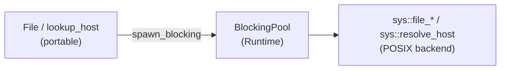
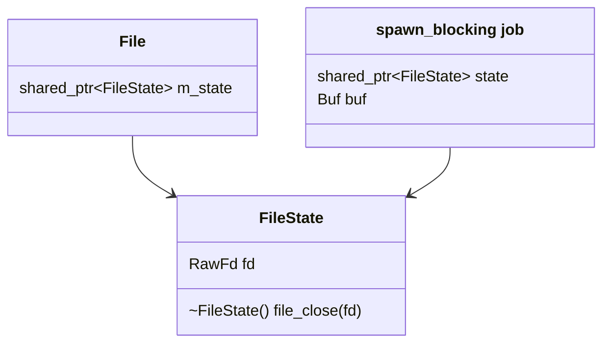

# File I/O and DNS

`File` (async regular files) and `lookup_host()` (name resolution). Neither has any
readiness to wait for: `epoll_ctl` rejects a regular file with `EPERM`, because a disk
read is always "ready" and then blocks, and `getaddrinfo` is a blocking library call.
So neither goes through the [I/O Driver](io_driver.md). Each operation runs as one job
on the Runtime's blocking pool ([`spawn_blocking`](spawn_blocking.md)), as tokio does
for `tokio::fs` and `lookup_host`.

`File` is desktop only. `lookup_host()` runs on Pico too, where lwIP's DNS client is
asynchronous and a query waits on the driver like a socket; see
[`lookup_host`](#lookup_host).

---

## Goals

- **Same owned-buffer API as sockets.** Every read and write takes a
  `ByteBuffer` by value and hands it back with the byte count.
- **One thread hop per operation.** The `_exact` variants loop inside one job instead of
  hopping per chunk.
- **No write-behind.** A write completes when its syscall has returned, so an error is
  reported by the call that caused it.
- **Safe to drop.** Dropping an operation's future, or the `File` itself, never closes
  the fd under a running syscall.
- **No driver needed.** Only `current_runtime()`'s blocking pool, so both work on a
  `CurrentThreadExecutor` with a caller-supplied `Parker`.

## Non-goals

- **Directory operations, metadata by path, `rename`, `remove`.** Use `spawn_blocking`
  around `std::filesystem` for now; see [Path operations](#path-operations).
- **Cancelling a running syscall.** A dropped job runs to completion.
- **Memory-mapped files.** Touching a page of a mapping whose file has since been
  truncated raises `SIGBUS`, which kills the process unless a process-wide signal handler
  intervenes, and a library can't install one on its users' behalf. A positional read of
  a truncated file just comes up short. A reader of a file another process may change
  should read it with `read_at`.

---

## Layers



The portable layer never makes a syscall itself. Everything goes through two backend
seams, in the style of the driver's [`sys` layer](io_driver.md#the-sys-layer):

| Seam | Functions | POSIX backend |
|---|---|---|
| `detail/sys/file.h` | `file_open`, `file_read`, `file_write`, `file_sync`, `file_stat`, `file_close` | `src/detail/sys/posix/file_posix.cpp` |
| `detail/sys/dns.h` | `resolve_host(host, port)`, `dns_category()` | `src/detail/sys/posix/dns_posix.cpp` |

Unlike the socket seams, these are ordinary blocking calls. `EINTR` is retried inside
the backend. `file_read`/`file_write` take an `offset`: negative means the file position
(`read`/`write`), anything else is positional (`pread`/`pwrite`).

---

## `File`

```cpp
#include <coro/io/file.h>

auto file = co_await coro::File::open("data.bin", coro::FileMode::ReadWrite |
                                                   coro::FileMode::Create);

auto [written, out] = co_await file.write_exact(std::string("hello"));
co_await file.sync_all();

auto [n, buf] = co_await file.read_at(std::vector<std::byte>(4096), 0);
buf.resize(n);
```

| Method | Returns | Syscall |
|---|---|---|
| `static open(path, mode)` | `OpenFuture` = `BlockingHandle<File>` | `open`, close-on-exec, mode 0644 with `Create` |
| `read(buf)` / `write(buf)` | `IoFuture<Buf>` = `BlockingHandle<pair<size_t, Buf>>` | one `read` / `write` at the file position |
| `read_exact(buf)` / `write_exact(buf)` | `IoFuture<Buf>` | loops until `buf` is full / written, or EOF |
| `read_at(buf, off)` / `write_at(buf, off)` | `IoFuture<Buf>` | one `pread` / `pwrite` |
| `read_at_exact` / `write_at_exact` | `IoFuture<Buf>` | positional loops |
| `sync_all()` | `BlockingHandle<void>` | `fsync` |
| `metadata()` | `BlockingHandle<FileMetadata>` | `fstat` |

`FileMode` flags (`Read`, `Write`, `ReadWrite`, `Create`, `Truncate`, `Append`,
`CreateNew`) combine with `|` and are translated to `sys::FileOpenFlags`, then to `O_*`
flags by the backend. `CreateNew` is `O_CREAT | O_EXCL`: it creates the file and fails
with `EEXIST` if the path exists, so of two openers racing to make a file, only one
succeeds.

`FileMetadata` holds the `size`, the `modified` time (`sys_time<nanoseconds>`, the last
change to the data) and `is_regular`. It describes the open file, not whatever is at its
path now, so a reader can check that a file it opened is the one it expected.

Errors are `std::system_error` in `std::system_category()`, thrown at `co_await`. A
short read returns fewer bytes than `buf.size()`, and 0 means EOF. Any call on a
moved-from `File` throws `std::logic_error`.

### Ownership of the fd



`File` holds a `shared_ptr<detail::FileState>`, which owns the fd and closes it
synchronously in its destructor. Every job captures its own share. So the fd closes
when the `File` and every job started on it are gone, on whichever thread drops the last
share, and never while a syscall is running on it (the fd can't be reused under a read
either). Because the close is synchronous, reopening the same path right after dropping
a `File` sees every completed write.

### Eager operations

The futures are `BlockingHandle`s, not lazy futures: an operation starts when the method
is called, like a `JoinHandle`. `co_await` hides the difference. `File` returns its
handles already detached (`BlockingHandle::detach()`), so dropping one does not cancel
the job: it runs to completion and discards its result, buffer included. Without that, a
job dropped while still queued would be skipped, and whether a dropped `write()` reached
the file would depend on timing.
For `read()`/`write()` at the file position, that means the position still moves.

!!! note "NOTE: no write-behind, unlike `tokio::fs::File`"
    tokio's `File` buffers writes and reports their errors on a later call or on
    `flush()`. coro's `write()` completes only when the syscall has returned, so dropping
    a `File` never loses an error that was already reported as success. Completed writes
    have reached the kernel, not necessarily the disk: `sync_all()` is for that.

---

## `lookup_host`

```cpp
#include <coro/io/lookup_host.h>

std::vector<coro::SocketAddress> addrs = co_await coro::lookup_host("example.com", 443);
```

- **Numeric literals** (`"127.0.0.1"`, `"::1"`, `"fe80::1%3"`) are parsed by
  `SocketAddress::parse` and returned at once, without a pool hop.
- **Anything else** goes to the `sys/dns.h` seam, which has one of two forms, chosen by
  the backend's `sys::kResolverBlocks`:
    - **Blocking (POSIX).** `sys::resolve_host` runs on the blocking pool:
      `getaddrinfo(AF_UNSPEC, SOCK_STREAM)`, so `/etc/hosts`, nsswitch and search
      domains apply. Addresses come back in the resolver's preference order, each with
      `port`.
    - **Registered query (lwIP).** `sys::dns_start` starts a lookup and returns a
      `RawFd` for it. `lookup_host` registers it in a `SocketState` and waits for read
      readiness, then takes the result with `sys::dns_try_result`. lwIP returns one
      IPv4 address. See [Pico Port](pico_port.md#name-resolution).
- **Errors** are `std::system_error`, thrown at `co_await`. A resolver failure is in
  `dns_error_category()` (category name `coro.dns`, `gai_strerror` messages; "no
  addresses" is `EAI_NONAME`). `EAI_SYSTEM` is reported as its `errno` in
  `std::system_category()`.
- **Dropping the future** doesn't cancel the lookup. It finishes on the pool (POSIX) or
  in lwIP (Pico), and the result is discarded.

`TcpStream::connect`, `TcpListener::bind` and `UdpSocket::bind` take a host string and
resolve it with `lookup_host`. They try each address in order and rethrow the last
failure if all of them fail, as tokio does.

**Testing without the machine's DNS.** A lookup the system resolver has to fail can
take 10 s or more where no nameserver answers (a VPN's slow backup servers, a container
with none). So the tests don't ask it, except for one:

- `sys::set_resolver_for_testing(fn)` makes `lookup_host` call `fn` instead of
  `resolve_host()` until it is reset (blocking backends only; it is defined in
  `lookup_host.cpp`, not by the backends). `test/fake_resolver.h` wraps it in an RAII
  `FakeResolver`, with `resolve_nothing`, which fails every name with
  `sys::host_not_found_error()`: the backend's own "not found" code. Every test of a
  failed lookup, and of `connect()` trying each address, uses it.
- `test/io/test_system_resolver.cpp` is the one test that asks the real resolver, for
  `nonexistent.invalid`. It is its own executable with the ctest label `network`, so
  `ctest -LE network` skips it on a machine whose DNS is slow.

!!! tip "TODO: asynchronous resolver"
    `getaddrinfo` holds a pool thread for the whole lookup, up to the resolver's timeout.
    That is fine at connect-time rates. If a workload resolves many names concurrently,
    consider an asynchronous resolver (c-ares, or a minimal UDP DNS client on the driver)
    behind `sys/dns.h`.

---

## Races

- **Close vs. an in-flight job.** Each job holds a share of `FileState`, so the close in
  its destructor runs on whichever thread drops the last share: possibly a pool thread,
  after the user has dropped the `File` and every future.
- **Concurrent operations on one `File`.** Jobs may run in parallel on different pool
  threads. `read_at`/`write_at` (`pread`/`pwrite`) share no state and may overlap
  freely. Position-based `read`/`write` calls that overlap run in an unspecified order
  and interleave at the kernel's discretion: await one before starting the next if order
  matters. A `File` must not be moved or assigned while another task is calling it.
- **Dropped open.** If the `OpenFuture` is dropped before its job finishes, the `File`
  dies with the job's discarded result and closes its fd: no leak.
- **Runtime shutdown.** The Runtime cancels and drains its tasks and its blocking jobs
  together before it stops either, so no task is left awaiting a job that the pool
  abandons. See [runtime_shutdown.md](runtime_shutdown.md).

!!! tip "TODO: io_uring backend for files"
    `sys/file.h` is the seam for an io_uring backend (`IORING_OP_READ`/`WRITE`/`FSYNC`
    completions reaped by the driver), which would drop the pool hop per operation. The
    blocking pool would stay as the fallback where io_uring is unavailable or disabled
    (containers, older kernels).

---

## Not yet: designs to come

Gaps that a workload reading parts of large files, and writing derived files beside
them, runs into. Each needs its API thought through before it's added; until then, the
workaround given works.

### Path operations

`rename`, `remove`, metadata by path, `create_dir_all` and `read_dir`. Now:
`spawn_blocking` around `std::filesystem`.

Proposed: free functions in a `coro::fs` namespace, each one job on the blocking pool, as
`tokio::fs` has them. To decide:

- **Errors.** `std::filesystem` throws `filesystem_error`, which carries the paths;
  `File` throws `system_error`. One of them for both, or each its own.
- **Paths.** `std::filesystem::path`, or `std::string` as `File::open` takes.
- **Renaming over an existing file.** POSIX `rename` replaces it atomically; Windows
  needs `MoveFileExW` with `MOVEFILE_REPLACE_EXISTING`, which isn't atomic on every
  filesystem. Whether `coro::fs::rename` promises atomicity, and where.
- **Metadata by path**, returning the same `FileMetadata` as `File::metadata()`.

### Atomic replace

Writing a file under a temporary name, syncing it, renaming it over the real name and
syncing the directory, so a crash leaves either the old file or the new one, never half
of one. It's a common pattern and easy to get wrong: the directory sync is POSIX only,
the temporary needs a name nothing else uses and an exclusive create, and one left by a
crash needs cleaning up. Now: the caller does each step, creating the temporary with
`FileMode::CreateNew`.

Proposed: a helper on top of the path operations and `CreateNew`, which writes
through a `File` it hands to the caller and commits on success. It depends on the path
operations above.

### Several positional reads in one job

Each `read_at` is one hop to the blocking pool and one back. A reader that needs several
runs of one file, at different offsets, pays a hop per run where one job could read
them all. Now: lay the file out so a reader needs one run, or accept the hops.

Proposed: `read_at_many`, taking owned buffers each with an offset, reading them all in
one job and handing back each buffer with its byte count. `preadv` doesn't do it: it
reads one contiguous range into several buffers. To decide: whether it stops at the
first short read or failure, and how it reports which range failed.

### Access hints

Telling the kernel how a file will be read: sequentially once, so read-ahead can grow
and the pages needn't stay cached, or at random. Now: none; the default read-ahead
copes with a sequential reader.

Proposed: hint flags in `FileMode`, applied at open. Windows takes them only there
(`FILE_FLAG_SEQUENTIAL_SCAN`, `FILE_FLAG_RANDOM_ACCESS`); POSIX takes them any time
(`posix_fadvise`), so the backend applies them right after opening. To decide: whether
to offer dropping a range from the cache after reading it (`POSIX_FADV_DONTNEED`), which
Windows has no equivalent of.

---

## Tests

| Test | Checks |
|---|---|
| `FileTest.BasicOpenWriteReadClose`, `ReadEOF`, `PositionalIO`, `MultipleSequentialReads`, `MultipleConcurrentFiles` | Basic round trips, EOF, positional I/O, several files at once. |
| `FileTest.OpenNonExistentFileForWrite` | `Write` without `Create` on a missing path throws. |
| `FileTest.ExactVariantsRoundTripLargeBuffer` | 4 MiB `write_exact`/`read_exact` round trip; a read larger than the file stops short at EOF. |
| `FileTest.ReadAtExactAndWriteAtExact` | Positional exact variants, overlapping writes. |
| `FileTest.AppendWritesAtEnd` | `FileMode::Append`, plus `sync_all()`. |
| `FileTest.OpenMissingFileThrowsEnoent` | The error code is `no_such_file_or_directory`. |
| `FileTest.PendingWriteOutlivesFile` | Dropping the `File` with a write in flight: the write still lands. |
| `FileTest.ReopenAfterDropSeesWrites` | Close is synchronous. |
| `FileTest.MovedFromFileThrowsLogicError` | `write`, `sync_all` and `metadata` on a moved-from `File`. |
| `FileTest.MetadataReportsSizeTimeAndType` | Size, type, and the same mtime as `std::filesystem`. |
| `FileTest.CreateNewMakesMissingFile` | `CreateNew` on a missing path creates it. |
| `FileTest.CreateNewFailsIfPathExists` | `file_exists`; even `Truncate` leaves the file alone. |
| `FileTest.WorksWithoutDriver` | `CurrentThreadExecutor` with a `PollingParker`. |
| `LookupHostTest.NumericLiteralsReturnThemselves` | IPv4 and IPv6 literals, port applied. |
| `LookupHostTest.LocalhostResolvesToLoopbackWithPort` | Every result is loopback with the port. |
| `LookupHostTest.UnresolvableNameThrowsDnsError` | `nonexistent.invalid` (RFC 6761) fails in `dns_error_category()`. |
| `LookupHostTest.WorksWithoutDriver` | As for `File`. |

---

## Files

| File | Contents |
|---|---|
| `include/coro/io/file.h`, `file.hpp`, `src/io/file.cpp` | `FileMode`, `detail::FileState`, `File` |
| `include/coro/io/lookup_host.h`, `src/io/lookup_host.cpp` | `lookup_host()`, `dns_error_category()` |
| `include/coro/detail/sys/file.h`, `src/detail/sys/posix/file_posix.cpp` | File backend seam |
| `include/coro/detail/sys/dns.h`, `src/detail/sys/posix/dns_posix.cpp`, `src/detail/sys/windows/dns_windows.cpp`, `src/detail/sys/lwip/dns_lwip.cpp` | Resolver backend seam |
| `test/io/test_file.cpp`, `test/io/test_lookup_host.cpp`, `test/io/test_system_resolver.cpp`, `test/fake_resolver.h` | Tests, and the fake resolver |

`file.h` and `file.hpp` are excluded from the Pico install.
