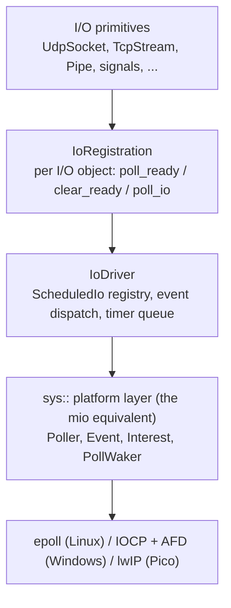
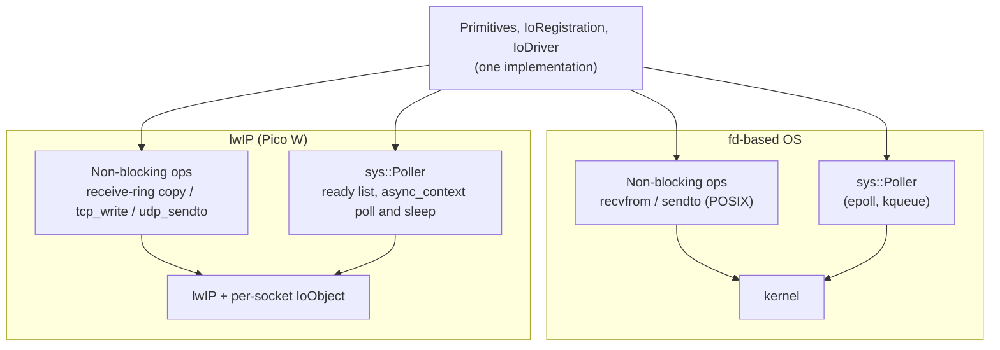
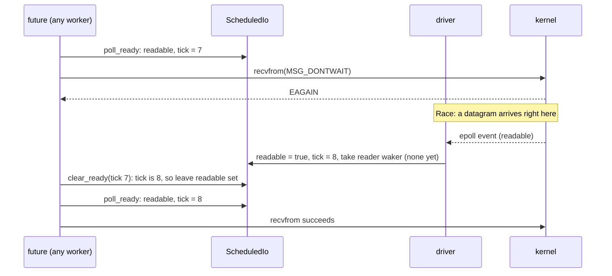
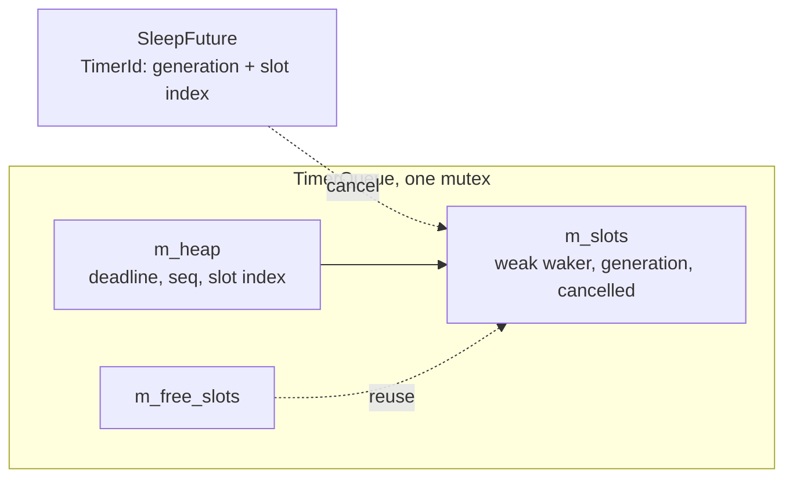
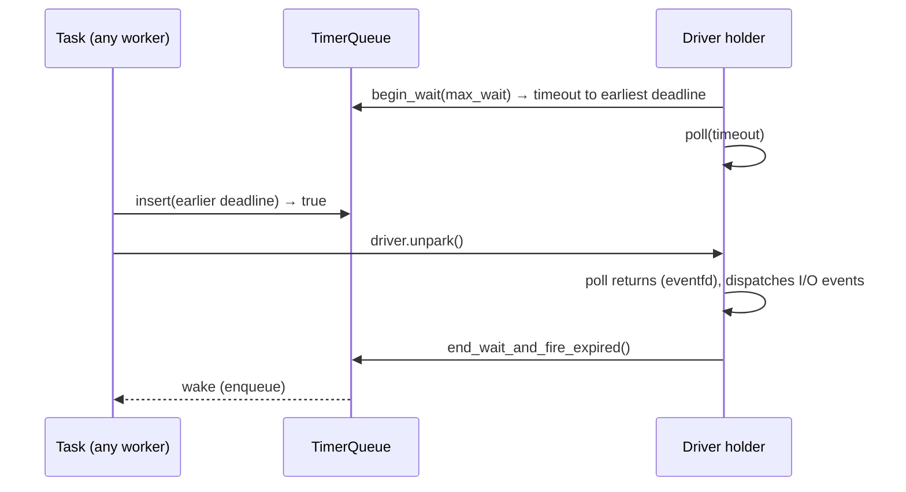

# I/O Driver (epoll reactor)

`IoDriver` is coro's readiness-based I/O reactor. It owns the OS readiness queue (epoll on
Linux) and the runtime's timer queue, and wakes the futures waiting on either. It has no
thread of its own: executor threads turn it when they run out of work, so an I/O wake
reaches its task without a cross-thread hop.

This document covers the driver itself: the platform layer under it, the readiness
handshake a primitive uses, registration lifetime, how executors turn it, and its timer
queue. Each I/O primitive built on it has its own document (see
[Primitives on the driver](#primitives-on-the-driver)).

| Piece | Where | Tests |
|---|---|---|
| `sys::Poller`, `sys::PollWaker`, `Interest`, `Event` (epoll) | `include/coro/detail/sys/poller.h`, `src/detail/sys/posix/poller_epoll.cpp` | `test/detail/test_poller.cpp` |
| `sys::Poller`, `sys::PollWaker` (lwIP) | `src/detail/sys/lwip/poller_lwip.cpp`; see [Pico Port](pico_port.md#poller) | `test/detail/test_notify.cpp`, and the TCP and UDP tests, on host lwIP and on the board |
| `sys::Poller`, `sys::PollWaker` (IOCP + AFD) | `src/detail/sys/windows/poller_iocp.cpp`; see [Windows Port](windows_port.md#the-iocpafd-poller) | `test/detail/test_poller.cpp` |
| `sys::notify_open`, `sys::notify_signal` | `include/coro/detail/sys/notify.h`, `src/detail/sys/posix/notify_posix.cpp`, `src/detail/sys/lwip/notify_lwip.cpp` | `test/detail/test_notify.cpp` |
| `IoDriver`, `ScheduledIo`, `IoRegistration`, `IoDriverParker` | `include/coro/runtime/io_driver.h`, `src/runtime/io_driver.cpp` | `test/runtime/test_io_driver.cpp`; the waiter list in `test/detail/test_notify.cpp`, on every backend |
| `Parker`, `PollingParker` | `include/coro/runtime/parker.h` | `test/runtime/test_current_thread_executor.cpp` |
| `Clock`, `Instant` | `include/coro/runtime/clock.h` | |
| `detail::TimerQueue`, `detail::TimerId` | `include/coro/detail/timer_queue.h`, `src/detail/timer_queue.cpp` | `test/detail/test_timer_queue.cpp` |

---

## Why a readiness driver

The driver follows tokio and mio: a pending I/O future stores its waker and returns
`PollPending`, and whichever thread turns the driver wakes it when the kernel reports the
fd ready. The alternative, a dedicated I/O thread that owns every socket and runs
completion callbacks, makes every slow-path operation a round trip through that thread:
a task allocation, a queue push, a wake of the I/O thread, and a second wake back to the
waiting worker. It also lends the caller's buffer to the I/O thread for as long as the
operation is armed, which makes dropping a pending future unsafe.

The readiness model avoids both:

- **No hop.** The future's own thread makes the non-blocking syscall. Only a wait goes
  through the driver, and the wake runs on whichever executor thread is turning it.
- **Safe cancellation.** A pending future holds no kernel state, only a waker in its
  registration. Dropping it clears nothing the kernel knows about, and no buffer is ever
  lent across a suspension.
- **Any syscall.** The driver reports only readiness, so a primitive can use whatever call
  it needs once the fd is ready (`recvmsg()` with control messages, `sendmmsg()`,
  `accept4()`), with no wrapper API in between.
- **Precise timers.** The driver blocks with a timeout in nanoseconds (`ppoll()` on
  the epoll descriptor), so the timer queue's earliest deadline bounds the wait
  directly.

## Goals

- Any thread can wait on an fd without a thread hop.
- Dropping an I/O future is always safe.
- Readiness waits are first-class, so any non-blocking syscall can be wrapped.
- Timers with sub-millisecond resolution.
- One small, explicit platform boundary, so adding an OS means implementing that boundary
  and nothing else. See [Porting to a new platform](#porting-to-a-new-platform).

## Non-goals

- **io_uring.** It is ruled out because of its security track record (many distributions
  and container runtimes disable it) and its uneven availability across Linux platforms.
- **A completion (proactor) model, and resuming tasks inline from the driver.** Wakes go
  through the executor. The same-thread queue round trip is cheap, and it avoids
  re-entrancy hazards. The one exception is a library that must be driven from an event
  loop; see [Level-triggered registrations](#level-triggered-registrations).
- **A dedicated driver thread.** See [Who turns the driver](#who-turns-the-driver).

---

## Layering

Primitives never touch the OS readiness API directly; they go through an
`IoRegistration`. Only `sys::Poller` and its companions are platform-specific.



| Layer | Portable? | Responsibility |
|---|---|---|
| `sys::Poller` and `sys::PollWaker` | **No.** One implementation per platform: epoll on Linux, IOCP + AFD on Windows, lwIP on Pico. | Register, re-register and deregister an fd with an interest set; wait for events with a timeout; wake a blocked wait from another thread. |
| `IoDriver` | Yes | Own the `Poller`, map each event to its `ScheduledIo`, update readiness, fire wakers; own the timer queue. |
| `IoRegistration` | Yes | The readiness handshake a future uses: wait until ready, attempt the syscall, clear readiness on `EAGAIN`. |
| Primitives | Mostly | Non-blocking syscalls behind a per-primitive backend seam (`detail/sys/udp.h`, `tcp.h`, ...), plus the `IoRegistration` handshake. |

### The `sys` layer

`include/coro/detail/sys/poller.h` is coro's internal equivalent of mio: only what the
driver needs.

```cpp
namespace coro::detail::sys {

// The handle of one I/O object: what the platform's "syscalls" take.
using RawFd = int;                     // POSIX: a file descriptor
// using RawFd = IoObject*;            // lwIP (CORO_SYS_LWIP): the object itself
// using RawFd = std::uintptr_t;       // Windows: a SOCKET
inline constexpr RawFd kInvalidFd = -1;   // nullptr on lwIP; all ones on Windows

// Backend-specific construction options. Empty on POSIX; on lwIP, the Pico SDK
// async_context poll() runs and sleeps on, and the PicoNetwork.
struct PollerOptions;

bool would_block(int err) noexcept;  // EAGAIN or EWOULDBLOCK

struct Interest { bool readable = false; bool writable = false; /* read(), write(), read_write() */ };
enum class Trigger { Edge, Level };

struct Event {
    void* key;       // the ScheduledIo* the fd was registered with
    bool  readable;
    bool  writable;
    bool  error;     // EPOLLERR: waiters in both directions retry and see the error
    bool  hup;       // EPOLLHUP / EPOLLRDHUP
};

class Poller {
public:
    explicit Poller(PollerOptions options = {});
    // thread-safe; trigger defaults to Trigger::Edge
    void register_fd(RawFd fd, void* key, Interest interest, Trigger trigger = Trigger::Edge);
    void reregister_fd(RawFd fd, void* key, Interest interest, Trigger trigger = Trigger::Edge);
    bool deregister_fd(RawFd fd) noexcept;                       // thread-safe
    /// Re-enables a direction after its consumer saw would-block. Thread-safe. A no-op
    /// where the OS delivers edges itself; see "Emulated edges" below.
    void rearm(RawFd fd, Interest interest) noexcept;
    /// Waits up to timeout (nullopt = forever) and appends events to out.
    void poll(std::vector<Event>& out, std::optional<std::chrono::nanoseconds> timeout);
};

/// Wakes a thread blocked in Poller::poll(). An eventfd on Linux, EVFILT_USER on kqueue,
/// a when-pending worker on the Pico SDK's async_context on lwIP.
class PollWaker {
public:
    PollWaker(Poller& poller, void* key);
    void wake() noexcept;   // thread-safe; a wake with nobody polling is kept
    void reset() noexcept;  // the polling thread consumes pending wakes
};

} // namespace coro::detail::sys
```

Socket creation and the per-protocol non-blocking operations live in their own seam
headers next to it (`socket.h`, `udp.h`, `tcp.h`, `pipe.h`, `signal.h`, `file.h`,
`dns.h`), each documented with the primitive that uses it. A backend implements the
seams for the primitives its platform has: the lwIP backend implements `poller.h`,
`socket.h`, `tcp.h`, `udp.h`, `dns.h` and `notify.h`.

`notify.h` is the eventfd seam: a handle that something outside the driver's thread
signals to make it readable.

```cpp
RawFd notify_open();                     // a new notify object; throws on failure
void  notify_signal(RawFd fd) noexcept;  // makes it readable; from any thread, and
                                         // on lwIP from an ISR
// close_socket(fd) closes it. A signal is an edge: each one is reported, and nothing
// needs to be read back to re-arm it.
```

On POSIX it is an `eventfd` (`EFD_NONBLOCK | EFD_CLOEXEC`), and `notify_signal()`
writes 1 to it. On lwIP it is an `IoObject` with its own `async_context` worker (see
[Pico Port](pico_port.md#notify-objects)). The ISR primitives are built on it (see
[ISR Safety](isr_safety.md#waiting-on-the-driver)).

`RawFd` is an integer on POSIX because a file descriptor crosses the boundary between
user space and the kernel. A backend with no such boundary uses a pointer to the object
itself. The layers above treat `RawFd` as opaque: they store it, pass it to `sys`
functions, and compare it with `kInvalidFd`.

Semantics every backend must provide:

- **Edge-triggered delivery.** An event is only guaranteed when readiness changes, so a
  consumer may only wait after it has seen `EAGAIN`. This is the strictest contract, and
  the handshake below follows it. A level-triggered backend still works under it; it just
  reports extra events.
- **Emulated edges.** A backend whose OS only offers one-shot polls (AFD on Windows)
  stops reporting a direction once it has reported it, and reports it again only after
  `rearm()`. `IoRegistration::clear_ready()` calls `rearm()` when it clears a direction,
  which is exactly when the edge contract lets a consumer wait. On epoll and lwIP it is
  an empty inline function. See [Windows Port](windows_port.md#edge-emulation).
- **Level-triggered delivery on request** (`Trigger::Level`; see
  [Level-triggered registrations](#level-triggered-registrations)). The fd is reported
  by every `poll()` while it is ready for something in its interest set. On epoll that
  is a registration without `EPOLLET`; on kqueue, one without `EV_CLEAR`. The interest
  set must be kept exact: an fd left registered for writing while nobody writes makes
  every `poll()` return at once. A backend whose platform runs no library that needs it
  may refuse it with `ENOTSUP`; the lwIP backend does.
- **Thread-safe registration.** Any thread may register or deregister while another
  thread is blocked in `poll()`. `epoll_ctl` and `kevent` both allow this.
- **High-resolution timeout.** `poll()`'s timeout is in nanoseconds. On Linux this is
  `ppoll()` on the epoll descriptor, which takes a `timespec` where `epoll_wait()`
  takes whole milliseconds, followed by a non-blocking `epoll_wait()` to collect the
  events. `epoll_pwait2()` (5.11 and later) would do it in one call, but Rocky Linux
  8's kernel lacks it, and one path that every platform's tests run is worth more
  than the saved call; its code is kept in `poller_epoll.cpp`, not compiled, in case
  profiling says otherwise. kqueue takes a `timespec` natively. Timer precision is
  the backend's job, not the timer queue's.

!!! tip "TODO: a kqueue backend"
    A kqueue backend is small (a few hundred lines), and would catch BSD-isms and
    Linux-isms leaking through `sys` that the lwIP backend, being so different, does not
    exercise.

---

## Porting to a new platform

A port implements the `sys` layer, and nothing else:

1. **A readiness source:** `sys::Poller` and `sys::PollWaker`. `poll()` waits up to a
   timeout and returns an `Event` for each object whose readiness changed.
2. **The non-blocking operations** each primitive is built on (`sys/tcp.h`,
   `sys/udp.h`, ...): "try to receive now", "try to send now", and so on. Each one
   either completes or reports *would block*.

Everything above `sys` is the same code on every platform: `IoDriver` and its timer
queue, the `IoRegistration` handshake, `SocketState`, each primitive's futures, buffer
ownership, cancellation and error mapping, the executors and the `Parker` protocol,
`Runtime`, and the public API.

| Platform | Readiness source | Non-blocking operations |
|---|---|---|
| **fd-based OS** (Linux epoll, macOS/BSD kqueue) | The OS readiness queue | POSIX syscalls (`recvfrom`, `sendto`, ...). Only OS-specific options (GSO, GRO) differ, behind `#ifdef` |
| **Windows** | `IOCTL_AFD_POLL` requests completing on an I/O completion port, one-shot, with edges emulated through `rearm()`. See [Windows Port](windows_port.md) | Winsock calls, with WSA errors translated to errno |
| **Network stack without an OS** (lwIP raw API on Pico W) | lwIP's callbacks put objects on the `Poller`'s ready list; `poll()` runs the Pico SDK's `async_context` (radio, lwIP timers, ISR signals) and sleeps the CPU on it | "Syscalls" on per-socket objects that play the kernel's part: copy from per-socket receive buffers, `tcp_write`, `udp_sendto`. See [Pico Port](pico_port.md#the-lwip-sys-backend) |



On the lwIP backend there is no operating system for the `sys` layer to adapt: the
backend itself does the kernel's job, with lwIP underneath. Each socket is an object
holding the lwIP pcb and the data received for it, and `RawFd` points to it.

!!! warning "WARNING: keep the shared layers free of fds and syscalls"
    A port stays this small only if:

    - nothing above `sys` assumes `RawFd` is an integer, or calls the OS;
    - each primitive's async logic calls its non-blocking operations through one narrow
      backend seam, never `::recvfrom()` inline.

---

## `ScheduledIo` and the readiness handshake

Each registered I/O object has one `ScheduledIo`. Its `IoRegistration` holds it, and the
kernel holds its address as the event key:

```cpp
class ScheduledIo {
    detail::Mutex m_mutex;              // std::mutex; a no-op on Pico
    bool          m_level    = false;   // Written once by add(), before the poller can
                                        //   name this object; read-only afterwards.
    bool          m_readable = true;    // GUARDED BY m_mutex. Starts true, so the first
    bool          m_writable = true;    //   attempt is a plain syscall.
    bool          m_shutdown = false;   // GUARDED BY m_mutex. Set by IoDriver::shutdown().
    uint64_t      m_tick     = 0;       // GUARDED BY m_mutex. Bumped on every driver event.
    Weak<Waker>   m_reader;             // GUARDED BY m_mutex
    Weak<Waker>   m_writer;             // GUARDED BY m_mutex
    IntrusiveList<IoWaiter*> m_waiters; // GUARDED BY m_mutex. Any number of waiters;
                                        //   see "More than one waiter".
    ScheduledIo*  m_prev = nullptr;     // GUARDED BY IoDriver::m_registrations_mutex
    ScheduledIo*  m_next = nullptr;     //   (the driver's registration list; see Shutdown)
};
```

- **One waker slot per direction, for sockets.** A socket allows one receive and one send
  in flight at a time; a concurrent receive and send are fine. Primitives that allow
  several waiters at once use the waiter list instead (see
  [More than one waiter](#more-than-one-waiter)).
- **Weak wakers.** The task owns the future, which owns the registration, so a strong
  waker here would be a reference cycle. A waker whose task is gone is skipped.
- **A plain mutex.** It is uncontended on the hot path. Every lock in the driver is a
  `detail::Mutex`, which is `std::mutex` on desktop and a no-op on single-threaded Pico
  (see [Pico Port](pico_port.md#synchronisation-and-isr-safety)).
- **The mutex is for the wakers, not just the flags.** `poll_ready()` checks readiness
  and stores its waker as one step, and `dispatch()` sets readiness and takes the waker
  as one step. That pairing is what makes a lost wake impossible. The flags and the tick
  could be packed into one atomic word, but the waker slots could not, so the mutex
  would remain on every path that waits. See
  [Future improvements](#future-improvements) for why that split is not made.

The handshake prevents lost wakeups by comparing ticks. Readiness is only cleared if no
event has arrived since the attempt that failed. `IoRegistration::poll_io()` packages the
loop (tokio's `Registration::poll_io`):

```cpp
// Inside some future's poll(). Read direction shown.
auto result = m_reg.poll_io(IoDirection::Read, ctx, [&]() -> std::expected<size_t, int> {
    ssize_t n = ::recvfrom(fd, ..., MSG_DONTWAIT, ...);
    if (n < 0) return std::unexpected(errno);
    return size_t(n);
});
if (!result) return PollPending;   // waker stored; the driver will wake us
// *result is the value, or an error other than would-block
```

which expands to:

```cpp
for (;;) {
    auto ready = reg.poll_ready(IoDirection::Read, ctx);  // not ready: store waker, nullopt
    if (!ready) return PollPending;
    auto r = op();
    if (r || !would_block(r.error())) return r;
    reg.clear_ready(*ready);                              // clears only if tick is unchanged,
}                                                         //   then Poller::rearm()s the direction
```



Without the tick, `clear_ready` would clear the flag the driver had just set, the future
would store its waker, and nothing would ever wake it.

An `Event` with `error` or `hup` set marks both directions ready, so each waiter retries
its syscall and receives the actual error or end of stream from it.

### More than one waiter

The per-direction slots serve one waiter each, which is all a socket's contract allows.
A primitive whose contract allows any number of concurrent waiters on one direction
(the ISR primitives: see [ISR Safety](isr_safety.md#waiting-on-the-driver)) uses the
registration's **waiter list** instead. This is tokio's design: its `ScheduledIo` keeps
the same two slots for `poll_read_ready()` and a list for its `readiness()` futures,
which any number of tasks may await at once.

```cpp
/// One waiter on a ScheduledIo. Lives inside the waiting future, so a wait allocates
/// nothing. Linked into ScheduledIo::m_waiters while waiting.
class IoWaiter {
    IoWaiter*         prev = nullptr;  // detail::IntrusiveList links.
    IoWaiter*         next = nullptr;  //   GUARDED BY the ScheduledIo's m_mutex
    bool              m_linked = false;// GUARDED BY the ScheduledIo's m_mutex
    Weak<Waker>       m_waker;         // GUARDED BY the ScheduledIo's m_mutex
    IoDirection       m_direction;
    bool              m_ready = false; // GUARDED BY the ScheduledIo's m_mutex. Set by
                                       //   dispatch() or shutdown() when it wakes this
                                       //   waiter, which unlinks it.
};

// IoRegistration: the waiter-list forms of poll_ready() and poll_io().
std::optional<IoReadyEvent> poll_ready(IoDirection direction, detail::Context& ctx,
                                       IoWaiter& waiter);
template<typename Op>
auto poll_io(IoDirection direction, detail::Context& ctx, IoWaiter& waiter, Op&& op);
void cancel_wait(IoWaiter& waiter) noexcept;   // unlinks; the waiter's owner calls it on drop
```

`poll_ready(direction, ctx, waiter)`, under `m_mutex`:

1. Shut down: return an event with `shutdown` set.
2. The waiter was woken (`m_ready`): clear the flag and return an event with the current
   tick.
3. The waiter is linked: it is still waiting. Replace its waker and return `nullopt`.
4. The direction is ready: return an event with the current tick.
5. Otherwise link the waiter, store its waker, and return `nullopt`.

`poll_io()` wraps it in the same loop as the slot form: run the operation, and on
`EAGAIN` call `clear_ready(event)` and poll again, which links the waiter.

`dispatch()` wakes the list after the slots. For each linked waiter whose direction the
event made ready, it sets `m_ready`, takes its waker and unlinks it. It collects at
most `kWakeBatch` (32) wakers at a time in a local array, then unlocks and wakes them,
and re-locks to continue from the head of the list. Woken waiters are no longer linked, so restarting
from the head never wakes one twice, and `dispatch()` allocates nothing however many
waiters there are. `shutdown()` does the same for every waiter, whatever its direction.

- **Why each waiter has its own `m_ready`.** The readiness bit is shared, and any waiter
  whose operation fails calls `clear_ready()`. Suppose one event wakes waiters A and B,
  and then a waiter C, which arrived after the event, runs first: it sees the direction
  ready, its operation finds nothing for it, and it clears the bit. Without their own
  flag, A and B would find readiness cleared and wait again for a signal they were
  woken for. With it, each woken waiter returns ready exactly once, and its own
  operation decides the outcome.
- **The waiter must not move while linked.** The list holds its address. That follows
  from the future contract: the waiter lives in a future, a future is pinned from its
  first poll (see
  [Future and Stream](future_and_stream.md#movable-until-the-first-poll-pinned-after)),
  and only a poll links it. The owning future's move operations assert that its waiter
  is not linked.
- **Dropping a waiting future** calls `cancel_wait()`, which unlinks it under `m_mutex`.
  A waiter that `dispatch()` already unlinked is not linked, so its drop does nothing,
  and the waker `dispatch()` took finds a task that tolerates a spurious wake.
- **A registration is deregistered with an empty list.** Every waiter's future holds a
  share of whatever owns the registration, so the last waiter is gone before the
  registration can be dropped. `deregister()` asserts it in debug builds.
- **Level-triggered registrations do not use the list.**

### Registration lifetime and stale events

An event batch returned by `poll()` may still name a `ScheduledIo` whose primitive was
dropped (and deregistered) after the kernel queued the event. `Event::key` must not
dangle:

- The `IoRegistration` holds the only strong reference; the kernel holds the object's
  address as the event key. Every path that drops the reference (destructor,
  move-assignment, explicit `deregister()`) deregisters first.
- Deregistration (from the primitive's destructor, on any thread) calls
  `Poller::deregister_fd()` and moves the reference onto the driver's pending-release
  list. The primitive closes the fd afterwards.
- The driver drops pending releases only at the **start** of a turn, before calling
  `poll()`, so no batch it is still processing can reference them.
- Because events are keyed by `ScheduledIo*` rather than by fd, a new socket that reuses
  the fd number of a closed one is harmless: a stale event in flight lands on the old
  object, which no longer has any wakers.
- A `ScheduledIo` built on one thread reaches the turning thread only through the
  kernel (`epoll_ctl()`, then the `epoll_wait()` that returns its address), which orders
  the two. ThreadSanitizer can't see that ordering and reports a race between the
  construction and `dispatch()` (`IoDriver.RegisterWhileTurnIsBlocked`), so `add()` and
  `dispatch()` carry `__tsan_release`/`__tsan_acquire` annotations. They compile to
  nothing outside TSan builds. A mutex would do the same, but taken on every turn it
  would bounce a shared cache line between workers for the sake of a tool.

!!! danger "WARNING: deregister before closing the fd"
    epoll watches the open file, not the fd number. If a primitive closes its fd while a
    dup of it is still open (a `dup()`, a `fork()`ed child, an fd passed over a Unix
    socket), the registration survives the close, and the later `EPOLL_CTL_DEL` on the
    closed number fails. The kernel then still holds the `ScheduledIo`'s address after the
    deferred release frees it: a use-after-free on the next event. Even without a dup, a
    reused fd number could deregister someone else's socket. `IoDriver::deregister()`
    asserts that the removal succeeded, in debug builds only. See the TODO under
    [Future improvements](#future-improvements) on letting the registration own the fd.

A released object can outlive its primitive until the driver's next turn. Two details
keep that cheap, both taken from tokio:

- **Each turn checks before locking.** An atomic count mirrors the list's size. It is
  written only under the release mutex and read without it at the start of each turn,
  so the usual empty case skips the lock, whose cache line would otherwise move to
  every worker that turns. It is only a hint: a stale zero delays a release to a later
  turn, which is always safe.
- **The 16th pending release unparks the driver**, so a blocked driver doesn't hold them
  until some unrelated event. Only an executor that never turns the driver lets the list
  grow without bound.

### Shutdown

`IoDriver::shutdown()` is the last step of `Runtime::shutdown()`, after the executor's
threads have stopped. From then on nothing turns the driver, so a waiter left on it
would never be woken. The runtime's own tasks have all finished by then. What can be
left is a waiter the runtime does not own: a thread outside it, or a task of another
runtime, parked on one of this driver's registrations or timers (see
[runtime_shutdown.md](runtime_shutdown.md), "Waiters on the I/O driver from outside the
runtime").

The poller knows registrations only as opaque keys, so the driver keeps its own list of
them: an intrusive list through `ScheduledIo`, under `m_registrations_mutex`. `add()`
links a registration and `deregister()` unlinks it, so the mutex is taken twice in a
registration's lifetime and never per operation. This is tokio's `RegistrationSet`.

`shutdown()` then:

1. Sets the driver's `is_shut_down()` flag.
2. For every listed registration, sets `ScheduledIo::m_shutdown` and takes its reader
   and writer wakers, and every listed waiter's waker (unlinking it and setting its
   `m_ready`), under that registration's mutex. It collects them into a vector, as
   it may allocate where `dispatch()` may not.
3. Wakes those wakers, outside both locks.
4. Closes the timer queue, which removes every timer and wakes its waker
   (`TimerQueue::close_and_wake_all()`).

Steps 2 to 4 run with the turn held (see
[Level-triggered registrations](#level-triggered-registrations)).

Afterwards:

| Call | Result |
|---|---|
| `IoRegistration::poll_ready()` | Always returns an event, with `shutdown` set; stores no waker |
| `IoRegistration::poll_io()` | Returns the error `sys::kDriverShutDown` (`ECANCELED`) without running the operation. Each I/O future already turns an errno into a `std::system_error` |
| `IoDriver::add_timer()` | Throws `std::runtime_error` |
| A `SleepFuture` polled again before its deadline | Checks `is_shut_down()` and fails with `std::runtime_error` |
| Registering a new fd | Throws `std::runtime_error` |
| `deregister()`, `cancel_timer()`, `turn()`, `unpark()` | Work as before, so sockets and futures that outlive the shutdown are destroyed as usual |

Races:

- A `poll_ready()` on another thread stores its waker under the registration's mutex,
  the same one `shutdown()` sets the flag under. It either stored first and is woken,
  or runs afterwards and sees the flag.
- An `add()` holds `m_registrations_mutex` across the poller call and the link, so
  `shutdown()` sees either a linked registration or none; a later `add()` is refused.
- A `deregister()` unlinks under `m_registrations_mutex` before it gives up its
  reference, so every registration `shutdown()` walks is alive.
- A timer insert takes the queue's mutex either before the close, and is woken by it,
  or after, and is refused.
- `is_shut_down()` is an atomic flag, read without a lock. `SleepFuture` reads it on a
  re-poll that otherwise touches nothing shared, which is the hot path of a timeout
  raced against a busy future. It is written once, before anyone is woken, so a waiter
  woken by `shutdown()` always sees it.

---

## Who turns the driver

!!! danger "WARNING: there is no I/O thread"
    The executor's own worker threads turn the driver. A dedicated driver thread would
    bring back the very thing this design removes: a cross-thread hop on every slow-path
    wake. Don't add one.

`IoDriver` doesn't know about executors. It exposes:

```cpp
/// Releases pending registrations, waits up to timeout for events, dispatches them
/// (sets readiness, bumps ticks, fires wakers), then fires expired timers. Returns the
/// number of events dispatched plus timers fired. One thread at a time.
std::size_t turn(std::optional<std::chrono::nanoseconds> timeout);

/// Like turn(), but returns nullopt at once if another thread is turning.
std::optional<std::size_t> try_turn(std::optional<std::chrono::nanoseconds> timeout);

/// Like try_turn(), but calls before_poll() once this thread holds the driver; false
/// releases the driver without polling and returns 0.
template<typename BeforePoll>
std::optional<std::size_t> try_turn(std::optional<std::chrono::nanoseconds> timeout,
                                    BeforePoll&& before_poll);

/// Makes a blocked turn() return, or the next turn() return at once. Any thread.
void unpark() noexcept;
```

`unpark()` writes the `PollWaker`'s eventfd. The write is sticky: if no thread is in
`poll()`, the next turn returns immediately. Only the thread holding the driver consumes
it (`PollWaker::reset()` when the waker's key comes back in a batch). Callers must
publish the work they want the turning thread to see *before* calling `unpark()`.

`try_turn()` exists for executors whose workers share one driver: a worker that can't
get it parks somewhere else rather than queueing behind the holder. The `before_poll`
form lets a parking worker publish "I am blocked in the driver" only once it holds the
turn, so an unpark aimed at it can't be consumed by another thread's turn.

Each executor turns the driver from its scheduling loop:

- **When idle,** a thread blocks in `turn(nullopt)` (bounded by the earliest timer)
  instead of on a condition variable. A wake from another thread calls `unpark()`.
- **When busy,** the executor turns with a zero timeout every N task polls, as tokio
  does with its `event_interval` (61), and at once after a task poll that yielded (see
  [Task Budget](task_budget.md)). This keeps I/O from starving behind a long ready
  queue. Because events are edge-triggered, they wait safely in the kernel until then.

Dispatch calls `wake()` on the thread that is turning. If the woken task belongs to that
thread, it is a plain local enqueue: no lock on a shared queue, no hop.

### `Parker`

A single-threaded executor waits for outside events through a `Parker` (tokio's `Park`
trait). Waiting has two halves: the executor thread waits, and other threads interrupt
the wait.

```cpp
class Parker {
public:
    virtual ~Parker() = default;
    /// Waits up to max_wait for outside events; nullopt = no limit, zero = don't block.
    virtual void park(std::optional<std::chrono::nanoseconds> max_wait) = 0;
    /// Makes a blocked park() return early, or the next one return at once. Any thread.
    virtual void unpark() noexcept = 0;
};
```

| Parker | `park(max_wait)` | `unpark()` | Used by |
|---|---|---|---|
| `IoDriverParker` | `driver.turn(max_wait)` | `driver.unpark()` | desktop `Runtime(1)`, Pico `Runtime` |
| `PollingParker` | calls a function once, ignores `max_wait` | nothing | a `CurrentThreadExecutor` built without a `Runtime` (tests) |

The executor picks the wait: zero when a ready queue isn't empty, otherwise no limit
(the driver bounds it by the earliest timer itself). It also decides how often it
parks while busy: once per batch of `event_interval` task polls, so a task that keeps
re-waking itself doesn't pay an `epoll_wait()` per poll (see
[Executor Scheduling Design](executor_design.md#the-loop)). The parkers keep no count
of their own.

### Per-executor integration

| Executor | How it turns the driver | Details |
|---|---|---|
| `CurrentThreadExecutor` (`Runtime(1)`, Pico `Runtime`) | Parks through an `IoDriverParker`; a remote enqueue unparks it only while it is parked. | [Executor Scheduling Design](executor_design.md) |
| `WorkStealingExecutor` (`Runtime(n)`) | The first idle worker takes the driver with `try_turn(nullopt, before_poll)`; other idle workers park on their own condition variable. Busy workers `try_turn(0)` every 61 polls. | [Work-Stealing Scheduler](work_stealing_executor.md) |
| `WorkSharingExecutor` | One idle worker turns the driver; a remote enqueue unparks it. | [Executor Scheduling Design](executor_design.md) |

!!! note "NOTE: I/O latency depends on someone turning the driver"
    After a holder leaves `turn()` to run the tasks it woke, nobody is in the driver until
    it parks again, another worker parks and finds the driver free, or a busy worker
    reaches its `event_interval` turn. Edge-triggered events wait in the kernel meanwhile,
    so nothing is lost, but a long-running task on the holder delays I/O and timer
    delivery while every other worker sleeps. Tokio has the same property.

---

## Level-triggered registrations

Some libraries own their sockets and want an event loop to drive them: call them when an
fd is ready, and never from two threads at once. libwebsockets is the one coro has (see
[WebSocket Stream](websocket_stream.md)). Such a library does the reads and writes
itself and expects `poll()` semantics, so the edge-triggered handshake does not fit: it
may stop reading before `EAGAIN` and still expect to be called again.

It needs no second mechanism in the driver, only a registration that behaves like
`poll()` and a waker that does the work instead of scheduling a task:

```cpp
// IoRegistration
IoRegistration(IoDriver& driver, sys::RawFd fd, sys::Interest interest, sys::Trigger trigger);
void set_interest(sys::Interest interest);          // level-triggered only
void set_waker(detail::Weak<detail::Waker> waker);  // level-triggered only; both directions
IoLevelReady take_ready();                          // {readable, writable, shutdown} since the last call; clears it
```

- **The waker stays.** `dispatch()` takes an edge-triggered registration's waker out of
  its slot when it wakes it. A level-triggered registration's waker is set once with
  `set_waker()` and is woken on every turn in which the fd is ready, with no call to
  put it back and no allocation per event.
- **`take_ready()` tells the waker why it was woken.** `wake()` has no arguments, so
  `dispatch()` records the directions on the `ScheduledIo` as it already does (an error
  or hang-up counts as both), and the waker collects and clears them.
- **`set_interest()`** re-registers the fd. The owner must keep the interest exact (see
  [The `sys` layer](#the-sys-layer)).
- **The waker does the work inside `wake()`**, on the thread that holds the turn. That
  is where the library's mutual exclusion comes from: one thread turns at a time, and
  nothing else calls the library.
- **`shutdown()` wakes with the turn held.** Its wakes reach these wakers too, with
  `shutdown` set in `take_ready()`, and they must not overlap a turn made by a thread outside the
  runtime. The executor's threads have stopped by then, so the turn is free or about to
  be.
- **Lifetime is unchanged.** The registration's owner holds the waker; the driver holds
  it weakly and upgrades it for the duration of `wake()`. A waker may therefore drop its
  own registration from inside `wake()`, and an event for a registration dropped earlier
  in the same batch finds no waker (see
  [Registration lifetime and stale events](#registration-lifetime-and-stale-events)).
- **The same waker can go on the timer queue** (`add_timer()`), which also fires inside
  the turn. A library's own timers need nothing else.

!!! danger "WARNING: a waker that works inline must not block, turn the driver, or run a task"
    It runs with the turn held: while it runs, no I/O event and no timer is delivered to
    anything. It may fill queues and wake other wakers. It must not wait on a lock that
    a task can hold across a suspension, call `turn()` or `try_turn()`, or resume a
    coroutine. Task wakers stay as they are; this is for a library that cannot be driven
    any other way.

---

## Timers

The driver owns the runtime's timer queue. The earliest deadline bounds every blocking
turn, so timers have the driver's nanosecond resolution and fire on whichever thread is
turning, without a hop. The user-facing API built on it (`sleep_for`, `sleep_until`,
`timeout`, `IntervalTimer`) is described in [Timers](timers.md).

### `Clock` and `Instant`

`coro::Clock` is the runtime's monotonic clock, and `coro::Instant` is
`Clock::time_point`. Every timer deadline is an `Instant`.

- Desktop: an alias for `std::chrono::steady_clock`.
- Pico: `PicoClock`, a small clock over `time_us_64()` with microsecond ticks. It meets
  the standard's *Clock* requirements, so `Instant` arithmetic with `std::chrono`
  durations works on both platforms. Its `now()` is defined in `runtime.cpp`, next to the
  SDK include, so `clock.h` doesn't pull in the SDK.

### `detail::TimerQueue`

One timer queue type, used by the driver and by a `CurrentThreadExecutor` that runs
without a `Runtime`:

```cpp
namespace coro::detail {

// Names one timer: slot index in the low 32 bits, that slot's generation in the high 32.
using TimerId = std::uint64_t;

class TimerQueue {
public:
    struct Inserted {
        TimerId id;
        // True if the caller must unpark the thread blocked waiting, because this
        // deadline is earlier than the one it is waiting for.
        bool    unpark;
    };

    // Adds a timer that wakes `waker` once `deadline` has passed.
    Inserted insert(Instant deadline, Weak<Waker> waker);

    // Cancels the timer, so it fires nothing. Does nothing if `id` is stale: the timer
    // has already fired or been cancelled.
    void cancel(TimerId id) noexcept;

    // For the thread about to block: min(max_wait, time to the earliest deadline),
    // rounded up. If that is non-zero, records that a waiter is blocked, for insert().
    std::optional<std::chrono::nanoseconds>
        begin_wait(std::optional<std::chrono::nanoseconds> max_wait);
    void end_wait();

    // Pops every entry with deadline <= Clock::now() and wakes the live ones, outside
    // the lock. Returns the number woken.
    std::size_t fire_expired();

    // Both of the above under one lock. IoDriver calls this once per turn.
    std::size_t end_wait_and_fire_expired();

private:
    struct Entry { Instant deadline; std::uint64_t seq; std::uint32_t slot; };
    struct Slot  { Weak<Waker> waker; std::uint32_t generation; bool cancelled; };

    Mutex                      m_mutex;      // guards everything below
    std::vector<Entry>         m_heap;
    std::vector<Slot>          m_slots;
    std::vector<std::uint32_t> m_free_slots;
    std::size_t                m_cancelled;  // cancelled entries still in the heap
};

}
```

A timer is one heap entry plus one slot, with no allocation of its own:



- **Binary heap.** A `std::vector` with `std::push_heap`/`std::pop_heap`, ordered by
  deadline then by insertion sequence number, so equal deadlines fire in FIFO order.
  Insert and pop are O(log n).
- **Slots.** Heap entries move on every insert and pop, so an id can't name a position in
  the heap. It names a slot instead: an element of `m_slots`, which keeps its index from
  `insert()` until its entry leaves the heap. The slot holds the waker and the entry
  holds the slot's index, so `cancel()` reaches the waker by indexing, with no search and
  no map.
- **Generations.** A slot goes back on the free list when its entry leaves the heap, and
  a later `insert()` reuses it. Freeing a slot bumps its generation, and an id carries
  the generation it was issued with. An id for a timer that has already fired therefore
  doesn't match, and can't cancel the slot's next tenant. This is what lets
  `SleepFuture`'s destructor cancel without knowing whether its timer fired.
- **Lazy cancellation.** `cancel()` drops the slot's waker and marks it cancelled. It
  doesn't touch the heap: the entry stays until its deadline and is then popped without a
  wake. A cancel is a lock and a few stores, with no O(log n) sift.
- **Sweep.** So that cancelled entries can't accumulate without bound, `cancel()` counts
  them. When they outnumber the live entries, and there are at least
  `kSweepMinCancelled` (64) of them, it removes them all: `std::erase_if` over the heap,
  freeing each slot, then `std::make_heap`. The heap is thus never more than about twice
  the live timers. A sweep of n entries follows at least n/2 cancels, so it costs a
  constant per cancel. It runs on the cancelling thread, which already holds the lock.
- **Nothing allocated per timer.** The three vectors grow to the largest number of timers
  pending at once and are reused from then on.
- **Wakes run outside the queue mutex.** `fire_expired()` moves up to 32 live wakers
  into a local array, unlocks, wakes them, and repeats while more are due, so firing
  allocates nothing either. A wake enqueues onto an executor and takes that executor's
  locks. Keeping the queue mutex out of that means it is never held while another lock
  is taken.
- **Weak waker**, as in `ScheduledIo`: a strong one would keep a finished task alive
  until its deadline.

!!! danger "WARNING: the queue must outlive every future that holds a `TimerId`"
    `SleepFuture`'s destructor calls `cancel()`. On the driver this follows from
    `Runtime`'s destruction order (see [Runtime integration](#runtime-integration)).
    `CurrentThreadExecutor` owns its own queue, so it must declare the queue before
    its task containers, so that the tasks are destroyed first.

!!! tip "PERF: a sweep holds the queue mutex for O(n)"
    Inserts and the driver's turn wait while a sweep runs. If a very large heap ever
    makes that pause matter, have `cancel()` only set a flag and let the driver holder
    sweep at the start of its next turn. A hashed timer wheel (tokio's design) removes a
    cancelled timer in O(1) and needs no sweep, at a much larger cost in code.

### Who fires timers



`IoDriver`'s turn:

1. releases pending registrations, if the pending count says there are any;
2. `effective = timers.begin_wait(timeout)`;
3. polls with `effective`;
4. dispatches I/O events, then `timers.end_wait_and_fire_expired()`: one lock where
   `end_wait()` and `fire_expired()` would take two.

`turn()` returns the I/O events dispatched plus the timers fired, so a caller sees that
tasks were woken either way.

`begin_wait()` records a waiter only for a non-zero `effective`. A zero-timeout turn (a
busy worker's `try_turn(0)`, or `CurrentThreadExecutor`'s park after a batch) still fires expired
timers, but `insert()` never unparks it. `IoDriver::add_timer(deadline, waker)` calls
`insert()`, then `unpark()` if told to, and returns the `TimerId`.
`IoDriver::cancel_timer(id)` is `cancel()`.

Where a timer goes:

- **A `Runtime`**, any executor, desktop or Pico: `Runtime::add_timer()` adds it to the
  driver, and `Runtime::cancel_timer()` cancels it there.
  `CurrentThreadExecutor`'s `IoDriverParker` and the multi-threaded executors' driver
  turns pick up the earliest deadline by themselves. On Pico the deadline bounds the
  CPU's sleep in `Poller::poll()`.
- **`CurrentThreadExecutor`'s own `TimerQueue`** serves an executor built without a
  `Runtime`, through `CurrentThreadExecutor::add_timer()` and `cancel_timer()`. Its
  loop brackets `park()` with `begin_wait()`/`end_wait()` and calls `fire_expired()`
  after each batch. `add_timer()` unparks when `insert()` says so, which keeps a
  blocking `Parker` correct.
- **Neither:** on a `Runtime` whose executor never turns the driver (a
  `CurrentThreadExecutor` given its own `Parker`), `Runtime::add_timer()` throws
  `std::logic_error`, as registering an fd does.

Timers fire only when some thread turns the driver, so they have the same latency as I/O
readiness (see the note under [Who turns the driver](#who-turns-the-driver)). They are
never early: `SleepFuture` checks the clock itself.

### Timer races

- **Insert while the holder is blocked.** `begin_wait()` computes the timeout and records
  the waiter under the queue mutex, and `insert()` compares against it under the same
  mutex. Either the holder's `begin_wait()` sees the new entry, or `insert()` sees the
  recorded waiter and returns true. In the second case, `unpark()` writes the eventfd,
  which stays readable until the holder's poll consumes it, so an unpark made between
  `begin_wait()` and the poll is not lost.
- **Sweep while the holder is blocked (benign).** A sweep can remove the entry the
  holder computed its timeout from, leaving a later one at the front. `insert()` compares
  against the current front, so it may now ask for an unpark the holder didn't need, and
  never misses one it did. The holder still wakes at the removed entry's deadline, fires
  nothing, and turns again.
- **Stale waiter record (benign).** The holder returns from poll, but `insert()` runs
  before `end_wait()` and returns true. On the driver that window includes dispatching the
  I/O events, since `end_wait_and_fire_expired()` runs after it. The unpark makes the
  holder's *next* turn return immediately: one extra loop iteration, nothing lost.
- **Future dropped while its timer is firing.** `fire_expired()` takes the waker out of
  the slot and frees the slot under the queue mutex, and wakes after unlocking. A
  destructor that runs in between calls `cancel()` with an id whose generation no longer
  matches, which does nothing. The wake then reaches a task whose future is gone, which
  is a spurious wake the task tolerates. The `Weak` waker stops it from touching a freed
  task.
- **Cancel after the slot was reused.** The same stale id, arriving after another
  `insert()` took the slot. The generation check keeps it from cancelling that other
  timer.
- **Clock read after the poll.** `fire_expired()` reads `Clock::now()` after
  the poll returns. Rounding the timeout up guarantees the earliest deadline has
  passed by then, so a timer-only wake always fires something.

---

## Runtime integration

- `Runtime` owns an `IoDriver`, exposed as `Runtime::io_driver()`. Primitives reach it via
  `current_runtime().io_driver()`; a separate thread-local `current_driver()` isn't
  needed. `Runtime::turns_io_driver()` says whether the runtime's executor turns it;
  primitives that register an fd throw `std::logic_error` when it doesn't.
- Declaration order is `m_io_driver`, `m_blocking_pool`, `m_executor`, so destruction
  runs in the reverse order:
    - The executor goes first. Its tasks own the futures that own `IoRegistration`s, and
      those deregister from a driver that is still alive.
    - The driver only dispatches inside `turn()`, and only executor threads call `turn()`.
      Once the executor is gone, nothing dispatches.
- The Pico `Runtime` has the same shape without the blocking pool: an `IoDriver` whose
  `Poller` is the lwIP backend, configured by the `PicoNetwork` passed to the
  constructor, and a `CurrentThreadExecutor` that parks through an `IoDriverParker`.
  See [Pico Port](pico_port.md#runtime-on-pico).

!!! warning "FIXME: wakes into a destroyed executor"
    A wake calls into the executor, and for a parked executor into its parker and the
    driver. The driver outlives the executor, but nothing stops a thread that still holds
    a waker (a blocking-pool thread, a foreign thread with a cloned waker) from waking a
    task after the executor is destroyed. That is a use-after-free. Wakers would need to
    hold the executor alive, or the executor would need to detach its tasks' wakers on
    destruction.

---

## Primitives on the driver

| Primitive | How it uses the driver | Design |
|---|---|---|
| `UdpSocket` | `IoRegistration` per socket; non-blocking ops in `detail/sys/udp.h` | [UDP Socket](udp_socket.md) |
| `TcpStream`, `TcpListener` | `IoRegistration` per socket; non-blocking ops in `detail/sys/tcp.h` | [TCP Stream](tcp_stream.md) |
| `Pipe` | `IoRegistration` per FIFO end; `detail/sys/pipe.h` | [Pipe](pipe_streaming.md) |
| `ctrl_c()`, `shutdown_requested()`, `signal()`, `signal_stream()` | A self-pipe written by the signal handler; each watcher reads it through the driver | [Signal Handling](signal_handling.md) |
| `sleep_for`, `sleep_until`, `timeout`, `IntervalTimer` | The driver's timer queue | [Timers](timers.md) |
| `File` | Not on the driver: a regular file is always "ready", so each operation runs on the blocking pool | [File I/O](file_io.md) |
| `lookup_host()` | POSIX: `getaddrinfo()` blocks, so it runs on the blocking pool. lwIP: each query is an object registered with the driver, made readable by lwIP's DNS callback | [File I/O](file_io.md#lookup_host), [Pico Port](pico_port.md#name-resolution) |
| `IsrEvent`, `IsrChannel<T>`, `IsrSemaphore` (Pico) | A notify fd per primitive, signalled by the ISR and registered while the primitive has waiters; its waiters use the [waiter list](#more-than-one-waiter) | [ISR Safety](isr_safety.md#waiting-on-the-driver) |
| `WsStream`, `WsListener` | A [level-triggered registration](#level-triggered-registrations) per libwebsockets socket, whose waker calls lws inside the turn; lws's timers on the timer queue | [WebSocket Stream](websocket_stream.md) |

---

## Tests

| Test | Checks |
|---|---|
| `Poller.*` | Timeouts (zero, sub-millisecond, honored), key delivery, edge-triggering, deregistration, re-registration, HUP on peer close, append-without-clear. |
| `PollWaker.*` | A wake from another thread unblocks `poll()`; a wake before `poll()` is kept; `reset()` consumes it. |
| `IoRegistration.*` | Starts ready in both directions; `clear_ready()` makes a direction pending. |
| `IoDriver.EventBetweenEagainAndClearIsNotLost` | The tick handshake. |
| `IoDriver.DirectionsAreWokenIndependently`, `WakerFiresOncePerWait`, `LaterPollReplacesStoredWaker`, `ExpiredWakerIsIgnored` | Waker slots. |
| `IoDriver.DeregisteredFdNoLongerWakes`, `DropWithQueuedEventIsSafe`, `MoveAssignDeregistersPrevious`, `RegisterWhileTurnIsBlocked` | Registration lifetime and stale events. |
| `IoDriver.ManyDeregistrationsUnparkBlockedTurn`, `FewDeregistrationsDoNotUnparkBlockedTurn` | The pending-release threshold. |
| `IoDriver.UnparkWakesBlockedTurn`, `UnparkBeforeTurnIsNotLost`, `UnparkIsConsumedByTurn` | `unpark()` is sticky and consumed by one turn. |
| `IoDriver.TryTurnReturnsNulloptWhileAnotherThreadTurns`, `TryTurnDispatchesWhenFree` | `try_turn()` never blocks on a held driver, and behaves like `turn()` otherwise. |
| `IoDriver.PollIoWaitsForWritable`, `PollIoPassesThroughOtherErrors`, `UdpReceiveHandshake` | `poll_io()` end to end on real sockets. |
| `IoDriverParker.*` | A zero wait turns only every N-th call; a non-zero wait always turns; `unpark()` interrupts an unlimited park. |
| `TimerQueue.*` | Deadline and FIFO order, lazy cancellation, when `insert()` reports an unpark, `begin_wait()` bounds. |
| `TimerQueue.StaleIdIsIgnored`, `CancelAfterSlotReuseLeavesNewTimer` | A cancel after the timer fired does nothing, including once another timer has taken its slot. |
| `TimerQueue.SlotsAreReused`, `SweepRemovesCancelledEntries`, `NoSweepBelowMinimum` | Fired and swept timers free their slots; cancelling more than half the heap shrinks it; a small heap is left alone. |
| `TimerQueue.FiresMoreThanOneBatch`, `InsertAfterSweepStillUnparksWaiter` | More timers due than one wake batch all fire in order; an insert after a sweep emptied the heap still unparks the waiter. |
| `IoDriver.TurnTimesOutAtNextDeadline`, `ShorterMaxWaitBeatsTimer`, `CancelledTimerFiresNothing`, `CancelAfterFireIsIgnored`, `EarlierTimerFromOtherThreadUnparks` | Timers on the driver. |
| `TimerQueue.CloseWakesLiveTimersAndEmptiesTheQueue`, `InsertAfterCloseIsRefused`, `CancelAfterCloseIsIgnored` | Closing the queue wakes every live timer, refuses later inserts and leaves old ids stale. |
| `IoDriver.ShutdownWakesWaitersAndFailsPollIo`, `ShutdownIsReportedOnAReadyDirection`, `ShutdownRefusesNewRegistrations` | Shutdown wakes both directions once; `poll_io()` then fails without running the operation; a new registration throws. |
| `IoDriver.DeregisterAfterShutdownIsSafe`, `ShutdownSkipsDeregisteredRegistrations`, `ShutdownWakesTimersAndRefusesNewOnes` | The registration list across deregistration in any order; timers woken, refused and cancelled after shutdown. |
| `Poller.LevelTriggeredReportsUntilDrained`, `LevelTriggeredFollowsInterestChange` | A level-triggered fd is reported by every poll while readable; dropping an interest stops its reports. |
| `IoDriver.LevelWakerStaysStored`, `TakeReadyReportsAndClearsBothDirections`, `SetInterestStopsWritableWakes` | A level-triggered registration: its waker is woken on every turn while the fd is ready, `take_ready()` says which directions fired, and `set_interest()` reaches the poller. |
| `IoDriver.WakerMayDeregisterItselfDuringWake`, `ShutdownWakesLevelWakerAndReportsIt`, `ShutdownWakesWithTheTurnHeld` | A waker that drops its own registration from `wake()`; shutdown wakes a level-triggered waker, which then reads `shutdown`; a shutdown wake can't overlap a turn on another thread. |
| `IoWaiter.EveryListedWaiterIsWoken`, `LateWaiterClearingReadinessLosesNoWake`, `DroppedWaiterIsUnlinked`, `MoreThan32WaitersAreAllWoken`, `ShutdownWakesListedWaiters` | The waiter list: one event wakes every waiter of its direction; a waiter that arrives after the event and clears readiness doesn't strand those already woken; a dropped waiter is unlinked; wakes in batches lose no one; shutdown reaches the list. |
| `Notify.SignalMakesReadable`, `SignalsAreEdges` | `sys/notify.h`: a signal from another thread wakes a waiting future; each signal is reported without reading the notify back. |
| `Notify.SignalFromIsrEndsASleepingTurn`, `TurnTimesOutWhenIdle`, `SignalWhileDeregisteredLeavesAtMostOneEvent` | On every backend, the board's included: an interrupt's signal ends a sleeping turn; an idle turn sleeps out its timeout; a signal while the notify object is deregistered is reported at most once by its next registration, and the next signal still wakes it. |

---

## Future improvements

These are candidates, not plans. Each one is worth doing only once a benchmark shows the
cost it removes, and each makes the code harder to review. The locks the driver takes, by
how often:

| Frequency | Locks |
|---|---|
| Every I/O operation | `ScheduledIo::m_mutex` in `poll_ready()`; an EAGAIN adds `clear_ready()` and a second `poll_ready()` |
| Every event | `ScheduledIo::m_mutex` once in `dispatch()` |
| Every turn | `m_turn_mutex`; the `TimerQueue` mutex twice (`begin_wait()`, `end_wait_and_fire_expired()`); `m_release_mutex` only when releases are pending |
| Every sleep or timeout | The `TimerQueue` mutex once to insert and once to cancel |
| Register / deregister | `m_release_mutex` on deregister |

!!! tip "PERF: lock-free readiness on `ScheduledIo` (tokio's design)"
    Every successful send or receive takes `ScheduledIo::m_mutex` in `poll_ready()`, and a
    task that work-stealing moved to another core pulls that cache line with it. Tokio
    splits the state instead: an atomic word packs the readiness bits, the tick and a
    shutdown bit, and a mutex guards only the waiters.

    - `poll_ready()` loads the word and returns if ready, without a lock. If not, it
      locks the waiters, **reloads** the word, and stores the waker only if still not
      ready.
    - `dispatch()` updates the word first, then locks the waiters to take the wakers.
    - `clear_ready()` is a compare-and-swap loop that clears only if the tick still
      matches.

    No wake is lost: dispatch locks after its atomic update, so either the reload under
    the lock sees the readiness, or dispatch's lock follows the stored waker and finds it.

    The split removes the lock only from the "already ready" path. The waker slots
    (`Weak<Waker>`, two words and a reference count) stay behind the mutex, so every
    wait still locks. The gain is one uncontended lock per successful operation, and
    the cost is a second synchronisation mechanism whose correctness rests on an
    ordering argument rather than on one lock. This is the trade CLAUDE.md's "prefer
    mutexes over atomics" guideline decides against, so the driver keeps the plain
    mutex. Revisit it only if a profile shows `ScheduledIo::m_mutex` as a real cost,
    and then copy tokio's protocol rather than inventing one, and keep it inside
    `poll_ready()`, `clear_ready()` and `dispatch()`.

!!! tip "PERF: skip the timer queue lock when it is empty"
    `begin_wait()` takes the queue mutex on every blocking turn, even with no timers. An
    atomic "non-empty" hint, like the pending-release count, would skip it. The gain is
    one uncontended lock per turn, so it's marginal.

!!! tip "PERF: per-worker timer wheels"
    One heap behind one mutex is shared by every worker. Tokio uses a hierarchical timer
    wheel, sharded per worker to cut contention.

!!! tip "PERF: take the waker instead of upgrading a weak one"
    `dispatch()` and `fire_expired()` upgrade a weak waker with `lock()`, a
    compare-and-swap loop on its reference count. Tokio moves a strong waker out of its
    slot instead. Weak is deliberate here (a strong waker would be a reference cycle
    through the task), so this needs a different way to break that cycle.

!!! tip "TODO: let `IoRegistration` own the fd"
    The rule "deregister before closing" (see
    [Registration lifetime and stale events](#registration-lifetime-and-stale-events)) is
    checked only by a debug assert. If the registration owned the fd and closed it after
    deregistering, the ordering would be impossible to get wrong, at no runtime cost. Every
    primitive would change, so it waits for a reason to touch them all.

## Open questions

- **Waiting while no executor thread is running.** `CurrentThreadExecutor` only turns the
  driver inside `block_on()`. A `blocking_wait()` on a foreign thread for I/O, while the
  runtime thread sits outside `block_on()`, never makes progress. Decide whether that is
  supported, and document it if not.
