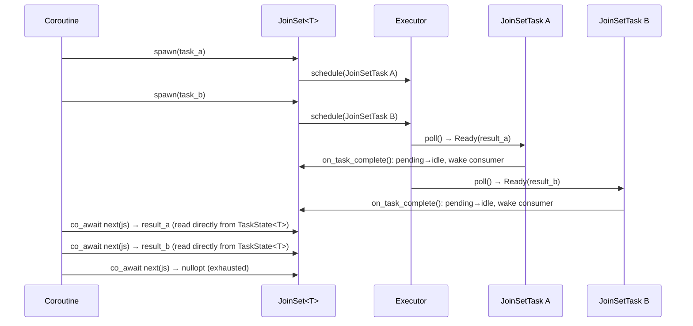

# JoinSet

`JoinSet<T>` is a structured-concurrency primitive that lets a coroutine spawn multiple
homogeneous child tasks and collect their results as they complete.



## Motivation

`JoinSet` makes the child-task lifecycle **explicit** and gives the user full control:

- Consume results one-by-one as they complete (`next()`)
- Wait for all to finish and discard results (`drain()`)
- Cancel remaining tasks by dropping the `JoinSet`
- Compose with `select` for heterogeneous result types via multiple `JoinSet`s

## API

```cpp
// Non-void T: spawn, stream results, or drain
JoinSet<int> js;
js.spawn(compute(1));
js.spawn(compute(2));
js.spawn(compute(3));

// Option A: consume results in completion order
while (auto result = co_await next(js))
    use(*result);

// Option B: drain and discard results (first exception rethrown)
co_await js.drain();

// Void tasks: spawn and drain only
JoinSet<void> js2;
js2.spawn(fire_and_forget_a());
js2.spawn(fire_and_forget_b());
co_await js2.drain();
```

`JoinSet<T>` (non-void) satisfies `Stream<T>` and composes with `select`:

```cpp
JoinSet<int>    int_tasks;
JoinSet<string> str_tasks;
// ...spawn into each...
co_await select(next(int_tasks), next(str_tasks));
```

## Cancel on drop

Dropping a `JoinSet` (without calling `drain()`) cancels all pending child tasks.
The executor's owned list keeps each cancelled task alive until it drains to a terminal
state. On shutdown, the executor-level drain ensures all tasks complete before
`block_on` returns.

```cpp
co_await co_invoke([&data]() -> Coro<void> {
    JoinSet<void> js;
    for (auto& item : data)
        js.spawn(process(item));
    if (error_condition)
        co_return;  // js dropped here → tasks cancelled → scope drains before return
    co_await js.drain();
});
```

## Exception handling

- `next()`: an exception from a completed task is rethrown when that result is dequeued.
- `drain()`: waits for all tasks to finish, then rethrows the first exception encountered.
- In both cases, remaining tasks continue running and are only cancelled when `JoinSet`
  is dropped.
- `drain_or_cancel()`: on the first exception, cancels the remaining tasks, waits for
  them to finish, then rethrows (below).

## Cancelling without dropping: `cancel_all()` and `drain_or_cancel()`

Dropping the set cancels its tasks but stops tracking them; the enclosing coroutine
scope is left to wait for them. That is too late when the tasks borrow something that
lives next to the set, in the same frame or the same future, rather than in an outer
frame. Two additions cancel while the set keeps tracking:

```cpp
js.cancel_all();                // like tokio's abort_all(): each pending task is cancelled
                                // but stays in the set and still reports when it finishes

co_await js.drain_or_cancel();  // drain(); but on the first exception, cancel_all(),
                                // wait for every task to finish, then rethrow it
```

`drain_or_cancel()` is for tasks that depend on each other, where one failing leaves the
others waiting for it: parts of a computation that meet at a [barrier](barrier.md), or a
producer and its consumers. `drain()` would wait on them forever.

Both futures are the existing `JoinSetDrainFuture<T>` with a mode parameter:

```cpp
enum class DrainMode { All, CancelOnError };
template<typename T, DrainMode Mode = DrainMode::All>
class JoinSetDrainFuture;
```

- **`cancel_all()`** calls `cancel_task()` on each pending task under the set's mutex but,
  unlike `cancel_pending()`, leaves `Node::task` set. A cancelled task's
  `on_task_complete()` still runs at its terminal exit (`mark_done`) and moves it to
  `idle_handles`, so `next()` and the drain futures see it finish. Calling it twice
  cancels nothing new.
- **`CancelOnError`**: when a sweep of `idle_handles` finds the first exception, the
  future calls `cancel_all()` and goes on draining. It returns the exception once
  `pending_handles` is empty. Cancelled tasks carry no exception, so later sweeps find
  only exceptions from tasks that failed on their own; they are dropped, as in `drain()`.
- **Cancellable.** The `CancelOnError` future also has `cancel()`, so a coroutine or
  combinator that drops it follows the [cancellation protocol](coroutine_scope.md#step-1-drain-or-drop-the-awaited-future):
  `cancel()` calls `cancel_all()`, and later polls return pending until every task has
  finished, then `PollDropped`. `parallel()` relies on this.

!!! danger "WARNING: `cancel_all()` waits for nothing"
    It only asks. The tasks finish at their next poll, on whatever worker, and
    anything they reference must outlive that. Await `drain()` (or the drain future's
    `PollDropped`) before releasing it.

## Internal design

### Allocation model

Each `spawn()` call creates a single `JoinSetTask<F>` via `make_shared`. `JoinSetTask<F>`
inherits `TaskImpl<F>`, which in turn inherits both `TaskBase` (executor interface / waker)
and `TaskState<T>` (result, exception, cancellation flag). One allocation therefore covers:

- The executor-facing `TaskBase` interface
- The result-holding `TaskState<T>` subobject
- The `JoinSet` tracking data (`weak_ptr<JoinSetSharedState<T>>`)
- The user's future `F`

No separate handle wrapper is needed.

### Shared state

`JoinSetSharedState<T>` (internal, `detail/`) is shared between the `JoinSet`, every
live `JoinSetTask`, and any live `JoinSetDrainFuture` via `shared_ptr`. It holds:

| Field | Type | Description |
|---|---|---|
| `pending_handles` | intrusive list of `JoinSetTask*` | Non-owning; O(1) removal when task completes. Executor's owned list is the lifetime anchor. |
| `idle_handles` | `list<shared_ptr<TaskState<T>>>` | Completed tasks awaiting consumption; aliased into the same allocation as the corresponding `TaskBase` |
| `consumer_waker` | `shared_ptr<Waker>` | Wakes the `next()`/`drain()` consumer when a task completes |
| `mutex` | `std::mutex` | Protects all fields |

### Task lifecycle

`JoinSetTask<F>` overrides `on_task_complete()`, which `TaskImpl<F>::poll()` calls at
every terminal exit (after `setResult`, `setException`, or `mark_done`). The override:

1. Locks `JoinSetSharedState::mutex`.
2. Erases `self` from `pending_handles`.
3. Pushes an aliased `shared_ptr<TaskState<T>>` (same allocation, `TaskState<T>*`
   stored pointer) onto `idle_handles`.
4. Steals `consumer_waker` while still under the lock.
5. Releases the lock, then calls `waker->wake()`.

`JoinSet::poll_next()` pops from `idle_handles` and reads the result directly from
`TaskState<T>` under its own mutex — the same logic used by `JoinHandle::poll()`. No
result copy into an intermediate queue is needed.

```
After spawn(A), spawn(B), spawn(C):
  pending_handles: {A, B, C}
  idle_handles:    []

After B completes (on_task_complete() moves B):
  pending_handles: {A, C}
  idle_handles:    [B]          ← B's TaskState<T> is readable; no extra allocation

After poll_next() consumes B:
  pending_handles: {A, C}
  idle_handles:    []           ← B's allocation freed when shared_ptr<TaskState<T>> drops
```

The `JoinSetTask` uses a `weak_ptr<JoinSetSharedState<T>>` to avoid a reference cycle:
`JoinSetSharedState::pending_handles` → `TaskBase` → `(weak)` → `JoinSetSharedState`.
When the `JoinSet` is destroyed, `lock()` returns null and `on_task_complete()` is a
silent no-op; the executor's temporary strong reference keeps the task alive through the
remainder of `poll()`.

### Cancellation flow

When `JoinSet` is dropped, `cancel_pending()`:

1. Iterates `pending_handles` (intrusive list of raw `JoinSetTask*` pointers) under
   the mutex and calls `cancel_task()` on each, setting `cancelled = true` and enqueuing
   the task so the executor sees the flag on its next poll.
2. Clears `pending_handles`.

The executor's owned list keeps every task alive through this process — no strong refs
need to be collected first. No ownership transfer to a `CoroutineScope` is needed: the
executor-level drain on shutdown ensures all cancelled tasks reach a terminal state
before `block_on` returns.

### Stream<T> satisfaction

`JoinSet<T>` (non-void) exposes `ItemType = T` and `poll_next()`, satisfying `Stream<T>`.
The existing `next()` free function and all stream combinators work without modification.
`JoinSet<void>` does not satisfy `Stream` (no `ItemType`); only `drain()` is provided.
