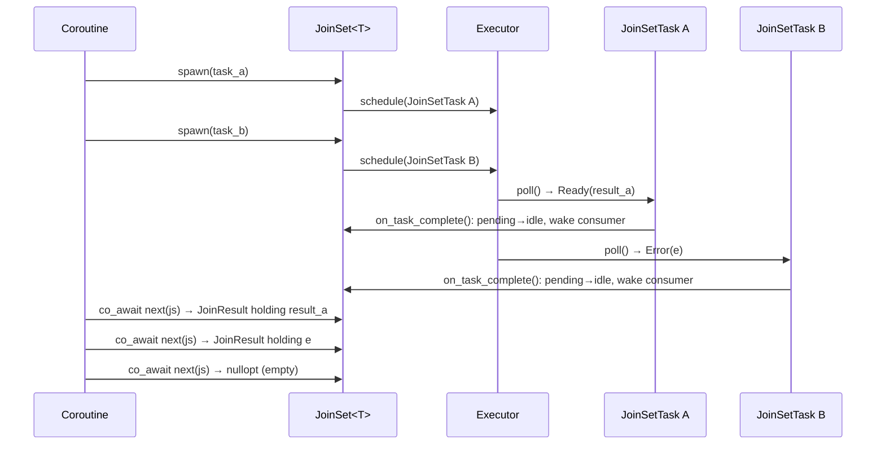

# JoinSet

`JoinSet<T, Tag>` is a structured-concurrency primitive that lets a coroutine spawn many
homogeneous child tasks and collect how each one ended, in completion order.



## Motivation

`JoinSet` makes the child-task lifecycle **explicit** and gives the user full control:

- Consume outcomes one by one as tasks finish (`next()`)
- Collect them all at once (`join_all()`), or wait and keep only the first failure (`drain()`)
- Cancel the tasks and wait for them (`shutdown()`), or drop the set to cancel them
- Cancel a single task through the `CancelHandle` that `spawn()` returns
- Compose with `select` for heterogeneous result types via multiple `JoinSet`s

## API

```cpp
JoinSet<int> js;
js.spawn(compute(1));
js.spawn(compute(2));

// A: one outcome at a time, in completion order
while (auto r = co_await next(js))
    total += r->value();            // rethrows that task's exception

// B: every outcome at once, in completion order; never throws
for (auto& r : co_await js.join_all())
    if (r.has_value()) total += r.value();

// C: wait for every task, then rethrow the first failure
co_await js.drain();

// D: cancel every task, wait for them, ignore the outcomes
co_await js.shutdown();
```

The set is a `Stream` of `JoinResult<T, Tag>`, for `void` tasks too, so it composes
with `select`:

```cpp
JoinSet<int>    int_tasks;
JoinSet<string> str_tasks;
// ...spawn into each...
co_await select(next(int_tasks), next(str_tasks));
```

`next()` yields `nullopt` only when no task is pending or unconsumed. That is not
permanent: after another `spawn()` the set yields again. An empty set's `next()` is
ready at once, so in a `select()` loop guard it with
`coro::when(!js.empty(), [&]{ return next(js); })`.

### `JoinResult`

Each task's outcome is exactly one of a value, an exception, or cancelled:

| Member | Meaning |
|---|---|
| `has_value()` | The task returned (for `void`, returned normally). |
| `exception()` | The task's exception, or null. |
| `is_cancelled()` | The task was cancelled before it produced a result. |
| `value()` | The value; rethrows the task's exception, or throws `JoinCancelled`. Never undefined behaviour. |
| `tag()` | The tag the task was spawned with (tagged sets only). |

`JoinCancelled` derives from `std::exception` and is unrelated to `TaskCancelled`. To the
parent a missing result is an ordinary error, not its own cancellation: a
`TaskCancelled` escaping the parent would cancel the parent itself. It carries nothing;
a caller who needs to know which task it was checks `is_cancelled()` before `value()`,
and reads `tag()` there.

### Tags

A `JoinSet<T, Tag>` with `Tag` other than `void` requires a tag at every spawn, and
returns it in that task's `JoinResult`, however the task ended:

```cpp
JoinSet<Reply, int> calls;
for (int id : ids)
    calls.spawn(id, request(id));
while (auto r = co_await next(calls)) {
    if (r->is_cancelled()) log("call {} cancelled", r->tag());
    else                   handle(r->tag(), r->value());
}
```

A tag is the caller's own data, an id or a category. The set only stores it: it never
looks a task up by tag, so tags need not be unique, and there is no cancel by tag. Keep
the `CancelHandle` for that. `build_task(tag, f)` is the tagged form of `build_task(f)`.

### Bulk operations

`join_all()`, `drain()` and `shutdown()` run the `next()` loop inside the set, so the
awaiter is resumed once rather than once per task.

| Operation | Hands back | Throws | On a failure |
|---|---|---|---|
| `next(js)` | one `JoinResult` | never | — |
| `join_all(OnError = Cancel)` | every `JoinResult`, in completion order | never | per `OnError` |
| `join_all(C into, OnError)` | as above, into `into` | never | per `OnError` |
| `drain(OnError = Cancel)` | nothing | the first failure | per `OnError` |
| `shutdown()` | nothing | never | — (cancels everything at its first poll) |
| `cancel_all()` | nothing | never | — (cancels; waits for nothing) |

The rule: an operation that hands back outcomes never throws them; one that hands back
none throws the first failure.

- **`OnError::Cancel`,** the default, cancels the remaining tasks at the first failure,
  an exception or a task that ended cancelled. They then end as cancelled, unless they
  finish first. The tasks of one set often wait on each other, parts of a computation
  that meet at a [barrier](barrier.md) or a producer and its consumers, and with one
  failed the rest may never finish on their own.
- **`OnError::Wait`** lets every task run to its own end: independent connections, say,
  where one failing says nothing about the others.
- **`drain()`** rethrows the first failure in completion order: a task's exception, or
  `JoinCancelled` for a cancelled task. Later failures are dropped.
- **`join_all()`** returns a `std::vector<JoinResult>` by default. `join_all<C>()` and
  `join_all(C into)` fill any movable container with `emplace_back()`, such as a
  `std::deque`, a `std::list` or one reserved ahead.
- **`shutdown()`** cancels every task, waits for them all and ignores their outcomes.
  Tasks spawned after its first poll aren't cancelled, but are waited for.

Every bulk operation waits for every task, so the set is empty and reusable afterwards.

The three futures are `Cancellable`: cancelled, a bulk future cancels every task, waits
for them all, discards their outcomes, and ends with `PollDropped`. A coroutine or
combinator that drops one therefore follows the
[cancellation protocol](coroutine_scope.md#step-1-drain-or-drop-the-awaited-future)
without leaving tasks running. `parallel()` relies on this.

### Cancelling

There are four ways to cancel, by how much the caller still wants to know:

- **One task:** `spawn()` returns a [`CancelHandle`](task_ownership.md#cancelhandle).
  `cancel()` asks that task to stop. It stays in the set and is reported as usual,
  cancelled unless it finished first. Ignoring the handle is fine: dropping it never
  cancels.
- **Every task, and wait:** `co_await js.shutdown()`.
- **Every task, without waiting:** `js.cancel_all()`, like Tokio's `abort_all()`. The
  tasks stay in the set and still report when they finish.
- **Drop the set:** every pending task is cancelled, and the set stops tracking them.
  Their outcomes are discarded. Inside a coroutine each is registered with the
  enclosing [scope](coroutine_scope.md), so the parent waits for them before it
  completes; outside one, the executor's drain at shutdown waits for them before
  `block_on` returns.

```cpp
co_await co_invoke([&data]() -> Coro<void> {
    JoinSet<void> js;
    for (auto& item : data)
        js.spawn(process(item));
    if (error_condition)
        co_return;  // js dropped here → tasks cancelled → scope waits before return
    co_await js.drain();
});
```

Dropping waits too late when the tasks borrow something that lives next to the set, in
the same frame or the same future, rather than in an outer frame: by the time the scope
waits, that has already been destroyed. Await `shutdown()` or `drain()` first.

!!! danger "WARNING: `cancel_all()` and `CancelHandle::cancel()` wait for nothing"
    They only ask. A task finishes at its next poll, on whatever worker, and anything
    it references must outlive that. Await `shutdown()` or `drain()` (or a bulk
    future's `PollDropped`) before releasing it.

### A task's frame is gone before its outcome is seen

A task's future, and the coroutine frame it holds, is destroyed before the task reports
its completion to the set. So once `next()` has yielded a task's outcome, or a bulk
operation has completed, the task's locals have been destroyed and nothing it ran still
references what it borrowed. This is what lets a drained set guard a borrowed object,
and what lets [`parallel()`](parallel.md#errors) see a part's own error before the
`TeamBroken` its destroyed member causes in the others.

## Internal design

### Allocation model

Each `spawn()` call creates a single `JoinSetTask<F, Tag>` via `make_shared`.
`JoinSetTask<F, Tag>` inherits `TaskImpl<F>`, which in turn inherits both `TaskBase`
(executor interface / waker) and `TaskState<T>` (result, exception, cancellation flag).
One allocation therefore covers:

- The executor-facing `TaskBase` interface
- The result-holding `TaskState<T>` subobject
- The `Node` that links the task into the set, and holds its tag
- The `JoinSet` tracking data (`weak_ptr<JoinSetSharedState<T, Tag>>`)
- The user's future `F`

No separate handle wrapper is needed. The tag lives in the task's `Node`, not in its
future, so a task cancelled before it ran, whose future was never polled, still has it.

### Shared state

`JoinSetSharedState<T, Tag>` (internal, `detail/`) is shared between the `JoinSet`, every
live `JoinSetTask`, and any live bulk future via `shared_ptr`. It holds:

| Field | Type | Description |
|---|---|---|
| `pending_handles` | intrusive list of `Node*` | Running tasks. Non-owning; O(1) removal when a task completes. The executor's owned list is the lifetime anchor. |
| `idle_handles` | intrusive list of `Node*` | Completed tasks awaiting consumption. Each `Node` holds `completed`, the task's `shared_ptr<TaskState<T>>` to itself, which keeps it alive until it is consumed. |
| `consumer_waker` | `shared_ptr<Waker>` | Wakes the `next()` or bulk-future consumer when a task completes |
| `mutex` | `Mutex` | Protects all fields |

Each `Node` holds:

| Field | Description |
|---|---|
| `task` | Raw `TaskBase*` while the task is pending; null once it has completed, or once the dropped set has released it. |
| `completed` | Set only while the node is in `idle_handles`. Moved out when the node is consumed, and released outside the mutex, since that may destroy the task. |
| `next`, `prev` | The intrusive links. |
| `tag` | The task's tag; empty (`[[no_unique_address]]`) for an untagged set. |

### Task lifecycle

`JoinSetTask<F, Tag>` overrides `on_task_complete()`, which `TaskImpl<F>::poll()` calls at
every terminal exit, after it has destroyed the future and stored the result, the
exception, or the cancelled state. The override:

1. Locks `JoinSetSharedState::mutex`. If the node's `task` is already null, the set
   has been dropped: the outcome is discarded.
2. Erases the node from `pending_handles` and clears its `task`.
3. Stores an aliased `shared_ptr<TaskState<T>>` (same allocation, `TaskState<T>*`
   stored pointer) in the node's `completed`, and pushes the node onto `idle_handles`.
4. Steals `consumer_waker` while still under the lock.
5. Releases the lock, then calls `waker->wake()`.

`JoinSet::poll_next()` pops a node from `idle_handles` and, outside the lock, builds the
`JoinResult` from the task's `TaskState<T>` and the node's tag (`take_result()`). It
needs no lock on the task's own mutex: the task wrote its result before pushing the node
under the set's mutex, and the consumer popped it under that same mutex, which orders
the write before the reads. No result is copied into an intermediate queue.

```
After spawn(A), spawn(B), spawn(C):
  pending_handles: {A, B, C}
  idle_handles:    []

After B completes (on_task_complete() moves B):
  pending_handles: {A, C}
  idle_handles:    [B]          ← B's TaskState<T> is readable; no extra allocation

After poll_next() consumes B:
  pending_handles: {A, C}
  idle_handles:    []           ← B's allocation freed when its completed reference drops
```

The `JoinSetTask` uses a `weak_ptr<JoinSetSharedState<T, Tag>>` to avoid a reference
cycle: `JoinSetSharedState::idle_handles` → task → `(weak)` → `JoinSetSharedState`.
When the `JoinSet` is destroyed, `lock()` returns null and `on_task_complete()` is a
silent no-op; the executor's temporary strong reference keeps the task alive through the
remainder of `poll()`. The shared state's destructor releases any completed tasks nobody
consumed, since each refers to itself while it is in `idle_handles`.

### Bulk futures

`join_all()`, `drain()` and `shutdown()` all return one class template,
`JoinSetBulkFuture<T, Tag, Collector>`, differing only in what the collector does with
each outcome:

| Collector | Used by | Keeps | Result |
|---|---|---|---|
| `JoinAllCollector<C>` | `join_all()` | every `JoinResult`, in `C` | `C` |
| `DrainCollector` | `drain()` | the first failure | ready, or that failure as an error |
| `ShutdownCollector` | `shutdown()` | nothing; cancels every task at the first poll | ready |

Each poll moves the whole of `idle_handles` out under the lock, then, outside it, hands
each task's `JoinResult` to the collector. With `OnError::Cancel`, the first failure
cancels every pending task (`join_set_cancel_all()`, at most once per future). The
future stays pending while any task is pending, and re-checks both lists under the lock
before completing, since a task may finish between the sweep and the check. Then it
returns what the collector made of the outcomes.

`cancel()` cancels every pending task and marks the future dropped: later outcomes are
discarded rather than collected, and once every task has finished the future returns
`PollDropped`.

`DrainCollector` also takes an internal predicate, `set_ranks_last()`: an exception it
matches gives way to a later one that it doesn't. `parallel()` uses it to report a
part's own error ahead of the `TeamBroken` that error causes in the other parts.

### Cancellation flow

Two internal paths cancel pending tasks. Both collect strong references under the
mutex, then call `cancel_task()` on each outside it. `cancel_task()` is the task's own:
it sets the cancelled flag and wakes the task, and never touches the set's mutex. A task
that has already finished ignores both. The references must be taken under the lock:
once it is released, a task may finish, be erased from the executor's owned list, and
be destroyed.

- **`join_set_cancel_all()`**, behind `cancel_all()`, `shutdown()`, `OnError::Cancel`
  and a bulk future's `cancel()`, leaves each node in `pending_handles` with its `task`
  set. A cancelled task's `on_task_complete()` still runs at its terminal exit and moves
  it to `idle_handles`, so `next()` and the bulk futures see it finish. Calling it twice
  cancels nothing new.
- **`cancel_pending()`**, run when the `JoinSet` is destroyed or move-assigned over,
  empties `pending_handles` and clears each node's `task`, the sentinel that tells
  `on_task_complete()` to discard the outcome. Inside a coroutine it registers each
  cancelled task with the enclosing scope as a `weak_ptr`.

The executor's owned list keeps every task alive until it reaches a terminal state. On
shutdown, the executor-level drain ensures every cancelled task does so before
`block_on` returns.

A `CancelHandle` from `spawn()` reaches the task through a `weak_ptr<TaskBase>` and calls
the same `cancel_task()`, so it touches neither the set nor its mutex.

### `Stream` satisfaction

`JoinSet<T, Tag>` exposes `ItemType = JoinResult<T, Tag>` and a `poll_next()` that
returns `optional<JoinResult>`, for every `T` including `void`. It never returns an error
or `PollDropped`: a task's failure is part of its result, not a failure of the stream.
The `next()` free function and all stream combinators work without modification.
