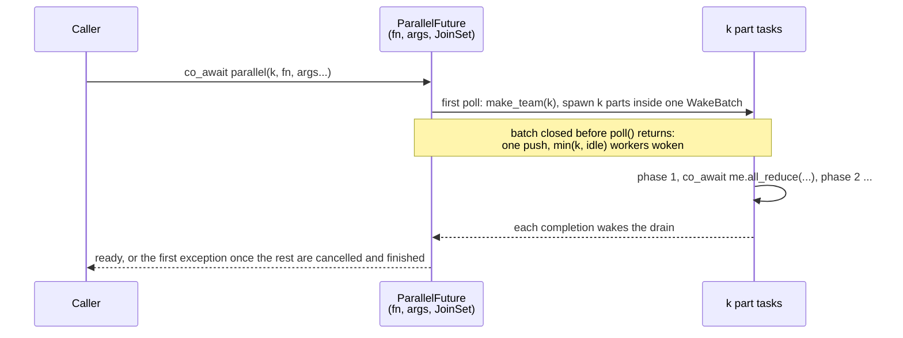

# parallel()

`coro::parallel()` splits a computation into `k` parts, runs them as tasks across the
runtime's workers, and completes when every part has finished. Each part receives its
member of a [team](team.md) of `k`: its rank, its share of the work, and collectives that
wait for or combine values with the other parts. So a computation with several phases
keeps the same tasks for all of them.

```cpp
#include <coro/task/parallel.h>

// Each part filters its share of the rows, learns how many rows all of them kept, then
// reads what all of them wrote.
coro::Coro<void> filter_part(coro::TeamMember me, Table& table, Out& out) {
    const auto [begin, end] = me.range(table.rows());
    const std::size_t kept  = filter_rows(table, begin, end);
    const std::size_t total = co_await me.all_reduce(kept);   // every part has filtered
    reduce_rows(table, out, total, begin, end);
}

co_await coro::parallel(coro::worker_count(), filter_part, std::ref(table), std::ref(out));
```

---

## Motivation

coro's tasks are cheap to start and to wake: a push to a run queue, against a futex
wake and a context switch for a thread. That makes the runtime's workers a reasonable place to
run a short data-parallel computation, one that takes tens of microseconds per part, when
the alternative is a second thread pool (OpenMP, a task system) that competes with the
runtime's workers for cores and whose parallel region blocks the coroutine that starts it.

The pieces exist: `JoinSet` spawns the parts and a `Team` keeps them in step.
`parallel()` puts them together so that each use doesn't have to get the cancellation, the
exception handling and the wake-up right again:

- the parts start on as many workers as are idle at once, not one by one
  ([`WakeBatch`](work_stealing_executor.md#batched-wakes-wakebatch));
- a part that throws cancels the others, and the exception it threw is the one reported,
  not the `TeamBroken` it causes in the parts waiting for it;
- the data the parts borrow outlives them on every path, including cancellation of the
  caller.

!!! note "Not a replacement for a compute pool"
    A part runs inside a task poll, holding its worker. That's fine for parts that take
    microseconds to a few milliseconds, and with at least one more worker than parts that
    are running long, so the I/O driver and other tasks keep a worker. Work that runs for
    tens of milliseconds per call belongs in `spawn_blocking()` (see
    [BL.5](../guidelines.md#bl5-keep-long-computations-off-a-runtime-that-serves-latency-sensitive-tasks)).

---

## API

```cpp
namespace coro {

/// Runs fn(member, args...) for k parts, each as its own task. Completes when all have
/// finished; rethrows the first exception after cancelling the rest.
template<typename F, typename... Args>
    requires (std::invocable<F&, TeamMember, Args&...> && /* returns a Future<void> */ ...)
[[nodiscard]] ParallelFuture<F, Args...> parallel(std::size_t k, F fn, Args... args);

/// Worker threads of the current runtime: 1 on CurrentThreadExecutor and Pico.
std::size_t worker_count();

} // namespace coro
```

`Runtime::worker_count()` is added alongside the free function, for code outside the
runtime that sizes `k` before calling `block_on()`.

A part's `TeamMember` gives `rank()` (0 .. `k - 1`), `size()` (`k`), `range(n)` (its even
share of `n` items) and the collectives: `sync()`, `all_reduce()`, `broadcast()`,
`all_gather()`, the scans and the rest. See [Team: API](team.md#api).

### Arguments

- **`fn` is a function or a lambda returning a future**, normally `Coro<void>`, whose
  first parameter is a `TeamMember` taken by value.
- **A capturing lambda coroutine is safe as `fn`**, though invoking one directly isn't
  ([CS.3](../guidelines.md#cs3-never-invoke-a-capturing-lambda-coroutine-directly-use-co_invoke)).
  Each part's frame points at the lambda object, and `ParallelFuture` gives it the
  two guarantees `co_invoke` gives: it holds `fn` until every part has finished, on
  every path (see [Design](#design)), and it isn't moved once the parts have started
  (moving it after the first poll is a checked bug). All `k` parts share that one
  object, so a capture is shared like an `args` reference: parts that write to the
  same capture race. `[&]` capturing the caller's locals is the common case, and is
  as safe as passing them with `std::ref`, since the caller is suspended in the
  `co_await` until every part has finished.
- **The member is move-only, and belongs in the part's frame.** Its destructor tells
  the other parts that this one has ended (see
  [Team: Passing a member](team.md#passing-a-member)). A coroutine that takes it by value
  keeps it for as long as the part runs. That is the supported pattern: an `fn` that
  keeps the member some other way isn't stopped, but its lifetime is then the caller's
  to get right.
- **`args` are stored once, in the `ParallelFuture`,** and every part receives them as
  lvalue references (`Args&`). A part that takes a parameter by value gets its own copy; one
  that takes it by reference shares the stored one. To share the caller's object instead
  of a copy, pass `std::ref(x)` or a pointer, as with `std::thread`.
- **`k >= 1`.** `k` larger than the worker count is allowed: the parts interleave at
  each collective. Pass `worker_count()` for one part per worker.

### Errors

The first exception is rethrown once every part has finished. A part that throws ends,
and destroying its member breaks the team, so the parts waiting in a collective fail
with `TeamBroken`, and the parts it cancels end with `JoinCancelled`. The `JoinSet` may
see one of those first. `parallel()` reports the first error that is none of
`TeamBroken`, `TeamRoundBroken` and `JoinCancelled`, and one of those only if nothing
else failed. A `TeamUsageError` is reported like any other error.

A part's exception is recorded before its frame, and the member in it, are destroyed,
so the part's own error always reaches the drain first. An `fn` that isn't a coroutine
and drops the member instead of passing it into the future it returns breaks the team
at once. `TeamBroken` is then the right report: it points at that bug.

---

## Design

`ParallelFuture` is a hand-written future that lives in the caller's frame, like any
awaited future. It is a `JoinSet<void>` and its `drain()` future, which cancels the
other parts at the first failure (see [JoinSet](join_set.md#bulk-operations)), with
`fn` and `args` stored alongside:

```cpp
template<typename F, typename... Args>
class ParallelFuture {
    std::size_t                 m_k;
    F                           m_fn;
    std::tuple<Args...>         m_args;
    JoinSet<void>               m_set;
    std::optional<detail::JoinSetDrainFuture<void, void>> m_drain;
    std::exception_ptr          m_spawn_error;   // from starting a part
};
```



- **First poll.** Create the drain, then `make_team(k)` and spawn the `k` parts, each
  given its member and named `"parallel[i]"` for traces, inside a `WakeBatch` that is a
  stack local of `poll()`. Then poll the drain. The constructor does nothing, as for every
  coro future. The team's state is reference-counted, so `ParallelFuture` holds none of
  it: the members are the team.
- **Later polls** forward to the drain.
- **First exception.** The drain cancels the other parts, including those suspended in
  a collective, and stays pending until every part has finished. Only then does it
  return the exception, and only then can the caller's frame destroy the future with
  the args. The parts waiting in a collective would fail with `TeamBroken` regardless;
  the cancel stops the ones still computing between collectives. Choosing which error
  to report is a predicate the drain is given, `set_ranks_last()` (see [Errors](#errors)).
- **A part fails to start** (`fn` or a spawn throws). The members not yet handed out are
  destroyed, which breaks the team for the parts already running, and those are
  cancelled. The drain still ends in ready or an error, and `poll()` reports the start
  failure ahead of anything else.
- **The caller is cancelled.** `ParallelFuture` is `Cancellable`: `cancel()` forwards to the
  drain's `cancel()`, and polls return pending until every part has finished, then
  `PollDropped`. The caller's coroutine does not destroy an awaited `Cancellable` future
  before that ([Coroutine Frame Lifetime](coroutine_scope.md)), and every combinator
  follows the same rule, so the args outlive the parts on this path too.
- **Destroyed with parts running anyway** (a caller that breaks the protocol): the
  `JoinSet` destructor cancels them, but they may still be running against the args
  destroyed with the future. This is a bug, caught by a debug assertion.
- **Moved after its first poll.** The parts point at the args, so this is a bug too,
  caught by a debug assertion. Before the first poll a move is fine.

The call itself allocates nothing; each part allocates its `JoinSet` task and its
coroutine frame, and `make_team()` the team's shared state. That is paid once per call,
not once per phase.

### The caller's worker

After the spawn the caller suspends on the drain and its worker is free; it takes a
part from the injection queue in its own Step 2. With `k = worker_count()` and every other
worker idle, the batch wakes `k` workers for `k` parts, one more than needed; the spare
finds nothing and parks again. See [Open questions](#open-questions) for running part 0
in the caller instead.

### Executors

- **`WorkStealingExecutor`**: the parts spread over the workers as above.
- **`CurrentThreadExecutor`**: the parts run one after another on the one thread up to
  each collective, then through the next phase, and so on. The result is the same; there
  is no speed-up, and no hazard beyond the parts holding the thread for as long as they
  compute.
- **`WorkSharingExecutor`**: works; the `WakeBatch` does nothing there.
- **Pico**: not what `parallel()` is for, since one core gains nothing from splitting
  work, and each call allocates a task per part and the team's state. It works as on
  `CurrentThreadExecutor`, though, and supporting it takes no code of its own, so nothing
  stops its use there.

!!! tip "PERF: one launch per computation, not per phase"
    Spawning and joining costs a wake-up per part. A computation with several phases
    should use one `parallel()` call with a collective between phases rather than one call
    per phase: a round costs at most one wake-up per part, but the spawn, the join and
    the task allocations happen only once.

!!! tip "TODO: parts that return a value, and `parallel_reduce()`"
    Let `fn` return a future of `T`, with a `parallel()` that gives back the parts'
    results as a `std::vector<T>` in rank order, and a `parallel_reduce(k, op, fn, args...)`
    that combines them into one `T`, as TBB and Kokkos name it. This needs no
    [`Team`](team.md) collective: a part that has returned has nothing left to wait for,
    so there are no rounds, wakes or cancellation rules. Each result goes into a slot,
    by rank, owned by the `ParallelFuture`, which outlives every part. The first version
    folds the slots in `poll()` once every part is done. If an expensive `op` shows up in
    traces, each part can instead combine whatever its result makes ready as it finishes,
    and return rather than wait when nothing is. Either way the fold uses the same fixed
    tree as `Team`, from a shared `detail::` helper, so a floating-point `parallel_reduce`
    gives the same result as an `all_reduce` of the same values.

---

## Placement

`include/coro/task/parallel.h`, under `task/` with `JoinSet` and `spawn_blocking()`, since
it spawns tasks (see [Module Structure](module_structure.md)). `worker_count()` goes in
`runtime/runtime.h`.

---

## Tests

`test/task/test_parallel.cpp`, on every executor unless noted:

- Every rank from 0 to `k - 1` runs exactly once, and `size()` is `k`. `range()` is
  tested with `Team` ([Team: Tests](team.md#tests)).
- `k = worker_count()` runs that many parts.
- Two phases separated by `sync()`: no part starts phase two before every part has finished
  phase one.
- Collectives through the member each part receives: `all_reduce`, `exclusive_scan`,
  `broadcast` and `any` give the right results.
- Args: a value argument is copied once into the call, not once per part; `std::ref`
  reaches the caller's object.
- A part that throws before a collective: `parallel()` rethrows it, the other parts are
  cancelled (not left waiting), and their destructors have run before the rethrow.
- A part that throws while the others wait for it: `parallel()` reports that exception,
  never `TeamBroken`, however the completions are ordered.
- Two parts that throw: one exception is rethrown.
- `fn` throws while the parts are being started: the parts already spawned are cancelled
  and that exception is rethrown.
- The caller cancelled while the parts run (the losing branch of a `select()`): every
  part is dropped before the caller resumes.
- Cancelled before its first poll: nothing is spawned.
- A `ParallelFuture` moved before its first poll works; nothing is spawned until then.
- On `WorkStealingExecutor` only, with `k = worker_count()`: every part has started on a
  different worker before any finishes.

`worker_count()` is tested in `test/runtime/test_runtime.cpp`: 1 on a single-threaded
runtime, `n` on `Runtime(n)` for both multi-threaded executors.

---

## Open questions

**Run part 0 in the caller.** It would save one task and one wake per call, and keep the
caller's worker busy instead of free. As a hand-written future this is cheap to add:
`ParallelFuture` holds part 0's future and polls it alongside the drain, and on the
drain's first exception it cancels part 0 as well and polls it to `PollDropped`. Part 0
then runs inside the caller's task poll and counts against the caller's budget. Worth
trying if traces show the extra wake matters.

**A synchronous `fn`.** Parts that never use a collective don't need to be coroutines.
Accepting an `fn` that returns `void` and wrapping it in a small hand-written future would
save one frame per part. Add it if a use without phases turns up.

**Name.** `parallel()` reads well at the call site but is generic. `fork_join()` or
`parallel_for()` are alternatives; `parallel_for` suggests a loop over items rather than
over parts.
