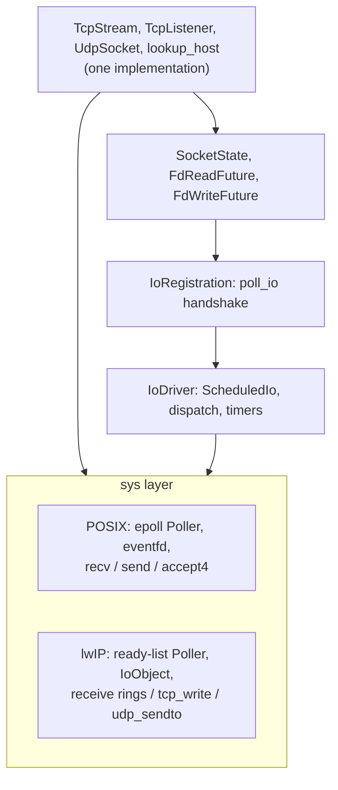
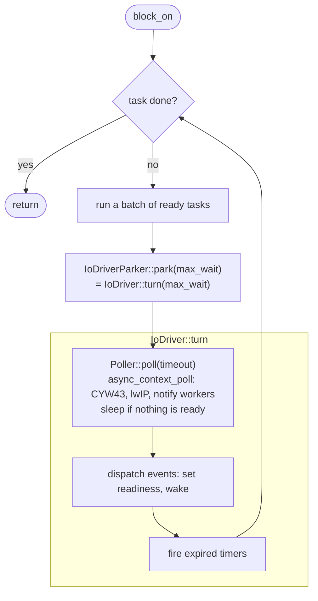
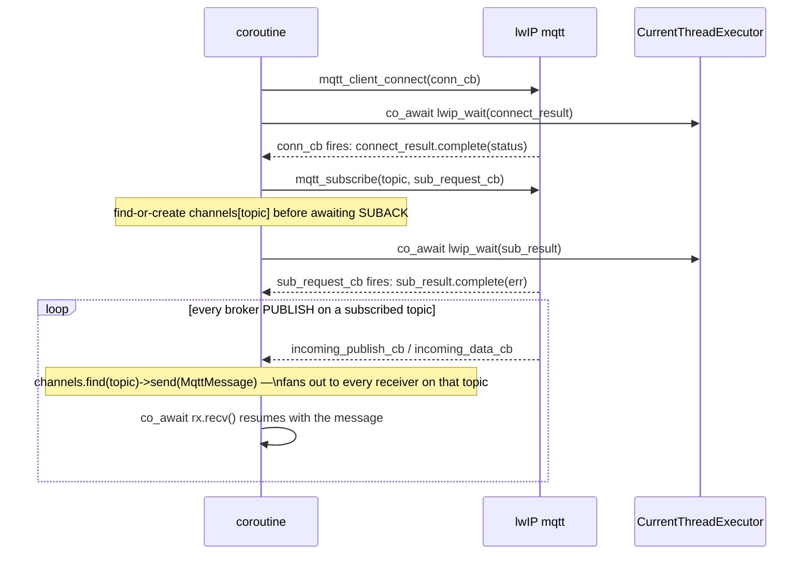
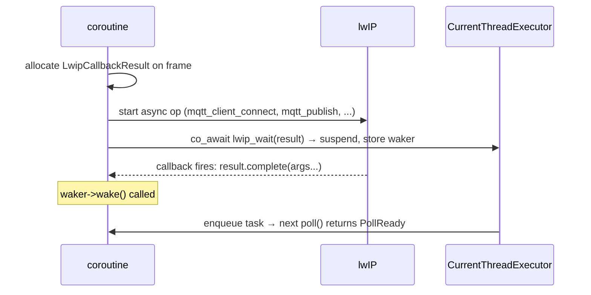

# Pico Port

The port of coro to the Raspberry Pi Pico W (RP2040/RP2350), on the Pico SDK in
`CYW43_ARCH_POLL` mode. It runs the same `Runtime`, `CurrentThreadExecutor`,
[`IoDriver`](io_driver.md) and socket types as the desktop build. What differs is
underneath the driver's `sys` layer: on a desktop the operating system's network stack
sits there, and on Pico lwIP does.

## Scope

| Included | Excluded |
|---|---|
| `Coro<T>`, `JoinHandle<T>`, `JoinSet<T>`, `spawn()` | `WorkStealingExecutor`, `WorkSharingExecutor` |
| `CurrentThreadExecutor` on the `IoDriver` | `spawn_blocking` and the blocking pool (no threads) |
| `TcpStream`, `TcpListener`, `UdpSocket` (lwIP `sys` backend) | `File`, `Pipe`, signals |
| `lookup_host` (lwIP DNS) | `WsStream`, `WsListener` |
| `sleep_for`, `timeout`, `IntervalTimer` (the driver's timer queue) | `blocking_wait`, `blocking_next` |
| `mpsc`, `oneshot`, `watch`, `broadcast`, `select`, `join`, fibers | |
| `IsrEvent`, `IsrChannel<T>`, `IsrSemaphore` | |
| Optional: `coro_pico_hal` (DMA, GPIO), `coro_pico_mqtt` | |

All coroutine machinery in `include/coro/detail/` and `include/coro/sync/` is portable
C++20/23 and compiles unchanged.

---

## Architecture

### Compile-time flags

| Flag | Effect |
|---|---|
| `CORO_PICO` | The single-threaded platform: no-op `detail::Mutex`, non-atomic `Rc`/`Weak`/`RelaxedState`, `PicoClock`, the ISR primitives, and the Pico `Runtime` constructor |
| `CORO_SYS_LWIP` | Selects the lwIP backend of the `sys` layer: `sys::RawFd` is an `IoObject*`, and `Poller`, `PollWaker` and the socket and DNS seams are implemented over lwIP |

`cmake/platforms/pico.cmake` sets both. The host-side tests build `CORO_SYS_LWIP`
against a host build of lwIP, so the lwIP backend is tested on the development machine
as well as on the board.

No public header depends on `CORO_SYS_LWIP`. `TcpStream`, `TcpListener` and `UdpSocket`
have one declaration and one implementation; only `src/detail/sys/lwip/` changes.

### Layering



The desktop and Pico builds differ only inside the `sys` box:

| Piece | Desktop (POSIX) | Pico (lwIP) |
|---|---|---|
| `sys::RawFd` | `int` file descriptor | `IoObject*` |
| Socket state | The kernel's | An `IoObject` subclass: the lwIP pcb, received data, error state |
| Readiness source | epoll | lwIP callbacks put the `IoObject` on the `Poller`'s ready list |
| Kernel event queue | The epoll instance | The Pico SDK's poll-mode `async_context` |
| Blocking wait in `Poller::poll()` | `ppoll()` on the epoll fd | `async_context_wait_for_work_until()` |
| `PollWaker` | An eventfd | A when-pending worker on the `async_context` |
| ISR → task | (none) | Each ISR primitive signals its notify fd, an `IoObject` with its own when-pending worker |
| Non-blocking operations | `recv`, `send`, `accept4`, ... | `src/detail/sys/lwip/*.cpp` over the lwIP raw API |
| Name resolution | `getaddrinfo` on the blocking pool | lwIP DNS, as a query registered with the driver |
| Who turns the driver | Executor threads | `CurrentThreadExecutor`, through `IoDriverParker` |

### The event loop

`Runtime::block_on()` runs `CurrentThreadExecutor`'s loop, the same loop as on a desktop
`Runtime(1)`:



`max_wait` is zero while a task is ready, so a busy loop turns the driver without
sleeping. When nothing is ready the driver's earliest timer bounds the wait, and the CPU
sleeps in `Poller::poll()` until a timer is due or a wake source reports work (see
[Wake sources](#wake-sources)). The loop is the desktop `CurrentThreadExecutor`'s,
step for step: ISR signals reach tasks from inside the turn, not from a separate step.

### `Runtime` on Pico

The Pico `Runtime` owns an `IoDriver` and a `CurrentThreadExecutor` whose parker turns
it, as a desktop `Runtime(1)` does. It has no blocking pool. `turns_io_driver()` is
true, so sockets and timers take the same paths as on a desktop.

Every Pico `Runtime` runs on a poll-mode `async_context` (`pico_async_context`): the
SDK's event queue, which plays the epoll instance's part. Its constructor takes a
`PicoNetwork`, which says where that context comes from and what runs on it. The
context and the `PicoNetwork` reach the driver as the backend's `sys::PollerOptions`:

| `PicoNetwork` | `async_context` | Runs on it | The application must first call |
|---|---|---|---|
| `Cyw43` (default) | The CYW43 driver's: `cyw43_arch_async_context()` | The CYW43 driver, lwIP's timers, coro's workers | `cyw43_arch_init()` |
| `Lwip` | The `Runtime`'s own, on which it calls `lwip_nosys_init()` | lwIP's timers, coro's workers | nothing |
| `None` | The `Runtime`'s own | coro's workers | nothing |

In every mode `Poller::poll()` also drains lwIP's loopback queue; see
[lwIP configuration](lwip_config.md#loopback).

An `async_context` belongs to the core that created it, and the SDK panics if it is
polled from another core. The `Runtime` must therefore be constructed and run on the
core that called `cyw43_arch_init()`.

`Runtime::shutdown()` drains the tasks, then calls `IoDriver::shutdown()`, as on
desktop. Destroying the `Runtime` withdraws its workers from the context; with `Lwip`
and `None` it then deinitialises its own context.

!!! danger "WARNING: destroy a `Cyw43` runtime before `cyw43_arch_deinit()`"
    With `PicoNetwork::Cyw43` the `Runtime`'s workers live on the CYW43 driver's
    `async_context`, which `cyw43_arch_deinit()` destroys. A `Runtime` still alive at
    that point withdraws its workers from a destroyed context when it is destroyed.
    Give the runtime a scope that ends before `cyw43_arch_deinit()` (see
    [Usage example](#usage-example)). The order mirrors construction:
    `cyw43_arch_init()`, then the `Runtime`; the `Runtime` gone, then
    `cyw43_arch_deinit()`.

**No network, no sockets.** A `PicoNetwork::None` runtime does not initialise or run
lwIP, so a socket could never complete, and creating one would call into an
uninitialised lwIP. Every `sys` function that creates a socket or a DNS query
(`tcp_connect_start()`, `tcp_listen()`, `udp_open()`, `dns_start()`) therefore checks
the backend's "lwIP is running" flag, which the `Poller` sets only for `Cyw43` and
`Lwip`, and fails with `ENETDOWN` before it touches lwIP. Like any other setup failure,
that reaches the caller as a `std::system_error` thrown at the `co_await` of
`TcpStream::connect()`, `TcpListener::bind()`, `UdpSocket::bind()` or `lookup_host()`.
Notify fds need no network, so the ISR primitives work in every mode.

**`Runtime::poll()`** is for firmware that keeps its own main loop instead of calling
`block_on()`. It runs one batch of ready tasks and then turns the driver with a zero
wait, so one call does everything a pass of `block_on()`'s loop does except sleep:

```cpp
coro::Runtime rt;
// ... spawn tasks ...
while (true) {
    rt.poll();
    // other firmware work
}
```

---

## The lwIP `sys` backend

### Why lwIP sits below `sys`

On a desktop, the kernel owns each socket: it buffers received data, tracks the
connection, and reports readiness through epoll. A task makes a non-blocking syscall and
waits for readiness only when the syscall would block. On Pico, lwIP does the kernel's
job, but its raw API is shaped differently: received data is pushed into a `recv`
callback as pbufs, and send-buffer space is announced by a `sent` callback.

The lwIP backend adapts that to the kernel's shape. Each socket is an `IoObject` that
holds what the kernel would hold (the pcb, the received data, the error state). lwIP's
callbacks update it and mark it ready, and the `sys` functions (`tcp_try_read`,
`udp_try_send`, ...) are "syscalls" on it that either complete or report `EAGAIN`.
Everything above `sys` is then the desktop code, unchanged.

lwIP's own sockets and netconn APIs are not an option: both require `NO_SYS=0`, an RTOS
with threads.

### `IoObject` and `RawFd`

```cpp
namespace coro::detail::sys {

/// The lwIP backend's analogue of an open file: one per socket or DNS query.
/// Touched only on the executor's thread.
struct IoObject {
    enum class Kind : uint8_t { Tcp, TcpListener, Udp, DnsQuery, Notify };

    // Bits of `flags`. The first four are readiness seen since the object was last
    // reported, set by lwIP callbacks; kQueued means it is on the Poller's ready list,
    // which keeps it there at most once.
    static constexpr uint8_t kReadable = 1u << 0;
    static constexpr uint8_t kWritable = 1u << 1;
    static constexpr uint8_t kError    = 1u << 2;
    static constexpr uint8_t kHup      = 1u << 3;
    static constexpr uint8_t kQueued   = 1u << 4;

    // Set by Poller::register_fd(): the ScheduledIo* reported in this object's Events.
    // Null while unregistered.
    void*     key        = nullptr;
    // The Poller's ready list.
    IoObject* next_ready = nullptr;
    // The Poller it is registered with, which lwIP callbacks report readiness to;
    // null while unregistered.
    Poller*   poller     = nullptr;
    Kind      kind;
    uint8_t   flags      = 0;
};

using RawFd = IoObject*;
inline constexpr RawFd kInvalidFd = nullptr;   // -1 on POSIX

}
```

`LwipTcp`, `LwipListener`, `LwipUdp`, `LwipDnsQuery` and `LwipNotify` derive from it. A `sys`
function casts its `RawFd` to the type it expects with `static_cast`, and debug builds
assert the `kind` first. `close_socket()` switches on `kind` to release the lwIP
resources, then deletes the object.

A pointer, not an integer: POSIX numbers its files because the number crosses the
boundary between user space and the kernel. Here there is no boundary, so the handle can
be the object itself, with no table to look it up in.

The flags share one byte rather than five `bool`s. With 32-bit pointers the base is
16 bytes instead of 20, every socket's object being that much smaller, and recording
readiness is a single OR of the callback's bits. One byte is one memory location, so
two threads must not write different bits of it without a common lock. That holds
because only the executor's thread touches an `IoObject`, and dual-core work (see
[Dual-core wakes](#dual-core-wakes)) must revisit it.

### `Poller`

The lwIP `Poller` keeps an intrusive FIFO of ready `IoObject`s.

- **`register_fd(fd, key, interest, Trigger::Edge)`** stores `key` in the object. The
  interest set is ignored, as epoll's is for error and hang-up: every readiness change
  is reported. Registration needs no queueing, because a new `ScheduledIo` starts ready
  in both directions, so the first operation always tries the "syscall".
- **`register_fd(..., Trigger::Level)`** fails with `ENOTSUP`. Level-triggered
  registrations serve libraries that own a socket themselves (libwebsockets), and none
  runs on lwIP.
- **`deregister_fd(fd)`** clears `key` and unlinks the object from the ready list, so a
  closed socket never appears in a batch. The driver's deferred release
  ([Registration lifetime](io_driver.md#registration-lifetime-and-stale-events)) still
  applies on top of that.
- **`mark_ready(obj, bits)`**, called by lwIP callbacks with `kReadable`, `kWritable`,
  `kError` and `kHup` as needed, ORs the bits into `obj->flags`, and appends the object
  to the ready list unless `kQueued` is already set. Several callbacks in one pass
  produce one `Event`.

`poll(out, timeout)`:

```
service()                                   // see below
if the ready list is empty and timeout != 0:
    async_context_wait_for_work_until(ctx, now + timeout)   // no limit if nullopt
    service()
move every ready object with a key to `out` as an Event, clearing its flags
if the PollWaker's worker ran: add an Event carrying the PollWaker's key

service():
    async_context_poll(ctx)                 // CYW43, lwIP timers, coro's workers
    while lwIP's loopback queue is not empty:
        netif_poll_all()
```

- **Callbacks run inside `poll()`.** `async_context_poll()` runs the CYW43 driver and
  lwIP's timers, which run lwIP's callbacks synchronously, so every callback runs on the
  executor's thread, inside the turn. See [Callback rules](#callback-rules).
- **Always service before sleeping.** The SDK recomputes the context's next timer
  deadline only at the end of `async_context_poll()`, and the sleep is bounded by it.
- **The loopback queue is drained to empty.** lwIP queues packets for the device's own
  addresses until `netif_poll_all()`, and processing one can queue another (a SYN
  produces a SYN-ACK). The loopback queue is not an `async_context` wake source, so the
  `Poller` must not sleep while it holds anything. It checks the netif's `loop_first`
  (present with `LWIP_NETIF_LOOPBACK`).
- **`PollWaker`** is a when-pending worker on the context. `wake()` is
  `async_context_set_work_pending()`, which may be called from any core or IRQ; its
  `do_work` records that it ran, and `reset()` clears that. Like an eventfd, a `wake()`
  made while nobody sleeps is kept (see [Wake sources](#wake-sources)).
- **No locks.** Everything above runs on the executor's thread. The `Poller` contract's
  "thread-safe registration" holds trivially.
- **Teardown during `service()` is deferred.** Code that runs inside `service()` can drop
  the last reference to an I/O object. For example, an `LwipCallbackResult` wake (MQTT)
  can drop the last reference to a task, whose futures then close their sockets or
  deregister their notify fds. Neither is safe at that point:
  `async_context_remove_when_pending_worker()` would edit the worker list while
  `async_context_poll()` is walking it, and `tcp_close()` would run inside one of lwIP's
  own callbacks. So a flag marks the service pass (module-level state of the lwIP
  backend: a Pico has one thread, so one pass runs at a time), and while it is set:
    - `deregister_fd()` does everything that touches only the object itself: it clears
      the key, unlinks the object from the ready list, and, for a notify object, clears
      its context pointer, so later signals are dropped. It then appends the object to a
      deferred list instead of removing its worker from the context.
    - `close_socket()` appends the object to the same list instead of releasing its lwIP
      resources and deleting it.

  The end of `service()`, after the loopback drain, finishes the deferred work in the
  order it was requested: it removes the workers, then closes and deletes the objects.
  Outside `service()` both run at once.

### Wake sources

`async_context_wait_for_work_until()` waits on the context's semaphore until a deadline:
the earlier of the driver's `timeout` and the context's next at-time worker. The only
thing that releases the semaphore early is `async_context_set_work_pending()`. An
interrupt that does not call it wakes the core, which finds no permit and goes back to
sleep.

So the rule is the eventfd rule on desktop: **anything that can make a task runnable
from outside the executor's thread calls `async_context_set_work_pending()` when it
happens.** The set of such things is small and closed:

| Source | How it wakes the sleep |
|---|---|
| Wi-Fi traffic: sockets, DNS, and lwIP applications such as MQTT | The CYW43 driver's interrupt marks its worker pending |
| lwIP's timers: retransmits, DNS retries, MQTT keep-alive | At-time workers on the context bound the sleep |
| coro's timers (`sleep_for`, `timeout`) | The driver passes the earliest deadline as the sleep's limit |
| ISR primitives (`IsrEvent`, `IsrChannel<T>`, `IsrSemaphore`), and through them the HAL (DMA, GPIO) | Each signal function signals the primitive's notify fd, whose worker is marked pending; see [Notify objects](#notify-objects) |
| `IoDriver::unpark()` | `PollWaker::wake()` marks its worker pending |
| Packets to the device's own address | Not a wake source: the `Poller` drains the loopback queue before it sleeps |

lwIP applications such as MQTT need nothing of their own: they run inside lwIP, so
everything that drives them is already on the list. A user ISR reaches a task only
through an ISR primitive, which [ISR Safety](isr_safety.md) already requires, so it is
covered too.

The context's semaphore is binary and latched (`sem_init(&sem, 1, 1)`). A release made
while the executor is awake leaves a permit, so the next wait returns at once: a wake
that lands between the last check and the sleep costs one extra turn, never a lost
wake.

!!! warning "WARNING: a library polled from the main loop stalls while the CPU sleeps"
    Anything that expects to be called from the firmware's main loop (TinyUSB in polled
    mode, `tud_task()`, for example) does not run while the executor sleeps, and nothing
    wakes the executor for it. Run it as an `async_context` worker, which then also
    needs a wake source, or drive it from a task. `pico_stdio_usb` services USB from its
    own interrupt and needs neither.

!!! note "NOTE: the sleep is WFE"
    `sem_acquire_block_until()` waits with WFE, using the default alarm pool for its
    timeout, so `PICO_TIME_DEFAULT_ALARM_POOL_DISABLED` must stay unset. The core is
    clock-gated while it waits. The chip's dormant and deep-sleep modes are not used.

### Callback rules

Every lwIP callback the backend registers:

- runs on the executor's thread, inside `Poller::poll()`, inside `IoDriver::turn()`;
- touches only its own `IoObject` and the `Poller`'s ready list (through `mark_ready()`);
- never calls `wake()`, never runs a task, and never frees the `IoObject` (only
  `close_socket()` does, except for an orphaned DNS query; see
  [Name resolution](#name-resolution)).

A socket's waiter is woken only in `IoDriver::dispatch()`, exactly as on desktop.
`close_socket()` detaches every callback (`tcp_arg(pcb, nullptr)` and friends) before it
deletes the object, so no callback can reach a freed one.

A notify object's worker follows the same rules: it only calls `mark_ready()`.

One other thing that runs inside `poll()` does wake tasks directly:
`LwipCallbackResult` (used by MQTT). It runs on the executor's thread, inside the turn,
where a wake only enqueues the task, which is why `dispatch()`'s wakes are safe there
too.

### Received data: per-socket buffers

lwIP hands received data to a `recv` callback as pbufs from `PBUF_POOL`, the pool the
CYW43 driver also receives every frame into. The callback copies the data into a buffer
owned by the socket and frees the pbuf at once, so unread data never holds pool buffers
and the radio can always receive, for every connection.

- **TCP** copies each pbuf into the connection's receive ring, a `CircularByteBuffer`
  of `TCP_WND` bytes allocated when the first data arrives. `tcp_try_read()` copies out
  of the ring and then calls `tcp_recved()` for the bytes it took.
- **UDP** copies each datagram into the socket's receive ring of `CORO_LWIP_UDP_RX_BYTES`
  bytes (default 8192), as a record: its length, its sender, then its payload.
  `udp_try_recv()` takes one record, copies its payload into the caller's buffer
  (truncated to fit, as `recvfrom()` does) and discards the rest of the record.

**Flow control is TCP's own.** The callback does not call `tcp_recved()`; only a read
does. lwIP shrinks a connection's receive window by every byte it hands to the callback
and grows it by every byte `tcp_recved()` reports, and it advertises the window to the
peer in every ACK. A slow reader therefore closes the window, and the peer stops
sending until the application reads. Bytes received but not yet read never exceed
`TCP_WND`, which is why the ring needs no more.

**UDP is bounded by the ring.** A datagram that does not fit in the ring's free space
is dropped, as a kernel drops one at a full `SO_RCVBUF`.

**Allocation inside a callback never throws.** A connection's ring is allocated by its
first `recv` callback, so an idle connection costs nothing, and the `tcp_accept`
callback allocates the `LwipTcp` itself. An exception must not unwind through lwIP's C
code, so both allocate with `std::nothrow` and report failure the way lwIP expects:

| Allocation fails in | Returns | lwIP then |
|---|---|---|
| `tcp_recv` (the ring) | `ERR_MEM`, keeping the pbuf | Holds the data as the pcb's refused data and offers it again on a later timer tick |
| `tcp_accept` (the `LwipTcp`) | `ERR_MEM` | Aborts the new connection; the peer sees a reset |

A UDP socket allocates its ring in `udp_open()`, outside any callback, where a failure
throws `std::bad_alloc` as usual.

Each received byte is copied twice: from the pbuf into the socket's ring, then from the
ring into the caller's buffer. Sends copy once: `tcp_write(..., TCP_WRITE_FLAG_COPY)` and
the pbuf `udp_try_send()` fills. Sending without the copy would lend the caller's buffer
to lwIP until the data is acknowledged, which would make dropping a pending write
unsafe.

!!! tip "PERF: keep pbufs while the pool has room"
    The first copy could be skipped by queueing the pbufs themselves on the socket and
    copying them into the ring only when the pool runs low. The receive queue would then
    hold both forms in order, switching to copying would have to move the queued pbufs
    into the ring first, and the pool's free count needs `MEMP_STATS`. The copy it saves
    runs much faster than the radio delivers data, so this is worth doing only if a
    profile shows it.

### TCP

`LwipTcp` holds the pcb, the receive ring, the end-of-stream flag, the pending
errno, and its connection state.

| Seam function | lwIP implementation |
|---|---|
| `tcp_connect_start(peer)` | `tcp_new_ip_type()`, install the callbacks, `tcp_connect()`. A synchronous failure aborts the pcb and throws |
| `tcp_try_finish_connect(fd)` | 0 once the connected callback has run; the pending errno if the connect failed; otherwise `EAGAIN` |
| `tcp_listen(local, backlog)` | `tcp_new_ip_type()`, `SOF_REUSEADDR`, `tcp_bind()`, `tcp_listen_with_backlog()` |
| `tcp_try_accept(listener)` | Pop the oldest queued connection and call `tcp_backlog_accepted()`; `EAGAIN` if none |
| `tcp_try_read(fd, ...)` | Copy from the receive ring, then `tcp_recved()` for the bytes taken. Empty: the pending errno, else 0 at end of stream, else `EAGAIN` |
| `tcp_try_write(fd, ...)` | `tcp_write()` up to `tcp_sndbuf()`, then `tcp_output()`. No room, or `ERR_MEM`: `EAGAIN` |

| Callback | Effect on the `LwipTcp` | Marks |
|---|---|---|
| `tcp_connect`'s connected callback | Connected | writable |
| `tcp_recv`, data | Copy into the receive ring; free the pbuf | readable |
| `tcp_recv`, null pbuf | End of stream | readable, hup |
| `tcp_sent` | — | writable |
| `tcp_poll` (periodic) | — | writable, if a write is waiting and `tcp_sndbuf()` has room |
| `tcp_err` | pcb gone (lwIP has freed it); errno recorded | error |

- **Bytes before errors.** `tcp_try_read()` returns buffered bytes before it reports the
  pending error or end of stream. A reset that arrives right behind the last data
  segment does not discard data the peer sent.
- **Writes and acknowledgements.** `EAGAIN` from a full send buffer means data is in
  flight, so `tcp_sent` follows. `ERR_MEM` can also come from lwIP's segment pools with
  nothing in flight; the `tcp_poll` callback then marks the socket writable on lwIP's
  next poll interval, so a write never waits for an event that cannot come.
- **Nagle is disabled** on every connection (`tcp_nagle_disable()`). `tcp_try_write()`
  flushes with `tcp_output()` after each write, so a small write goes out at once.
- **Connect errors.** A reset during the handshake is `ECONNREFUSED`, as on desktop. The
  desktop `ConnectFuture` runs unchanged: it waits for write readiness and calls
  `tcp_try_finish_connect()`.
- **Close.** `close_socket()` detaches the callbacks, frees the receive ring and calls
  `tcp_close()`, falling back to `tcp_abort()` if that fails. lwIP sends a reset instead
  of a FIN when unread data is discarded, as Linux does. If `tcp_err` already freed the
  pcb, only the object is freed. A close requested inside the `Poller`'s `service()` (and
  so possibly inside an lwIP callback) runs when `service()` ends; see
  [Poller](#poller).

**Listener.** `LwipListener` holds the listening pcb and a FIFO of accepted
`LwipTcp`s. The `tcp_accept` callback builds the `LwipTcp` and installs its callbacks at
once, so data that arrives before the application calls `accept()` is queued, not lost.
It calls `tcp_backlog_delayed()` on the new pcb, which makes lwIP enforce the backlog
until `tcp_try_accept()` hands the connection out, and marks the listener readable.

- A queued connection that failed before it was accepted is closed and skipped, as
  `accept4()`'s `ECONNABORTED` is on desktop.
- The backlog is capped at `MEMP_NUM_TCP_PCB`, since every pending connection holds a
  pcb.
- Closing the listener aborts every connection still queued (the kernel resets its
  backlog the same way) and closes the listening pcb.

### UDP

`LwipUdp` holds the pcb, the receive ring, and whether `connect()` was called.

| Seam function | lwIP implementation |
|---|---|
| `udp_open(local)` | `udp_new_ip_type()`, `udp_bind()`, `udp_recv()` (installed for the socket's lifetime; it copies each datagram into the receive ring and frees the pbuf) |
| `udp_connect(fd, peer)` | `udp_connect()`; lwIP then filters out other senders |
| `udp_try_send(fd, ..., dest)` | `pbuf_alloc(PBUF_TRANSPORT, PBUF_RAM)`, copy, `udp_sendto()` (or `udp_send()` for `dest == nullptr`) |
| `udp_try_recv(fd, ..., sender)` | Take one record from the receive ring; `EAGAIN` if empty |
| `udp_try_recv_segments(...)` | As `udp_try_recv()`, with the segment size equal to the byte count |
| `udp_set_broadcast(fd, on)` | Nothing: lwIP checks no broadcast flag with `IP_SOF_BROADCAST` at its default of 0 |
| `udp_set_membership(fd, group, iface, join)` | `igmp_joingroup_netif()` / `igmp_leavegroup_netif()` on `netif_default`; `iface` is ignored, as a Pico has one interface |
| `udp_set_segment_size()`, `udp_set_gro()` | Fail with `ENOTSUP`, as on any desktop other than Linux |

**Sends never wait.** `udp_sendto()` is synchronous, so `udp_try_send()` completes or
fails and never reports `EAGAIN`. An exhausted pool is `ENOBUFS`, an error rather than a
wait, because no callback would ever report the socket writable again. A send with
`dest == nullptr` on an unconnected socket fails with `EDESTADDRREQ`, and an IPv6
address with `EAFNOSUPPORT`.

`close_socket()` uninstalls the receive callback, calls `udp_remove()` and frees the
receive ring.

### Notify objects

`sys/notify.h` is the driver's eventfd seam (see
[I/O Driver](io_driver.md#the-sys-layer)), and the ISR primitives are built on it (see
[ISR Safety](isr_safety.md#waiting-on-the-driver)). On lwIP a notify fd is an
`LwipNotify`: an `IoObject` that embeds its own `async_when_pending_worker_t` and the
context it is attached to.

| Operation | lwIP implementation |
|---|---|
| `notify_open()` | Allocate an `LwipNotify`, attached to no context |
| `register_fd()` | Store the key; set the object's context to the `Poller`'s, and add its worker to the context (`async_context_add_when_pending_worker()`) |
| `notify_signal(fd)` | If the object has a context: `async_context_set_work_pending(ctx, &worker)`. Safe from an ISR, on either core |
| The worker's `do_work` | `mark_ready(obj, kReadable)`, on the executor's thread inside `async_context_poll()` |
| `deregister_fd()` | Clear the object's context and key, then remove the worker from the context (after `service()` returns, if called inside it; see [Poller](#poller)) |
| `close_socket()` | Delete the object (it is already deregistered; deferred in the same way) |

- **Each signal is an edge.** The SDK clears `work_pending` before it calls `do_work`, so
  every signal after that runs the worker again and reports the object again. Several
  signals before the worker runs produce one `Event`, which is all the driver needs:
  the primitive's own state records how many there were.
- **Only the signalled object runs.** `async_context_poll()` runs the workers whose
  `work_pending` is set, so a signal costs one worker call, not a scan of every
  primitive.
- **A signal while unattached is dropped**, because the object has no context. Nothing is
  waiting then (see [ISR Safety](isr_safety.md#the-wait)), and the primitive's state
  records the signal for the next wait.
- **The worker must leave the context before the context dies.** Deregistration
  detaches it, and a notify fd is deregistered when its primitive's last waiter leaves,
  which is always before the `Runtime` is destroyed.

### Name resolution

`lookup_host()` resolves a numeric address inline on every platform. A name goes to the
`sys/dns.h` seam, which has two forms, selected by `sys::kResolverBlocks`:

- **Blocking (POSIX).** `resolve_host()` calls `getaddrinfo()` on the blocking pool.
- **Registered query (lwIP).** `dns_start(host)` creates an `LwipDnsQuery` and calls
  `dns_gethostbyname()`. `lookup_host()` registers it in a `SocketState` and waits on
  `poll_io(Read, dns_try_result)`, like any other socket. The found callback stores the
  address, or "not found" in `dns_category()`, and marks the query readable. An answer
  already in lwIP's cache (`ERR_OK` from `dns_gethostbyname()`) marks it readable at
  once.

lwIP's DNS has no cancel. A `lookup_host()` dropped mid-query closes its query, and
`close_socket()` then only marks it orphaned. The found callback, which lwIP always
calls eventually (with a failure after its retries), frees an orphaned query instead of
marking it ready. lwIP returns one IPv4 address, so `connect()` and `bind()` have one
address to try.

### Error mapping

Every `sys` function reports an errno, so errors reach the caller as the
`std::system_error` they are on desktop. lwIP's `err_t` values map as lwIP's own
`err_to_errno()` table does:

| `err_t` | errno |
|---|---|
| `ERR_MEM`, `ERR_BUF` | `ENOBUFS` (a send) or `ENOMEM` |
| `ERR_TIMEOUT` | `ETIMEDOUT` |
| `ERR_RTE` | `EHOSTUNREACH` |
| `ERR_VAL`, `ERR_ARG` | `EINVAL` |
| `ERR_USE` | `EADDRINUSE` |
| `ERR_ALREADY` | `EALREADY` |
| `ERR_ISCONN` | `EISCONN` |
| `ERR_CONN`, `ERR_CLSD` | `ENOTCONN` |
| `ERR_ABRT` | `ECONNABORTED` |
| `ERR_RST` | `ECONNRESET` (`ECONNREFUSED` during a connect) |
| `ERR_IF` | `EIO` |

### Races

There are no threads, so the races are about ordering within the one loop:

- **Data that arrives before registration.** An accepted connection may receive data in
  the same `cyw43_arch_poll()` that accepted it. The callbacks are already installed, so
  the data is queued. Its readiness flags are set with no key, which reports nothing,
  but the new `ScheduledIo` starts ready, so the first read finds the data.
- **Readiness after `EAGAIN`.** A callback runs only inside `poll()`, never between a
  "syscall" returning `EAGAIN` and `clear_ready()`. The tick handshake still runs, and
  never has a lost wake to prevent.
- **pcb freed under a socket.** lwIP frees the pcb before it calls `tcp_err`. The
  callback nulls the `LwipTcp`'s pcb, and every `sys` function checks it.
- **Socket closed while queued on the ready list.** `deregister_fd()` unlinks it.
- **Object torn down from inside `service()`.** A task dropped by a wake inside
  `async_context_poll()` or an lwIP callback closes its sockets and notify fds there.
  The `Poller` defers removing workers and closing pcbs until `service()` ends, so
  neither the SDK's worker list nor lwIP's callback is changed under its own feet (see
  [Poller](#poller)).

---

## Synchronisation and ISR safety

### `detail::Mutex`: a no-op on Pico

On all non-Pico targets `detail::Mutex` / `detail::SharedMutex` are aliases for
`std::mutex` / `std::shared_mutex`. On Pico they are **no-ops**:

```cpp
class Mutex {
public:
    void lock()     {}
    void unlock()   {}
    bool try_lock() { return true; }
};
```

This is correct because `CurrentThreadExecutor` is **cooperative and single-threaded**.
`co_await` is the only yield point: no two coroutines ever run concurrently, so no
mutual exclusion is needed to protect channel state, wakers, the ready queue, or the
`IoDriver`'s registration and timer state (the driver's locks are `detail::Mutex`). IRQ
handlers communicate with coroutines only through `IsrEvent`, `IsrChannel<T>` and
`IsrSemaphore` (described below), never by calling coro sync primitives directly.

#### Why not hardware spin locks

A spin-lock `Mutex` (`spin_lock_blocking()`, which disables IRQs) would let ISR handlers
and core-1 code call coro APIs directly. It would also tie IRQ liveness to coro's lock
scopes, and those scopes contain application code. Application code may legitimately do
slow I/O that needs an IRQ handler to make progress, and with IRQs disabled it
deadlocks. For example, in the `pico_ws2812_tcp` example:

1. `display_loop` calls `rx.borrow_and_update()`, which would take the `detail::Mutex`
   and disable IRQs.
2. Inside the lock, `lcd.write()` issues an I2C transaction (~640 µs per character).
3. The I2C peripheral fires a TX-empty IRQ to advance the transfer, but IRQs are
   disabled.
4. `i2c_write_blocking` spins forever waiting for the IRQ flag. USB-CDC `printf` needs
   IRQ service too, and blocks once its TX buffer fills.

The locks are unnecessary in the first place, so they are no-ops.

!!! warning "WARNING: Core-1 task dispatch would require revisiting this decision"
    No-op mutexes are correct *only* as long as all coro operations (spawning tasks,
    sending on channels, waking futures, registering sockets) happen on the same core as
    the executor. A feature that dispatches tasks or sends on channels from core 1 must
    turn every `detail::Mutex` guard site back into a real critical section.

#### Cortex-M0+ atomics

`std::atomic` operations in coro internals use IRQ-disable (`CPSID I / CPSIE I`) on
Cortex-M0+, because M0+ lacks the `LDREX` / `STREX` instructions. The libatomic fallback
disables IRQs for roughly 4–6 instructions per operation, far too short to cause the
deadlock above.

### Non-atomic refcounting and scheduling state (`Rc<T>` / `Weak<T>` / `RelaxedState<T>`)

The argument that makes `Mutex` a no-op also covers task ownership and scheduling-state
fields, which on desktop go through `std::shared_ptr`/`std::weak_ptr` and
`std::atomic<T>`.

`coro::detail::Rc<T>` / `Weak<T>` ([`detail/rc.h`](../../include/coro/detail/rc.h)) are
conditional aliases:

```cpp
#ifdef CORO_PICO
template<typename T> using Rc   = /* non-atomic intrusive-refcount pointer */;
template<typename T> using Weak = /* corresponding weak reference */;
#else
template<typename T> using Rc   = std::shared_ptr<T>;
template<typename T> using Weak = std::weak_ptr<T>;
#endif
```

On Pico, `Rc<T>`/`Weak<T>` are a plain non-atomic intrusive-refcount pointer covering
only the subset of `shared_ptr`/`weak_ptr`'s API the library uses: `make_rc<T>(...)`,
copy/move, `reset()`, an aliasing constructor (for `JoinHandle<T>`/`StreamHandle<T>`
holding a view into the same allocation as the owning task; see
[task_ownership.md](task_ownership.md)), and `Weak<T>::lock()`. There is no generic
`enable_rc_from_this<T>`: `TaskBase` has a private `Weak<TaskBase> m_self` member plus
`set_self()`/`shared_from_this()`/`weak_from_this()` under `CORO_PICO`, set once at each
task-creation call site right after the controlling `Rc<TaskImpl<F>>` is constructed.
Call-site syntax is identical on both platforms; only construction differs.

`RelaxedState<T>` ([`detail/relaxed_state.h`](../../include/coro/detail/relaxed_state.h))
does the same for scheduling fields (`TaskBase::scheduling_state`,
`TaskState<T>::cancelled`, `StreamTaskImpl::m_cancelled`) and for the `IoDriver`'s
lock-free hints (the pending-release count and the shutdown flag). It exposes the
`load`/`store`/`compare_exchange_strong` surface these call sites use, backed by a plain
`T` on Pico and an alias for `std::atomic<T>` elsewhere.

!!! warning "WARNING: `Rc<T>`/`Weak<T>`/`RelaxedState<T>` must never leave the executor thread"
    Dropping atomicity is justified only because nothing outside the
    `CurrentThreadExecutor`'s own thread touches one of these. Multi-core task dispatch
    on Pico (see the core-1 warning above) breaks this for `Mutex`, `Rc`/`Weak` and
    `RelaxedState` at once, and all three need revisiting together.

### Coroutine frame pooling (`FramePool`): experimental, off by default

!!! note "NOTE: disabled unless CORO_PICO_FRAME_POOL is defined"
    This feature is experimental. It is gated behind its own opt-in flag,
    `CORO_PICO_FRAME_POOL`, separate from `CORO_PICO`. `cmake/platforms/pico.cmake` does
    **not** define it, so firmware gets the plain heap allocator unless an application
    adds `target_compile_definitions(coro_pico PUBLIC CORO_PICO_FRAME_POOL)`.

When enabled, `CoroPromiseBase` ([`include/coro/coro.h`](../../include/coro/coro.h))
overrides `operator new`/`operator delete` to route small and medium coroutine frame
allocations through `FramePool<SlotSize, SlotCount>`
([`detail/frame_pool.h`](../../include/coro/detail/frame_pool.h)) instead of the general
heap allocator. `FramePool` is a fixed-size-class intrusive-freelist allocator, the
technique tcmalloc and jemalloc use for small allocations, narrowed to a single-threaded
target with a closed set of coroutine frame sizes (no locking, for the same reason
`Mutex` is a no-op). Both operators fall back to `::operator new`/`::operator delete`
whenever a pool doesn't fit the request or is exhausted, so correctness never depends on
the configured slot sizes and counts; only the performance gain does. `FramePool` itself
is platform-agnostic and unit-tested on desktop
([`test/detail/test_frame_pool.cpp`](../../test/detail/test_frame_pool.cpp)). The host
test suite (`test_pico_suite`) enables the flag so the pooling/`Coro<T>` integration
stays exercised.

### ISR → coroutine communication: `IsrEvent`, `IsrChannel<T>`, `IsrSemaphore`

The **only supported** way to signal a coroutine from an ISR is through `IsrEvent`,
`IsrChannel<T>` or `IsrSemaphore` (declared in `include/coro/sync/isr_event.h`).

!!! danger "WARNING: All other coro APIs are undefined behavior from ISR"
    Calling `oneshot::send()`, `mpsc::send()`, `watch::send()`, `event::set()`,
    `CancellationToken::cancel()`, or any other coro sync primitive from an ISR is
    **undefined behavior**, even if it appears to work on single-core RP2040. These APIs
    call `waker->wake()`, which calls `shared_from_this()` and `Executor::enqueue()`. The
    library makes no ISR-safety guarantee for any API other than the ISR primitives. A
    different executor, a dual-core configuration, or a port to another MCU can silently
    break code that relies on it. See [ISR Safety](isr_safety.md) for the full analysis.

`IsrEvent` signals that something happened (DMA complete, GPIO edge, timer tick).
`IsrChannel<T>` additionally transfers a trivially copyable value (ADC reading, byte
received, encoder count), and `IsrSemaphore` counts events. The ISR updates the
primitive's state under the primitive's own hardware spin lock, then signals the
primitive's notify fd, which marks its worker pending on the `async_context` and ends
the executor's sleep. It never touches the scheduler, wakers, or reference counts. The
notify fd is an ordinary driver registration, so the driver's `dispatch()` wakes the
waiting coroutines, inside the turn, on the executor's thread (see
[ISR Safety](isr_safety.md#waiting-on-the-driver)).

```cpp
// Shared between ISR and coroutine — must outlive both.
coro::IsrEvent g_dma_done;

extern "C" void dma_irq_handler() {
    dma_irqn_acknowledge_channel(0, DMA_CHANNEL);
    g_dma_done.signal_from_isr();   // one volatile write; nothing else
}

coro::Coro<void> do_dma_transfer() {
    // configure and start DMA here ...
    co_await g_dma_done.wait();   // sleeps until the ISR signals
    // DMA complete; buffer is ready
}
```

See [ISR Safety](isr_safety.md) for the full design, including the multi-core
memory-barrier note for `IsrChannel<T>::send_from_isr()`.

---

## Optional HAL layer: `coro_pico_hal`

`coro_pico_hal` is an **optional** cmake target, separate from `coro_pico`, that provides
async wrappers for RP2040 hardware peripherals (DMA, GPIO). Applications that only need
networking do not need it.

```cmake
# Link the HAL layer in addition to the core:
target_link_libraries(my_firmware PRIVATE coro_pico coro_pico_hal hardware_dma)
```

The HAL layer depends on `coro_pico` (for `IsrEvent`) and on SDK hardware libraries
(`hardware_dma`, etc.). It lives in `src/pico/hal/` and `include/coro/pico/hal/`.

### `AsyncDmaTransfer`: RAII async DMA channel

`AsyncDmaTransfer` claims one DMA channel on construction, performs an async transfer
whose future completes when the DMA IRQ fires (via `IsrEvent`), and releases the channel
on destruction. Cancellation aborts the in-progress transfer immediately.

`transfer()` and `wait()` return `DmaWaitFuture`, a hand-written future and not a `Coro`,
so a transfer has no coroutine frame and allocates nothing. It wraps an `IsrWaitFuture` on
`m_done`. On completion it takes the channel out of the dispatch table; if destroyed
first, it also calls `dma_channel_abort()`.

!!! danger "WARNING: `transfer()` starts the transfer when called"
    `transfer()` is `start()` followed by `wait()`. The DMA engine is running by the time
    it returns, not from the first `co_await` of the result. A returned future that is
    dropped without being awaited aborts the transfer. The `AsyncDmaTransfer` must
    outlive the future.

```cpp
// include/coro/pico/hal/dma.h
class AsyncDmaTransfer {
public:
    // Claims an unused DMA channel. Throws std::runtime_error if none available.
    AsyncDmaTransfer();

    // Aborts any in-progress transfer and releases the DMA channel.
    ~AsyncDmaTransfer();

    // Returns the claimed channel number (useful for DREQ configuration).
    int channel() const;

    // Configures and starts the transfer described by ctrl/read_addr/write_addr/count.
    // The returned future completes when the DMA IRQ fires.
    // Cancellable: if the future is destroyed before it completes, the in-progress
    // transfer is aborted immediately via dma_channel_abort() (synchronous and safe).
    [[nodiscard]] DmaWaitFuture transfer(
        const dma_channel_config& ctrl,
        const volatile void*      read_addr,
        volatile void*            write_addr,
        uint                      transfer_count);

private:
    int      m_channel;
    IsrEvent m_done;
};
```

#### IRQ dispatch

`DMA_IRQ_0` on RP2040 is a shared interrupt for all 12 DMA channels. `AsyncDmaTransfer`
uses a module-internal dispatch table:

```cpp
// Internal — not part of the public API
static IsrEvent* g_dma_events[NUM_DMA_CHANNELS] = {};

static void dma_irq0_handler() {
    for (int ch = 0; ch < NUM_DMA_CHANNELS; ++ch) {
        if (dma_irqn_get_channel_status(0, ch)) {
            dma_irqn_acknowledge_channel(0, ch);
            if (g_dma_events[ch])
                g_dma_events[ch]->signal_from_isr();
        }
    }
}
```

`AsyncDmaTransfer::transfer()` stores `&m_done` in `g_dma_events[m_channel]` before
starting the transfer and clears it after `wait()` returns (or on abort). The IRQ
handler is registered once (via `irq_add_shared_handler`) when the first
`AsyncDmaTransfer` is constructed.

!!! note "NOTE: DMA_IRQ_1 available"
    For applications that need lower IRQ latency on high-priority channels,
    `AsyncDmaTransfer` could be extended to support `DMA_IRQ_1` as an alternative.

!!! warning "WARNING: dispatch table is lock-protected, but not fully use-after-free-safe across cores"
    The snippet above is illustrative; the real dispatch table (`s_dispatch` in
    `src/pico/hal/dma.cpp`) is guarded by a dedicated striped spin lock around
    every read and write, since nothing restricts `AsyncDmaTransfer`
    construction/destruction to the core that services `DMA_IRQ_0`. The lock
    is released, however, before calling `signal_from_isr()` on the looked-up
    `IsrEvent*`, because holding one striped spin lock while acquiring another
    (`IsrEvent`'s own internal lock) risks a same-core self-deadlock if the
    two alias the same underlying hardware lock; the striped pool's contract
    forbids nesting them. This leaves a narrow window where an
    `AsyncDmaTransfer` destructed on another core between the dispatch lookup
    and the call is a use-after-free; see the identical, more fully explained
    tradeoff in [GPIO Pin](gpio_pin.md)'s matching warning for `GpioPin`.

---

## Optional MQTT module: `coro_pico_mqtt`

`coro_pico_mqtt` is an **optional** cmake target, separate from both `coro_pico` and
`coro_pico_hal`, that wraps lwIP's `apps/mqtt` client (`lwip/apps/mqtt.h`) as coroutine
APIs. Applications that don't need MQTT do not link it, and lwIP's MQTT app stays
compiled out unless `LWIP_MQTT` is enabled in `lwipopts.h`.

It depends only on `coro_pico`, not on `coro_pico_hal`.

```cmake
# Link the MQTT module in addition to the core:
target_link_libraries(my_firmware PRIVATE coro_pico coro_pico_mqtt)
```

```c
// lwipopts.h
#define LWIP_MQTT 1
```

### Wrapping pattern

lwIP's MQTT client opens and owns its TCP connection itself, so it is wrapped above lwIP
directly rather than through the `sys` backend. Its callbacks fire inside
`cyw43_arch_poll()`, which runs in the driver's `Poller::poll()`, on the executor's
thread. A callback that completes an operation wakes the waiting task directly, which,
like a wake from `dispatch()`, only enqueues it.

- **Connect** (`mqtt_client_connect()` + `mqtt_connection_cb_t`) is one-shot, wrapped
  with `LwipCallbackResult<mqtt_connection_status_t>` (see below).
  `connect()` also accepts optional Last Will and Testament parameters, forwarded
  directly to `mqtt_connect_client_info_t::will_topic`/`will_msg`/`will_qos`/`will_retain`;
  an empty `will_topic` (the default) disables the LWT entirely. It likewise accepts
  optional `username`/`password` parameters, forwarded to `client_user`/`client_pass`;
  an empty `username` (the default) omits both fields (lwIP only sends a password
  alongside a user name, so a non-empty `password` with an empty `username` is ignored).
- **Publish acknowledgement** (`mqtt_publish()`'s per-call request callback, used for
  QoS 1/2) is also one-shot per call, with the same `LwipCallbackResult` pattern.
- **Incoming messages** are different: `mqtt_set_inpub_callback()` registers a single
  pair of callbacks (`mqtt_incoming_publish_cb_t` / `mqtt_incoming_data_cb_t`) for the
  *whole client*, firing repeatedly for the life of the connection. `MqttCtx` keeps one
  `BroadcastSender<MqttMessage>` per distinct subscribed topic string, in an
  `std::unordered_map<std::string, BroadcastSender<MqttMessage>>`; `on_incoming_data()`
  looks up the incoming message's topic in that map and `send()`s into the single
  matching entry (or drops the message if nobody has ever subscribed to that topic).
  `subscribe(topic, qos, capacity)` finds or creates the map entry for `topic` and
  returns `entry.subscribe()`'s `BroadcastReceiver<MqttMessage>`, already filtered to
  that exact topic, since every message reaching that channel was looked up by it.
  Any number of topics, and any number of receivers per topic (via repeated
  `subscribe()` calls on the same topic string), may be live concurrently. Map entries
  are never evicted when their receiver count drops to zero: `MqttCtx` holds the entry's
  only sender clone, so the channel stays valid for a later `subscribe()` on the same
  topic to reattach to without re-sending a wire-level SUBSCRIBE. Topic matching is
  exact string match only, with no MQTT wildcard (`+`/`#`) filters.

```cpp
// include/coro/pico/mqtt.h
struct MqttMessage {
    std::string topic;
    std::vector<std::byte> payload;
};

class MqttClient {
public:
    // Resolves host, opens the TCP connection, and performs the MQTT CONNECT handshake.
    // An empty will_topic (the default) disables the Last Will and Testament. An empty
    // username (the default) omits the User Name/Password fields entirely.
    [[nodiscard]] static coro::Coro<MqttClient> connect(
        std::string_view host, uint16_t port, std::string_view client_id,
        std::string_view will_topic = {}, std::string_view will_payload = {},
        uint8_t will_qos = 0, bool will_retain = false,
        std::string_view username = {}, std::string_view password = {});

    // Publishes a message. Suspends until the broker PUBACK for QoS 1/2; returns
    // immediately after the write completes for QoS 0.
    [[nodiscard]] coro::Coro<void> publish(
        std::string_view topic, std::span<const std::byte> payload,
        uint8_t qos = 0, bool retain = false);

    // Sends SUBSCRIBE and returns a receiver of every message that arrives on `topic`
    // from this point onward. Concurrent subscriptions to distinct topics, and
    // multiple receivers on the same topic, are both supported; see the per-topic
    // channel map above.
    [[nodiscard]] coro::Coro<coro::BroadcastReceiver<MqttMessage>> subscribe(
        std::string_view topic, uint8_t qos = 0, size_t capacity = 8);

private:
    mqtt_client_t* m_client;
    std::unordered_map<std::string, coro::BroadcastSender<MqttMessage>> m_channels;
};
```



### `LwipCallbackResult<Args...>`

A one-shot bridge between an lwIP C callback and an awaiting coroutine, for lwIP
applications (such as MQTT) that own their own connections. It stores a waker set by
`poll()` and an `optional<tuple<Args...>>` result set by `complete()`, with no mutex:
under `CYW43_ARCH_POLL` every lwIP callback runs on the executor's thread.



!!! note "NOTE: QoS 2 and persistent sessions are out of scope"
    lwIP's `apps/mqtt` only implements QoS 0/1 publish acknowledgement and does not
    support persistent sessions (`CONNECT` always sends `clean_session = 1`). The coro
    wrapper adds nothing beyond what lwIP provides.

!!! warning "WARNING: the port requires `CYW43_ARCH_POLL`"
    Under `CYW43_ARCH_THREADSAFE_BACKGROUND`, lwIP callbacks run from a background IRQ
    or the other core. The lwIP backend's callbacks, `LwipCallbackResult` and `MqttCtx`
    all rely on callbacks running on the executor's thread.

---

## Executor and timers on Pico

### `CurrentThreadExecutor`

The same executor as on desktop (see [Executor Design](executor_design.md),
"CurrentThreadExecutor"), built by the `Runtime` with an `IoDriverParker`. What differs
on Pico:

- **Single-threaded.** There are no other threads. `m_inject_mutex` is a no-op
  `detail::Mutex` (see [Synchronisation](#synchronisation-and-isr-safety)). Wakes from
  ISR handlers go through the ISR primitives, never through `enqueue()`.
- **Nothing Pico-specific in the loop.** ISR primitives are driver registrations, like
  sockets, and neither the executor nor the `Runtime` has an ISR-specific API. The
  executor's loop is the desktop one.
- **`Runtime` is the public entry point.** Users call `rt.block_on(coro)` or
  `rt.poll()`, not `CurrentThreadExecutor` methods.

### `sleep_for` / `timeout`

`SleepFuture` is the same code as on desktop (see [Timers](timers.md)). Its deadline is
a `coro::Instant` from `coro::Clock`, which on Pico is `PicoClock`, reading
`time_us_64()`. `current_runtime().add_timer()` puts it on the driver's timer queue,
and the earliest deadline bounds the driver's sleep, so a timer wakes a sleeping CPU.
`timeout<F>` is built on `sleep_for` and `select` and needs nothing Pico-specific.

---

## File structure

```
cmake/platforms/
  pico.cmake                    Defines coro_pico (CORO_PICO, CORO_SYS_LWIP)
  pico_hal.cmake                Optional HAL layer: coro_pico_hal (DMA, GPIO)
  pico_mqtt.cmake               Optional MQTT module: coro_pico_mqtt

include/coro/
  detail/mutex.h                No-op mutex on Pico, std::mutex elsewhere
  detail/sys/poller.h           RawFd, Poller, PollWaker: one declaration, two backends
  detail/sys/{socket,tcp,udp,dns,notify}.h
                                Socket, DNS and notify seams, implemented by both backends
  sync/isr_event.h              IsrEvent, IsrChannel<T>, IsrSemaphore, on notify fds
  io/lwip/lwip_callback_result.h
                                LwipCallbackResult<Args...> + lwip_wait() (MQTT)
  pico/hal/dma.h, gpio.h        coro_pico_hal
  pico/mqtt.h                   MqttClient (coro_pico_mqtt)

src/
  runtime/runtime.cpp           Pico Runtime: async_context, IoDriver, CurrentThreadExecutor,
                                PicoClock
  detail/sys/lwip/
    io_object.h                 IoObject, LwipTcp, LwipListener, LwipUdp, LwipDnsQuery,
                                LwipNotify; the receive-ring helpers and the
                                deferred-teardown hooks the files below share
    poller_lwip.cpp             Poller (ready list, async_context poll and sleep, loopback
                                drain, deferred teardown), PollWaker
    socket_lwip.cpp             close_socket(), parse_ipv4/6(), err_t → errno,
                                SocketAddress ↔ ip_addr_t
    tcp_lwip.cpp                sys/tcp.h over the lwIP raw TCP API
    udp_lwip.cpp                sys/udp.h over the lwIP raw UDP API
    dns_lwip.cpp                sys/dns.h over lwIP DNS
    notify_lwip.cpp             sys/notify.h on async_context workers
  io/lwip/lwipopts.h.in         coro's lwIP configuration (see lwip_config.md)
  pico/hal/                     coro_pico_hal
  pico/mqtt.cpp, mqtt_ctx.h     coro_pico_mqtt

examples/pico/
  tcp_echo/                     TCP echo server and client
  ws2812_tcp/                   WS2812B LED controller with a TCP command interface
  pico_led/                     LED effects
```

The socket types, `SocketState`, `stream_io.h`, `IoDriver` and `IoRegistration` are the
desktop files, compiled into `coro_pico` as they are.

---

## CMake integration

`cmake/platforms/pico.cmake` defines a single `coro_pico` STATIC library containing all
sources (portable core, executor, driver, lwIP `sys` backend). All sources are merged
into one archive to avoid circular linker ordering between the core (which references
`CurrentThreadExecutor`) and the executor (which references core symbols).

```cmake
# examples/pico/CMakeLists.txt pattern

cmake_minimum_required(VERSION 3.13)
include($ENV{PICO_SDK_PATH}/external/pico_sdk_import.cmake)
project(my_pico_project CXX C ASM)

set(PICO_CXX_ENABLE_EXCEPTIONS 1)    # must be set before pico_sdk_init()
pico_sdk_init()

set(CORO_ROOT /path/to/coro)
include(${CORO_ROOT}/cmake/platforms/pico.cmake)

add_executable(my_firmware main.cpp)
target_link_libraries(my_firmware PRIVATE coro_pico pico_stdlib pico_cyw43_arch_lwip_poll)
pico_enable_stdio_usb(my_firmware 1)
pico_add_extra_outputs(my_firmware)   # generates .uf2 / .bin / .hex
```

!!! note "SDK deps are PRIVATE to coro_pico"
    `pico_stdlib` and `pico_cyw43_arch_lwip_poll` are linked PRIVATE to `coro_pico`.
    They provide include paths for compiling the library sources but are not bundled
    into the archive. Applications must link them directly to avoid duplicate symbol
    errors (the SDK uses OBJECT libraries internally).

!!! note "PICO_BOARD"
    Set `PICO_BOARD=pico_w` (not the default `pico`): the `pico` board has no CYW43
    WiFi chip and `cyw43_arch.h` will not be found. Set it as an environment variable
    or pass `-DPICO_BOARD=pico_w` to cmake.

`coro_pico` owns `lwipopts.h`; see [lwIP configuration](lwip_config.md).

---

## Testing on the host

The Pico code is also built for the development machine (`test_pico_suite`, and the
socket tests against a host build of lwIP), with the Pico SDK replaced by stubs in
`test/pico/stub/`. The lwIP backend runs on the SDK's `async_context`, so the stubs
include one: `pico/async_context.h`, `pico/async_context_poll.h` and `pico/lwip_nosys.h`,
implemented in `test/pico/stub/async_context_stub.cpp`.

The stub has the SDK's types and field names (`async_context_t`,
`async_context_poll_t`, `async_when_pending_worker_t`, `async_at_time_worker_t`), so
the lwIP backend compiles unchanged against it. It must reproduce exactly the
behaviour the backend relies on:

| SDK behaviour | Stub |
|---|---|
| `async_context_set_work_pending()` may be called from any context | Sets the worker's `work_pending` under the stub's `std::mutex`, then releases the permit. Callable from any thread: `IsrTrigger` signals from a thread on the host (see [Interrupts in tests](on_target_tests.md#interrupts-in-tests)) |
| The wait's semaphore is binary, latched, and starts with a permit (`sem_init(&sem, 1, 1)`) | A `bool` permit, initially true, and a `std::condition_variable`. A release while the permit is set changes nothing |
| `async_context_wait_for_work_until(until)` waits for a permit or the earlier of `until` and the next at-time worker, and consumes the permit | `wait_until()` on the condition variable with that deadline |
| `async_context_poll()` runs every due at-time worker, then every when-pending worker whose flag is set, clearing the flag before `do_work`; it recomputes the next deadline at the end | The same, with flags read and cleared under the mutex and `do_work` called outside it |
| Polling or adding and removing workers from another core panics | The context records the thread that initialised it, and asserts every poll, add and remove comes from that thread |
| `lwip_nosys_init(ctx)` runs lwIP's timers as an at-time worker | Calls `lwip_init()` and adds an at-time worker that calls `sys_check_timeouts()` and re-adds itself `sys_timeouts_sleeptime()` later |

`cyw43_arch_async_context()` returns a stub context created by the stub
`cyw43_arch_init()`, and `cyw43_arch_poll()` polls it, so a `PicoNetwork::Cyw43`
runtime also runs on the host, with no radio.

On the host the "interrupt" is a real thread, so a test exercises the cross-core
reasoning (state under the primitive's lock, then a signal through the context's mutex)
under ThreadSanitizer, which the board, with one core and real interrupts, cannot. The
same test files run on the board against the real SDK.

---

## Usage example

```cpp
#include <pico/stdlib.h>
#include <pico/cyw43_arch.h>
#include <lwip/netif.h>
#include <coro/runtime/runtime.h>
#include <coro/io/tcp_listener.h>
#include <coro/io/tcp_stream.h>
#include <coro/coro.h>
#include <coro/task/join_set.h>
#include <coro/sync/timeout.h>
#include "wifi_credentials.h"   // gitignored — copy wifi_credentials.h.example
#include <string>

using namespace coro;
using namespace std::chrono_literals;

static Coro<void> handle(TcpStream stream) {
    for (;;) {
        auto [n, buf] = co_await stream.read(std::string(4096, '\0'));
        if (n == 0) co_return;
        buf.resize(n);
        co_await stream.write(std::move(buf));
    }
}

static Coro<void> run_server() {
    TcpListener listener = co_await TcpListener::bind("0.0.0.0", 8080);
    JoinSet<void> sessions;
    for (;;) {
        auto result = co_await coro::timeout(5s, listener.accept());
        if (result.index() != 0) {
            std::printf("still waiting...\n");
            continue;
        }
        sessions.spawn(handle(std::move(std::get<0>(result).value)));
    }
}

int main() {
    stdio_init_all();
    cyw43_arch_init();
    cyw43_arch_enable_sta_mode();
    cyw43_arch_wifi_connect_timeout_ms(WIFI_SSID, WIFI_PASSWORD,
                                       CYW43_AUTH_WPA2_AES_PSK, 15000);
    std::printf("IP: %s\n", ip4addr_ntoa(netif_ip4_addr(netif_default)));

    {
        // Scoped so the runtime is destroyed before cyw43_arch_deinit() destroys the
        // async_context it runs on (see "Runtime on Pico").
        coro::Runtime rt;
        rt.block_on(run_server());
    }

    cyw43_arch_deinit();
}
```

---

## Known limitations and future work

### IPv4 only

The lwIP backend creates IPv4 pcbs, and `lwipopts.h.in` does not enable `LWIP_IPV6`.
An `Ipv6Address` passed to any socket call fails with `EAFNOSUPPORT`. Dual-stack would
use `IPADDR_TYPE_ANY` pcbs and `ip_addr_t` throughout; lwIP's DNS already returns an
`ip_addr_t` that can hold either family.

### Dual-core wakes

Everything on Pico runs on the executor's core. If core 1 ever runs code that wakes core
0's tasks, two things change:

- **The executor's state needs real locks.** See the core-1 warnings under
  [Synchronisation](#synchronisation-and-isr-safety).
- **A wake must reach a sleeping core.** This half needs nothing new.
  `PollWaker::wake()` is `async_context_set_work_pending()`, whose `sem_release()`
  takes a hardware spin lock and notifies both cores, so `unpark()` from core 1 ends
  core 0's sleep in `Poller::poll()`, latched like an eventfd (see
  [Wake sources](#wake-sources)). ISR signals on core 1 already work this way.

The reverse direction, core 0 waking a core-1 thread, would back a `CORO_PICO` `Waker`
for [`blocking_wait`/`blocking_next`](blocking_wait.md#excluded-on-coro_pico--for-now),
letting a compute loop on core 1 park until core 0 (or an ISR) wakes it. A
`pico_sync` semaphore per blocked waiter fits: core 1 blocks in
`sem_acquire_blocking()`, and the waker's `wake()` is `sem_release()`.

### More `sys` primitives on Pico

The lwIP backend makes Pico's `sys` layer a small operating system of its own, so it can
offer other fd types modelled on Linux's, each an `IoObject` kind with readiness reported
through the `Poller` like a socket. Add one when a higher-level primitive or peripheral
driver can be built on it.

!!! tip "TODO: a pipe fd"
    The `pipe` analog: an ISR-safe single-producer, single-consumer byte ring that the
    ISR writes and that is readable while it holds data. It would implement the
    `IsrRingBuffer` TODO in [ISR Safety](isr_safety.md#limitations), and make UART RX,
    PIO RX or USB-CDC byte streams read with the same `stream_io.h` futures as
    `TcpStream` and `Pipe`.

!!! tip "TODO: a counting notify fd (maybe)"
    The analog of `eventfd` with its counter and `EFD_SEMAPHORE` mode. `IsrSemaphore`
    would become a thin wrapper over it. With the hardware spin lock behind a small
    abstraction, the ISR primitives could also run on desktop over a real eventfd, for
    signalling from foreign threads, C callbacks or signal handlers. `IsrEvent`
    (broadcast) and `IsrChannel<T>` (a value slot) do not map onto a counter, so weigh
    that gain before adding it.

`timerfd` is not needed, since the driver's timer queue covers it, and `signalfd` and
`inotify` have no Pico counterpart.

The HAL (`GpioPin`, `AsyncDmaTransfer`) stays on the public ISR primitives rather than
using `sys` directly. The primitives hold the state that makes a wait lossless (the
epoch a DMA transfer's `start()` captures, the edge count `GpioPin::edges()` needs), and
the driver's registration, waiter and pinning rules are implemented once inside them.
If a driver ever wants to supply its own state, such as a peripheral's status register,
factor the primitives' common core (notify fd, registration share, `IoWaiter`) into an
internal helper with a pluggable check, and build the driver on that.

### Potential future primitives

| Primitive | Layer | Notes |
|---|---|---|
| GPIO edge | `coro_pico_hal` | `gpio_set_irq_enabled_with_callback` → `IsrEvent::signal_from_isr()` |
| DMA completion | `coro_pico_hal` | `AsyncDmaTransfer`; see above |
| UART async RX | `coro_pico_hal` | PIO or SDK UART RX IRQ → `IsrChannel<uint8_t>::send_from_isr()` |
| I2C / SPI async | `coro_pico_hal` | DMA-backed transfers via `AsyncDmaTransfer` |
| ADC burst | `coro_pico_hal` | DMA from ADC FIFO via `AsyncDmaTransfer` |
| TLS | `coro_pico` | mbedTLS layered over `TcpStream` |
| MQTT | `coro_pico_mqtt` | `MqttClient` over lwIP `apps/mqtt`; see [Optional MQTT module](#optional-mqtt-module-coro_pico_mqtt) |

The ISR primitives are the integration point for every peripheral that signals a
coroutine from an interrupt, and the reason an interrupt can end the executor's sleep
(see [Wake sources](#wake-sources)). A peripheral driven without an ISR (for example
blocking SPI in a spawned coroutine) needs no special primitive.
