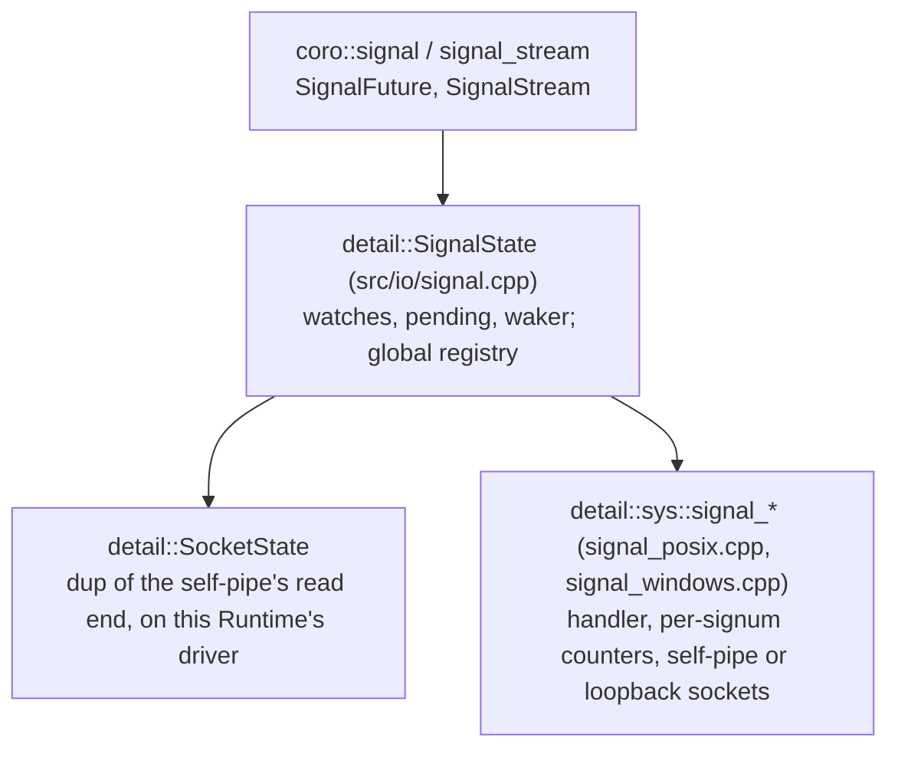
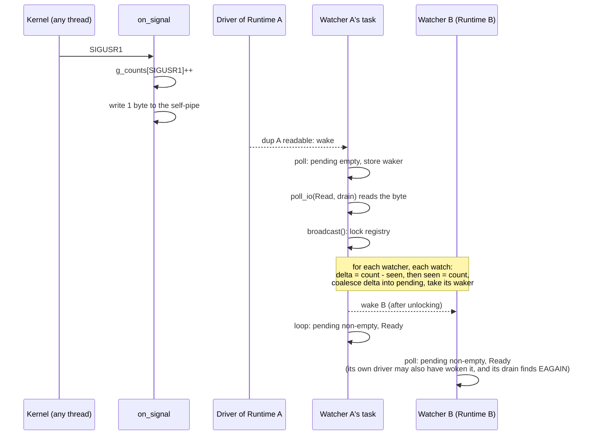

# Signal Handling

`coro::ctrl_c()`, `coro::shutdown_requested()`, `coro::signal()` and
`coro::signal_stream()` deliver Unix signals (`SIGINT`, `SIGTERM`, `SIGHUP`, ...), and
on Windows console control events, to coroutines. A `sigaction` handler counts each delivery and writes one
byte to a process-wide self-pipe. Every watcher reads that pipe through the
[I/O Driver](io_driver.md) and is handed the new counts.

Each kind of watch comes in two forms:

- **A future** (`SignalFuture`): resolves on the next delivery. For shutdown triggers,
  where only the first occurrence matters.
- **A stream** (`SignalStream`): yields one coalesced `{signum, count}` event per
  watched signal that has fired since the last item. For reload-on-`SIGHUP` and similar
  repeating signals, or to watch several signals through one object.

And three kinds of watch, following tokio's split between a portable `ctrl_c()` and
per-platform modules:

| | Future | Stream | Platforms |
|---|---|---|---|
| Ctrl-C | `ctrl_c()` | `ctrl_c_stream()` | every desktop platform: `SIGINT` on POSIX, `CTRL_C_EVENT` on Windows |
| Unix signals | `signal(signum)` | `signal_stream({signums...})` | POSIX |
| Console control events | `windows::console_event(event)` | `windows::console_event_stream({events...})` | Windows: Ctrl-C, Ctrl-Break (see [Windows](#windows)) |
| Shutdown request | `shutdown_requested()` → `ShutdownGuard` | — | every desktop platform: `SIGTERM` and `SIGHUP` on POSIX; `Close`, `Logoff`, `Shutdown` on Windows (see [Shutdown requests](#shutdown-requests)) |

`ctrl_c()` and `shutdown_requested()` let code that only needs to stop when asked build
everywhere without `#ifdef`. Anything more is platform-specific because the events are:
`SIGUSR1` has no Windows counterpart, and Ctrl-Break no POSIX one.

Desktop only. `signal.h` is excluded from the Pico install.

---

## Goals

- **Nothing missed after creation.** Watching starts synchronously in `signal()` /
  `signal_stream()`, so a delivery between creation and the first `co_await` counts.
- **No cooperation from other threads.** Works whatever signal mask the application's
  or a library's threads have.
- **Errors at the call site.** An uncatchable signal throws from `signal()` /
  `signal_stream()`, not from a later poll.
- **Default behaviour restored.** Once the last watcher of a signal is dropped, its
  previous action is back, so `SIGINT` terminates the process again.
- **Safe to drop**, at any time, on any thread.

## Non-goals

- **Blocking or masking signals** for the rest of the process.
- **Running user code in signal context.** Everything the user sees runs in a task.
- **Recovering deliveries the kernel merged** before the handler ran (see
  [Delivery counting](#delivery-counting)).
- **Chaining** to a handler the application installed itself, on POSIX. It is replaced
  while coro watches the signal, and restored afterwards. (On Windows, chaining comes
  for free; see [Windows](#windows).)

---

## API

```cpp
#include <coro/io/signal.h>

// Every platform: stop on Ctrl-C or a shutdown request. If the request won, `stop`
// holds its ShutdownGuard until the cleanup is done (on Windows the process ends when
// it is dropped):
auto stop = co_await coro::select(coro::ctrl_c(), coro::shutdown_requested());
co_await flush_and_disconnect();

// POSIX: reload on every SIGHUP until SIGTERM, so SIGHUP is left out of the shutdown
// request. Three SIGHUPs in a burst before the loop polls again give one item with
// count == 3, not three wake-ups:
auto reload = coro::signal_stream({SIGHUP});
auto stop   = coro::shutdown_requested({.hangup = false});
while (true) {
    auto sel = co_await coro::select(coro::next(reload), coro::ref(stop));
    if (sel.index() == 1) break;   // shutdown requested
    reload_config();
}
```

```cpp
struct SignalEvent {
    int      signum;
    uint64_t count;   // a lower bound: see "Delivery counting"
};
```

| Function | Returns | Output |
|---|---|---|
| `ctrl_c()`, `signal(signum)`, `windows::console_event(event)` | `SignalFuture` | `void`, on the first delivery after creation; stays ready once fired |
| `ctrl_c_stream()`, `signal_stream(signums)`, `windows::console_event_stream(events)` | `SignalStream` | one `SignalEvent` per signal with new deliveries; never exhausts |
| `shutdown_requested(options)` | `ShutdownFuture` | a `ShutdownGuard`, on the first request after creation (see [Shutdown requests](#shutdown-requests)) |

On Windows, `SignalEvent::signum` holds the `windows::ConsoleEvent` value.

All throw at the call:

- `std::system_error` `EINVAL` for a signum that can't be caught (`SIGKILL`, `SIGSTOP`,
  0, out of range; on Windows, a value that isn't a console event). A stream with one
  bad signum throws and watches nothing.
- `std::logic_error` on a Runtime whose executor never turns the driver.

A failure reading the pipe fails the next poll with `std::system_error`. Destruction is
synchronous: the previous action is restored by the time the last watcher's destructor
returns. Only one task may poll a given watcher at a time.

---

## Why a self-pipe, not `signalfd`

`signalfd` only receives a signal that is **blocked in every thread** of the process.
coro doesn't own every thread: a library may start its own, and the application may
start a `std::thread` before the first watcher exists. If any thread leaves the signal
unblocked, the kernel may deliver it there and take the default action, which for
`SIGINT`/`SIGTERM` kills the process. A `sigaction` handler needs no cooperation from
other threads, works the same on every POSIX platform, and is what tokio (through mio)
does too.

!!! tip "TODO: `EVFILT_SIGNAL` backend for kqueue"
    On a kqueue driver, `EVFILT_SIGNAL` reports deliveries without a self-pipe. It would
    go behind the same `sys/signal.h` seam.

---

## Layers



### The `sys/signal.h` seam

| Function | POSIX implementation |
|---|---|
| `signal_watch(signum)` | Reference-counts `signum`; the first watch installs `on_signal` with `SA_RESTART` and saves the previous action. Throws `std::system_error`. |
| `signal_unwatch(signum)` | The last unwatch restores the saved action. `noexcept`. |
| `signal_count(signum)` | Deliveries counted so far for `signum`. |
| `signal_pipe_dup()` | A close-on-exec `dup` of the self-pipe's read end. |
| `signal_pipe_release(fd)` | Nothing: the pipe is shared, and nothing writes to a particular dup. (Windows: see [Windows](#windows).) |
| `signal_pipe_drain(fd)` | Reads the pipe until empty; `EAGAIN` if it already was. |
| `signal_ignored(signum)` | POSIX only: `signum` is `SIG_IGN` and unwatched, for `shutdown_requested()`. |

- **The self-pipe** is non-blocking, created on first use and never closed: a handler
  may run on any thread at any time, so its write end must stay valid.
- **The handler** (`on_signal`) increments `g_counts[signum]`, an atomic, then writes
  one byte to the pipe. Both are async-signal-safe. A full pipe (`EAGAIN`) is fine,
  since unread bytes already guarantee a wake-up. It saves and restores `errno`.
- **The install refcounts** and saved actions are guarded by a mutex that is only ever
  taken innermost.

The atomic counters are the CLAUDE.md exception for signal handlers: a handler can
interrupt a thread holding any mutex, so it must not take one. Everything outside the
handler uses mutexes.

### `detail::SignalState`

One per `SignalFuture` / `SignalStream`, held by `unique_ptr`:

- `pipe`: a `SocketState` holding its own `dup()` of the pipe's read end, registered
  with the creating Runtime's driver. All dups share one open file description, so a
  byte drained through any of them is gone for all.
- `watches`: `{signum, seen}` per watched signal, where `seen` is the count last handed
  out. Guarded by the registry mutex.
- `pending` (at most one `SignalEvent` per signum) and a weak `waker`, guarded by the
  state's own mutex.

**The registry** is a global mutex and the list of live `SignalState`s. It is leaked, so
a watcher dropped during static destruction is safe.

---

## Delivery

Every watcher's dup is in some driver's epoll set, so a delivery makes every polling
watcher's fd readable. Whichever one's task polls first drains the pipe and
**broadcasts** to all watchers, on every Runtime:



- `poll` loops. If `pending` is non-empty, it is ready. Otherwise it stores the weak
  waker, then calls `poll_io(Read, signal_pipe_drain)`:
    - pending means the pipe was empty (another watcher drained it, or nothing has
      arrived);
    - an error fails the future with `std::system_error`;
    - a successful drain calls `broadcast()` and loops.
- `SignalStream::poll_next` pops one event; it never yields `nullopt`.
  `SignalFuture::poll` never pops, so once fired it stays ready.
- Because of the broadcast, a watcher on a Runtime whose driver isn't turning right now
  (busy, or blocked elsewhere) still gets its event, through its waker, from whichever
  Runtime drained.

!!! note "NOTE: broadcast is O(watchers) per drain"
    Each drain locks the registry and walks every watcher. Programs watch a handful of
    signals, so this is far simpler than per-signum watcher lists and costs nothing
    measurable.

---

## Delivery counting

`pending` holds at most one event per signum. Deliveries that arrive before the consumer
polls again add to that event's `count` instead of queueing more events, so a burst of
three `SIGHUP`s is one wake-up and one `{SIGHUP, 3}` item. The consumer couldn't tell
"woken three times" from "woken once with count 3" anyway.

!!! warning "WARNING: `count` is a lower bound, never an exact count and never an overcount"
    For standard (non-realtime) signals, the kernel does not queue repeats: a signal
    sent again while the previous instance is still pending is merged into it, before
    any of coro's code runs. `kill(pid, SIGHUP)` three times in quick succession may run
    the handler only once or twice. This is POSIX semantics; raw `sigaction` in C sees
    the same.

    coro itself loses nothing: the handler counts before it writes, and a watcher
    drains before it reads the counts, so every drained byte's delivery is counted. So
    the first delivery after creation is always reported, and `count` means "at least
    this many times". A delivery that is counted but whose byte is still unread is just
    handed out early; the byte later causes an empty broadcast.

    **Real-time signals** (`SIGRTMIN`..`SIGRTMAX`) are queued by the kernel one per
    send, so for them `count` is exact.

!!! tip "TODO: make coalescing optional"
    `poll_next()` could decrement `count` and yield `{signum, 1}` per delivery instead of
    one batch, as a `SignalStream` mode. The broadcast wouldn't change. Deferred until a
    use case needs it; the batch form covers shutdown and reload.

---

## Shutdown requests

"The process is being asked to go away" is a different event on each platform, and
the platforms disagree about what happens next:

| | Watched | After the request |
|---|---|---|
| POSIX | `SIGTERM` (`kill`, `systemctl stop`, `docker stop`); `SIGHUP` (the terminal closed) unless `options.hangup` is false | The process lives until it exits by itself, or until whoever sent `SIGTERM` gives up (systemd: `SIGKILL` after 90 s by default). |
| Windows | `Close` (the console window closed), `Logoff`, `Shutdown` | The process ends as soon as the console handler returns, and in any case after about 5 s (`Close`) or 20 s (`Logoff`, `Shutdown`). |

So `shutdown_requested()` resolves to a guard, and the cleanup runs while it is held:

```cpp
auto guard = co_await coro::shutdown_requested();
co_await flush_and_disconnect();
co_return;   // `guard` is dropped here
```

- **The guard is one more watch of each signal its future watched, without an fd.** Its
  constructor calls `signal_watch()` for each and its destructor `signal_unwatch()`, so
  the seam needs nothing new.
  - On Windows that is what keeps the process alive: the handler for these three events
    waits until the event's watch count is 0 (see
    [the handler waits](#close-logoff-and-shutdown-the-handler-waits)).
  - On POSIX nothing needs holding open, but the watch keeps coro's handler in place, so
    a second `SIGTERM` during the cleanup is absorbed rather than killing the process.
    Once the guard is dropped, the previous action is back.
- **No gap.** `ShutdownFuture::poll` constructs the guard while the future still
  watches, so the count never touches 0 between the future being destroyed (when the
  `co_await` completes) and the guard taking over.
- **Hold it to the end of `main()`**, and the same code is correct on both platforms.
  The guard is `[[nodiscard]]`, so `co_await coro::shutdown_requested();` on its own
  draws a warning where the compiler checks awaited results; on Windows that line lets
  the process end at once.
- **`SIGHUP`** is the true counterpart of `Close`, so it is watched by default. A daemon
  that uses `SIGHUP` to mean "reload" passes `{.hangup = false}` and watches it with
  `signal_stream()` instead. The option is ignored on Windows, where nothing but the
  guard can keep the process alive through `Close`.
- **An ignored signal stays ignored.** Under `nohup`, `SIGHUP` is `SIG_IGN`; watching it
  would install coro's handler and undo that, so `shutdown_requested()` leaves out any
  signal that is ignored and unwatched when it is called (`sys::signal_ignored()`).
- **Ctrl-C isn't included.** It comes from the user at the terminal, and many programs
  treat it differently (a second Ctrl-C to force); `select` on `ctrl_c()` as well to
  stop on either.
- **The time allowed differs**, and isn't hidden: about 5 s on Windows after `Close`,
  whatever the guard does, against whatever the sender of `SIGTERM` allows.

On Windows, `console_event()` and `console_event_stream()` throw `std::invalid_argument`
for `Close`, `Logoff` and `Shutdown`: a plain watcher would be destroyed with the
`co_await` that awaited it, and the process would end just as the cleanup began.

---

## Windows

Windows has no Unix signals. Its counterpart is the **console control event**, which
Windows delivers by calling the routines registered with `SetConsoleCtrlHandler()`, on
a thread it creates for the purpose. `src/detail/sys/windows/signal_windows.cpp`
implements the same `sys/signal.h` seam with them, so everything above the seam
(`SignalState`, the registry, the broadcast, `SignalFuture`, `SignalStream`) is the same
code on both platforms. The signums are the events' own values:

| `windows::ConsoleEvent` | Value | Sent when | Default (nobody handles it) |
|---|---|---|---|
| `CtrlC` | `CTRL_C_EVENT` (0) | Ctrl-C | the process ends |
| `CtrlBreak` | `CTRL_BREAK_EVENT` (1) | Ctrl-Break | the process ends |
| `Close` | `CTRL_CLOSE_EVENT` (2) | the console window is closed | the process ends; it also ends once the handler returns |
| `Logoff` | `CTRL_LOGOFF_EVENT` (5) | the user logs off; services only | as `Close` |
| `Shutdown` | `CTRL_SHUTDOWN_EVENT` (6) | the system shuts down; services only | as `Close` |

A console process receives `Close` for logoff and shutdown too. A process with no
console (a GUI application, or one started detached) receives no events at all, so a
watcher there never fires; the API documents this rather than failing, as tokio does.

### The seam on Windows

| Function | Windows implementation |
|---|---|
| `signal_watch(event)` | `EINVAL` unless a console event. The first watch in the process installs `on_console_event` with `SetConsoleCtrlHandler(TRUE)`; every watch counts a reference for the event. |
| `signal_unwatch(event)` | Drops the reference, and wakes a handler waiting for it to reach 0 (see below). The handler stays installed. |
| `signal_count(event)` | Events counted so far. |
| `signal_pipe_dup()` | A new non-blocking loopback UDP socket, bound to `127.0.0.1:0`, added to the list of receivers. |
| `signal_pipe_release(fd)` | Removes the socket from the receivers, before `SocketState` closes it. |
| `signal_pipe_drain(fd)` | Reads datagrams until `WSAEWOULDBLOCK`; `EAGAIN` if there were none. |

- **One socket per watcher, not a shared pipe.** The IoDriver's
  [AFD poller](windows_port.md) reports readiness for sockets only, and a Windows pipe
  has no readiness at all. So each watcher gets a socket of its own, and the handler
  sends a one-byte datagram to every receiver through one shared sender socket. That
  replaces "every dup sees the pipe's bytes", and the broadcast works as on POSIX:
  whichever watcher drains first hands everyone their counts, and the others drain their
  own datagrams later and find nothing new. Sending by address rather than by handle
  means the handler never touches a watcher's socket, so a watcher can close its own
  whenever it likes; `signal_pipe_release()` (under the mutex the handler sends under)
  makes sure nothing is sent to its port once it is gone.
- **The handler is an ordinary thread.** Windows runs it on a thread of its own, not by
  interrupting one, so unlike `on_signal` it takes a mutex, sends with ordinary calls,
  and may block. The counts are still atomics, because `signal_count()` reads them
  without the mutex.
- **Count, then send**, as on POSIX: a watcher drains before it reads the counts, so a
  datagram it drained always has its delivery counted. A datagram that doesn't fit in a
  receiver's buffer is dropped, which is fine: the unread ones already guarantee a
  wake-up.
- **The state is leaked**, like the registry: the handler may still be waiting on its
  mutex when the process exits.

### Restoring the default: the handler stays installed

POSIX restores the previous action when the last watcher goes. Windows has the same
effect without removing anything: **`on_console_event` returns `FALSE` for an event
with no watchers**, and Windows then calls the next routine in its list and finally the
default one, `ExitProcess()`. The routine is installed once and never removed, because
removing it could race with a call to it already running on Windows' thread.

That also makes Windows the platform where coro **chains** rather than replaces:
Windows calls the routines last registered first, so one the application registered
before coro's runs when coro's passes an event on, and one registered after it runs
first.

### Close, logoff and shutdown: the handler waits

For `Close`, `Logoff` and `Shutdown`, Windows ends the process as soon as the routine
returns, whatever it returns. A watcher that is merely woken would lose the race with
`ExitProcess()`: its cleanup would be cut off as soon as it began. So for these three,
`on_console_event` counts and sends as usual, then **waits until the event's watch
count is 0** before it returns. What holds the count through the cleanup is the
`ShutdownGuard` from `shutdown_requested()` (see [Shutdown requests](#shutdown-requests)).

- The wait uses a condition variable on the seam's mutex, signalled by
  `signal_unwatch()` when a count reaches 0.
- A guard or future kept for the life of the program holds the handler until Windows'
  own deadline, after which Windows ends the process anyway. So the wait needs no
  timeout of its own.
- If the application finishes first and returns from `main()`, the process ends with
  the handler still waiting, which is harmless.
- `CtrlC` and `CtrlBreak` don't end the process, so the handler returns at once for
  them.

### Why not the completion port

The handler could post a packet to each driver's completion port instead of sending
datagrams, and `sys/notify.h` will need that kind of non-socket object on Windows one
day. It would need a new kind of registration in the poller (`RawFd` is a socket there),
for no gain here: loopback datagrams are cheap at the rate console events arrive, and
the AFD path is already tested. The sockets keep the poller and everything above the
seam unchanged.

---

## Races

- **Registration vs. delivery.** The constructor takes the registry mutex, reads each
  baseline `seen = signal_count(signum)` and *then* installs the handler. No broadcast
  can run in between, so every delivery after the baseline is handed to this watcher
  and none before it is.
- **Check vs. store of the waker.** `poll` checks `pending` and stores the waker under
  the state mutex, which `broadcast` also takes. So a broadcast from another thread
  either lands before the check (seen) or after the store (wakes).
- **Drain by another watcher.** If watcher B drains between A's readiness event and A's
  read, A's read gets `EAGAIN` and re-arms. B's broadcast has already filled A's
  `pending` and woken it.
- **Last unwatch vs. a delivery in flight.** A handler already running on another thread
  finishes normally; its count is seen by nobody. A later delivery takes the restored
  action. Commented in `signal_posix.cpp`.
- **Lock order:** registry, then a state's mutex. Wakers are called after both are
  released. The `sys` install mutex is only ever taken innermost.
- **Windows: release vs. a send.** The handler sends to the receivers under the seam's
  mutex, and `signal_pipe_release()` removes one under it. So once release returns,
  nothing more is sent to that port, which may be given to another socket after this
  one closes.
- **Windows: last unwatch vs. a waiting close handler.** The handler waits on the
  condition variable with the reference count as its predicate, under the same mutex
  `signal_unwatch()` decrements it under, so the wake-up can't be missed.
- **Windows: an event as the last watcher goes.** The handler checks the count under the
  mutex: either it sees a watcher (counts, sends, and for close events waits for the
  unwatch), or it sees none and passes the event on to the default.

---

## Tests

`test/io/test_signal.cpp` (`test_signal`), on every desktop platform. The tests watch
and raise through `test/signal_test_util.h`, which picks two signals per platform:

- **POSIX:** `SIGUSR1` and `SIGUSR2`, raised with `::raise()`, which runs the handler on
  the calling thread before it returns.
- **Windows:** `CtrlBreak` and `CtrlC`, raised with `sys::signal_console_event()`, which
  runs the console handler on the calling thread as Windows runs it on its own. Windows
  itself can only send a console event to every process on the console, the test runner
  and the shell that started it included, so a real one is out of the question.

Either way the delivery is counted and the watchers' fds are readable by the time the
raise returns, so no extra synchronisation is needed. Every await is bounded by
`timeout(5s)`. The `SignalFutureTest`, `SignalStreamTest` and `CtrlCTest` suites run on
every executor.

| Test | Checks |
|---|---|
| `SignalFutureTest.ResolvesOnDelivery` | A raise between creation and `co_await` resolves the future. |
| `SignalFutureTest.PendingUntilDelivered` | No delivery: still pending after 20 ms. |
| `SignalFutureTest.ResolvesOnDeliveryFromAnotherThread` | From a `std::thread`: `kill(getpid())` on POSIX, the handler on Windows (as Windows runs it). |
| `SignalFutureTest.IgnoresDeliveriesBeforeCreation` | A delivery counted while only an older watcher existed doesn't fire a newer one. |
| `SignalFutureTest.MultipleIndependentWatchersOfSameSignal` | One raise resolves both. |
| `SignalFutureTest.InvalidSignalThrows` | POSIX: `SIGKILL`, `SIGSTOP`, 0, -1. Windows: 3, 4, 7, -1 (not console events). And a stream with one bad signum. All throw `system_error`. |
| `SignalFutureTest.DroppingBeforeDeliveryDoesNotHang`, `SignalStreamTest.DroppingBeforeDeliveryDoesNotHang` | Drop without delivery. |
| `SignalStreamTest.ResolvesOnDelivery` | One raise: `{signal, 1}`. |
| `SignalStreamTest.CoalescesBurstIntoOneEventWithCount` | Three raises before polling: one item, `count == 3`. |
| `SignalStreamTest.DistinctSignalsYieldSeparateEvents` | Two signals: two items. |
| `SignalStreamTest.CountsResetBetweenItems` | Counts 2 then 1. |
| `CtrlCTest.FutureResolvesOnCtrlC` | `ctrl_c()` resolves on `SIGINT` / `CTRL_C_EVENT`. |
| `CtrlCTest.StreamYieldsEachCtrlC` | `ctrl_c_stream()`: two Ctrl-Cs, two items with the platform's signum. |
| `SignalTest.RestoresDefaultWhenLastWatcherDrops` | The default is back only after the last watcher drops: `SIG_DFL` on POSIX; on Windows the handler passes the event on. |
| `SignalTest.WatchersOnSeparateRuntimesBothResolve` | One raise resolves watchers on two Runtimes on two threads. |
| `SignalTest.ThrowsWithoutDriver` | `logic_error` from every constructor, and nothing left installed. |
| `ShutdownTest.ResolvesOnEachRequest` | `shutdown_requested()` resolves on each request it watches by default: `SIGTERM`, `SIGHUP`; `Close`, `Logoff`, `Shutdown`. Raised on another thread, since on Windows the handler then waits for the guard. |
| `ShutdownTest.GuardHoldsUntilDropped` | With only the guard left (the future, a temporary, is gone): on Windows the `Close` handler doesn't return until it is dropped; on POSIX `SIGTERM` stays handled, a second one is absorbed, and `SIG_DFL` is back once it is dropped. |
| `ShutdownTest.HangupCanBeLeftOut` | POSIX: `{.hangup = false}` leaves `SIGHUP` at `SIG_DFL`. |
| `ShutdownTest.IgnoredHangupStaysIgnored` | POSIX: with `SIGHUP` at `SIG_IGN` (as under `nohup`), `shutdown_requested()` leaves it there. |
| `SignalTest.ConsoleEventRejectsEventsThatEndTheProcess` | Windows: `console_event()` / `console_event_stream()` throw `invalid_argument` for `Close`, `Logoff`, `Shutdown`. |
| `SignalTest.CtrlBreakHandlerReturnsAtOnce` | Windows: the handler doesn't wait for a Ctrl-Break watcher. |

`TaskBudgetTest.AlwaysReadyLoopLetsSignalThrough` (`test_task_budget.cpp`) uses the same
helper, so it runs on Windows too.

!!! note "NOTE: what the Windows tests don't cover"
    That Windows calls the routine at all, on which thread, and how it treats the
    return value: those are Windows' side, and only a real console event exercises them.
    Try it by hand: run a program that awaits `coro::ctrl_c()` in a console and press
    Ctrl-C; close the console window while it holds the guard from
    `shutdown_requested()`, and check its cleanup runs.

---

## Files

| File | Contents |
|---|---|
| `include/coro/io/signal.h`, `src/io/signal.cpp` | `SignalEvent`, `SignalFuture`, `SignalStream`, `detail::SignalState`, the registry |
| `include/coro/detail/sys/signal.h` | The backend seam |
| `src/detail/sys/posix/signal_posix.cpp` | POSIX: `sigaction` handler and self-pipe |
| `src/detail/sys/windows/signal_windows.cpp` | Windows: console control handler and loopback sockets |
| `test/io/test_signal.cpp`, `test/signal_test_util.h` | Tests, and watching and raising per platform |
