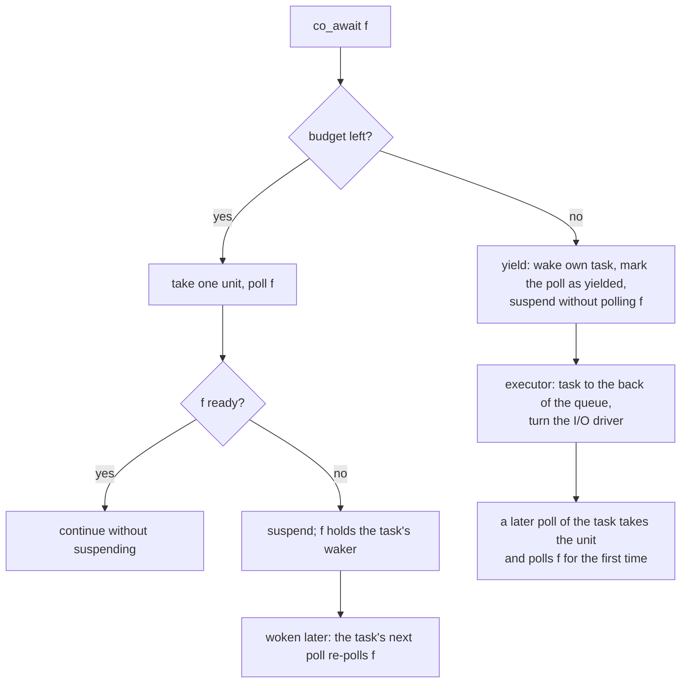

# Task Budget

## Summary

A task whose awaited futures are always ready never returns to the executor, so nothing
else on its thread runs: other tasks, timers, signals, and every I/O event. On a
single-thread `Runtime` that is the whole program.

The fix is a budget, as in Tokio's cooperative scheduling. Each time the executor polls
a task, the task may pass 128 `co_await`s. At the next one it yields: it suspends
without polling the future, is put at the back of the run queue, and the executor turns
the I/O driver before it runs again. `coro::yield_now()` does the same on request.

The number follows Tokio and is counted in awaits, not in time. It can be changed per
`Runtime`.

## The problem

A `co_await` polls its future at once and does not suspend when the result is already
there (`FutureAwaitable::await_ready()` in `include/coro/detail/future_awaitable.h`).
That is the intended fast path: a hand-written future such as a UDP receive completes
in its first `poll()` when data is waiting, with no trip through the run queue.

The consequence is that a loop of this shape

```cpp
for (;;) {
    auto datagram = co_await socket.recv(...);   // ready every time, under load
    handle(datagram);
}
```

runs inside a single `Coro::poll()` for as long as the socket has data. The executor
gets the thread back only when a future returns pending. Until then:

- no other task on that worker is polled;
- that worker does not turn the I/O driver, so the readiness events, timers and signals
  it would dispatch wait;
- on `Runtime(1)` there is no other worker to do either.

A receiver that falls behind its sender shows it most clearly: a datagram is always
waiting, so the program keeps processing but accepts no connections, fires no timers and
does not respond to `SIGINT`. It is not a deadlock. As soon as the source runs dry the
task suspends and everything queued behind it runs.

The executors already turn the driver while busy, every `event_interval` (61) task
polls. That does not help here, because it is counted in task polls and this one poll
never ends.

## Design

### The budget

The budget is a count held in `detail::Context`, the object the executor builds for
each poll of a task and that every `poll()` receives.

- **The executor sets it.** Each executor builds the `Context` with the runtime's budget
  (128 by default) just before it calls `task->poll(ctx)`.
- **One budget per task poll.** A coroutine that awaits another coroutine passes the
  same `Context` down, and so do `select()`, `join()` and `timeout()`. Everything a task
  runs in one poll draws on one count.
- **Unlimited outside an executor.** A `Context` built anywhere else has no limit. That
  covers `blocking_wait()` and `blocking_next()`, which poll on a thread that has
  nothing else to run.

```cpp
class Context {
public:
    static constexpr std::uint32_t kUnlimitedBudget = UINT32_MAX;

    explicit Context(Rc<Waker> waker, std::uint32_t budget = kUnlimitedBudget);

    /// Takes one unit of the task's budget. False when none is left: the caller
    /// should then yield_to_executor() and return pending without doing its work.
    bool try_consume_budget() noexcept;

    /// Wakes the task and marks this poll as yielded, so that the executor turns the
    /// I/O driver before the task runs again. The caller then returns pending.
    void yield_to_executor();

    /// True once yield_to_executor() has been called in this poll. Read by the executor.
    bool yielded() const noexcept;
    // ...
};
```

### Where it is charged: `co_await`

Tokio charges the budget inside each leaf resource (socket, channel, timer). coro
charges it in one place instead, `FutureAwaitable`, which every `co_await` in a `Coro`
or `CoroStream` goes through. That covers every future, including ones written outside
the library, with no change to any of them.

```cpp
bool await_ready() noexcept {
    detail::Context& ctx = *m_promise->m_ctx;
    if (!ctx.try_consume_budget()) {
        // Budget spent: do not poll. poll() below makes the first poll of the
        // future on a later turn of the task, and takes the unit then.
        ctx.yield_to_executor();
        m_deferred = true;
        return false;
    }
    // as today: poll once, skip suspension when the result is ready
}
```



The budget is checked **before** the future is polled, which is Tokio's order. The
other order, polling first and suspending with the result in hand, was considered and
rejected:

- A future that has completed has taken something: a datagram from the socket, a
  message from a channel. If the task is then cancelled or dropped while suspended, that
  value is destroyed with the frame. Not polling means nothing is taken.
- It needs no kept result. The existing re-poll before resume (`Coro::poll()` calls
  `m_poll_current->poll()`) makes the first poll of the future; one flag tells it that
  this poll is the first and still has to be paid for.

The cost is one extra trip through the run queue when the future would have been
pending anyway.

The rest of the path is unchanged:

- **The re-poll of a future that is waiting never refuses.** `FutureAwaitable::poll()`,
  which `Coro::poll()` and `CoroStream::poll_next()` call before they resume a
  suspended coroutine, polls a future that has been polled before whatever the budget,
  and takes nothing from it. Refusing there would leave the future with no waker
  registered.
- **The first poll of a deferred future is charged.** A future that `await_ready()`
  deferred has never been polled and has nothing registered, so `poll()` treats it as
  `await_ready()` would have: it takes a unit, and with none left it calls
  `yield_to_executor()` again and stays pending. A task poll therefore starts at most
  `budget` awaits, however many coroutines the earlier polls left suspended.
- **A pending future costs its unit.** Tokio hands the unit back when the operation
  made no progress. Here the task is about to suspend anyway, so nothing is gained by
  it.

`fiber_await()` is the same operation for fibers and gets the same check: with no
budget left it calls `yield_to_executor()` and `fiber_yield()` before it polls. A fiber
is suspended in one `fiber_await()` at a time, so its one uncharged poll after the
yield cannot multiply and is left as it is.

!!! note "NOTE: the charge on a deferred first poll is a failsafe"
    It is not what the budget rests on. A future that polls several others is meant to
    stop when the budget is spent ([below](#futures-that-poll-several-others-join-and-select)),
    and as long as every such future does, a free first poll would cost about one
    extra await per task poll and nothing more. The charge is there for a future that
    polls several others and does not make that check.

    What it guards against: if a deferred future were polled for free on the next turn,
    and a `join()` didn't make the check, then under nested `join()` each coroutine
    resumed for free would start its children, every one of them would be deferred at
    its own first `co_await`, and all of those would be resumed for free on the turn
    after. The number of suspended coroutines would grow by the width of the `join()`
    on every turn. A task that walks a tree of ready coroutines depth-first, with a few
    dozen frames alive, would instead have the whole tree alive at once; one benchmark
    of that shape takes about six times as long.

    Removing it would loosen the bound from `budget` awaits started per task poll to
    `budget` plus one for each deferred await resumed in that poll, and would leave
    the bound depending on every future of that kind making the check. It costs one
    flag per awaitable and one test of it per resume.

### Futures that poll several others: `join()` and `select()`

A coroutine awaits one future at a time, so the check in `co_await` is enough for it. A
future that polls several others in one `poll()` is different: when one branch spends
the budget, the branches after it are still to come. `JoinFuture` and `SelectFuture`
therefore ask before they poll each branch that is still running:

```cpp
// Context
bool yield_if_budget_spent() {
    if (m_budget != 0) return false;
    if (!m_yielded) yield_to_executor();
    return true;
}

// JoinFuture::poll_active_one<I>(), and the same in SelectFuture
if (m_states[I] != JoinBranchState::Active) return;
if (ctx.yield_if_budget_spent()) return;      // leave it for the next task poll
auto result = std::get<I>(m_futures).poll(ctx);
```

Three rules make this up:

- **Look, do not take.** The branch pays for its own awaits. A unit taken here as well
  would charge every branch twice.
- **A skipped branch means the task must yield.** The task may have been woken for
  exactly the branch that is skipped. If another branch took the last unit and then
  went to wait on a real future, nothing has yielded yet, and returning pending would
  lose that wake. So the check itself makes sure `yield_to_executor()` has been called
  in this poll.
- **Draining is not held back.** The passes that drain a cancelled branch (the losers
  of a `select()`, the other branches of a `join()` after an error) poll whatever the
  budget. They start no new work, and a result that is ready should be delivered in
  the poll that found it.

Branches that are skipped include ones that were already waiting. They lose at most a
trip through the run queue, and both futures start one branch later on each poll, so
no branch is last every time.

`timeout()` is a `select()` and behaves the same. A future with a single child
(`FutureRef`, `next()`, `when()`, `co_invoke()`) needs no check: its child makes its
own.

!!! warning "Why the branches must not be polled once the budget is spent"
    A coroutine branch that has not started runs, when polled, up to its first
    `co_await`. With the budget spent it is refused there, but by then it has built
    whatever it was about to await. Under nested `join()` that is a whole level of
    child coroutines: every `join()` on the way back up the stack starts its remaining
    branches, and each of them allocates its children only to be deferred. With the
    check, a task that walks a tree of ready coroutines depth-first stops where the
    budget ran out and carries on from there on its next poll.

!!! note "NOTE: a `co_await join(...)` that takes the last unit does nothing that turn"
    The `co_await` is allowed, and the join then finds the budget spent before its
    first branch and yields. That is one trip through the run queue, not a stall: the
    next poll re-polls the join without charge and its branches run on the new budget.

!!! note "NOTE: a combinator written outside the library"
    A future of your own that polls several others should make the same call before
    each branch. If it does not, the charged first poll above, which is kept as a
    failsafe for exactly this, still keeps the number of awaits started per poll
    within the budget, but branches that have not started are run up to their first
    `co_await` for nothing. Rotate the starting branch as
    well, as `join()` and `select()` do: with a fixed order a later branch can stay
    deferred for as long as the earlier ones spend the whole budget in every poll.

### What a yield does

`yield_to_executor()` wakes the task's own waker, as any self-waking future does. The
task is `Running`, so it becomes `RunningAndNotified`, and when its poll returns pending
the executor re-queues it. Every executor's own-thread queue is first-in first-out, so
the task goes behind whatever else is runnable there.

The flag it sets is what makes a yield more than a self-wake. After a poll that yielded,
the executor turns the I/O driver without waiting for the `event_interval` count:

| Executor | After a poll that yielded |
|---|---|
| `WorkStealingExecutor` | does its non-blocking `try_turn(0)` now, not on the 61st poll |
| `CurrentThreadExecutor` | ends the batch: timers are checked and the driver is turned |
| `WorkSharingExecutor` | nothing extra; its busy workers never turn the driver |

Without that, a lone task that keeps spending its budget would be polled 61 times
between driver turns, and I/O, timers and signals would wait for 61 × 128 awaits.
With it they wait for 128.

!!! note "NOTE: Tokio defers the wake; coro wakes at once and turns the driver"
    Tokio hands the waker of a task that yields to the scheduler, which wakes it only
    after the scheduler has run out of ready tasks or reached `event_interval`, and has
    polled the driver. The task therefore runs after everything the driver woke. Here
    the task is re-queued at once and the driver is turned straight after, so tasks the
    driver wakes are queued behind it and wait for one more of its polls. That saves a
    list of deferred wakers in each executor. If the ordering ever matters, the
    executor can hold a yielded task back until after the turn; nothing outside the
    executors would change.

!!! danger "WARNING: a yield relies on a first-in first-out local queue"
    A task that yields must go behind the other runnable tasks. `WorkStealingExecutor`'s
    [LIFO slot](work_stealing_executor.md#lifo-slot) would poll it again at once, so a
    task that wakes itself, by yielding or otherwise, is re-queued after its poll
    straight to the back of the local queue and never goes through the slot, as in
    Tokio. A new path that re-queues a task after its own poll must do the same
    (`requeue_after_poll()`).

### `yield_now()`

```cpp
#include <coro/task/yield_now.h>

for (std::size_t i = 0; i < items.size(); ++i) {
    process(items[i]);                    // no co_await in here
    if (i % 64 == 63) co_await coro::yield_now();
}
```

`yield_now()` returns a hand-written future. Its first `poll()` calls
`ctx.yield_to_executor()` and returns pending; its second returns ready. It is for code
that does long work between awaits, which the budget cannot see, and it is what the
executor tests use to make a task yield on demand.

When the budget happens to be spent at a `co_await coro::yield_now()`, the task yields
twice: once for the budget and once for the future's own first poll. That is harmless.

!!! note "NOTE: `yield_now()` ends its own branch, not the task poll"
    `yield_now()` makes only the coroutine that awaits it return pending. If that
    coroutine is a branch of a `select()` or `join()`, the combinator goes on polling
    its other branches, and each of them runs until it completes, awaits something
    pending, or spends the budget that is left.

    - Under `join()`, the task's poll returns pending once the other branches have
      done what they can.
    - Under `select()`, another branch may win. The yielding branch is then dropped
      and the task carries on past the `select()` with its remaining budget, as if
      nothing had yielded. The wake has already been made, so when the task next
      returns pending it is queued and polled once more for nothing; the re-poll
      before resume absorbs that.

    Either way the wake and the mark are acted on when the task's poll returns: the
    task is re-queued and the driver is turned. A yield caused by the budget does not
    have this tail, because with no budget left the combinator polls no further
    branch.

    To make `yield_now()` end the whole task poll promptly, have
    `Context::yield_to_executor()` also set `m_budget = 0`. Every later `co_await` in
    that poll then yields without polling its future. That is one line, and it changes
    nothing for a yield caused by the budget, where the count is already zero. It
    would also apply to a hand-written future that calls `yield_to_executor()`. Tokio
    does not do this, so it is left out until a case asks for it.

### Changing the budget

```cpp
coro::Runtime rt(1);
rt.set_task_budget(32);     // 0 means no limit
```

The value is held by the executor and read once per task poll. It is meant to be set
before `block_on()`; a change made later applies to the polls that follow. Tests use
small values so that a yield is reached quickly.

There is no way to switch the budget off for part of a task (Tokio's
`unconstrained()`). Nothing needs it yet.

## What the budget bounds, and what it does not

With the budget, one task poll starts at most `budget` awaits. A coroutine that was
already waiting is resumed without charge, though under `join()` or `select()` only
until the budget is spent. The time that takes is whatever the code between those awaits
costs: the budget counts awaits, not time, and a task that does 10 ms of work between
awaits still holds its thread for 10 ms at a time.

Not covered:

- **Code with no `co_await`.** A long computation, or a loop over `try_recv()` and
  `try_send()`. Use `yield_now()`, or `spawn_blocking()` for work that is really
  blocking.
- **A hand-written future that loops inside its own `poll()`.** For example one that
  drains a socket until it would block. Such a future should either bound its loop or
  call `ctx.try_consume_budget()` for each item and stop when it fails, calling
  `ctx.yield_to_executor()` before it returns pending.
- **A branch of a combinator that is not a coroutine and does its own work.**
  `select()`, `join()` and `timeout()` do not charge for polling a branch; they only
  stop once the budget is spent. A hand-written future used as a branch is polled for
  free while budget remains. The `co_await` of the combinator is charged, which is
  what breaks a loop around it.
- **Fairness between the branches of a `select()` built anew in each iteration.** After
  a yield the timer or cancellation branch may well be ready, but a new `SelectFuture`
  starts at its first branch, so an always-ready first branch still wins every time.
  See [Select](select.md), "Fairness". It is a separate question from this one.
- **Starvation of the injection queue by a busy local queue.** A yield puts the task
  behind the tasks in its worker's own queue, not behind tasks waiting in the shared
  queue. That is what the
  [periodic injection-queue check](work_stealing_executor.md#periodic-injection-queue-check)
  is for.

## Edge cases

- **Cancelled while suspended by the budget.** `Coro::poll()` on a cancelled coroutine
  cancels and drains the awaited future only when it is `Cancellable` (a `Coro` or
  `CoroStream`). Cancelling one that was never polled is already supported: `select()`
  does it to a losing branch it never reached. Any other future is destroyed with the
  frame, never having been polled.
- **Dropped while suspended by the budget.** The same: the future was never polled, so
  it holds nothing.
- **A future that starts work in its constructor.** A few do, on purpose. The budget
  delays its first poll by one trip through the run queue, which is no different from
  the task having been queued behind others.
- **Several coroutines under one `join()`.** One of them spends the budget and yields;
  the branches after it are not polled in that task poll. The task is woken once and
  its poll is marked once. On the next poll, which starts one branch later, they share
  the new budget; the ones that get none of it stay where they were.
- **Cancelled while deferred, with the budget already spent.** Draining a cancelled
  `Coro` goes through the same `poll()`, so the drain of a deferred child can wait one
  more turn. The task has woken itself, so the turn comes.
- **A wake that races with the yield.** `yield_to_executor()` is an ordinary `wake()`
  on a `Running` task. A second wake from another thread finds
  `RunningAndNotified` and does nothing, as today.
- **A yield outside an executor.** In `blocking_wait()` the budget is unlimited, so
  only `yield_now()` reaches `yield_to_executor()` there. It wakes the blocking waker
  and the loop polls again at once.

## Cost

Per `co_await`: one load, one compare and one decrement on the `Context` the awaitable
already holds a pointer to. Per resume of a suspended coroutine: one test of a flag. Per yield: one `wake()` (a reference-count increment and
one compare-and-swap), one trip through the run queue, and one non-blocking driver
turn. With the default that is one `epoll_wait` for every 128 awaits completed without
suspending.

!!! tip "PERF: check the coroutine micro-benchmarks"
    The decrement is on the path of every `co_await`. Run the existing coroutine and
    channel benchmarks before and after; the expectation is no measurable change.

## Tests

In `test/runtime/test_task_budget.cpp`. The typed tests run on every executor
(`AllExecutors`) with `set_task_budget(4)`, so that they do not depend on the default.
A loop that should have been interrupted gives up after 5 s, so a missing yield fails
the test and does not hang the suite.

The file is also built for Pico, in the stub suite and in the `runtime` firmware image
(see [On-Target Tests](on_target_tests.md)). The tests that need a file descriptor, a
signal or `blocking_wait()` are desktop only, and the fiber test is left out of the
stub suite, which has no fibers.

| Test | Proves |
|---|---|
| `TaskBudgetContext.*` | A default `Context` has no limit; a budget of N is taken exactly N times; `yield_to_executor()` wakes once and sets `yielded()`; `yield_if_budget_spent()` takes nothing, and yields once when the budget is spent. |
| `TaskBudgetCoro.FutureIsNotPolledWhenBudgetIsSpent` | The future awaited at the yield is first polled in the task's next poll, and exactly once. |
| `TaskBudgetCoro.DropWhileSuspendedByBudget` | Destroying the coroutine at a yield destroys the awaited future, never polled. |
| `TaskBudgetCoro.CancelWhileSuspendedByBudget` | Cancelling at a yield gives `PollDropped`; the awaited future is never polled. |
| `TaskBudgetCoro.CancelWhileSuspendedByBudgetOnCoro` | The same with a `Coro` as the awaited future: it is cancelled and drained without having started. |
| `TaskBudgetCoro.BlockingWaitHasNoBudget` | `blocking_wait()` of a coroutine that awaits 1000 ready futures polls it once. |
| `TaskBudgetCoro.YieldNowInBlockingWait` | `blocking_wait(yield_now())` returns after two polls. |
| `TaskBudgetCoro.DeferredFirstPollIsCharged` | With two deferred awaits under a `join()` and a budget of 1, the next poll makes exactly one of them. |
| `TaskBudgetCoro.JoinDoesNotStartBranchWhenBudgetIsSpent` | A `join()` whose first branch spends the budget does not run the body of its second branch until the next task poll. |
| `TaskBudgetCoro.SelectDoesNotStartBranchWhenBudgetIsSpent` | The same for `select()`; the skipped branch runs, and wins, on the next poll. |
| `TaskBudgetCoro.SkippedBranchMakesTheTaskYield` | When the first branch takes the last unit and then waits, skipping the second branch yields the task; with budget to spare nothing yields. |
| `YieldsAfterBudgetAwaits` | With budget 4, ten ready awaits take three task polls, which start after 0, 4 and 8 of them: four per poll, the deferred one included. |
| `ZeroBudgetMeansUnlimited` | With `set_task_budget(0)` 1000 ready awaits take one task poll. |
| `NestedCoroutinesShareOneBudget` | Awaits made in a coroutine awaited by the task count against the task's budget. |
| `NestedJoinStartsAtMostBudgetAwaitsPerPoll` | A four-level tree of `join()`s over ready coroutines starts no more than `budget` awaits in any task poll. |
| `JoinedCoroutinesYieldTogether` | Two looping coroutines under `join()` both finish and the task is polled more than once. |
| `PendingAwaitResumesAfterBudgetSpent` | Under `join()`, a branch waiting on timers is resumed in polls where the other branch spends the budget (the re-poll of a waiting future never refuses). |
| `AlwaysReadyLoopLetsPeerTaskRun` | A task looping on an always-ready future does not stop a second task from running. On `Runtime(1)` this hangs without the budget. |
| `AlwaysReadyLoopLetsTimerFire` | The same loop, and a `sleep_for()` in another task completes. |
| `AlwaysReadyLoopLetsIoEventThrough` | The same loop, and a read on a socket pair in another task completes. |
| `AlwaysReadyLoopLetsSignalThrough` | The same loop, and a `signal()` future completes after `raise()`. |
| `ValueDeliveredOnceAcrossYield` | 200 values sent through a channel are each received once, in order, by a loop that yields many times. |
| `YieldNowLoopLetsPeerTaskRun` | A task looping on `yield_now()` lets a second task run. |
| `YieldNowTurnsDriver` | A task looping on `yield_now()` still lets a timer fire. |
| `TaskBudgetSingleThread.YieldNowAlternatesTasks` | Two tasks that yield in turn run strictly alternately on `Runtime(1)`. |
| `TaskBudgetSingleThread.FiberAwaitYieldsWhenBudgetSpent` | A fiber looping on `fiber_await()` of an always-ready future does not stop a peer task. |

## Files

| File | Change |
|---|---|
| `include/coro/detail/context.h`, `src/task/context.cpp` | the budget count, the yielded flag and their three functions |
| `include/coro/detail/future_awaitable.h` | the check in `await_ready()` |
| `include/coro/task/fiber.h` | the same check in `fiber_await()` |
| `include/coro/task/yield_now.h` | `yield_now()` and its future |
| `include/coro/runtime/executor.h` | the budget value, `set_task_budget()` and `task_budget()` |
| `include/coro/runtime/runtime.h` | `Runtime::set_task_budget()` |
| `src/runtime/work_stealing_executor.cpp` | builds the `Context` with the budget; brings the driver turn forward after a yield |
| `src/runtime/current_thread_executor.cpp` | builds the `Context` with the budget; ends the batch after a yield (see [its loop](executor_design.md#the-loop)) |
| `src/runtime/work_sharing_executor.cpp` | builds the `Context` with the budget |
| `test/runtime/test_task_budget.cpp`, `test/tests.cmake` | the tests above |
| `doc/guidelines.md` | CA.3: what the budget does and does not cover |
| `doc/design/module_structure.md` | lists `yield_now.h` under `task/` |

## Later, if measurements ask for it

- **A time check.** The budget could also end when a task poll has run for longer than
  some limit, reading the clock every N units. Tokio does not do this, and a clock read
  per await is too dear, so it stays out until a real workload shows the count alone is
  not enough.
- **A per-task opt-out**, as Tokio's `unconstrained()`.
- **`yield_now()` ending the whole task poll**, by zeroing the budget in
  `yield_to_executor()`, as described in the note under "`yield_now()`".
- **Holding a yielded task back until after the driver turn**, as described in the note
  under "What a yield does".
