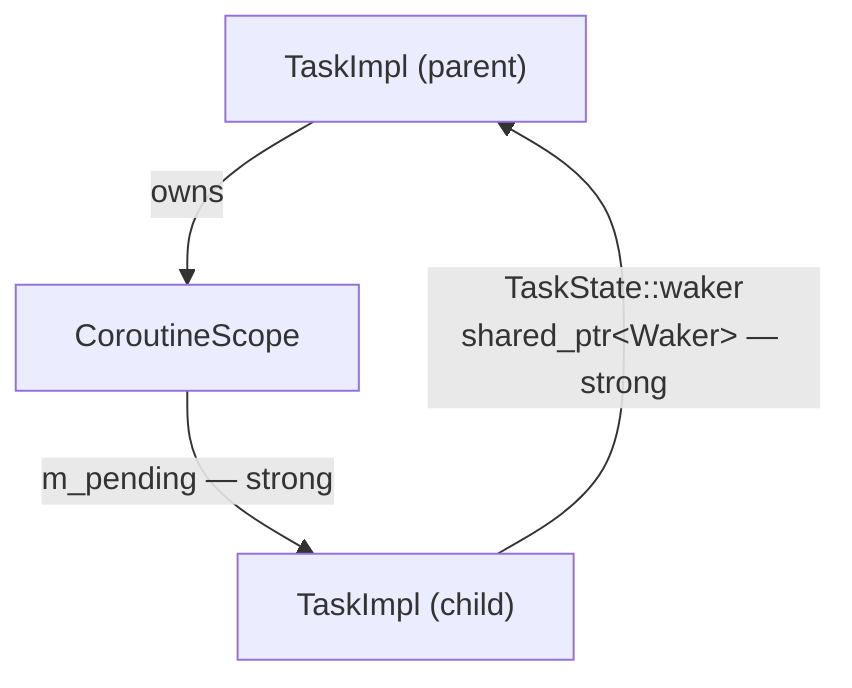
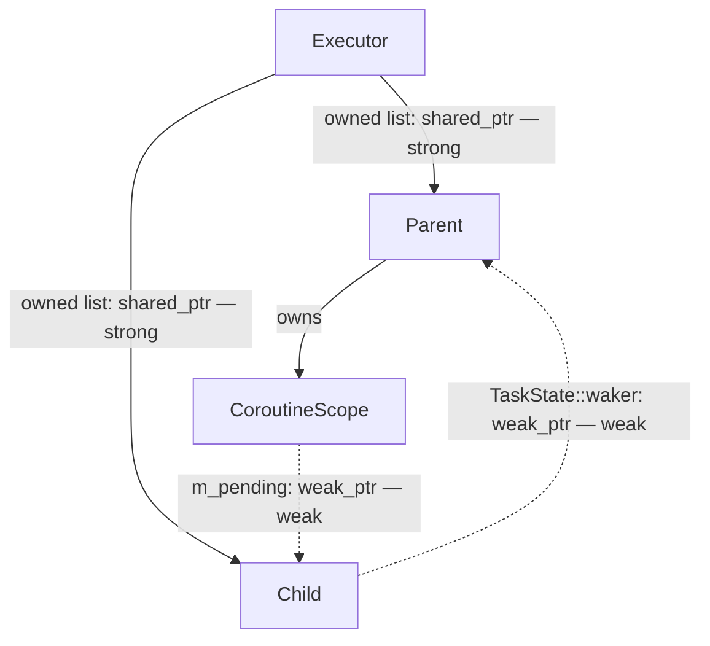
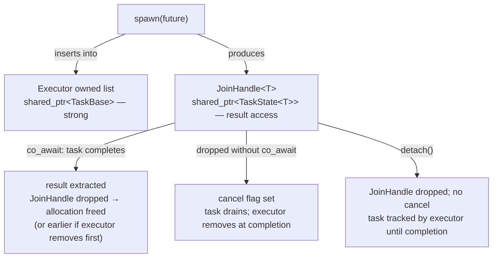
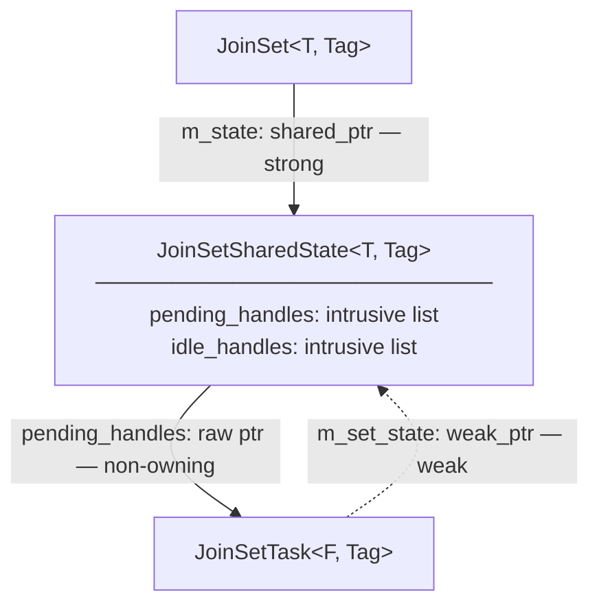
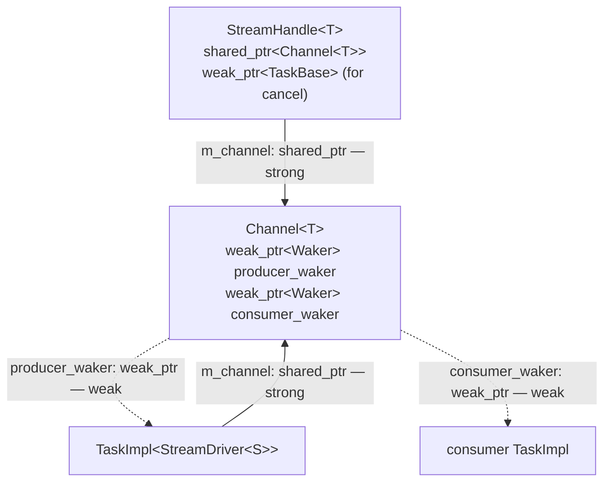
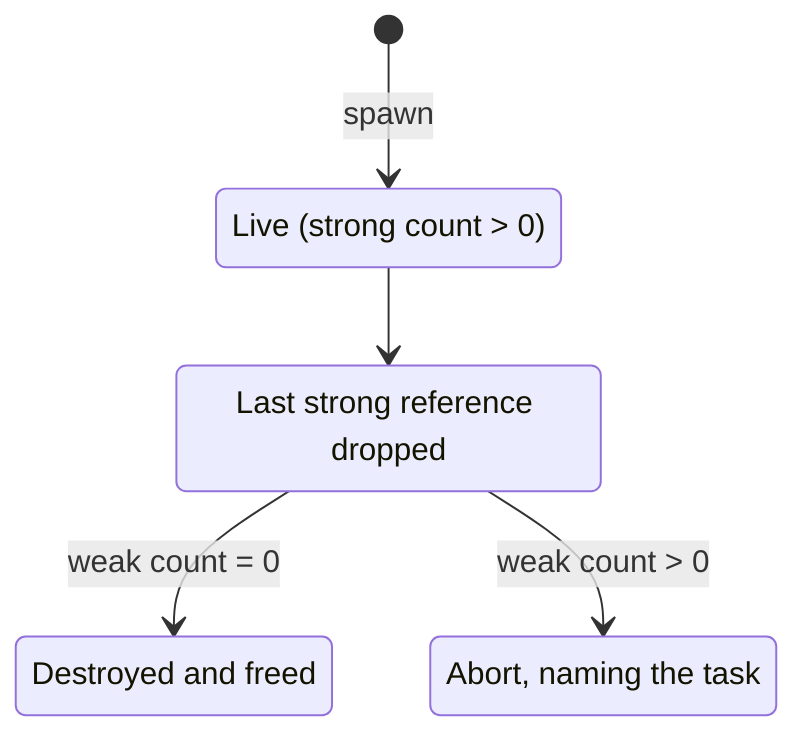

# Task Ownership Model

## Background

`TaskBase` IS the `Waker` — it inherits both `Waker` and
`enable_shared_from_this<TaskBase>`. `clone()` returns `shared_from_this()`, so a
waker clone is a strong `shared_ptr<TaskBase>` pointing to the same allocation as the
task itself.

This makes waker clones **dual-purpose**: they serve as both the *notification
mechanism* (calling `wake()` re-enqueues the task) and as a *strong reference* to the
task allocation. The problem is that any future which needs to notify a task also holds
a strong reference to it. For the `CoroutineScope` this creates a persistent strong
cycle:



Both edges are load-bearing — the parent must track children, and children must be
able to wake the parent — so the cycle cannot be removed without changing the mechanism.

---

## Design

Two complementary changes break all cycles and provide a clean ownership hierarchy:

**Executor-owned task list** — the executor holds a `shared_ptr<TaskBase>` for every
live task, from spawn until the task reaches a terminal state. This is always the
authoritative lifetime anchor. No other entity needs to hold a persistent strong
reference to a `TaskBase`/`TaskImpl` allocation while the task is running. `OwnedTask`
as a concept is eliminated: the executor IS the owner.

**`weak_ptr<Waker>` storage** — all fields that store wakers for later notification
change from `shared_ptr<Waker>` to `weak_ptr<Waker>`. `TaskBase` and the `Waker`
interface are otherwise unchanged. Firing a stored waker becomes `lock()` + `wake()`
rather than `->wake()`. If the task has been freed before the waker fires, `lock()`
returns null and the call is a safe no-op.

With these two changes, the reference graph for Cycle 3 becomes:



The executor is the root. Both edges between parent and child are weak. The parent's
allocation is kept alive by the executor's owned list, not by any child-held reference.

---

## Executor-owned task list

The executor maintains an intrusive doubly-linked list of all live tasks. The list node
is embedded directly in `TaskBase` — no separate allocation per entry. The list is
protected by a single mutex and is accessed at three points only:

- **Spawn** — insert the new task into the list
- **Completion** — remove the task; if no `shared_ptr<TaskState<T>>` references remain,
  the allocation is freed immediately
- **Shutdown** — iterate, cancel all tasks, and drain before returning from `block_on`

Normal polling never touches this list. The mutex is rarely contended.

This replaces `OwnedTask` as the mechanism that keeps a parked task alive between the
executor dropping its queue reference and the task being woken back into the queue. The
executor's owned list always covers this window.

---

## `JoinHandle<T>` — result access only

`JoinHandle<T>` holds a single `shared_ptr<TaskState<T>>`. This serves two purposes:

- While the task is running, it provides typed access to the result slot once the task
  completes (aliased into the same `TaskImpl` allocation as `TaskBase`).
- After the executor removes the task from its owned list at completion, if the
  `JoinHandle` is still alive it becomes the sole surviving reference to the allocation,
  keeping it live until the result is consumed.

`JoinHandle` holds no `OwnedTask` and is not the task's lifetime anchor while the task is
running — the executor's owned list handles that.



---

## Weak waker storage and `Context`

`TaskBase` and the `Waker` interface are unchanged. `clone()` still returns
`shared_from_this()` — a strong `shared_ptr<TaskBase>`. The change is in how futures
**store** wakers for later notification.

`Context` gains a `get_weak_waker()` accessor that returns a `weak_ptr<Waker>` to the
task:

```cpp
class Context {
public:
    std::shared_ptr<Waker> getWaker() const;        // existing — strong, for temporary use
    std::weak_ptr<Waker>   get_weak_waker() const;  // new — for persistent storage
};
```

Leaf futures and `TaskState::waker` change their stored type from `shared_ptr<Waker>`
to `weak_ptr<Waker>` and use `get_weak_waker()` to register:

```cpp
// Registering for notification — weak, does not extend task lifetime:
m_waker = ctx.get_weak_waker();

// Firing:
if (auto w = m_waker.lock()) w->wake();
```

An executor's `Context` holds no reference of its own: it is built from `*task`, and the
executor's own `Rc` keeps the task alive through the poll. `getWaker()` and
`get_weak_waker()` take a reference only when a future asks for one, through `clone()` and
`weak_clone()`. Most polls never ask, so this saves a reference count increment and
decrement per poll. A `Context` built from an `Rc<Waker>` (`blocking_wait()`, tests) holds
that `Rc` and returns it.

The executor constructs `Context` with a strong `shared_ptr<Waker>` for the duration
of the poll call. This temporary strong reference exists only while the task is
Running; it is dropped when `poll()` returns. It is not stored anywhere.

---

## JoinSet tasks

`JoinSet::spawn()` allocates a `JoinSetTask<F, Tag>` covering the executor-facing
`TaskBase`, the result-holding `TaskState<T>`, and the node that links it into the set and
holds its tag. Unlike a regular spawned task, there is no `JoinHandle`: the consumer reads
results via the `JoinSetSharedState`. `spawn()` returns a [`CancelHandle`](#cancelhandle)
instead, which can cancel the task but owns nothing.

With executor-level ownership, `JoinSetSharedState::pending_handles` doesn't need to
anchor each task's lifetime. It uses an intrusive list of raw `JoinSetTask*` pointers
(safe because the executor's owned list guarantees the tasks remain live) with O(1)
insertion, removal, and iteration:



On task completion, `on_task_complete()` unlinks `this` from `pending_handles` in O(1)
via the embedded intrusive list node, stores an aliased `shared_ptr<TaskState<T>>` to
itself (into the same allocation) in that node, and links the node into `idle_handles`
for the consumer to read. A node is in at most one of the two lists, and neither list
allocates. At this point the executor still holds the task via its owned list; when both
the executor's owned-list entry and the node's reference are dropped, the allocation is
freed. The consumer takes the reference when it pops the node (`next()` or a drain); a
`JoinSetSharedState` destroyed with nodes still in `idle_handles` drops their references
in its destructor.

On `JoinSet` destruction, `cancel_pending()` iterates `pending_handles`, calls
`cancel_task()` on each, and clears the list. Inside a coroutine it also registers each
cancelled task with the enclosing `CoroutineScope` as a `weak_ptr`, so the parent waits
for them. No ownership transfer is needed: the executor's owned list keeps every
cancelled task alive, and the executor-level drain on shutdown ensures all cancelled
tasks reach a terminal state before `block_on` returns.

---

## Stream tasks

`StreamHandle<T>` holds a `shared_ptr<Channel<T>>` for the consumer end of the channel.
The background `StreamDriver` task is tracked by the executor's owned list like any
other spawned task — no `OwnedTask` is needed in `StreamHandle`.

When `StreamHandle` is dropped, the channel's consumer end is closed. `StreamDriver`
detects this on its next poll (channel write returns a closed-channel error) and returns
`PollDropped`, after which the executor removes it from the owned list and the allocation
is freed.

For rapid cancellation without waiting for the driver to reach its next natural poll,
`StreamHandle` can call `cancel_task()` on the driver via a `weak_ptr<TaskBase>` — this
wakes the driver immediately so it polls and exits in the next executor cycle. The
`weak_ptr` does not anchor the driver's lifetime; that is the executor's job.



!!! warning "WARNING: Channel waker fields must remain weak_ptr"
    Do not change `Channel::producer_waker` or `Channel::consumer_waker` to `shared_ptr<Waker>`.
    Both fields form cycles through the task graph that prevent allocations from ever being freed
    when a task is cancelled. Use `ctx.get_weak_waker()` to set them and `lock()` before firing.

---

## Detached tasks

When `JoinHandle::detach()` is called, the caller surrenders ownership of the result.
The task continues running and is tracked by the executor's owned list like any other
task. No `self_owned` self-reference is needed — the executor guarantees the allocation
remains live until the task reaches a terminal state.

On `JoinHandle` drop without `detach()` (with `cancelOnDestroy = true`): the cancel
flag is set and the task will drain. The executor's owned list keeps it alive through
the drain.

A detached task can still be stopped before shutdown through a
[`CancelHandle`](#cancelhandle) taken before `detach()`.

On shutdown, the executor cancels all tracked tasks (including detached ones) and drains
them before `block_on` returns. Detached tasks are therefore not truly "fire and forget"
with respect to memory — they are cleaned up safely on shutdown — but they are decoupled
from any `CoroutineScope` and do not block their spawning coroutine from returning.

---

## `CancelHandle`

A copyable handle whose only operations are `cancel()` and `is_finished()`, like
Tokio's `AbortHandle`. The `JoinHandle` (or `StreamHandle`, `BlockingHandle`) stays the
task's only owner and the only way to get its result. A `CancelHandle` just lets other
code ask the task to stop.

The main use is a detached task that should still be stoppable: take a `CancelHandle`
first, then `detach()`.

```cpp
auto handle = coro::spawn(serve(conn));
coro::CancelHandle stop = handle.cancel_handle();
std::move(handle).detach();
// ... later:
stop.cancel();
```

Where one comes from:

| Source | Gives |
|---|---|
| `JoinSet::spawn()`, `JoinSetSpawnBuilder::spawn()` | A handle to the new task. Ignoring it is fine. |
| `JoinHandle::cancel_handle()` | `Empty` for an empty, moved-from or detached handle; `Finished` once `poll()` has seen the task end. |
| `StreamHandle::cancel_handle()` | A handle to the background task; `Empty` for an empty or moved-from handle. |
| `BlockingHandle::cancel_handle()` | A handle to the blocking task, even after `detach()`: a detached `BlockingHandle` keeps its task and can still be awaited. |

`co_await handle` on an lvalue `JoinHandle` moves the handle into the awaiter, so a
`cancel_handle()` taken afterwards is `Empty`. Take it before awaiting.

### States

The handle keeps its own state, and every answer comes from it:

| State | Meaning | `cancel()` | `is_finished()` |
|---|---|---|---|
| `Empty` | Default-constructed, moved-from, or taken from a handle with no task | does nothing | throws `std::logic_error` |
| `Tracking` | The task may still be running | cancels the task, unless it has ended | asks the task |
| `Finished` | The task has ended, with a value, an exception or cancelled | does nothing | `true` |

`is_finished()` throws on an `Empty` handle because there is no task to answer for:
`false` would say the task is running, and `true` that it ran.

The task pointer is used only while `Tracking`. The moment `cancel()` or `is_finished()`
sees the task has ended, the handle releases the pointer and becomes `Finished`, so a
handle kept around does not pin the task's memory. (With `make_shared`, a `weak_ptr`
keeps the whole allocation alive after the task is destroyed.) An expired pointer also
means the task has ended, since the executor holds every task until then. A debug assert
checks that the pointer is engaged only while `Tracking`.

A moved-from handle is `Empty`: the move operations are hand-written so that it is not
left `Tracking` with no task.

### Behaviour

- **One `Weak<TaskBase>`,** a Category 4 reference. `cancel()` locks it and calls the
  virtual `TaskBase::cancel_task()`. So it is not a template, one type serves every
  kind of task, and the task needs no new fields.
- **Same effect as `JoinHandle::cancel()`:** the task ends as cancelled at its next
  poll. An awaiting `JoinHandle` sees it end as cancelled, and a `JoinSet` reports it
  with `JoinResult::is_cancelled()`. For a blocking task it is a request, seen at the
  callable's next cancellation point, as with `BlockingHandle::request_cancel()`.
- **A late cancel changes nothing.** A cancel that arrives after the task has stored its
  result is ignored: `JoinHandle::poll()` returns the result whenever one is present,
  whatever the `cancelled` flag says.
- **It never keeps the task alive.** After the task is freed, `lock()` fails and
  `cancel()` does nothing.
- **Dropping never cancels.** It is not a `Future`, so it does not satisfy
  `Cancellable`, and discarding one is harmless. `JoinSet::spawn()`'s return is
  therefore not `[[nodiscard]]`.
- **Threads.** `cancel_task()` is safe from any thread, so copies of one handle may be
  used on any threads at once. One object may not: `cancel()` and `is_finished()` are
  `const` yet may release the pointer, which races with another call on the same
  object. Give each thread its own copy; copying is cheap. A mutex in every handle would
  cost more than the copy it saves.

This replaces the dropped `CancellationToken` idea. Built-in cancellation already
reaches every task without code in the task, which an opt-in token can't. For a
graceful shutdown, where tasks choose how to wind down, use a `watch` channel that
the tasks `select` on.

---

## Reference categories

Every `shared_ptr` or `weak_ptr` touching a `TaskBase`/`TaskState` allocation falls
into one of four categories.

!!! note "NOTE: The categories outlive `shared_ptr`"
    These categories describe ownership, not a pointer type. The planned intrusive
    reference counts (see [Planned: intrusive reference counting](#planned-intrusive-reference-counting))
    change how each reference is stored, but not which category it belongs to.

---

### Category 1 — Executor owned list: the authoritative lifetime anchor

The executor holds one `shared_ptr<TaskBase>` per live task in its owned-list from
spawn until terminal state. This is the single entity whose lifetime controls when the
`TaskImpl` allocation MAY be freed (the actual free happens when all Category 2
references are also released).

No other data structure may hold a persistent `shared_ptr<TaskBase>` as a lifetime
anchor. The executor's owned list is the only correct place.

---

### Category 2 — `shared_ptr<TaskState<T>>`: result access and post-completion lifetime

`JoinHandle<T>` holds `m_state: shared_ptr<TaskState<T>>`. Both Category 1 and
Category 2 are aliased `shared_ptr`s into the same `TaskImpl` allocation — they share
one reference count.

Category 2 references exist for result reading (`poll()`, reading the value after
completion). After the executor removes the task at terminal state, any surviving
Category 2 references extend the allocation's lifetime until they are released.

`block_on` uses this same pattern for its root task:

```cpp
auto impl = std::make_shared<detail::TaskImpl<F>>(std::move(future));
std::shared_ptr<detail::TaskState<...>> state = impl;  // aliased — same allocation
m_executor->schedule(std::shared_ptr<detail::TaskBase>(impl));
m_executor->wait_for_completion(*state);
// state keeps TaskImpl alive on the call stack for the duration of block_on()
```

Each `JoinSetTask` in `JoinSet::idle_handles` also holds a `shared_ptr<TaskState<T>>`
to itself, aliased into its own allocation, keeping it alive until the consumer reads
the result.

---

### Category 3 — Executor queue: temporary strong reference (Notified/Running only)

Executor queues (`m_ready`, `m_local_queues`, `m_injection_queue`, `m_incoming_wakes`)
hold `shared_ptr<TaskBase>`. These exist only while the task is in the `Notified` or
`Running` state. They are in addition to, not instead of, the Category 1 owned-list
entry.

These references **must not** be changed to `weak_ptr`.

---

### Category 4 — `weak_ptr<Waker>`: notification only, no lifetime ownership

All wakers stored for later notification are `weak_ptr<Waker>`:

- `TaskState::waker` — a single slot shared between `JoinHandle::poll()` (while the
  caller awaits the result) and `CoroutineScope` (while the scope waits for a dropped
  child to drain).
- Leaf futures (I/O readiness, sleep, channels, etc.) — store the waker from `ctx.get_weak_waker()`

A `weak_ptr<Waker>` does not contribute to the reference count of the task it points
at. Firing is `if (auto w = stored_waker.lock()) w->wake()`. If the task has already
been freed, `lock()` returns null and the call is a safe no-op.

**This is the correct storage type for any waker that will be held across a suspension
point.** Using `shared_ptr<Waker>` instead creates an ownership cycle because
`TaskBase IS the Waker` — storing a strong waker clone inside an object transitively
owned by the same `TaskImpl` forms a cycle that prevents the task from ever being freed.
See [shared_ptr_cycles.md](../notes/shared_ptr_cycles.md) for the full cycle analysis.

---

### Quick-reference table

| Usage | Type | Category | Why |
|---|---|---|---|
| Executor owned list entry | `shared_ptr<TaskBase>` | 1 — lifetime anchor | authoritative owner from spawn to terminal state |
| `JoinHandle::m_state` | `shared_ptr<TaskState<T>>` | 2 — result access | typed result access; same allocation; extends lifetime after executor removes at completion |
| `JoinSetSharedState::Node::completed` (while in `idle_handles`) | `shared_ptr<TaskState<T>>` | 2 — result access | the task's reference to itself, aliased into its own allocation; consumer takes it on pop and reads the result directly |
| `Runtime::block_on()` local `state` | `shared_ptr<TaskState<T>>` | 2 — result access | root task anchor for synchronous call stack |
| Executor queue entries | `shared_ptr<TaskBase>` | 3 — temporary (Notified/Running) | task must stay alive between enqueue and poll |
| `TaskState::waker` | `weak_ptr<Waker>` | 4 — notification only | shared slot for JoinHandle awaiter and CoroutineScope drain; must not create cycle |
| Leaf future waker fields | `weak_ptr<Waker>` | 4 — notification only | fires task wake from I/O or timer callback |
| `Channel::producer_waker` | `weak_ptr<Waker>` | 4 — notification only | wakes StreamDriver when buffer has space; must not create cycle |
| `Channel::consumer_waker` | `weak_ptr<Waker>` | 4 — notification only | wakes consumer task when buffer has items or stream is closed; must not create cycle |
| `CoroutineScope::m_pending` | `vector<weak_ptr<TaskBase>>` | — non-owning | drain tracking only; executor's owned list provides lifetime |
| `JoinSetSharedState::pending_handles` | intrusive list of `JoinSetTask*` | — non-owning | O(1) task lookup/removal; executor's owned list provides lifetime |
| `StreamHandle` driver ref | `weak_ptr<TaskBase>` | — non-owning | cancel-on-drop only; executor's owned list provides lifetime |
| `CancelHandle::m_task` | `weak_ptr<TaskBase>` | 4 — cancel only | engaged only while `Tracking`; released once the handle sees the task end |

---

## Cycle analysis

Each row is a cycle that strong references at that point would form, and what breaks it.

| Potential cycle | How it is broken |
|---|---|
| 1: `TaskImpl → Coro → CoroutineScope → waker → TaskImpl` | `CoroutineScope` stores no waker of its own; waker storage is `weak_ptr` |
| 2: `JoinSetSharedState → pending_handles → JoinSetTask → JoinSetSharedState` | `JoinSetTask::m_set_state` is `weak_ptr<JoinSetSharedState>`; `pending_handles` uses raw pointers, not strong refs |
| 3: `CoroutineScope → TaskState_child → waker → TaskBase_parent` | `CoroutineScope::m_pending` uses `weak_ptr`; `TaskState::waker` is `weak_ptr`; no strong edge in either direction |
| 4: `TaskImpl → TaskState → waker of its own task → TaskImpl` | `TaskState` holds no waker for its own task; `JoinHandle::cancel()` wakes the task through its own weak task reference. No future stores a strong waker pointing back to its own task |
| Detached task self-ref: `TaskImpl → self-reference → TaskImpl` | A detached task holds no reference to itself; the executor's owned list is its lifetime anchor |
| 5: `StreamDriver → m_channel → producer_waker → StreamDriver` | `Channel::producer_waker` is `weak_ptr<Waker>` |
| 6: `consumer_task → StreamHandle → m_channel → consumer_waker → consumer_task` | `Channel::consumer_waker` is `weak_ptr<Waker>` |

---

## Invariants

**1. The executor's owned list is the sole persistent `shared_ptr<TaskBase>`.**
No other data structure holds a persistent strong reference to a `TaskBase` allocation
while the task is alive. Temporary strong references (executor queue entries,
`weak_ptr::lock()` during waker firing, `shared_from_this()` during `on_task_complete()`)
are held only for the duration of the current call stack and are never stored.

**2. The executor inserts each task exactly once (at spawn) and removes it exactly once
(at terminal state).**
Between these two events, the executor's owned list guarantees the allocation is live.
After removal, any remaining Category 2 references (`JoinHandle::m_state`,
`JoinSetSharedState::idle_handles`) extend the allocation until they are released.

**3. `weak_ptr<Waker>` is always used for stored wakers.**
`Category 4` wakers must use `get_weak_waker()` and `lock()` before firing. Using
`shared_ptr<Waker>` for any stored waker field creates a reference cycle through the
task graph.

**4. `cancel_pending()` may iterate raw task pointers safely.**
Because the executor's owned list keeps every tracked task alive, iterating
`JoinSetSharedState::pending_handles` (raw pointers) or `CoroutineScope::m_pending`
(`weak_ptr<TaskBase>`) is safe as long as the iteration happens while the executor is
running and before the owned list entry is removed (i.e., before terminal state). Under
the shared mutex, this is always the case.

**5. `cancel_pending()` does not need to transfer tasks to a `CoroutineScope`.**
The executor-level drain on shutdown ensures all cancelled tasks reach a terminal state
before `block_on` returns. `add_child()` is not required for JoinSet cancellation.

**6. Detached tasks are tracked by the executor.**
`JoinHandle::detach()` removes the handle's Category 2 reference. The executor's owned
list keeps the task alive. On shutdown, the executor cancels and drains all tracked
tasks including detached ones — no self-reference or external anchor is needed.

---

## Planned: intrusive reference counting

!!! tip "TODO: Intrusive reference counting for tasks"
    Replace `make_shared`'s control block with counts stored in the task, so each task
    reference is one pointer and task allocations shrink (320 to 256 bytes for a
    `TaskImpl`). The plan, with its rules and migration stages, is the rest of this
    section.

The ownership model above keeps its shape. The executor's owned list is still the
lifetime anchor, and notification references still own nothing. What changes is how
references are represented:

- **The counts move into the task.** `Rc<Waker>` and `Weak<Waker>` (and the `TaskBase`
  forms) stay RAII types that adjust the counts automatically, as `shared_ptr` and
  `weak_ptr` do. Each becomes a single 8-byte pointer to the task, not a pointer pair.
- **A `Weak` must not outlive the task.** Today a `weak_ptr` may outlive its target,
  and `lock()` then returns null. Under the new rule, every `Weak` is destroyed before
  the task's last strong reference drops. The weak count becomes a check: if it is not
  zero when the strong count reaches zero, the process aborts.

### Why

A task's allocation is larger than `sizeof` suggests. `make_shared` puts a 16-byte
control block (a vptr and the two counts) in front of the object in the same
allocation. Because `TaskBase` is `alignas(64)`, that block is padded to 64 bytes so the
task starts on a cache line. Measured on x86-64 GCC:

| Type | `sizeof` | `make_shared` allocation |
|---|---|---|
| `TaskImpl<Coro<size_t>>` | 256 | 320 |
| `JoinSetTask<Coro<size_t>>` | 320 | 384 |

The `shared_ptr` machinery accounts for 112 bytes of a `TaskImpl` allocation:

- 64 bytes for the control block and its padding;
- 16 bytes for the `enable_shared_from_this` weak pointer, which only exists so
  `clone()` can find the control block;
- 16 bytes for `owned_self`, the owned list's strong reference stored in the task;
- 8 of the 16 bytes of the `TaskState::waker` slot.

Size is not the only reason. A `weak_ptr` keeps the allocation's memory alive until the
`weak_ptr` itself goes away. A `weak_ptr` left in a long-lived structure, such as a timer
entry that is never removed, pins that memory indefinitely, and nothing reports it.
Under this design the memory is freed as soon as the last strong reference drops, and
the same mistake aborts the process, naming the task.

### The state word

`Waker` gains one 32-bit word that packs the scheduling state, task flags and the
strong count, as Tokio's task header does. It replaces both the 8-bit
`scheduling_state` and the `shared_ptr` strong count. The weak count is a separate
32-bit atomic beside it (see below).

| Bits | Field |
|---|---|
| 0–2 | `SchedulingState` (the five states described above) |
| 3 | `CANCELLED`: replaces `TaskState::cancelled`, set by `JoinHandle`'s destructor and `cancel_task()` |
| 4–7 | Reserved for flags |
| 8–31 | Strong reference count, in units of `REF_ONE = 1 << 8` |

- **Reference count changes** use `fetch_add` and `fetch_sub` of `REF_ONE`. These never
  disturb the low bits, so cloning a waker needs no CAS. 24 bits allow about 16 million
  references; an increment that would overflow aborts.
- **Scheduling transitions** stay CAS loops, now over the whole word, preserving the
  count bits. A concurrent clone or drop can make a CAS retry. That is the cost of
  sharing the word, and Tokio accepts the same cost.
- **Setting `CANCELLED`** is a `fetch_or`.
- **Wakers that are not tasks** (`BlockingWaker`, test mocks) use only the count bits.
  Keeping the word in `Waker` makes reference counting non-virtual for every waker.
- **Destruction** goes through `Waker`'s virtual destructor. The control block's vptr
  is gone, because the task already has one.
- **On Pico** the word is a plain integer, as `RelaxedState` is today.

`cancel_requested` stays a plain `bool`. It is only touched by the polling thread and
fills padding that would otherwise be wasted, so moving it into the word would turn plain
stores into atomic read-modify-writes and save nothing. `terminated` and the `waker`
slot stay under `TaskStateBase::mutex`. Tokio replaces that mutex with more flag bits
(`COMPLETE`, `JOIN_WAKER`), but doing so rewrites the completion protocol. That is a
separate change, which the reserved bits leave room for, and it needs a profile to
justify it under the mutex-over-atomics convention.

### Weak references and the weak count

`Weak` keeps its role: it is a reference that owns nothing, used for every Category 4
waker and every "notify or cancel, but don't keep alive" link. What changes is its
lifetime contract:

- **Creating, copying or destroying a `Weak`** increments or decrements the weak count,
  as `weak_ptr` does now.
- **`lock()`** increments the strong count without checking it first. The contract
  guarantees the target is alive while any `Weak` to it exists, so there is no CAS loop.
  Debug builds assert that the strong count was not zero.
- **When the strong count reaches zero**, the task is destroyed and freed at once,
  unless the weak count is not zero. Then the process aborts, naming the task. This
  check is in every build, not only debug builds. The weak count never keeps memory
  alive; it only reports a `Weak` that outlived its task.

The weak count does not need libstdc++'s convention of reserving one weak count for
all strong references together. The memory is freed when the strong count reaches
zero, so there is no separate "last weak reference frees" path to coordinate with.

`Weak` references held as intrusive list links change shape, because a list that
outlives its members must unlink them at completion:

| Today | Planned |
|---|---|
| `TaskState::waker`, leaf future, channel, timer and I/O waker fields (`weak_ptr<Waker>`) | `Weak<Waker>`, 8 bytes |
| `StreamHandle`'s driver reference (`weak_ptr<TaskBase>`) | `Weak<TaskBase>`, 8 bytes |
| `CancelHandle::m_task` (`weak_ptr<TaskBase>`) | `Rc<TaskBase>`, 8 bytes, released as today once the handle sees the task end |
| `CoroutineScope::m_pending` (`vector<weak_ptr<TaskBase>>`) | An intrusive list, unlinked by the child at completion, as `JoinSet` does |
| `JoinSetSharedState::pending_handles` (raw pointers today) | Unchanged, except that linking a node takes a weak count and unlinking it releases the count |

A `CancelHandle` is the one holder that has to become strong. It belongs to the
user and may be kept for as long as they like, long after the task ends, so no rule can
make it release its reference in time. A strong reference keeps the task's memory alive
until the handle is dropped or sees the task end, as the `weak_ptr` does today through
`make_shared`'s shared allocation; the task's future is already destroyed by then. It
then doesn't satisfy "never keeps the task alive" in
[`CancelHandle`](#behaviour); that text changes with the switch.

Intrusive links are the only place raw task pointers remain. They adjust the weak count
explicitly when they link and unlink, so the abort check covers them too.
`JoinSetTask::m_set_state` is a weak reference to `JoinSetSharedState`, which is not a
task, so it keeps its current type.

Two rules make the contract hold:

!!! danger "WARNING: Destroy every `Weak` before the task's last strong reference drops"
    A holder releases its `Weak` when the waiting future is destroyed, if firing the
    waker has not already released it. This works because the future is reset when
    the task reaches a terminal state, which runs every registration's destructor,
    while the owned list still holds the task. Keep that order: reset the future
    first, remove the task from the owned list second.

!!! danger "WARNING: Upgrade a stored `Weak` under the holder's lock"
    Wakers are fired after unlocking. If a holder moves its `Weak` out under the lock
    and calls `lock()` only after unlocking, the target can finish in that gap. The
    abort check then sees an outstanding weak count. So, while holding the lock, call
    `lock()` and release the `Weak`. After unlocking, call `wake()` on the resulting
    `Rc`. The target's deregistration takes the same lock, so it cannot interleave.
    Mark each site with a `// RACE:` comment naming the lock.



### Handles and aliased references

A `shared_ptr` can alias: `JoinHandle`'s `shared_ptr<TaskState<T>>` shares the task's
count but points at a different base. An intrusive count lives in `Waker`, which
`TaskState<T>` does not inherit. So `JoinHandle<T>`, `StreamHandle<T>` and
`Runtime::block_on()`'s local reference each hold a strong task reference plus a typed
`TaskState<T>*`. That is 16 bytes, the same as today, and it sits in the handle, not in
the task. `JoinHandle`'s destructor sets `CANCELLED` through the task reference.

A `JoinSetSharedState::Node` is embedded in its own task. While the node is in
`idle_handles`, the list holds a strong count on the task, so `Node::completed` shrinks
from a 16-byte aliased `shared_ptr` to an 8-byte `TaskState<T>*`.

### Expected sizes

Measured with a mock of the planned layout on x86-64 GCC, keeping `alignas(64)`:

| Type | Data | Allocation today | Allocation planned |
|---|---|---|---|
| `TaskImpl<Coro<size_t>>` | 208 | 320 | 256 |
| `JoinSetTask<Coro<size_t>>` | 256 | 384 | 256 |

With the switch, the alignment costs no padding, because nothing sits in front of the object
in its allocation. `JoinSetTask` uses all 256 bytes, with no room to spare. Moving
`cancelled` into the state word is what frees the last 8 bytes.

### Audit

Before switching, every holder of a `Weak` must be checked against the first rule.
Holders whose stored reference can outlive the waiting future need fixing.
The IoDriver's timer and fd registrations are known cases. Also check:

- the `Mutex` waiter queue;
- the waker lists in `broadcast`;
- the waker slots in `oneshot`, the channels and `isr_event`;
- the lwIP callback results.

Some of these store a strong `Rc<Waker>` today. Those do not need to change: a strong
reference cannot dangle, and its only failure is keeping the task alive if it is never
released. The audit only needs to confirm that each one is released when its future is
destroyed. Converting one to `Weak` is optional; it gains the abort check in exchange
for following the two rules above.

### Scope

- **Changes:** the `Waker` base and every `Waker` subclass (`TaskBase`,
  `BlockingWaker`, and the test mocks); every field and parameter typed `Rc<Waker>`,
  `Weak<Waker>`, `Rc<TaskBase>` or `Weak<TaskBase>`, including the executor queues,
  `Context` and the owned lists; `JoinHandle`, `StreamHandle`, `CancelHandle`,
  `CoroutineScope` and `JoinSet`'s nodes.
- **Unchanged:** `Rc` and `Weak` for types that are not wakers, such as
  `JoinSetSharedState` and channel state. These stay `std::shared_ptr` off Pico.
- **The atomics convention:** the strong and weak counts are atomics,
  but `shared_ptr`'s counts already are. The state word extends the existing
  scheduling-state exception rather than adding a new synchronization protocol.

### Migration stages

The sections above describe the end state. Getting there takes three changes, each
tested on its own before the next starts:

| Stage | Change | `TaskImpl` allocation | `JoinSetTask` allocation |
|---|---|---|---|
| Today | `shared_ptr` / `weak_ptr` | 320 | 384 |
| 1 | Intrusive counts, today's weak semantics | 256 | 320 |
| 2 | `Weak` must not outlive the task | 256 | 320 |
| 3 | Strong count and `CANCELLED` packed into the state word | 256 | 256 |

**Stage 1: intrusive counts, no change in behaviour.** Every `Rc` and `Weak` of `Waker`
or `TaskBase` switches to the intrusive types. The strong and weak counts are two plain
32-bit atomics in `Waker`. `last_worker_index` moves next to `scheduling_state` so the
counts fill existing padding. `JoinHandle`, `StreamHandle` and `block_on()` hold a task
reference plus a typed `TaskState<T>*` instead of an aliased `shared_ptr`. Weak
semantics stay exactly as they are today:

- When the strong count reaches zero, the payload is destroyed.
- When the weak count reaches zero, the memory is freed.
- `lock()` returns null once the strong count is zero.

So the IoDriver, `CoroutineScope` and every other `Weak` holder keep their current
logic, and the existing tests, TSan runs included, stay a valid baseline. This stage
needs three pieces of machinery that stage 2 removes:

- **A split between destruction and freeing.** The payload (result, exception, name,
  stream buffer) is destroyed when the strong count reaches zero, while the counts must
  stay readable until the weak count reaches zero. They must not be read from an
  object whose destructor has run. GCC's default `-flifetime-dse` treats that storage
  as dead, and sanitizers report the cross-thread reads. Workable layouts include:
    - a virtual hook that resets the payload members;
    - holding the payload in a `std::optional`;
    - counts in a header in front of the object that its destructor never touches.
      The header must not bring back the padding in front of a 64-byte-aligned task.

    The choice is left to the implementation.
- **One weak count held for all strong references together**, as libstdc++ does, so
  that only the thread that brings the weak count to zero frees the memory.
- **A CAS loop in `lock()`** that increments the strong count only if it is not zero.

**Stage 2: the `Weak` lifetime invariant.** This stage applies the two rules in
[Weak references and the weak count](#weak-references-and-the-weak-count):

- Fix every holder the audit finds, starting with the IoDriver's registrations.
- Convert `CoroutineScope::m_pending` to an intrusive list that children unlink at
  completion.
- Make `JoinSet`'s links take and release a weak count.
- Add the abort when the strong count reaches zero while the weak count is not.

Then remove the stage 1 machinery: the task is destroyed and freed at once, and `lock()`
becomes an unconditional increment. A forgotten `Weak` turns from silently pinned
memory into an abort that names the task.

**Stage 3: the packed state word.** This stage moves the strong count and
`TaskState::cancelled` into the state word described in [The state word](#the-state-word),
so every scheduling transition becomes a CAS that preserves the count bits.
`JoinSetTask` reaches 256 bytes in this stage. It is last because it is the only stage
that changes the scheduling protocol, and it is easier to review once reference
counting is settled.

### Alternatives considered

- **Weak references that may outlive the task (`make_shared` semantics).** These keep
  a `lock()` that can fail safely. But the memory stays allocated until the last weak
  reference drops, and a weak reference that is never removed pins it silently and
  indefinitely. The abort check covers the same mistakes and makes them loud.
- **Raw pointers with a hand-maintained count.** These have the same layout as the
  planned `Weak`, but every holder must remember to adjust the count, and a missed
  adjustment hides from the check. A RAII `Weak` makes the count automatic.
- **Strong wakers only (Tokio).** Tokio has no weak or raw waker references, and a
  stored waker owns the task. Missing a removal then keeps the whole task alive,
  coroutine frame included, and produces no report. With the planned `Weak`, the same
  mistake aborts.
