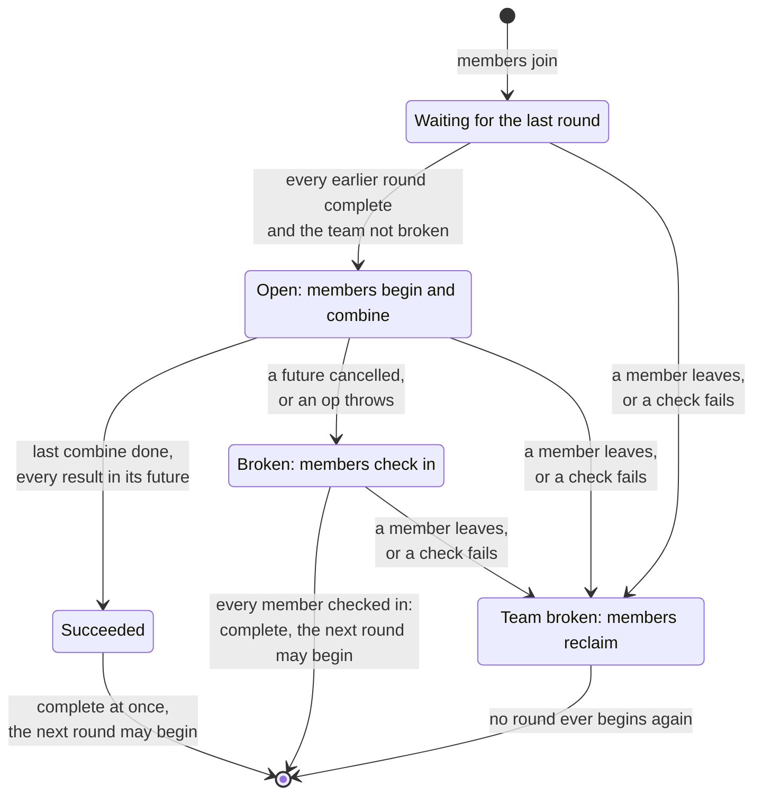
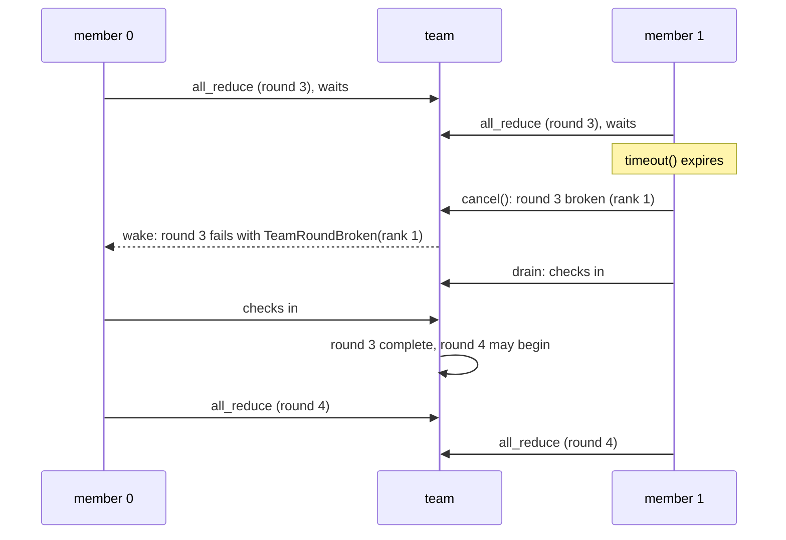
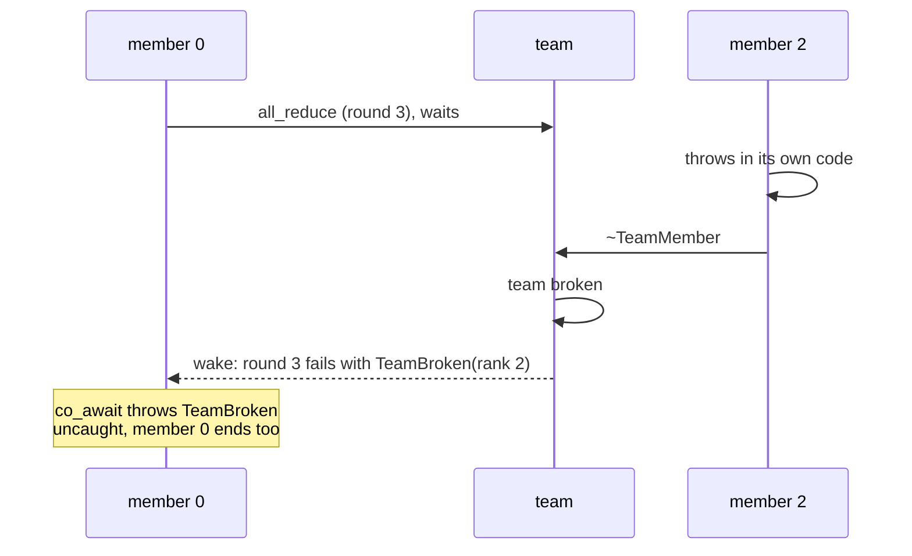
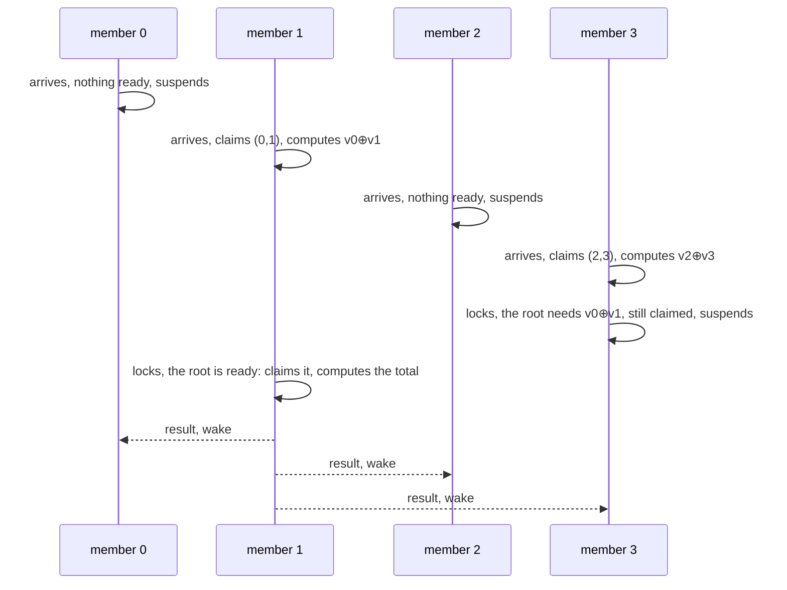

# Team

A `coro::Team` is a fixed group of `k` tasks that know each other by rank and run
collectives together: a barrier, reductions, scans, broadcasts, gathers and scatters, on
single values or element by element over arrays. Each task holds one move-only
`TeamMember` handle. If a member's task ends for any reason while the others still expect
it, the team breaks, and every collective that needed that member fails with `TeamBroken`
instead of hanging. A collective that times out fails only its round.

```cpp
#include <coro/sync/team.h>

// Each member filters its share of the rows, then writes its survivors after those of
// the members before it.
coro::Coro<void> compact(coro::TeamMember me, const Table& table, Out& out) {
    const auto [begin, end] = me.range(table.rows());
    std::vector<Row> kept = filter_rows(table, begin, end);

    const std::size_t offset = co_await me.exclusive_scan(kept.size(), std::size_t{0});
    const std::size_t total  = co_await me.all_reduce(kept.size());
    if (me.rank() == 0) out.resize(total);
    co_await me.sync();                   // out is sized
    std::ranges::copy(kept, out.begin() + offset);
}

coro::JoinSet<void> set;
for (coro::TeamMember& member : coro::make_team(k))
    set.spawn(compact(std::move(member), table, out));   // table and out outlive the drain
co_await set.drain();
```

[`parallel()`](parallel.md) builds one team per call and gives each part its member, so
the same collectives are available there with no setup:

```cpp
co_await coro::parallel(coro::worker_count(), compact, std::cref(table), std::ref(out));
```

---

## Motivation

[`Barrier`](barrier.md) separates phases, but a phase often needs more than "everyone is
done". Each part has a value, and every part needs something derived from all of them:

- a **total** or **maximum** (the size of the output, the largest error);
- an **offset**: each part produced a different number of items and must know where its
  own go (a scan);
- a **decision**: has every part converged? did any part find a match?
- **one part's value**: a parameter computed once and used by all (a broadcast);
- **every part's value**: the boundaries each part found, in part order (a gather).

With a bare `Barrier`, each of these is a shared array indexed by part, a barrier, a read,
and a second barrier before the array can be reused. That's easy to get subtly wrong (a
part that rereads the array after another has started overwriting it), and each use repeats
it.

The values aren't always small. A part's contribution can be a histogram, a matrix or a
partial model, which is expensive to copy, or a buffer owned through a move-only handle,
which can't be copied at all. Merging those needs work that runs in parallel, and copies
made only where a result really goes to more than one part.

The bigger problem is failure. A `Barrier` can't tell that one of its tasks has ended, so
a task that throws or returns early leaves the rest waiting forever. `parallel()` avoids
that by cancelling the rest, but code that spawns its own tasks has to remember to. A team
detects it: membership is a handle, and the handle's destructor runs whenever the task ends.

---

## Prior art

These are the libraries this design is measured against. Two kinds exist: barriers
without ranks, which carry no data, and groups with ranks, which provide collectives.
A third set covers how the work of a collective is done.

### Barriers without ranks

| Library | Membership | Data per round | Failure handling |
|---|---|---|---|
| C++20 `std::barrier` | fixed; `arrive_and_drop()` lowers the count for later phases | none; a completion function runs once per phase | none |
| Java `CyclicBarrier` | fixed | none; a barrier action runs once per round | **broken barrier**: a thread that is interrupted or times out breaks it, and every other waiter gets `BrokenBarrierException` |
| Java `Phaser` | dynamic: `register()`, `arriveAndDeregister()`; phasers can form a tree | none; numbered phases | none |
| .NET `Barrier` | dynamic: `AddParticipant()`, `RemoveParticipant()` | none; a post-phase action | an exception in the post-phase action reaches every participant as `BarrierPostPhaseException` |
| tokio `sync::Barrier`, Rust `std::sync::Barrier`, `pthread_barrier_t` | fixed | none; a leader flag | none |
| `coro::Barrier` | fixed | none; a leader flag | none |

### Groups with ranks

| Library | Ranks | Collectives | Size | Failure handling |
|---|---|---|---|---|
| **MPI** communicators | `MPI_Comm_rank`, `MPI_Comm_size` | barrier, bcast, reduce, allreduce, gather, allgather, scatter, scan, exscan, alltoall, reduce_scatter; reductions work element by element over buffers | fixed; `MPI_Comm_split` and `MPI_Comm_dup` create new communicators | by default the job aborts. The **ULFM** extension (Open MPI, MPICH; `MPIX_` routines) reports a dead process as `MPIX_ERR_PROC_FAILED` from the collectives that involve it, `MPIX_Comm_revoke` spreads the failure to every member, `MPIX_Comm_agree` reaches consensus among the survivors, and `MPIX_Comm_shrink` builds a **new** communicator of the survivors, with new ranks |
| **Fortran 2018** coarrays | image indices `1..num_images()` | `co_sum`, `co_min`, `co_max`, `co_reduce`, `co_broadcast`, `sync all`, `sync images`; the reductions take an optional `result_image` (a root) | fixed; `form team` creates subteams | collectives and image control statements return a status instead of hanging. A **failed** image (`STAT_FAILED_IMAGE`) is distinct from a **stopped** one (`STAT_STOPPED_IMAGE`, a normal exit), and `failed_images()` / `stopped_images()` list them. When several error statuses apply, `STAT_FAILED_IMAGE` has the lowest priority |
| **CUDA** cooperative groups | `thread_rank()`, `size()` | `sync()`, `cg::reduce`, `cg::inclusive_scan`, `cg::exclusive_scan`, broadcast by `shfl`, `any` / `all` / `ballot`, `match_any` / `match_all` | fixed; `tiled_partition` creates subgroups. `coalesced_threads()` forms a group from the threads active at that point, fixed once formed | none: GPU lanes don't fail independently |
| **OpenMP** teams | `omp_get_thread_num()` | `barrier`, the `reduction` clause, `single` with `copyprivate` (a broadcast), `masked`, `scan` (5.0) | fixed for the parallel region | `cancel parallel`, which takes effect at cancellation points |
| **SYCL 2020** group algorithms | `get_local_linear_id()` in a group or sub-group | `reduce_over_group`, `inclusive_scan_over_group`, `exclusive_scan_over_group`, `group_broadcast`, `any_of_group` / `all_of_group` / `none_of_group`, shifts and permutes | fixed | none |
| **Kokkos** `TeamPolicy` | `team_rank()`, `team_size()` | `team_barrier()`, `team_reduce()`, `team_scan()`, `team_broadcast()`, `single(PerTeam)`; custom reducers combine in place through `join(dest&, const src&)` | fixed for the kernel launch | none |
| **NCCL** / PyTorch `torch.distributed` | rank, world size | allreduce, broadcast, reduce, allgather, reduce_scatter, send/recv | fixed; split or `new_group` create new groups | `ncclCommAbort` ends every pending operation, and the group is re-created or shrunk to the survivors. Network errors arrive asynchronously. TorchElastic restarts the whole group |
| **HPX** collectives | site index | `all_reduce`, `all_gather`, `all_to_all`, `broadcast`, `scatter`, `exclusive_scan`, `inclusive_scan`, `reduce`, each **returning a future** | fixed communicator; repeated calls are told apart by a generation number | through the futures |
| **OpenSHMEM** teams | PE index within the team | reductions, broadcast, collect, alltoall | fixed; `shmem_team_split_strided` creates new teams | none |

Two related tools have no ranks or collectives but set the precedent for failure in a group
of tasks:

- **Go's `errgroup`:** the first error cancels the shared context, and `Wait()` returns that
  first error.
- **Kotlin and Swift structured concurrency:** a child that fails cancels its siblings.

### Doing the work of a collective

| Source | What it does |
|---|---|
| **Software combining trees** (Yew, Tzeng and Lawrie, 1987) | Arrivals meet at the nodes of a fixed tree. The first to reach a node leaves its value and waits; the second combines both and carries on up. Only one arrival reaches the root, and the work below it was done in parallel as the others arrived |
| **Tree barriers** (Mellor-Crummey and Scott, 1991), **LLVM's OpenMP runtime** (libomp) | Barriers arranged as trees to spread out contention. libomp runs the `reduction` clause's combining inside the barrier's gather phase, each thread combining its children's values as they arrive |
| **MPI implementations** (MPICH, Open MPI) | Binomial trees for reduce and broadcast, recursive doubling for small all-reduces. For large buffers, Rabenseifner's all-reduce: a reduce-scatter, in which each process combines one slice of every buffer, then an all-gather of the slices |
| **Parallel prefix** (Ladner and Fischer, 1980; Blelloch, 1990) | A scan as an up-sweep (a reduction tree that keeps its partial totals) and a down-sweep that hands each subtree the total of everything to its left, in about `2k` combines and `2 log₂ k` steps |
| **oneTBB** `parallel_deterministic_reduce` | Splits the range the same way on every run, so a floating-point reduction gives the same result however the work is scheduled. `std::reduce` and plain `parallel_reduce` don't |

### What the survey settles

1. **Every library with ranks keeps a group's size and its ranks fixed.** None changes the
   membership of an existing group. A different set of members is always a **new** group:
   MPI split and ULFM shrink, Fortran `form team`, CUDA partitions, NCCL re-creation.
   Ranks are what make gathers ordered, scans meaningful and reductions deterministic, and
   all of those break if a rank can disappear mid-computation.
2. **Changing membership in place belongs to barriers without ranks** (`std::barrier`,
   `Phaser`, .NET `Barrier`), where every participant is interchangeable.
3. **The same handful of collectives recurs everywhere:** barrier, all-reduce, scan,
   broadcast, all-gather and any/all votes. Rooted variants (reduce, gather and scatter to
   or from one rank) and reductions over buffers element by element come from MPI, where
   moving data is the cost being managed. In shared memory, copying a large value is that
   same cost, so they apply here too.
4. **The libraries that handle failure agree:** collectives fail rather than hang
   (`CyclicBarrier`, ULFM, Fortran 2018), a normal exit is not a failure (Fortran's
   stopped images), and a failure caused by another failure ranks below the original
   (Fortran's priority rule, `errgroup`'s first error).
5. **The work of a collective can start before the last arrival** (combining trees,
   libomp), and a fixed tree makes the result independent of arrival order (oneTBB).

---

## Decisions

- **A team's size and its members' ranks are fixed for its lifetime.** This follows every
  library with ranks. A different set of members is a new team, from a new `make_team()`.
  There is no `leave()`, `shrink()` or split in place.
- **Resizing belongs only to `Barrier`.** `Barrier` has no ranks, so a participant
  leaving changes nothing but the count. If a use turns up, it gains
  `arrive_and_drop()` as `std::barrier` has (see [Barrier](barrier.md#open-questions)).
- **Membership is a move-only handle, and its destructor is the failure signal.** None of
  the reference libraries does this. MPI and Fortran detect a dead process from the
  runtime, and `CyclicBarrier` detects interruption and timeouts. In coro, a task that
  ends for any reason (it returns, throws or is cancelled) has its frame destroyed, and the
  handle with it. That is precise, costs nothing while the team is healthy, and needs no
  heartbeat or timeout.
- **A broken team makes collectives fail; it doesn't cancel tasks.** The team doesn't own
  the tasks and has no way to cancel them; that belongs to whoever spawned them (a
  `JoinSet`, `parallel()`). An unhandled `TeamBroken` ends each remaining member at its
  next collective anyway, so the default behaviour is "the rest stop", and a member that
  wants to clean up can catch it.
- **A member that has done all its collectives can exit at any time.** Only collectives
  that need a member that has gone fail. This is Fortran's stopped-image rule: members can
  finish in any order after the last collective without anything being reported.
- **`TeamBroken` and `TeamRoundBroken` rank below every other error.** When member 2
  throws, member 0 fails with `TeamBroken`. The error to report is member 2's. This
  follows Fortran's priority rule and `errgroup`'s first error, and `parallel()` applies
  it.
- **No revoke or agree step.** ULFM needs `revoke` because a failure is seen by one
  process at a time over a network, and `agree` because the survivors may disagree on who
  failed. A team's state is in one place, behind one mutex: a break is seen by every
  member at once, and every member sees the same one.
- **A cancelled collective breaks only its round.** A member whose collective times out,
  loses a `select()` or is cancelled fails that round for every member, with
  `TeamRoundBroken`, and the next round goes ahead with all `k` members. That is what makes
  `timeout()` usable on a collective: a member that is late once doesn't end the team.
  `CyclicBarrier` breaks for good on a timeout and needs a `reset()`; here the next round
  is the reset. Only a member that leaves, its handle destroyed, breaks the team for good.
  The future carries the round, so cancelling the future is what breaks it; the handle
  decides about the team, as a `JoinHandle` does about a task. Cancelling a task usually
  cancels the future it awaits, which breaks the round. The team breaks only if the
  handle is then destroyed with the task's frame.
- **Rounds are numbered when a future is constructed, and no member gets ahead.** A member
  is in a round once it has constructed that round's future, polled or not, so a
  `timeout()` that expires before its first poll still accounts for the round. A round
  begins only once the previous one is complete for every member, so a member can't run
  ahead through a string of broken rounds, and the team's tables only ever hold one round.
- **Three groups of collectives, by what each member gets back** (see
  [Collectives](#collectives)): the same value to every member, which needs a copyable
  `T`; a value of its own or nothing, which works with move-only `T`; and element by
  element over arrays the members keep, which copies nothing.
- **Copyable doesn't mean cheap.** Values are combined in place, where the members keep
  them: contributions are moved, never copied, a result is copied only as many times as
  the collective returns it to more than one member, and it is handed out of each future
  by move. The [copy counts](#copies) are part of the contract, and the
  tests check them.
- **Work starts as members arrive, and a member that is working keeps working.** Each
  arriving member combines whatever part of the tree its value makes ready, then checks
  for more. It suspends only when nothing is ready, and is then woken once, at the end of
  the round. Which member does which combine is unspecified (see
  [Combining](#combining)).
- **The tree is fixed by the ranks, so results are deterministic.** The result doesn't
  depend on arrival order, on which member combines what, on the executor, or on where
  the combines run,
  so floating-point results are the same on every run. `op` must be associative; it need
  not be commutative. Lower ranks are always on the left.
- **A cheap `op` runs under the lock; an expensive one doesn't.** That is the only
  difference between them. An expensive `op`'s inputs are claimed under the lock and
  combined outside it, so combines run in parallel and nobody blocks behind one. By
  default an `op` on a small trivially copyable `T` is cheap; `cheap_op()` and
  `expensive_op()` wrappers override that for one `op` (see
  [Cheap and expensive ops](#cheap-and-expensive-ops)). A wrong guess only costs speed.
- **Misuse is checked in every build, not trusted.** A combine reads other members'
  values through pointers to its own `T`, so a mismatch between members isn't a wrong
  answer but type confusion. Everything that can be checked at a reasonable cost is: at
  compile time where possible, otherwise when a member begins a round, before any value
  is registered. A failed check breaks the team with `TeamUsageError` for every member
  (see [Checked misuse](#checked-misuse)). What's left to trust is listed there.
- **Collectives return futures.** As in HPX, and as every coro operation on a hot path:
  hand-written futures, `[[nodiscard]]`, allocating nothing per call except where the
  result is a new vector.
- **A team is independent of how its tasks are started.** OpenMP, Kokkos and CUDA tie the
  team to a launch. Here the handles can go to any tasks, spawned any way: a `JoinSet`,
  separate spawns, long-lived workers. `parallel()` is one way to start a team, not the
  only one.

---

## API

```cpp
namespace coro {

/// Creates a team of k members, ranks 0 .. k-1, one handle per rank; k >= 1.
[[nodiscard]] std::vector<TeamMember> make_team(std::size_t k);

class TeamMember {
public:
    TeamMember(TeamMember&&) noexcept;
    TeamMember& operator=(TeamMember&&) noexcept;
    TeamMember(const TeamMember&)            = delete;
    TeamMember& operator=(const TeamMember&) = delete;

    /// Leaves the team, which breaks it: rounds already complete keep their results, and
    /// every other round fails with TeamBroken. Does nothing on a moved-from handle.
    ~TeamMember();

    // These four throw TeamUsageError on a moved-from handle.
    std::size_t rank() const;    // 0 .. size() - 1
    std::size_t size() const;    // k
    /// [begin, end) of this member's even share of `n` items. The first n % k ranks get
    /// one item more.
    std::pair<std::size_t, std::size_t> range(std::size_t n) const;
    /// True once the team is broken for good (a member has left, or a check failed). For a
    /// member that wants to stop between collectives. A broken round doesn't count.
    bool is_broken() const;

    // Collectives. Every member calls the same ones, in the same order, with the same
    // types. Constructing the future puts this member in the next round (see Rounds). It
    // resolves once the member's result is ready, or fails with TeamRoundBroken,
    // TeamBroken, TeamUsageError or the exception an op threw. "v0 ⊕ v1 ⊕ ... ⊕ v(k-1)"
    // means the values combined with op on the team's fixed tree, lower ranks on the left
    // (see Combining). Every one of these futures is Cancellable: cancel(), then poll
    // until PollDropped (see Breaking). Each also has an opt-in tag for its round's
    // signature, set before the first poll:
    //     co_await me.all_reduce(v, op).tag(i);
    // `[[nodiscard]] F tag(std::uint64_t) &&` returns the future with the tag set (see
    // Checked misuse).
    //
    // Reductions and scans default op to std::plus<>, a sum. It is a different op type
    // from std::plus<T>, so members must all use the default or all spell the same one.

    [[nodiscard]] TeamSyncFuture sync();

    // --- The same result to every member: T copyable ---------------------------------

    /// v0 ⊕ ... ⊕ v(k-1), to every member.
    template<typename T, typename Op = std::plus<>>
    [[nodiscard]] TeamAllReduceFuture<T, Op> all_reduce(T value, Op op = {});

    /// The value passed by rank `root`, to every member. Other members' values are ignored.
    template<typename T>
    [[nodiscard]] TeamBroadcastFuture<T> broadcast(T value, std::size_t root);

    /// Every member's value, in rank order, written to `out` (size() elements).
    template<typename T>
    [[nodiscard]] TeamAllGatherFuture<T> all_gather(T value, std::span<T> out);

    /// The same, into a new vector.
    template<typename T>
    [[nodiscard]] TeamAllGatherVectorFuture<T> all_gather(T value);

    /// True if any member (or every member) passed true.
    [[nodiscard]] TeamAllReduceFuture<bool, std::logical_or<>>  any(bool value);
    [[nodiscard]] TeamAllReduceFuture<bool, std::logical_and<>> all(bool value);

    // --- A result of its own, or only at a root: T movable ----------------------------

    /// v0 ⊕ ... ⊕ v(k-1) at rank `root`; std::nullopt at the others.
    template<typename T, typename Op = std::plus<>>
    [[nodiscard]] TeamReduceFuture<T, Op> reduce(T value, std::size_t root, Op op = {});

    /// Every member's value, in rank order, at rank `root`; std::nullopt at the others.
    template<typename T>
    [[nodiscard]] TeamGatherFuture<T> gather(T value, std::size_t root);

    /// Rank r gets values[r] from rank `root`, which passes size() values. The others
    /// pass an empty vector.
    template<typename T>
    [[nodiscard]] TeamScatterFuture<T> scatter(std::vector<T> values, std::size_t root);

    /// Rank r gets init ⊕ v0 ⊕ ... ⊕ v(r-1); rank 0 gets init. Rank 0's init is used,
    /// the others' are ignored.
    template<typename T, typename Op = std::plus<>>
    [[nodiscard]] TeamScanFuture<T, Op> exclusive_scan(T value, T init, Op op = {});

    /// Rank r gets v0 ⊕ ... ⊕ vr.
    template<typename T, typename Op = std::plus<>>
    [[nodiscard]] TeamScanFuture<T, Op> inclusive_scan(T value, Op op = {});

    // --- Element by element over arrays: nothing copied --------------------------------

    /// out[i] = in0[i] ⊕ ... ⊕ in(k-1)[i] for every i, where in_r is rank r's `in`. Every
    /// member passes the same `out`, and `in` of the same length; `in` must not overlap
    /// `out` (all checked). Each member combines its range(out.size()) of the elements.
    /// Resolves when all of `out` is written and no member reads `in` any more.
    template<typename T, typename Op = std::plus<>>
    [[nodiscard]] TeamElementwiseFuture<T, Op> all_reduce_elementwise(
        std::span<const T> in, std::span<T> out, Op op = {});
};

/// Thrown by (returned as the error of) a collective that can't complete because a
/// member has left the team. Every later collective fails with it too. A team broken by
/// a failed check gives TeamUsageError instead.
class TeamBroken : public std::exception {
public:
    std::size_t   rank() const noexcept;          // the first member to leave
    std::uint64_t rounds_joined() const noexcept; // how many rounds it had joined
    std::uint64_t round() const noexcept;         // the round that failed
    const char* what() const noexcept override;
};

/// Thrown by (returned as the error of) every member's collective once a member has used
/// the team in a way it doesn't support (see Checked misuse). Breaks the team, and every
/// later collective fails with it too.
class TeamUsageError : public std::logic_error {
public:
    std::uint64_t round() const noexcept;
    // The member whose check failed: its arguments were wrong, or its call didn't match
    // the round's signature.
    std::size_t   rank() const noexcept;
    // For a mismatch, the member that began the round first and set its signature; which
    // of the two is "wrong" is the caller's call. SIZE_MAX if not a mismatch.
    std::size_t   other_rank() const noexcept;
};

/// Thrown by (returned as the error of) a collective whose round was broken by a member's
/// cancelled collective. The next round is unaffected.
class TeamRoundBroken : public std::exception {
public:
    std::size_t rank() const noexcept;    // the first member to cancel in that round
    const char* what() const noexcept override;
};

// --- Cheap and expensive ops (see Cheap and expensive ops) ------------------------------
// An op that is neither is cheap if T is trivially copyable and at most 64 bytes.

/// Calls `f`, and marks it as cheap: combines run under the team's lock.
template<typename F>
class CheapOp;

template<typename F>
[[nodiscard]] constexpr CheapOp<std::decay_t<F>> cheap_op(F&& f);

/// Calls `f`, and marks it as expensive: combines run outside the lock, in parallel.
template<typename F>
class ExpensiveOp;

template<typename F>
[[nodiscard]] constexpr ExpensiveOp<std::decay_t<F>> expensive_op(F&& f);

} // namespace coro
```

### Collectives

| Group | Collective | MPI | CUDA CG | OpenMP | SYCL | Kokkos | Fortran | HPX |
|---|---|---|---|---|---|---|---|---|
| | `sync` | barrier | `sync` | `barrier` | `group_barrier` | `team_barrier` | `sync all` | — |
| same result | `all_reduce` | allreduce | `reduce` | `reduction` | `reduce_over_group` | `team_reduce` | `co_sum`, `co_reduce` | `all_reduce` |
| same result | `broadcast` | bcast | `shfl` | `copyprivate` | `group_broadcast` | `team_broadcast` | `co_broadcast` | `broadcast` |
| same result | `all_gather` | allgather | — | — | — | — | — | `all_gather` |
| same result | `any` / `all` | allreduce LOR / LAND | `any` / `all` | `reduction(||)` / `(&&)` | `any_of_group` / `all_of_group` | `team_reduce` | `co_reduce` | `all_reduce` |
| own result | `reduce` | reduce | — | — | — | — | `co_reduce` with `result_image` | `reduce` |
| own result | `gather` | gather | — | — | — | — | — | — |
| own result | `scatter` | scatter | — | — | — | — | — | `scatter` |
| own result | `exclusive_scan` / `inclusive_scan` | exscan / scan | `exclusive_scan` / `inclusive_scan` | `scan` | `*_scan_over_group` | `team_scan` | — | `exclusive_scan` / `inclusive_scan` |
| elementwise | `all_reduce_elementwise` | allreduce on a buffer; Rabenseifner's algorithm | — | array sections in `reduction` | — | array reducers | `co_sum` on an array | — |

**The same result to every member.** Each member gets a copy of the same value, so these
need a copyable `T`, and the copies are unavoidable: it's what the call asks for. They are
the only copies made (see [Copies](#copies)).

**A result of its own, or only at a root.** Each result goes to exactly one member, so
nothing needs to be copied, and `T` only has to be movable. These are what a large or
move-only value needs: `reduce` when only one member uses the total, `gather` and
`scatter` to hand values to and from one member, and the scans, where every member's
prefix is different.

**Element by element over arrays.** The data stays in the members' own arrays, and the
result goes into one array they share. Each member combines its own slice of the elements
across every member's input, so the work is split `k` ways and nothing is copied. This is
the shape of MPI's large-buffer all-reduce (a reduce-scatter, then an all-gather), except
that the all-gather is free: the slices are already in the shared `out`.

Left out, with the reason:

- **Reduce-scatter on its own.** `all_reduce_elementwise` already makes each member
  combine one slice. A member that needs only its own slice gains nothing from finishing
  earlier, since the others still read its `in` until the round ends.
- **All-to-all.** Each member sends a different value to each other member, `k²` values.
  In shared memory that's a `k × k` array each member fills its row of, then a `sync()`.
- **`single`** (Kokkos, OpenMP). It's `if (me.rank() == 0) v = f();` followed by
  `broadcast(v, 0)`, which reads as plainly.
- **A leader flag on `sync()`.** `Barrier`'s leader is whichever task arrives last, which
  varies from run to run. In a team, "rank 0 does it" is the deterministic choice.
- **Point-to-point send and receive.** Channels already do this.

`any` and `all` are `all_reduce` with a logical operator, but convergence checks and early
exits are common enough to name, as CUDA and SYCL do.

### Copies

Contributions are moved into the computation, and every result is handed out of its future
by move. The only copies are of results that more than one member
receives:

| Collective | Copies of `T` per round |
|---|---|
| `all_reduce`, `broadcast` | `k − 1`: the result, for every member but the one that computed it (or the root) |
| `all_gather` | `k(k − 1)`: every value, into every other member's output |
| `reduce`, `gather`, `scatter` | none |
| `exclusive_scan`, `inclusive_scan` | none with an `op` callable as `op(const T&, T&&)`; one per combine, about `2k`, with an `op` that takes its left operand by value |
| `all_reduce_elementwise` | none |

What each collective asks of `T` and `op`:

| Collective | `T` | `op` is called as |
|---|---|---|
| `all_reduce`, `reduce` | copyable for `all_reduce`, movable for `reduce` | `op(T&&, T&&)`: both operands are used once |
| `exclusive_scan`, `inclusive_scan` | movable | `op(const T&, T&&)`: the left operand is still needed elsewhere in the scan (see [Scans](#scans)) |
| `all_reduce_elementwise` | the element type | `op(a, b)` with each operand an input element (`const T&`) or an intermediate (`T&&`) |

An `op` that takes both operands by value or by `const&`, like the standard function
objects or `[](float a, float b) { return a + b; }`, works everywhere. A scan of a move-only
`T` needs an `op` that takes its left operand by `const T&`.

!!! note "NOTE: a move costs as much as a copy for a type that holds its data inline"
    A `std::array<float, 4096>` moves by copying 16 KB. The counts above are what the team
    avoids, but a large inline type still costs a copy per move. Pass such data through
    `all_reduce_elementwise`, or hold it through a `std::vector` or `std::unique_ptr`,
    whose move is a pointer copy.

### Passing a member

A member is passed **by value** into the task that uses it: as a coroutine parameter, or
moved into a member of a hand-written future. Its lifetime is then the task's lifetime,
which is what makes the failure detection work.

That is the supported pattern. Other patterns aren't prevented, since C++ can't prevent
them, but code that uses one takes on the lifetime rules the pattern relies on. The
team catches what misuse it can (see [Checked misuse](#checked-misuse)), not all of it.

!!! danger "WARNING: a member stored outside its task hides the task's exit"
    A `TeamMember` kept somewhere that outlives the task (a struct, a container, a
    longer-lived frame) isn't destroyed when the task ends, so the team can't tell that
    the task has gone. The other members wait for it. Taking it by reference in a
    coroutine is worse: the reference dangles once the caller's handle moves or dies.

### Calling collectives

Every member must call the same collectives in the same order, with the same types and
the same `op` type, as in every library above. A mismatch is a `TeamUsageError` in every
build (see [Checked misuse](#checked-misuse)). Members that run different code (not the
usual SPMD case) and pass equivalent but separately written lambdas fail that check: the
`op` types differ. Define the `op` once, as a named type, and use it in both.

In a loop of identical collectives, tag each one with the loop index
(`me.all_reduce(v, op).tag(i)`). A member that skips an iteration then fails in the round
where it skipped, rather than combining values from different iterations until the loop
ends (see [Checked misuse](#checked-misuse)).

Every member must also join every round (rule 7 in [Rounds](#rounds)): construct its
future, even one it then drops to a `timeout()` without polling. Constructing one only on
some condition (lazily, inside a `when()` or a `select()` branch) isn't supported: that
member's rounds shift by one against the others'. A member has one collective future at a
time; constructing the next before the last has finished (resolved, or drained to
`PollDropped`) is a `TeamUsageError`. And once polled, every future must be polled until
it finishes, as for every coro future; one destroyed before then is a `TeamUsageError`
too. A future destroyed before its first poll is like one cancelled: it breaks its round.

`op` runs inside the `poll()` of whichever member takes the combine on: a cheap one under
the team's lock, an expensive one outside it, where different combines of one round can
run at the same time on different threads. It can't await: it must return a `T`. It must
not block, and if it has state, that state must be safe to use from several threads at
once. A call from inside it that would take a team's lock is a `TeamUsageError`.

---

## Semantics

### Rounds

Each collective is one round. The rules below are the whole of a round's life; Breaking,
Combining and Races describe how they're carried out. Every change to the shared state
happens under the team's lock, and the order in which members take the lock is the order
in which those changes happen.

**Terms:**

- A member **joins** a round when it constructs that round's future. The constructor
  takes the member's next round number from its handle and does nothing else, so the
  future can still be moved before its first poll.
- A member **begins** a round when it registers its values in the team's tables, at its
  future's first poll (or first drain poll) once the round may begin. A future waiting
  for that hasn't begun.
- A round is **complete** when it has ended, with one of two outcomes: **succeeded** or
  **broken**.
- A member **checks in** to a broken round when its future has nothing left in use:
  resolved with the error, or drained to `PollDropped`, with none of its values claimed.
- A **broken team** is permanent, and distinct from a broken round.

**Rules:**

1. **A member may begin round `n` only once every round before `n` is complete and the
   team isn't broken.**
2. **A round is broken by a request:** a member's collective future cancelled before the
   round succeeds, or destroyed before its first poll, or an `op` that throws. From then
   on no member makes progress on it: members only reclaim their values and check in. A
   member in the middle of a combine finishes that combine, then releases.
3. **The team is broken by a member leaving:** a handle destroyed, including one never
   given to a task. Or by a failed check (see [Checked misuse](#checked-misuse)), which
   includes a future destroyed after its first poll but before it finished. From then on no
   member begins or makes progress on any round, including one in flight: members only
   reclaim their values and fail with `TeamBroken`, or with the `TeamUsageError`.
4. **A round succeeds when, under the lock, its last combine finishes and every member's
   result is in its future.** It is complete at that moment, for every member. A member
   isn't obliged to take its result: a cancel that gets the lock afterwards only discards
   that member's result. A team broken afterwards doesn't take it back either: a member
   that is done can leave at any time.
5. **A broken round is complete once every member has checked in**, including a member
   that hadn't begun it when it broke: it has nothing to reclaim, but it checks in at its
   first poll or drain. That's what keeps any member from getting ahead of another.
6. **A future resolves or drains only once none of its values is claimed.** A future
   **finishes** when its poll returns anything but `PollPending`; its frame is then free
   to go.
7. **The caller's obligations:** every member joins every round, with one future at a
   time, and every future that has been polled is polled until it finishes (see
   [Calling collectives](#calling-collectives)). The destructor checks the last one.

So every future ends in one of four ways: it takes the result of a round that succeeded;
it discards that result, after a late cancel; it checks in to a broken round; or it
reclaims after the team breaks. And a round is always in one of these states:



A round that succeeds is complete for every member before any of them is woken, so a
member only ever waits for the last round after a break. In a round that succeeds, every
member but one suspends once and is woken once, when its result is in its future. The
member that completes the round, which is not necessarily the last to arrive, carries on
without suspending. See [Combining](#combining). `all_reduce_elementwise` is the
exception, with two wakes (see [Elementwise](#elementwise)).

### Breaking

A round breaks when a member gives up on a collective (rule 2); the team breaks when a
member leaves (rule 3).



**Breaking a round:**

- **A collective future cancelled** (its task was cancelled, it lost a `select()`, a
  `timeout()` around it expired, even before its first poll) breaks its round, unless the
  round has already succeeded. Every other member fails with `TeamRoundBroken`, and the
  next round goes ahead as usual. This makes `timeout()` the way to detect a member that
  is alive but stuck.
- **The future is `Cancellable`**, and `Coro`, `select()` and `timeout()` drain it as they
  do any other. `cancel()` breaks the round at once if it has begun; if it hasn't, the
  drain waits until it may begin, then breaks it. The future returns `PollPending` until
  it has checked in (see [Races](#races)), then `PollDropped`. Usually that's the first
  poll.
- **A future destroyed before its first poll** breaks its round in the same way, and
  checks in at once, since it registered nothing. The usual case is an exception thrown
  between constructing the future and awaiting it, caught within the task. If the round
  can't begin yet, the check-in is recorded and applied when it does (see
  [Races](#races)).
- **An `op` that throws** breaks its round, and every member of the round fails with that
  exception rather than `TeamRoundBroken`, as with .NET's post-phase exception. If
  combines on two threads throw, the first one recorded is used.
- **`TeamRoundBroken::rank()`** is the first member to cancel in that round.
- **A member that loses a result to a late cancel** (rule 4) and can't carry on without
  it breaks the next round, by cancelling its next collective, or leaves. The others find
  out at that round, the first point where they can be told anything. They may already
  have acted on the round that succeeded, so whatever members do after a broken round has
  to allow for that.

**Breaking the team:**

- **A handle destroyed** breaks the team. Rounds that are complete keep their results; a
  round in flight, or any later one, fails with `TeamBroken` for every member.
- **A future destroyed after its first poll but before it finished** breaks the team with
  `TeamUsageError`. Every coro future that has been polled must be polled until it
  finishes, and `Coro`, `select()` and `timeout()` always do, so this is a serious bug, in
  coro or in the caller: it fails loudly rather than leave the round unaccounted for.
- **A handle never given to a task** breaks the team when it is destroyed. A
  `make_team()` result dropped before every handle has been moved out is caught at the
  first collective, not left to hang.
- **A break of the team is permanent.** A fresh start is a new `make_team()`.
- **`TeamBroken::rank()`** is the first member whose leaving broke the team. The cause
  isn't recorded: the destructor can't tell an exception from cancellation from an early
  return. The actual cause reaches the spawner through that member's own task result.



### Checked misuse

Nothing a member can get wrong between members is left as undefined behaviour where a
check can catch it. In order of preference:

**Impossible at compile time** (concepts and `static_assert`):

- `op` must be callable as the collective calls it, `op(T&&, T&&)` for a reduction and
  `op(const T&, T&&)` for a scan, and return a `T`. An `op` that returns a future or a
  `Coro` doesn't compile.
- The same-result group needs a copyable `T`; every collective needs a movable `T`.
- `cheap_op(expensive_op(f))` and the reverse don't compile.

**The round's signature, checked when each member begins.** The first member to begin a
round records it; every later one compares its own before registering anything, so values
from mismatched calls never meet. The signature is:

- the collective;
- `T` and the `op` type, each identified by the address of a per-type tag variable
  rather than `typeid`, so `team.h` builds with RTTI off (`-fno-rtti`) as well;
- the `op`'s resolved mode, cheap or expensive;
- the root, for `broadcast`, `reduce`, `gather` and `scatter`;
- the `out` span's address and size, for `all_reduce_elementwise`;
- the tag, if the future has one. A tagged future and an untagged one don't match, so a
  member that forgets the tag fails the check rather than turning it off for the others.

**A member's own arguments, checked when it begins:**

- `root < size()`;
- `scatter`: exactly `size()` values at the root, none at the others;
- `all_gather` into a span: exactly `size()` elements;
- `all_reduce_elementwise`: `in` as long as `out`, and not overlapping it.

The future's constructor only records what it finds, and the check fails at the first
poll. A constructor could as well break the team and throw, but every other failed check
is reported by a poll, and a coro future's constructor has no side effects.

**Lifecycle:**

- A moved-from handle used for anything but destruction or assignment. `rank()`,
  `size()`, `range()` and `is_broken()` throw `TeamUsageError`, and a collective
  returns a future that fails with it at its first poll. Answering with the rank the
  handle had before the move would let a part go on with another part's share. Neither breaks
  anything, since there's no team, and the error's `rank()` is `SIZE_MAX`. The move
  resets the handle's rank, size and round count, so nothing of the old rank is left
  in it.
- A second collective future polled on a handle while its last one is unfinished (not
  yet resolved or drained). Constructing several and awaiting them in order is fine, and
  so is a finished future that hasn't been destroyed yet.
- A future destroyed after its first poll but before it finished.
- A future destroyed before its first poll while an earlier one dropped the same way is
  still owed a check-in: the member would be running ahead of a round that can't begin.
- `is_broken()` called from inside an `op`, on this team or another. With a cheap `op` it
  would deadlock on the lock that `op` runs under. A thread-local flag, set while an `op`
  runs, catches it; the error is recorded once the `op` returns, and `is_broken()` returns
  `true`. `rank()`, `size()` and `range()` don't lock and are allowed. A collective
  constructed inside an `op` takes no lock, and an `op` can't await it: on this member's
  handle it's a second unfinished future, and on another it's dropped unpolled.
- A future moved after its first poll. The team holds pointers into the original, so
  the moved-to future fails at its first poll, and the original, left to be destroyed
  unfinished, breaks the team with the case above. `tag()` called after the first poll
  is the same case: it returns the future by move, and the round may already have begun
  with the old signature.
- `make_team(0)` throws `std::invalid_argument`.

Every failed check except the moved-from handle and `make_team(0)` breaks the team, and
every member gets the same `TeamUsageError`, naming the round, the member whose check
failed and, for a mismatch, the member that set the signature. Every later collective
fails with it too. It's the cause, not a consequence, so it isn't ranked last as
`TeamBroken` is (see [Error precedence](#error-precedence-in-parallel)).

**Rounds out of step.** A member that skips a round (a `continue` the others don't take,
a collective built only on some condition) sends its next call under the skipped round's
number. No count can tell: a member's round number counts its calls, and a member that
skips one call in the middle has made as many calls as the others by the time they meet,
so every counter agrees. The signature catches it whenever the two neighbouring
collectives differ in kind, type, `op` or root, which covers most real code. On its own
it can't catch a skip in a loop of identical collectives. The call site
(`std::source_location`) in the signature would, but it would also reject the usual
rank-dependent branch (`if (rank == 0) broadcast(x, 0); else broadcast(y, 0);`), so it
isn't used. The opt-in tag catches it instead.

**The tag.** A value the caller passes, such as the loop index, that every member computes
the same way for the same call. It is compared with the rest of the signature, so a member
that skips iteration 2 sends its iteration-3 call tagged 3 into the round where the others
send 2, and that round fails with `TeamUsageError`. Nested loops pass any value that is
unique within the run of identical collectives, such as `outer * inner_count + inner`.
The rank-dependent branch keeps working, since both branches pass the same index. It's
opt-in because most code doesn't need it: the signature already catches a skip between
collectives that differ, and code with no loop has nothing to skip.

Without a tag:

- A member that joins fewer rounds in all (a loop that runs one round short, or a skip)
  ends in `TeamBroken`, never a hang, when it leaves and the others are still waiting.
  `TeamBroken::rounds_joined()` against `round()` shows how far out of step it was.
- A loop that runs short only misses its last round; the rounds before it are right. A
  skip in the middle misaligns every round after it, and those results are wrong.

**Still trusted**, since no check can see it at a reasonable cost:

- that `op` is associative, doesn't block, and keeps any state of its own thread-safe;
- that a handle lives in its task (see [Passing a member](#passing-a-member)): a handle
  kept elsewhere is a hang, which `timeout()` detects;
- that nothing else touches `out` during `all_reduce_elementwise`;
- that one handle isn't used from two threads at once: a data race on the handle itself,
  though the unfinished-future check catches it most of the time.

### Error precedence in `parallel()`

When member 2 throws, the others fail with `TeamBroken`, or end with `JoinCancelled`
once the drain cancels them, and the `JoinSet` may see one of those failures first.
`parallel()` reports the first error that is none of `TeamBroken`, `TeamRoundBroken`
and `JoinCancelled`, and one of those only if nothing else failed. A
`TeamUsageError` is reported like any other error. Code
that spawns members itself should do the same; a `JoinSet` drain helper for this is an
[open question](#open-questions).

---

## Design

### State

```cpp
namespace detail {
struct TeamState {                      // shared by the handles through an Rc
    Mutex          mutex;
    CondVar        claims_cv;           // a destroyed future waits here for its claims
    std::size_t    size;
    int            height;              // of the combining tree: ceil(log2(size))
    std::uint64_t  round        = 0;    // the current round; every earlier one is complete
    std::size_t    arrived      = 0;    // members that have begun the current round
    // The current round, once broken: who broke it, and how many members have checked in.
    bool           round_broken = false;
    std::size_t    round_broken_rank = SIZE_MAX;
    std::exception_ptr op_error;        // set if an op threw
    std::size_t    checked_in   = 0;
    // The team, once a member has left or a check failed. Permanent.
    bool           broken       = false;
    std::size_t    broken_rank  = SIZE_MAX;
    std::uint64_t  broken_rounds_joined = 0;  // the leaving member's, for TeamBroken
    std::exception_ptr usage_error;     // the TeamUsageError, if a check failed
    // The current round's signature, from the first member to begin it (see Checked
    // misuse): collective, type tags of T and op, mode, root, elementwise out, and the
    // caller's tag if any.
    bool           signature_set = false;
    TeamSignature  signature;
    std::size_t    signature_rank = SIZE_MAX;
    // Elementwise: every member has arrived, and how many have finished their slice.
    bool           phase2       = false;
    std::size_t    slices_done  = 0;
    // Futures for the next round, waiting for the current one to be complete. Only ever
    // non-empty after a break: a round that succeeds is complete before anyone is woken.
    IntrusiveList<TeamNode*> next_round;
    // Per rank: `settled`, the round its next future must have (one past its last
    // finished or dropped one), and `owed`, the round it owes a check-in to after
    // dropping a future unpolled before that round could begin.
    std::vector<TeamSlot>    slots;
    // This round's arrivals, by rank; null if not yet. Each node holds its member's waker
    // and how many of the values in its future other members have claimed.
    std::vector<TeamNode*>   members;
    // Per rank: the tree level of the total available in its future, or -1 if none (not
    // arrived, claimed, or used up). A total at level l covers ranks [r, r + 2^l).
    std::vector<int>         avail;
};
}

class TeamMember {
    Rc<detail::TeamState> m_state;      // null when moved from
    std::size_t           m_rank;
    std::size_t           m_size;
    std::uint64_t         m_rounds = 0;    // rounds this member has joined
};
```

Each collective future holds the `Rc`, its rank and its round number, and three flags:
whether it has been polled, whether it has begun its round, and whether it has finished.
The destructor needs the first: a future polled but waiting for its round to begin
hasn't begun, but it is registered in `next_round`. A full round number rather than one bit for even and odd: given rule 1,
one bit would be enough, but it saves nothing, and the full number lets a debug build
assert that every node the combining loop touches belongs to the current round.

The shared state lives as long as any handle does, so a team has no lifetime rule of its
own. Nobody owns a `Team` object: the handles are the team, the way a channel is its
sender and receiver. `make_team()` allocates the state, with its per-rank tables,
once.

### Where the data lives

Nothing is shared and typed. Each collective future holds its own contribution and a
slot for its result, and registers a pointer to both in the team's `members`, by rank.
The future doesn't move after its first poll, as for every coro future registered in a
list.

The tree's partial results live in the futures too, at a place fixed by the tree, not by
which member computed them: a subtree's total goes in the future of its first rank, in
place of that member's contribution once that has been used. A scan keeps its left
totals for the down-sweep, so each scan future has room for one more value: the total of
the node whose split point is its rank. Each node has a different one.

So no collective allocates (except `gather` and `all_gather` into a new vector), and no
buffer is reused across rounds, so there's no double-buffering and no second barrier to
protect one. A member that wakes finds its result already in its own future.

### Combining

The tree is fixed by the ranks: pairs `(0, 1)`, `(2, 3)`, ... at the bottom, then pairs of
pairs, lower ranks always on the left. When `k` isn't a power of two, a subtree without a
partner at some level passes its total up unchanged.

In each round, every value of the tree (a member's contribution or a subtree's total) is
in one of three states, kept in the team state under the lock: **unavailable** (not yet
arrived or computed), **available**, or **claimed** by the member combining it. A node is
**ready** when both of its inputs are available. Since a node's total lives in the future
of its lowest rank, one entry per rank holds all of them: `avail[r]` is the level of the
total available at rank `r`, or -1 when nothing is; a claim is counted on the future that
holds the value. Two rules drive the round:

1. **A member that arrives, or that finishes its combines, takes the lock, marks its new
   values available, and takes on every node that is ready.** For a cheap `op` it combines
   them there and then, under the lock, and again for any node that makes ready, until
   none is left. For an expensive `op` it claims them, unlocks, combines them outside the
   lock, and repeats. A member that is making progress keeps going: the input most likely
   to make the next node ready is the total it has just computed, which is in its cache.
2. **A member suspends only when it holds the lock and finds nothing ready.** Once
   suspended, it isn't resumed until the round has succeeded or broken.

Every change of state happens under the lock, and the member that makes it looks for
ready nodes before unlocking. So whichever member supplies a node's last input is the one
that sees the node become ready, and no ready node is left behind: the tree always
completes. A suspended member's value is either already in the tree or will be picked up
by a member that is still working or still to arrive. In a round that succeeds, every
member but one is woken exactly once.

Which member does which combine depends on the order of arrivals and, for an expensive
`op`, on how long each combine takes, and is left unspecified. With a cheap `op`, every
member but the last finds something missing and stops, and the last finishes the tree
along its own path, at most `log₂ k` combines. With an expensive `op`, combines on
subtrees that don't depend on each other run at the same time on different threads. Only
the tree is fixed, and with it the result. With four members and an expensive `op`, where
member 1 is slow to finish its combine:



`v2 ⊕ v3` was computed on member 3's thread while member 1 was still busy, and member 1
carried on to the root instead of handing it over. Three wakes, one per waiting member.

The member that completes the root hands out the result: for `all_reduce`, it copies the
total into every other member's future and moves it into its own; for `reduce`, it moves
it into the root's future. It does that under the lock, which nobody else needs by then,
since every other member is waiting. Still under the lock, it clears `members` and
`avail` and advances `round`: the round is complete for everyone, and the next
round's first arrival finds the tables clean. Then it wakes the others inside a
[`WakeBatch`](work_stealing_executor.md#batched-wakes-wakebatch), as `Barrier` does.
`broadcast`, the gathers and `scatter` have no combines: the last arrival moves or copies
the values under the lock in the same way.

### Scans

A scan uses the same tree in two sweeps, as Blelloch's scan does:

- **Up-sweep.** The same combining as a reduction, by the same two rules, except that each
  node keeps its left subtree's total, since the down-sweep needs it. That's why a scan's
  `op` is called as `op(const T&, T&&)`: the left operand stays, the right one is used up.
- **Down-sweep.** The member that completes the root carries on down the tree: it starts
  with rank 0's `init` (for an inclusive scan, nothing) as the prefix of the whole tree,
  gives the left subtree of each node that node's prefix, and the right subtree
  `prefix ⊕ left total`. At a leaf, the prefix goes into that member's future. Then it
  wakes everyone once. For a cheap `op` it does this under the lock; for an expensive one,
  outside it, since every other member is waiting and nothing else touches the values.

The result is defined by the tree: rank `r`'s exclusive prefix is `init` combined, from the
left, with the totals of the largest subtrees that cover ranks `0` to `r − 1`, in order;
its inclusive result is the same over ranks `0` to `r`, without `init`. An inclusive result
is thus the next rank's exclusive prefix, and comes out of the same down-sweep. Each value
is used up by the last combine that needs it, so with an `op` of that form a scan copies
nothing.

The down-sweep is about `k` combines on one thread. Spreading it over the members would
mean waking them in stages, which Combining's rule 2 rules out (see
[Open questions](#open-questions)).

### Cheap and expensive ops

The only difference between the two is whether a combine runs under the lock:

- **Cheap:** combining under the lock costs less than letting go of it. Nothing is ever
  claimed, so a value is only ever unavailable or available, and the round's combines
  mostly happen as members arrive, one at a time.
- **Expensive:** a combine held under the lock would block every member arriving
  meanwhile, and its worker thread with it (`detail::Mutex` blocks the thread, not the
  task). Claiming lets combines run outside the lock and in parallel, for one more lock
  and unlock per batch of combines.

Both evaluate the same tree, so the result is the same either way, and a wrong choice
costs only time. Whether an `op` is cheap depends on the `op` and on the values it works
on, so the choice is made per `op`, with a default from `T`:

- **By default, an `op` is cheap when `T` is trivially copyable and at most 64 bytes** (a
  cache line). It's a guess about the combine from the size of what it works on: a few
  bytes and an add, or a min, cost nanoseconds, while a large inline type costs a copy of
  itself just to be moved into `op`, and a type that owns memory usually means real work.
- **`expensive_op(f)` and `cheap_op(f)` override the default** for one `op`:

  ```cpp
  // A small type, but a costly combine:
  const auto merge = coro::expensive_op([](const Spectrum& a, Spectrum b) { ... });
  co_await me.all_reduce(spectrum, merge);

  // Not trivially copyable (a user-provided copy), but small and cheap:
  const auto widen = coro::cheap_op([](Interval a, Interval b) { return a.hull(b); });
  co_await me.all_reduce(interval, widen);
  ```

The marker is a wrapper because the cost belongs to the function, and an `op` is usually
a lambda. A lambda's type has no name, so a trait could only be specialized for one stored
in a variable, through `decltype`, at namespace scope. The wrappers' types, `CheapOp<F>`
and `ExpensiveOp<F>`, are what the team checks, and they work on a lambda written inline.
Nothing can tell a cheap lambda from an expensive one by its type (being empty or
`constexpr` says nothing about cost), so without a wrapper the default from `T` is the
best guess available. There is no per-call tag: an `op` that is reused is wrapped once
where it is defined.

!!! tip "PERF: confirm the 64-byte default with a benchmark"
    The default is an estimate. A benchmark of `all_reduce` with each wrapper, for `T` from
    8 bytes to a few KB and an `op` that adds them element by element, on
    `WorkStealingExecutor` with `k` from 2 to the worker count, should place the
    break-even point between holding the lock through a combine and the extra lock and
    unlock of claiming. It's a fixed constant rather than
    `std::hardware_destructive_interference_size`, which GCC warns (`-Winterference-size`)
    may change between compiler versions and flags, and which would make the choice depend
    on them.

### Elementwise

`all_reduce_elementwise` runs in two phases inside one round:

1. Every member registers its `in` and waits until all `k` have. The last arrival wakes
   them all.
2. Each member combines its `range(out.size())` of the elements, across all `k` inputs on
   the team's tree, into `out`, reading the other members' `in` in place. Then it arrives
   again, and the last to finish wakes the others.

When a member's future resolves, every element of `out` is written and no member reads
its `in` any more, so it can reuse `in` straight away.

This is the one collective that wakes members twice in a round: phase 2 is work for every
member, so they all have to be running for it. Its combines always run outside the lock,
split between the members. A member's phase 2 runs within one poll, without yielding to
the task budget, so its claims on the other members' `in` are never held across a
suspension. A break waits for at most one member's slice, not one combine.

### Races

- **A future cancelled while one of its values is claimed** (an expensive `op`). Another
  member is combining that value outside the lock, through a pointer into the future, and
  an `op` can't be interrupted. `cancel()` breaks the round under the lock; the future
  then returns `PollPending` while its claim count isn't zero. The claimer finds the round
  broken the next time it takes the lock, at the top of Combining's rule 1 loop, after
  its current combine: it claims nothing more, releases what it holds, wakes each owner
  whose count that brings to zero, and fails. So the wait is bounded by one combine. The same applies
  to an expensive scan's down-sweep, which claims the futures it writes into, and to
  `all_reduce_elementwise`'s `in`. With a cheap `op` nothing is claimed while the lock is
  free, so the first poll after `cancel()` returns `PollDropped`.
- **A waiter whose value is claimed when the round breaks.** A suspended member can still
  have its values in use: in the diagram above, member 1 combines `v0 ⊕ v1` into member
  0's future while member 0 waits. The break wakes at once only the waiters whose claim
  count is zero; the others are woken by the claimer as it releases. A waiter woken early
  by anything else finds its count above zero and returns `PollPending` again.
- **A future cancelled while its values are available.** Under the lock, before anyone
  claims them: the round breaks, and the values go with the future. A member that arrives
  afterwards finds the round broken, registers nothing, combines nothing, checks in and
  fails at once.
- **A future cancelled before its round may begin.** Its member's previous future has
  finished, but the previous round isn't complete yet. `cancel()` only marks the future;
  its drain waits in `next_round` like any first poll, then breaks the round and checks
  in.
- **A cancel that gets the lock after the round has succeeded.** The lock is the fence:
  the round succeeded at the moment the last combine published under it, and no cancel
  had been registered by then. The result is already in the future; `cancel()` only
  discards it (rule 4). The round stays succeeded, and every other member keeps its
  result. The `select()` or `timeout()` around it reports that it gave up; if that member
  can't carry on, it breaks the next round or leaves (see [Breaking](#breaking)).
- **A member begins the next round while this one is broken but not complete.** Members
  of this round may still be releasing claims and reading the tables, so the next round's
  future waits in `next_round` without touching them. The member whose check-in completes
  the round clears the tables, advances `round` and wakes `next_round`. After a round
  succeeds this can't happen: it's complete before anyone can begin the next one.
- **A handle destroyed.** Under the lock: the team breaks. Members in the current round,
  begun or not, and in `next_round` are woken, reclaim, and fail with `TeamBroken`. A
  member whose round has already succeeded keeps its result.
- **Two combines of one round throw.** Both record under the lock; the first wins.
- **A waiter woken by the break and a late arrival for the same round.** Both read the
  round's state under the lock, so both fail.
- **A future destroyed before its first poll.** Under the lock: if its round is the current
  one, the destructor breaks it (unless it's already broken) and checks in, which may
  complete it and let the next round begin. If the current round is broken and not yet
  complete, its round can't begin, so it records the check-in in its member's slot; when
  that round begins, it starts broken by that member, already checked in. It has nothing
  registered, so it never waits.
- **A future destroyed after its first poll but before it finished.** A broken contract
  (rule 7). The destructor breaks the team with `TeamUsageError`, under the lock. If any of
  its values is claimed, it then blocks the thread, without the lock, until the claim
  count is zero, so that no combine writes into freed memory. That's the only place a team
  blocks a thread: for up to one combine of an expensive `op`.

### Executors

Only a waker and `detail::Mutex`, so every executor. On a single thread the members run
one after another up to each collective, as `parallel()`'s parts do, and an expensive
`op`'s combines lose their overlap but give the same results.

Teams are meant for multi-threaded runtimes, where the members run in parallel. On a
single-threaded one, such as Pico's, they work but gain nothing, and `make_team()`
allocates the shared state once per team. Nothing stops their use there, since supporting
it takes no code of its own.

---

## `parallel()`

`parallel()` calls `make_team(k)` at its first poll and moves one member into each part,
so `fn` takes a `TeamMember`, by value since it's move-only. A part has no type of its
own: two names for one type would only make readers look for a difference.

- A part's position is `rank()` and `size()`, the names every reference library uses.
- `sync()` returns a `TeamSyncFuture`, with no leader flag.
- `parallel()` holds no `Barrier`: the team state is reference-counted and can be
  created at any time, so nothing has to be emplaced late.
- `test_team.cpp` covers `range()` for every `make_team(k)`.

`parallel()` cancels the other parts on the first error. With a team, the parts
waiting in a collective would have failed with `TeamBroken` regardless; cancelling them
stops the ones still computing between collectives.

---

## Placement

`include/coro/sync/team.h`, under `sync/` with `Barrier` and the channels
(see [Module Structure](module_structure.md)). `parallel.h` includes it.

---

## Tests

`test/sync/test_team.cpp`, on every executor unless noted:

- `make_team(k)`: ranks 0 to `k - 1`, each once; `size()` is `k`; `range()` covers `[0, n)`
  with no overlap for several `n` and `k`, including `n < k`.
- Each collective with `k = 1` (ready at once) and several `k`, including ones that aren't
  powers of two: results match a serial evaluation of the same tree. A non-commutative
  `op` (string concatenation) proves the order.
- Determinism: a floating-point `all_reduce` and scan whose result depends on the
  grouping give bit-identical results across arrival orders, executors, and cheap and
  expensive ops. An expensive `op` that sleeps for a random time varies which member does
  which combine.
- Each collective with an `op`, with the default, `cheap_op()` and `expensive_op()`. A
  `static_assert` on the default for `int`, a 64-byte struct, a 65-byte struct,
  `std::array<float, 4096>` and `std::string`.
- Copies: a `T` that counts its copies and moves. Every collective makes exactly the
  copies in the [table](#copies), with cheap and expensive ops; scans with an
  `op(const T&, T&&)` make none.
- Wakes: with a counting waker, in a round that succeeds every member but one is woken
  exactly once,
  with cheap and expensive ops, whatever the arrival order and combine times.
- Reductions and scans with no `op`: the results are sums. One member passing
  `std::plus<int>{}` while the others use the default is a `TeamUsageError`.
- Move-only `T` (`std::unique_ptr`): `reduce`, `gather`, `scatter` and both scans compile
  and give the right results.
- `exclusive_scan`: rank 0 gets `init`. `broadcast`, `reduce`, `gather` and `scatter` from
  every root.
- `all_gather` into a span and into a vector.
- `all_reduce_elementwise`: `out.size()` below, equal to and above `k`; members reuse
  `in` right after; a member cancelled while others read its `in` breaks the round, and the
  readers finish first (ASan run).
- Several collectives in a row, members arriving in different orders each round.
- A member that returns before a collective others call: those fail with `TeamBroken`,
  and `rank()` names it.
- Every member returns normally after the last collective, in random order: nothing fails.
- A member that throws while others wait: they wake with `TeamBroken`.
- A collective future cancelled while waiting (a `timeout()` around it): the round fails
  for the rest with `TeamRoundBroken`, `rank()` names it, and the next round succeeds
  for every member.
- A `timeout()` that has expired before the future's first poll: the round is still
  accounted for, fails for the rest, and the rounds stay in step.
- Several broken rounds in a row, one member timing out each time: no member gets more than
  one round ahead (checked through the round each member's future holds).
- A cancel that gets the lock after the round succeeded: every other member gets its
  result; the cancelling member then cancels its next collective, everyone gets
  `TeamRoundBroken` naming it in that round, and the round after succeeds.
- A member that leaves right after a round succeeds, before the others take their
  results: they still get them, and their next collective fails with `TeamBroken`.
- A handle destroyed while a round is in flight with some members begun and some still
  waiting: every member fails with `TeamBroken`, and none is left with a claimed value.
- Cancelled while another member has its value claimed by an expensive `op`: the future
  returns `PollPending` until the combine ends and the claim is released, then
  `PollDropped` (ASan run).
- A waiter whose value is claimed when the round breaks gets `TeamRoundBroken` only after
  the claimer releases it, and is woken by the claimer.
- Cancelled with a cheap `op`: `PollDropped` on the first poll after `cancel()`.
- A member arriving after a cancel fails at once and registers nothing.
- A future constructed and destroyed without a poll (an exception before the `co_await`,
  caught): the others get `TeamRoundBroken` naming that member, and the next round
  succeeds. The same while the previous round is broken and not yet complete: the round
  starts broken once it begins, and the rounds stay in step.
- Two futures dropped unpolled in a row while the first's round can't begin yet:
  `TeamUsageError`.
- A future polled once and destroyed before it finished, while claimed: the team breaks
  with `TeamUsageError` and the destructor waits for the combine (ASan run).
- An `op` that throws, cheap and expensive, at a node other than the root: every member
  of that round gets the exception, and the next round succeeds.
- A handle never given to a task, dropped: the first collective fails.
- A moved-from handle destroyed: nothing breaks.
- Checked misuse, in a release build: each of these gives every member the same
  `TeamUsageError`, naming the round and ranks, with the failing member registering
  nothing (ASan run):
    - different collectives in one round; the same collective with different `T`; the same
      `T` with different `op` types (two identical lambdas); one member's `op` wrapped in
      `expensive_op()`; different roots; different `out` spans for elementwise;
    - a root out of range; `scatter` with too few values at the root, or values at another
      rank; `all_gather` into a wrong-sized span; elementwise with `in` shorter than `out`,
      or overlapping it;
    - a second collective future polled while the first is unfinished;
    - an `op` that calls `is_broken()`, with cheap and expensive ops (it returns `true`).
- A finished but not yet destroyed future, then the next collective: no error.
- A collective on a moved-from handle fails at its first poll without breaking the
  team, with a `TeamUsageError` whose `rank()` is `SIZE_MAX`; `make_team(0)` throws.
- `rank()`, `size()`, `range()` and `is_broken()` on a moved-from handle throw
  `TeamUsageError`, and the handle it moved to answers for the old rank.
- A moved-from handle assigned a member works again, rounds and all; the handle
  assigned from then throws.
- One member skips a round between two different collectives: `TeamUsageError`.
- Tags: in a loop of identical tagged `all_reduce`s, one member skips an iteration, and
  the round it skips in fails with `TeamUsageError` naming it; one member untagged while
  the others are tagged fails the same way; `tag()` after the first poll is a
  `TeamUsageError`; every member untagged behaves as before.
- One member's loop runs one round short: the others get `TeamBroken`, with
  `rounds_joined()` equal to `round()` (rounds count from 0).
- A future moved after its first poll: the moved-to future fails with `TeamUsageError`.
- Compile-fail checks, as `static_assert`s on concepts that try the call: an `op` with
  the wrong signature or returning a future, `all_reduce` with a move-only `T`, a doubly
  wrapped `op`.
- Stress on `WorkStealingExecutor`: `k` = worker count, thousands of rounds of mixed
  collectives with cheap and expensive ops, checked against serial results.

`test/task/test_parallel.cpp` gains:

- A part that throws: `parallel()` reports that exception, never `TeamBroken` or
  `TeamRoundBroken`, however
  the completions are ordered.
- Collectives through the member `parallel()` passes in.

The benchmark for the default (see [Cheap and expensive ops](#cheap-and-expensive-ops)) is separate
from the tests.

---

## Open questions

**A parallel down-sweep for expensive scans.** The member that completes the up-sweep does
the whole down-sweep, about `k` combines. Handing subtrees to waiting members would spread
it over `log₂ k` steps, but means waking members before the round is complete, and some of
them more than once. Worth it only if scans of expensive values show up in traces.

**Copying in parallel.** `all_reduce`, `broadcast` and `all_gather` copy their
results serially, on the member that completes the round, under the lock: `k − 1` copies, or
`k(k − 1)` for `all_gather`. Each member could instead copy for itself after waking,
reading the shared value through a count of readers, with the last reader moving it
rather than copying. The copies would then run in parallel, at the cost of a value that
outlives the member that produced it, and a reader count. Worth it only if large results
show up in traces.

**A benchmark target.** coro has no benchmark executable yet. The cheap-op default's
benchmark needs one, or a stress-test-style executable that prints timings.

**More elementwise collectives.** An elementwise scan (each member's slice of every
prefix) and an elementwise `reduce` to a root follow the same two phases. No use for
them yet.

**A `JoinSet` drain that ranks the team's errors last.** `parallel()` applies the precedence
rule through `set_ranks_last()`, a predicate ("errors to rank last") on its internal drain
future, which keeps knowledge of the team's error types out of `JoinSet`. Making that
predicate public on `drain()` would let hand-spawned teams get the rule too.

**Breaking a round on purpose.** A member that loses a result to a late cancel, or that
wants the others to retry a round for its own reasons, breaks the next round by
cancelling its collective, for example with a `timeout()` whose deadline has passed. A
`break_round()` on the handle, or a collective that takes an error to report, would say
that directly. Worth adding if the pattern turns up.

**Cancelling on a break.** Members that compute for a long time between collectives only
find out about a break at their next collective or when they check `is_broken()`. The
team could cancel the members' tasks when it breaks, so they stop at their next
suspension point like any other cancelled task.

**Subteams.** MPI split, Fortran `form team` and CUDA `tiled_partition` all create
smaller teams from a larger one, each with its own ranks. Here that would be a collective,
`split(color)`, returning a new member handle in a new team. No use for it yet.

**A collective on a broken team that a member never reaches.** If every remaining member
has also finished, nothing reports the break. That is the intended rule (a member that is
done is not a failure), but it means a team broken by an early exit is silent unless
someone later calls a collective. A warning when the last handle of a broken
team is destroyed would surface it.
