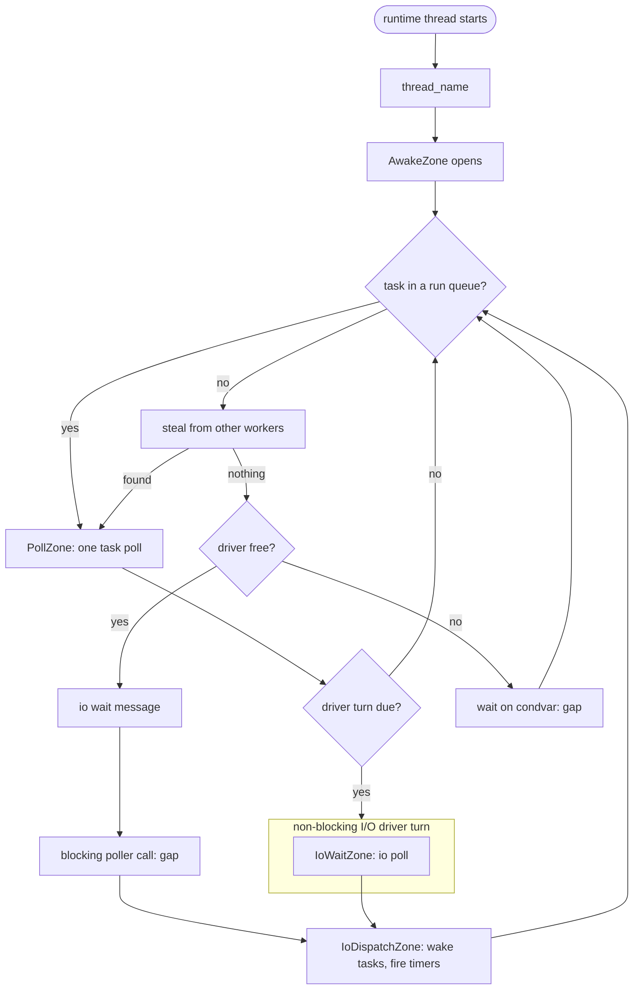

# Tracing

!!! note "Status"
    Proof of concept. Implemented so far: the build option, the awake zone and its gaps
    on every runtime thread, the poll zone in all three executors, the I/O wait message
    and the I/O poll and dispatch zones, the blocking-job zone and thread names. Not yet:
    the search zone, the plots, and the recording backend for tests.

## Summary

A sampling profiler shows where CPU time goes. It does not show what the runtime did
in what order: which task a worker polled and for how long, when the worker turned the
I/O driver, how long it was parked, and how long a woken task waited before it ran.

This design adds fixed trace points inside the runtime that record exactly that, with
nanosecond timestamps, as one timeline row per worker thread. The trace points are
compiled in only when the library is built with a tracing backend. The default build
has none, and its code is the same as today.

The first backend is [Tracy](https://github.com/wolfpld/tracy). The trace points go
through a small internal interface, so a second backend can be added without touching
the executors again.

What a capture shows:

- every task poll as a zone named after the task (`SpawnBuilder::name()`), on the row
  of the worker that ran it;
- every period a runtime thread was awake, with a gap wherever it slept waiting for work
  or events;
- every I/O driver turn, split into the wait and the dispatch of what the wait
  returned;
- every job on the blocking pool;
- run-queue depth and the number of live tasks as plots over time.

## What exists today

`coro::set_task_lifecycle_hooks()` installs two `std::function`s that every
`TaskImpl::poll()` calls, one on entry and one on exit. A program can already draw task
polls on a timeline by calling a tracer's begin and end from those two hooks, with no
change to the library.

That is not enough on its own:

- The hooks see tasks only. The I/O driver, parking and work search are invisible, and
  those are the gaps between polls that a timeline most needs to explain.
- They are checked on every poll in every build, whether or not anything is installed.
- They are a general extension point. A tracer installed there takes the slot from any
  other use.

The trace points described here are separate from the lifecycle hooks and leave them as
they are.

## Design

### The rule: a zone while awake, a gap while asleep

A thread the runtime owns (an executor's worker, the thread running the current-thread
executor's loop, a blocking-pool thread) is in its `awake` zone for all the time it is
awake, and in none while it sleeps waiting for work or events. A gap in its row means
that sleep and nothing else, so the busy time is easy to read off and nothing the
runtime does goes unrecorded.

- A thread sleeps in one of two ways: a condvar wait for work, or a poller call that can
  block (`epoll_wait` with no zero timeout). The `awake` zone closes for exactly that
  call.
- An `io wait` message is recorded just before a blocking poller call. The tick shows
  which thread took the driver, and the gap after it how long it waited.
- Mutex locks, contended or not, stay inside the zone. Contention is overhead worth
  seeing, not idle time.
- A task poll is one zone, from the call of `poll()` until it returns, whatever the
  task does inside, including blocking. The runtime never closes the `awake` zone during
  a poll. A blocking-pool job is the same, as a `blocking job` zone around the callable.

Every other zone on a runtime thread nests inside `awake`.

!!! danger "WARNING: a poll zone is named after its task"
    The poll zone takes the task's name (`SpawnBuilder::name()`), and that must not
    change: no fixed name, no prefix. The Statistics and Find zone views group zones by
    name, and that grouping is how a task's polls are found and measured.

### Trace points



| Trace point | Where | Records |
|---|---|---|
| `thread_name` | start of each worker and blocking-pool thread | row label, such as `coro-worker-3` |
| `AwakeZone` | the whole loop of each worker, current-thread loop and blocking-pool thread | `awake`; the time the thread is not asleep |
| `SleepScope` | around each condvar wait for work, and each blocking poller call | closes `awake` for the duration, leaving a gap |
| `PollZone` | around `task->poll(ctx)` in all three executors | task name; whether the poll finished the task |
| `BlockingJobZone` | around one job on the blocking pool | `blocking job`; nothing beyond the duration |
| `IoWaitZone` | around the poller call in `IoDriver::turn_locked()` | an `io poll` zone when the call cannot block; an `io wait` message and a gap when it can |
| `IoDispatchZone` | the dispatch loop and timer firing that follow | number of events and timers dispatched |
| `SearchZone` | the steal step of `WorkStealingExecutor::worker_loop()` | whether a task was found (not yet; the time is inside `awake`) |
| `plot` | at each driver turn | injection-queue depth, live task count, parked worker count |

A driver turn is made for two different reasons, recorded differently:

- `io poll`: a worker with tasks still to run calls the poller with a zero timeout, to
  collect what is already ready. It never blocks, so it is a zone.
- `io wait`: a thread with nothing to run blocks in the poller until an event, a timer
  or an unpark. This is a sleep: a message, then a gap.

Either is followed by `io dispatch`, the time spent handling what the poller returned.

The current-thread executor always parks in the poller (its driver's unpark eventfd is
always registered), so its gaps all follow an `io wait` tick. Its loop is traced only
through `IoDriverParker`; a different `Parker`, such as Pico's, has no trace points.
A blocking driver turn from a thread the runtime doesn't own records the message only.

The poll zone sits at the executor's call site, not inside `TaskImpl::poll()`. The
call sites are in `.cpp` files, so the public headers do not change and a program built
against a traced library needs no matching compile definition. It also means polls made
outside an executor (`blocking_wait()`, `blocking_next()`) are not recorded. Those run
on the caller's thread, which the caller can instrument directly.

Every zone begins and ends in one function on one thread, and zones on a thread nest.
That is the only shape Tracy accepts, and it is why there is no zone for the lifetime
of a task: a task moves between workers and is suspended for most of its life.

`awake` is the one zone closed and reopened from elsewhere, by a `SleepScope`, and
that is only valid while it is the innermost open zone. A thread-local pointer to it is
what `SleepScope` closes. `PollZone` and `BlockingJobZone` clear that pointer for their
duration, so a sleep inside a task (a `blocking_wait()`, a condvar in user code) leaves
the zones alone and stays in the poll. A runtime loop started from inside a poll, such as
a current-thread `block_on()`, opens an `awake` zone of its own nested in the poll, and
its sleeps close only that one.

### The interface

The executors and the driver use one internal header, `src/detail/trace.h`. It is not
installed. Each zone is a scope object:

```cpp
{
    detail::trace::PollZone zone(*task);
    done = task->poll(ctx);
    zone.finished(done);
}
```

With no backend selected, every type in the header is empty and every function is an
empty inline, so the trace points compile to nothing. Nothing is checked at run time.

A backend supplies the bodies. Besides Tracy there is a recording backend used only by
the tests, which appends each begin and end to a per-thread list so that a test can
check that the zones pair up, nest, and carry the right task name.

### Tracy backend

- A `PollZone` is one Tracy zone with a fixed source location, renamed at run time to
  the task's name (see the warning above). A task spawned without a name keeps the
  location's own name, `task poll`. Naming the tasks is what makes the capture readable.
- `AwakeZone` is a Tracy zone held in a `std::optional`, so a `SleepScope` can end and
  begin it again. The `io wait` tick is a `TracyMessageL`.
- Plots are Tracy plots. `thread_name` sets the Tracy thread name.
- Tracy is built with `TRACY_ON_DEMAND`: nothing is recorded or buffered until a
  viewer or `tracy-capture` connects. A traced binary left running with nobody
  connected does not grow.

Tracy's own sampling and context-switch capture work alongside the zones when the
process has the privileges for them. With context switches captured, a poll zone that
was descheduled part-way through shows as such, which a zone alone cannot tell apart
from a slow poll.

### Build

| | Option | Values | Default |
|---|---|---|---|
| CMake | `CORO_TRACING` | `none`, `tracy` | `none` |
| Conan | `tracing` | `none`, `tracy` | `none` |

`tracy` adds Tracy as a requirement and is rejected when `CORO_PLATFORM` is `pico`:
Tracy needs threads and a network socket. The interface itself has no such dependency,
so a Pico backend (for example, events to a ring buffer read over SWD) remains possible.

The option is part of the package ID, so a traced and an untraced library are separate
binaries.

!!! danger "WARNING: one Tracy client per process"
    Tracy keeps its state in one client instance. If the program also uses Tracy for
    its own zones, the program and the library must share that instance: either both
    link Tracy statically into one binary, or Tracy is built as a shared library. A
    shared `coro` with a static Tracy inside it, next to a program with its own static
    Tracy, gives two clients and a capture with half the data missing.

## Using it

### Build the library with tracing

```sh
conan create . -o tracing=tracy --build=missing          # the library itself
conan install . -o "coro/*:tracing=tracy" --build=missing  # from a program that requires it
```

This pulls `tracy/0.13.1` from Conan Center and builds the Tracy client, the part that
is linked into the program. A traced program listens on TCP port 8086 from the moment
it starts.

The Conan package contains the client only. The viewer and the command-line tools are
separate CMake projects in the Tracy repository and are built once per machine, outside
this repository.

!!! danger "WARNING: the tools must be built from the same Tracy version as the client"
    The network protocol between client and tools changes between releases. Build the
    tools from the tag that matches the version in `conanfile.py`, currently `v0.13.1`.
    A saved `.tracy` file is less strict: a newer viewer opens an older file.

### Build the viewer

These steps are for Ubuntu on a Wayland session.

```sh
sudo apt install libwayland-dev wayland-protocols libxkbcommon-dev libegl-dev \
                 libdbus-1-dev libfreetype-dev libtbb-dev libcapstone-dev

git clone --depth 1 --branch v0.13.1 https://github.com/wolfpld/tracy.git ~/tracy
cmake -S ~/tracy/profiler -B ~/tracy/profiler/build -DCMAKE_BUILD_TYPE=Release
cmake --build ~/tracy/profiler/build -j
```

The configure step downloads ImGui and a few other libraries, so it needs network
access. The build takes several minutes. If a package is missing, the CMake error names
it.

On X11, or if the Wayland build fails, add `-DLEGACY=ON` to the configure line and
install `libglfw3-dev`.

### Record and view live

1. Start the viewer: `~/tracy/profiler/build/tracy-profiler`.
2. Start the traced program. It appears in the viewer's list of clients; select it, or
   enter `127.0.0.1` and connect.
3. The timeline fills in as the program runs. Stop the capture from the connection
   popup, or let the program exit. The same popup saves the capture to a `.tracy` file.

Recording starts when the viewer connects (the client is built with on-demand mode), so
anything the program did before that is not in the capture. To record start-up, have
the viewer waiting before the program starts.

Where to look first:

- **Timeline.** One row per thread. Each runtime thread's row is a run of `awake` zones
  with gaps where it slept; task polls and the `io poll` and `io dispatch` zones nest
  inside them, and an `io wait` tick starts each gap spent in the poller. On the work-stealing
  executor, work collects on the lowest-numbered workers, and high-numbered workers
  that stay idle mean the program never had that many tasks ready at once, not that
  they were starved (see [Which worker is woken](work_stealing_executor.md#which-worker-is-woken)).
- **Statistics.** Every zone with its count, total time and mean.
- **Find zone.** Search for one task name to get a histogram of its poll durations;
  selecting part of the histogram shows those polls on the timeline. This is the
  quickest way to find the slow outliers.

### Record without a display

For a long or unattended run, or on a machine with no display, record with
`tracy-capture`. It uses less memory than the viewer and has no GUI dependencies.

```sh
cmake -S ~/tracy/capture -B ~/tracy/capture/build -DCMAKE_BUILD_TYPE=Release
cmake --build ~/tracy/capture/build -j

~/tracy/capture/build/tracy-capture -o run.tracy -s 10
```

It waits for a traced program, records for 10 seconds (`-s`; without it, until Ctrl-C),
and writes `run.tracy`. `-a <host>` records from another machine and `-f` overwrites an
existing file. Open the file in the viewer afterwards.

### Export to CSV

`tracy-csvexport` turns a capture into text, for scripts or for comparing runs.

```sh
cmake -S ~/tracy/csvexport -B ~/tracy/csvexport/build -DCMAKE_BUILD_TYPE=Release
cmake --build ~/tracy/csvexport/build -j

~/tracy/csvexport/build/tracy-csvexport run.tracy > zones.csv       # one row per zone name
~/tracy/csvexport/build/tracy-csvexport -u run.tracy > events.csv   # one row per zone event
```

### If nothing connects

- Check that the program is listening: `ss -ltnp | grep 8086` while it runs. No listener
  means the library it loaded was built without tracing.
- A version mismatch message means the tools were built from a different Tracy tag.
- Polls that all show as `task poll` come from tasks spawned without a name.

### Zones in user code

A program built with Tracy can add its own zones, and they nest inside the poll zone of
the task that runs them. One rule is specific to coroutines:

!!! danger "WARNING: a zone must not span a `co_await`"
    A scoped zone in a coroutine body stays open across every `co_await` in its scope.
    The task suspends with the zone open, the worker goes on to poll other tasks inside
    it, and the task may resume on a different worker and close a zone that thread never
    opened. The capture is corrupted from that point, and Tracy may abort.

    ```cpp
    coro::Coro<void> handle(Request req) {
        ZoneScoped;                         // WRONG: open across the co_await below
        auto reply = co_await fetch(req);
        encode(reply);
    }

    coro::Coro<void> handle(Request req) {
        auto reply = co_await fetch(req);
        {
            ZoneScoped;                     // right: closed before the next co_await
            encode(reply);
        }
    }
    ```

    Put zones around synchronous sections only, or in the ordinary functions a
    coroutine calls.

## Cost

A Tracy zone costs a few nanoseconds to begin and end. Renaming the poll zone copies
the task name once per poll. The `awake` zone adds one zone per wake, not per poll, and
one message per blocking driver turn.

The larger cost is volume. Every poll is an event, and a busy runtime polls hundreds of
thousands to millions of times a second. The viewer holds the whole capture in memory.
Captures of a few seconds to a minute are practical; captures of hours are not.

!!! tip "PERF: the trace points change what they measure"
    A task whose poll takes a few hundred nanoseconds is measurably slowed by a zone
    around it. Use the timeline for ordering and latency, and a sampling profiler on an
    untraced build for where the cycles go.

## Not included

- **One row per task.** Tracy's fibers can show a task as its own row across the
  workers it runs on. Each switch costs more than a zone, and thousands of short-lived
  tasks make thousands of rows. It may be added later as an opt-in per task.
- **Wake events.** Recording each `wake()` would show the delay from wake to poll, but
  a wake can come from any thread and there can be several per poll. The run-queue
  plots give a coarser view of the same thing.
- **Arrows from a wake to the poll it caused.** Tracy has no such link. See Perfetto
  below.
- **A public tracing API.** Programs that want their own zones use the backend
  directly.

## Alternatives considered

- **Perfetto SDK.** Supports a track per task and flow arrows from a wake to the poll
  it caused, and its viewer runs in a browser. It is a much larger dependency, each
  event costs more, and the live view is weaker. It is the likely second backend if
  wake-to-poll links become necessary.
- **LTTng-UST.** Lower overhead than either and suited to long captures, but Linux
  only, and the viewers have no notion of zones named at run time.
- **USDT probes with bpftrace.** No dependency and no cost when unattached. Each
  attached probe traps into the kernel, which is too slow for a per-poll event.
- **Only the lifecycle hooks.** Covered under [What exists today](#what-exists-today).

## Open questions

1. Should `PollZone` also record the task's previous worker, so that migrations are
   visible in the zone text? It is one integer per poll.
2. Whether `WorkSharingExecutor` and `CurrentThreadExecutor` need anything beyond the
   poll zone and the driver zones they get for free.
