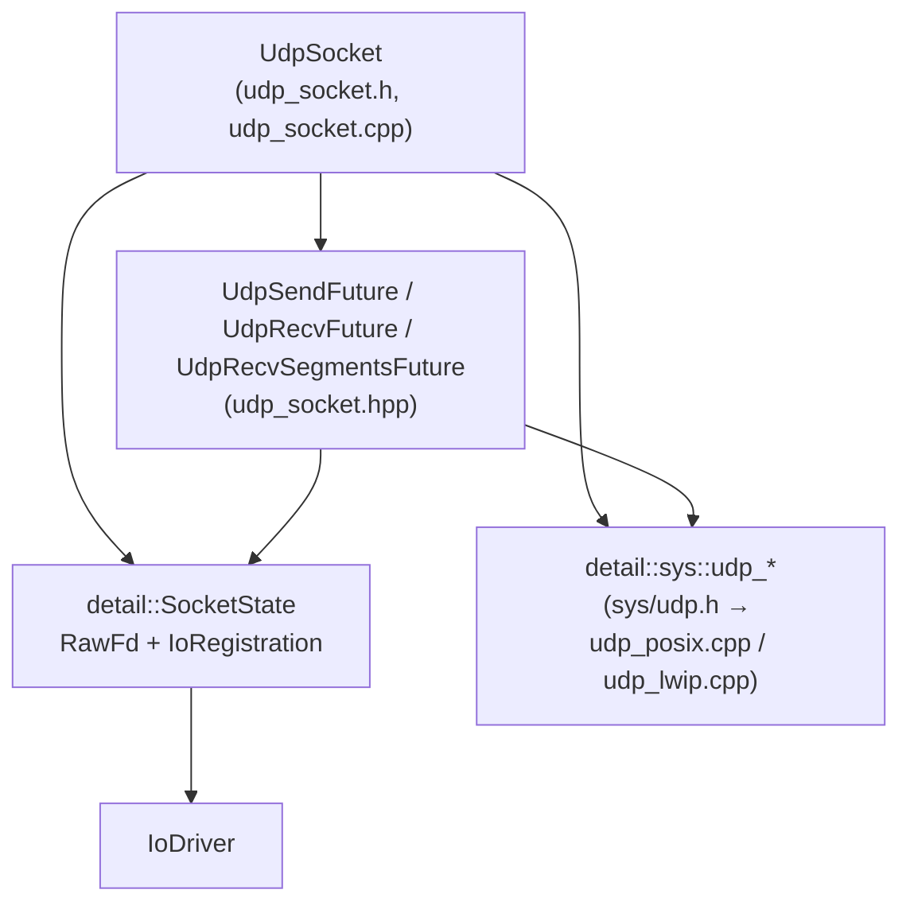
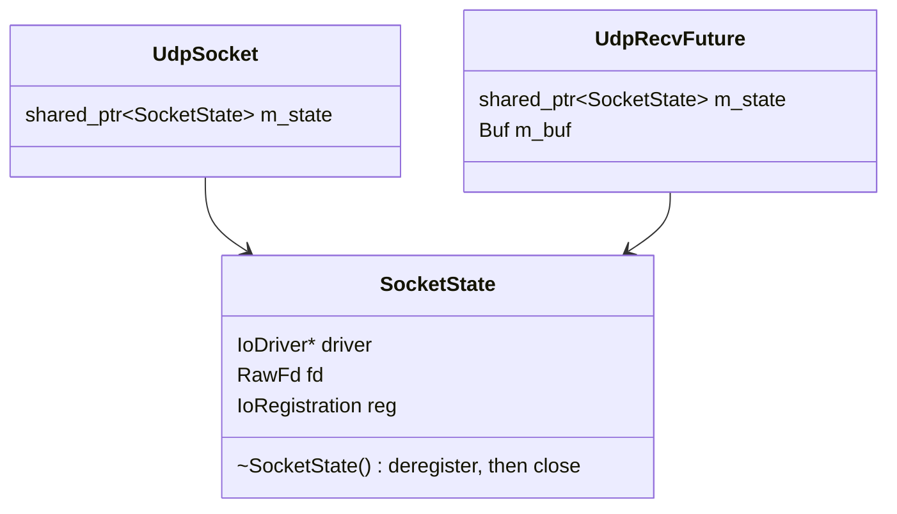
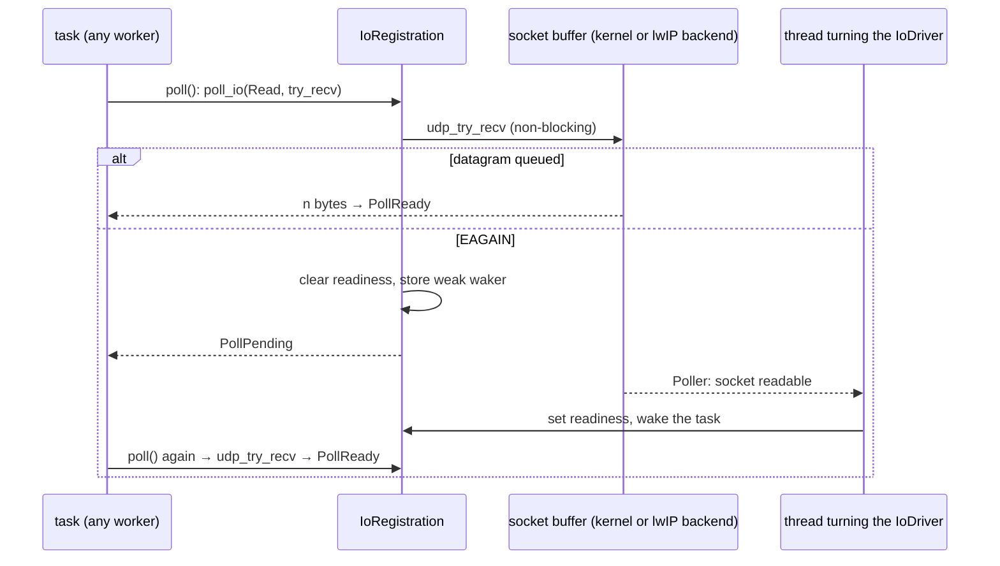

# UDP Socket

`UdpSocket`: async, connectionless UDP send and receive. It runs on the Runtime's
[I/O Driver](io_driver.md), and every operation goes through the `sys/udp.h` seam. The
same code runs on every platform: on desktop the seam is POSIX sockets, and on Pico it
is lwIP (see [On Pico](#on-pico)).

---

## Overview

`UdpSocket` exposes a `sendto`/`recvfrom`-style API: every send specifies a destination,
and every receive reports who it came from. It also supports an optional
`connect()`-fixed-peer mode, mirroring BSD "connected" UDP sockets: once connected,
`send()`/`recv()` drop the address argument and datagrams from any other peer are
filtered out below the socket.

```cpp
UdpSocket sock = co_await UdpSocket::bind("0.0.0.0", 9000);

// Send a datagram to a specific peer. SocketAddress::parse validates the
// address up front rather than deferring failure to send_to().
auto peer = SocketAddress::parse("127.0.0.1", 9001).value();
co_await sock.send_to(std::string("hello"), peer);

// Receive the next datagram into the caller's buffer; reports who sent it.
auto [n, buf, sender] = co_await sock.recv_from(std::string(1500, '\0'));
buf.resize(n);
std::printf("got %zu bytes from %s\n", n, sender.to_string().c_str());

// Or fix a single peer up front and drop the address argument on every call:
UdpSocket client = co_await UdpSocket::bind("0.0.0.0", 0);
co_await client.connect(peer);
co_await client.send(std::string("hello"));
auto [n2, buf2] = co_await client.recv(std::string(1500, '\0'));
```

Both directions take the caller's buffer by value and return it, so no span or raw
pointer ever escapes the I/O operation (see
[`ByteBuffer`](../../include/coro/io/byte_buffer.h)). `recv_from`/`recv` can't know the
datagram's size ahead of time, so an oversized datagram is truncated to fit the caller's
buffer, as POSIX `recvfrom()` does.

---

## `SocketAddress`

`recv_from()` reports a peer address back to the caller, so the library has an address
type. It is modelled on Rust's `SocketAddr`/`Ipv4Addr`/`Ipv6Addr` split, but spelled out
in full (`SocketAddress`) to match this codebase's naming (`JoinHandle`,
`StreamHandle`). Addresses are stored as fixed-size byte arrays, never as strings:

```cpp
// include/coro/io/socket_address.h
namespace coro {

struct Ipv4Address {
    std::array<uint8_t, 4> octets{};
};

struct Ipv6Address {
    std::array<uint8_t, 16> octets{};
    // Interface index disambiguating link-local addresses (fe80::/10), which are not
    // globally unique — the same address can be valid on multiple interfaces at once.
    // Zero for global-scope addresses, where it's meaningless. Corresponds directly to
    // sockaddr_in6::sin6_scope_id.
    uint32_t scope_id = 0;
};

struct SocketAddress {
    std::variant<Ipv4Address, Ipv6Address> address;
    uint16_t port = 0;

    /// Parses a numeric IPv4 or IPv6 address ("127.0.0.1", "::1", "fe80::1%3") plus
    /// port into a SocketAddress. Returns std::nullopt on malformed input — there is
    /// no way to construct a SocketAddress holding an invalid address.
    static std::optional<SocketAddress> parse(std::string_view host, uint16_t port);

    /// Renders back to text, e.g. "127.0.0.1:9001" or "[fe80::1%3]:9001". For
    /// logging/diagnostics only — allocates, so it must never sit on the send/recv
    /// hot path.
    std::string to_string() const;
};

} // namespace coro
```

`Ipv4Address` and `Ipv6Address` are trivially copyable, fixed-size value types (5 and 20
bytes respectively), with no heap allocation on any `send_to`/`recv_from`. Validation
happens once, at `parse()`, rather than being deferred to whatever eventually converts
a stored string. `parse()` calls the backend's address parsers through `sys/socket.h`
(`sys::parse_ipv4()` and `sys::parse_ipv6()`: `inet_pton()` on POSIX, `ip4addr_aton()`
on lwIP, whose `parse_ipv6()` always fails), so `socket_address.cpp` has no platform
`#ifdef`.

It lives alongside `byte_buffer.h` under `include/coro/io/` since, like `ByteBuffer`,
it's a plain value type. Each `sys` backend converts it to and from its own address type
(`sockaddr_storage` on POSIX, `ip_addr_t` on lwIP).

---

## Receive path

`UdpSocket` has no receive queue of its own. Datagrams that arrive between receives wait
in the socket's buffer below the `sys` seam, as they do for any UDP socket in any
language: the kernel's `SO_RCVBUF` on desktop, and the lwIP backend's per-socket ring on
Pico (see [Pico Port](pico_port.md#received-data-per-socket-buffers)). A full buffer drops the
newest datagram.

`recv_from()`/`recv()` try a non-blocking receive on the calling thread. If a datagram is
already queued, it is copied straight into the caller's buffer with no suspension. Only
on `EAGAIN` does the call wait, for read readiness from the driver, and then retry. See
[Send and receive futures](#send-and-receive-futures).

A queue above the socket buffer could do one thing differently, drop the *oldest*
queued datagram instead of the newest when full, and that isn't something this design
needs to provide.

---

## Public API

```cpp
// include/coro/io/udp_socket.h
class UdpSocket {
public:
    UdpSocket(UdpSocket&&) noexcept;
    UdpSocket& operator=(UdpSocket&&) noexcept;
    UdpSocket(const UdpSocket&)            = delete;
    UdpSocket& operator=(const UdpSocket&) = delete;

    ~UdpSocket();

    /// Binds a UDP socket to host:port. host is an IPv4 or IPv6 literal ("0.0.0.0",
    /// "::", ...) or a name resolved with lookup_host(); the first resolved address
    /// that binds is used.
    [[nodiscard]] static Coro<UdpSocket> bind(std::string host, uint16_t port);

    /// Sends buf as a single datagram to dest. Returns buf once the send completes.
    template<ByteBuffer Buf>
    [[nodiscard]] UdpSendFuture<Buf> send_to(Buf buf, SocketAddress dest);

    /// Waits for the next datagram, copying it into buf. Returns {n, buf, sender},
    /// where n is the number of bytes written into buf. If the datagram was larger
    /// than buf, it is truncated to fit — same as POSIX recvfrom().
    template<ByteBuffer Buf>
    [[nodiscard]] UdpRecvFuture<Buf, true> recv_from(Buf buf);

    /// Fixes peer as this socket's only correspondent. Once connected, plain
    /// send()/recv() may be used instead of send_to()/recv_from(); datagrams from
    /// any other address are dropped before they reach recv().
    [[nodiscard]] Coro<void> connect(SocketAddress peer);

    /// Sends buf to the peer fixed by connect(). Throws (EDESTADDRREQ) if not connected.
    template<ByteBuffer Buf>
    [[nodiscard]] UdpSendFuture<Buf> send(Buf buf);

    /// Waits for the next datagram from the peer fixed by connect(), copying it
    /// into buf. Same truncation contract as recv_from().
    template<ByteBuffer Buf>
    [[nodiscard]] UdpRecvFuture<Buf, false> recv(Buf buf);

    /// Enables (or disables) sending to broadcast addresses via send_to()/send().
    /// See [Multicast and broadcast](#multicast-and-broadcast).
    [[nodiscard]] Coro<void> set_broadcast(bool enabled);

    /// UDP GSO (Linux only; ENOTSUP elsewhere). Later send()/send_to() buffers longer
    /// than bytes go out as consecutive datagrams of bytes each (last may be
    /// shorter) in one syscall. 0 disables. See [Segmented sends (GSO)](#segmented-sends-gso).
    void set_segment_size(std::size_t bytes);

    /// UDP GRO (Linux only; ENOTSUP elsewhere). The kernel may coalesce consecutive
    /// same-sized datagrams from one sender into one queued buffer; read them with
    /// recv_segments_from(). See [Coalesced receives (GRO)](#coalesced-receives-gro).
    void set_gro(bool enabled);

    /// Like recv_from(), but returns {n, buf, sender, segment_size} -- buf[0, n)
    /// holds one or more datagrams of segment_size bytes each (the last may be
    /// shorter). Without GRO every read is one datagram with segment_size == n.
    template<ByteBuffer Buf>
    [[nodiscard]] UdpRecvSegmentsFuture<Buf> recv_segments_from(Buf buf);

    /// Joins multicast group so recv_from()/recv() start receiving datagrams sent to
    /// it. iface selects which local interface to join on; the default
    /// (Ipv4Address{}) lets the platform choose. IPv4 only — see
    /// [Multicast and broadcast](#multicast-and-broadcast).
    [[nodiscard]] Coro<void> join_multicast(Ipv4Address group, Ipv4Address iface = {});

    /// Leaves a multicast group previously joined with join_multicast().
    [[nodiscard]] Coro<void> leave_multicast(Ipv4Address group, Ipv4Address iface = {});
};
```

| Method | Return type | Why |
|---|---|---|
| `send_to()`, `send()` | `UdpSendFuture<Buf>` | A leaf future: the first `poll()` tries the non-blocking send; only on EAGAIN does it wait for write readiness |
| `recv_from()`, `recv()` | `UdpRecvFuture<Buf, WithSender>` | A leaf future: tries a non-blocking receive; on EAGAIN waits for read readiness. Safe to drop at any time |
| `recv_segments_from()` | `UdpRecvSegmentsFuture<Buf>` | Same as `recv_from()`, also reporting the GRO segment size |
| `bind()`, `connect()`, `set_broadcast()`, `join_multicast()`, `leave_multicast()` | `Coro<T>` | Plain calls on the calling thread; no thread hop. Errors are thrown on `co_await`. `bind()` throws `std::logic_error` on a runtime whose executor doesn't turn the IoDriver (a `CurrentThreadExecutor` given its own `Parker`) |
| `set_segment_size()`, `set_gro()` | `void` | A plain socket option |

**Concurrency** (matches `TcpStream`): only one receive (`recv_from()`/`recv()`/
`recv_segments_from()`) may be in flight at a time, and only one send
(`send_to()`/`send()`). A concurrent receive and send are fine; they use independent
wakers. `connect()` does not suspend and must not be called concurrently with a send or
receive already in flight, since it changes the peer those operations use.

**Mixing `_to`/`_from` calls with `connect()`:** once `connect()` has been called, both
`recv_from()` and `send_to()` remain callable. `sendto(2)`'s man page lists `EISCONN`
("a connection-mode socket was connected already but a recipient was specified"), but
that case doesn't arise for UDP on Linux: `sendto(2)` accepts an explicit destination on
a connected UDP socket, and `udp_sendto()` does on lwIP. `recv_from()` is unaffected
either way: once `connect()` has run, only the peer's datagrams are delivered, so
`recv_from()` and `recv()` behave identically.

---

## Multicast and broadcast

- **Multicast.** `join_multicast()`/`leave_multicast()` join and leave an IGMP group:
  `IP_ADD_MEMBERSHIP`/`IP_DROP_MEMBERSHIP` on POSIX, `igmp_joingroup_netif()`/
  `igmp_leavegroup_netif()` on lwIP (`LWIP_IGMP` is enabled in coro's `lwipopts.h.in`).
  No change to the receive path is needed: a socket bound to the any-address accepts a
  datagram addressed to any destination IP matching its port, multicast included, once
  the join has told the network layer to deliver that group's traffic.
- **Broadcast.** A POSIX kernel refuses a `sendto()` to a broadcast address with
  `EACCES` unless `SO_BROADCAST` is set, so `set_broadcast(true)` must be called before
  broadcasting. lwIP only checks an equivalent flag when `IP_SOF_BROADCAST` is enabled,
  which coro's `lwipopts.h.in` leaves at its default of 0, so there
  `set_broadcast()` succeeds and changes nothing. Portable code calls it.

**Scope:** `group`/`iface` are `Ipv4Address`, not `SocketAddress`: there is no IPv6
multicast (MLD). On Pico, `iface` is ignored: a Pico has one network interface, so the
join always acts on `netif_default`. Source-specific multicast (IGMPv3), multicast
TTL/loopback control, and directed (subnet) broadcast address computation are not
provided.

---

## Design



Every operation is a non-blocking call on the calling thread. An operation that would
block waits for readiness from the Runtime's [I/O Driver](io_driver.md), and is retried
on whichever worker the task is next polled on. There is no dedicated I/O thread and no
thread hop.

### The `sys/udp.h` seam

`UdpSocket` and its futures make no syscall themselves. Every one goes through
`include/coro/detail/sys/udp.h`, in the style of the driver's
[`sys` layer](io_driver.md#the-sys-layer), so a new platform implements that file and
reuses `UdpSocket` unchanged (see
[Porting to a new platform](io_driver.md#porting-to-a-new-platform)).

| Function | POSIX backend (`src/detail/sys/posix/udp_posix.cpp`) |
|---|---|
| `udp_open(local)` | `socket` (non-blocking, close-on-exec, `local`'s family) + `bind` |
| `udp_connect(fd, peer)` | `connect` |
| `udp_set_broadcast(fd, on)` | `SO_BROADCAST` |
| `udp_set_membership(fd, group, iface, join)` | `IP_ADD_MEMBERSHIP` / `IP_DROP_MEMBERSHIP` |
| `udp_set_segment_size(fd, bytes)`, `udp_set_gro(fd, on)` | `UDP_SEGMENT`, `UDP_GRO` (Linux; `ENOTSUP` elsewhere) |
| `udp_try_send(fd, data, size, dest)` | one `sendto`; `dest == nullptr` sends to the connected peer |
| `udp_try_recv(fd, data, size, sender)` | one `recvfrom`; `sender == nullptr` skips decoding the address |
| `udp_try_recv_segments(fd, data, size, sender, seg)` | one `recvmsg`, reading the `UDP_GRO` control message |

The lwIP backend's implementation of each is in
[Pico Port](pico_port.md#udp).

The setup functions throw `std::system_error`. The `try_` functions never block and
return an `IoResult`: a byte count, or an errno, where a would-block errno means "wait for
readiness and retry".

`SocketAddress` crosses to and from `sockaddr_storage` through `to_sockaddr()` and
`from_sockaddr()` in `src/detail/sys/posix/sockaddr_posix.h`. They dispatch on the
`SocketAddress` variant and on `sa_family`, and carry `scope_id` for IPv6. The header is
private to the POSIX backends; no public header needs it. The lwIP backend's equivalents
are `to_ip_addr()` and `from_ip_addr()` in `src/detail/sys/lwip/io_object.h`.

### `SocketState`: who owns the socket



`UdpSocket` holds a `shared_ptr<detail::SocketState>`, and every future it hands out
copies it. `SocketState` registers the socket with the driver once, for both directions,
when the socket is created. Its destructor deregisters and then closes it
(`sys::close_socket()`). So the socket is closed when the `UdpSocket` and every future
started on it are gone, on whichever thread drops the last share, and never while
another worker is in a syscall on it. The other socket primitives share the same
`SocketState`.

### Send and receive futures

`send_to()`/`send()`, `recv_from()`/`recv()` and `recv_segments_from()` return
hand-written leaf futures (`udp_socket.hpp`), not coroutines. Each `poll()` is one call to
the registration's `poll_io`, wrapping one `try_` call:

```cpp
PollResult<OutputType> poll(detail::Context& ctx) {
    SocketAddress sender;
    auto result = m_state->reg.poll_io(IoDirection::Read, ctx, [&] {
        return detail::sys::udp_try_recv(m_state->fd, data, size, &sender);
    });
    if (!result) return PollPending;                 // waker stored; the driver wakes it
    if (!*result) return PollError(detail::socket_error(result->error(), "UdpSocket::recv_from"));
    return OutputType{**result, std::move(m_buf), sender};
}
```



- **No allocation in the common case.** `FutureAwaitable::await_ready()` runs the first
  `poll()` eagerly. A send accepted at once, or a receive with a datagram already queued,
  completes without suspending and without a coroutine frame.
- **Readiness handshake.** `poll_io` is the driver's
  [readiness handshake](io_driver.md#scheduledio-and-the-readiness-handshake). Readiness
  that arrives after the call saw `EAGAIN` is not lost: `poll_io` retries at once.
- **One copy into the caller's buffer.** The datagram is copied once, from the socket
  buffer into `buf`. A datagram larger than `buf` is truncated, as with `recvfrom()`.
- **Atomic sends.** A UDP datagram is sent whole or not at all, so there is no
  partial-send bookkeeping.
- **Safe to drop.** The futures have no `cancel()`. While pending, a future has only a
  weak waker stored in the registration and nothing armed below the seam. Dropping it
  (for example when it loses a `timeout()`) leaves a stale waker that causes at most one
  spurious wake, and the next datagram goes to the next receive.

`send()` is `send_to()` with no destination, and `recv()` is `recv_from()` without
decoding the sender: on a connected socket only the peer's datagrams arrive.

### `connect` and socket options

`connect()`, `set_broadcast()`, `join_multicast()` and `leave_multicast()` are one `sys`
call each, on the calling thread. They never wait, but return `Coro<void>` so that errors
arrive at `co_await`. Each is a private static `_impl` coroutine that takes the
`shared_ptr<SocketState>` by value, so the lazy coroutine never holds `this` (the socket
may be moved before it runs).

After `connect()` only the peer's datagrams are delivered, and `send()` goes to the peer.
`join_multicast()` passes an all-zero `iface` as `INADDR_ANY`, letting the platform
choose the interface.

`set_segment_size()` and `set_gro()` return `void`: they are plain socket options that
throw `std::system_error` directly.

### Segmented sends (GSO)

`set_segment_size(bytes)` sets Linux's `UDP_SEGMENT` socket option on the fd. From then
on the kernel splits any send longer than `bytes` into datagrams of `bytes` each (only
the last may be shorter), after one syscall and one pass through the UDP/IP stack. The
send path itself is unchanged: the send future just hands the kernel a longer buffer.

This matters because the per-datagram cost of the kernel stack, not syscall entry,
dominates small-datagram sends. Measured on an i5-11500H over loopback with 1468-byte
datagrams (performance governor, CPU µs per datagram): one `send()` per datagram 1.75,
`sendmmsg()` of 20 datagrams 1.67, GSO with 10 segments 0.54, GSO with 20 segments 0.46.
That is why there is no `sendmmsg()`-style batch API: it saves only the syscall entry.

```cpp
Coro<void> send_packets(UdpSocket& sock, std::vector<std::byte> packed) {
    sock.set_segment_size(1468);           // once
    co_await sock.send(std::move(packed)); // up to 44 x 1468-byte datagrams
}
```

Limits (all enforced by the kernel):

- One buffer carries at most 65507 bytes and 64 segments (128 on newer kernels);
  larger sends fail with `EMSGSIZE`.
- The segments are equal-sized, so datagrams of different sizes need separate sends.
  A send no larger than `bytes` goes out as an ordinary single datagram, so it's fine to
  send short packets on the same socket.
- The outgoing interface needs checksum offload; without it the send fails with `EIO`.
  Loopback and common NICs have it.

!!! note "NOTE: race with in-flight sends"
    `set_segment_size()` runs on the caller's thread. A send in flight on another worker
    may be segmented with either the old or the new size. The kernel reads the option once
    per send, so each send uses one size or the other, never a mix.

### Coalesced receives (GRO)

`set_gro(true)` sets Linux's `UDP_GRO` socket option: the kernel may then hand the socket
several consecutive same-sized datagrams from one sender as one buffer. Datagrams sent with
GSO stay coalesced end to end over loopback; from a NIC, the driver's GRO coalesces them.
`recv_segments_from()` reads such a buffer and reports the segment size (from the
`UDP_GRO` control message), and the caller splits it. `recv_from()` can't: it would return
the coalesced datagrams as one.

It does two things for a receiver of many small datagrams:

- **Faster receive.** Kernel cost per datagram drops from about 0.56 µs (`recv()`) to
  0.14 µs (same machine and datagrams as the GSO figures above).
- **Deeper receive buffer.** One coalesced buffer takes less of `SO_RCVBUF` than the same
  datagrams queued separately: with the default 212992-byte buffer and 1468-byte datagrams
  sent in GSO batches, the socket holds 176 datagrams instead of 88 before the kernel drops.

`UdpRecvSegmentsFuture` is `UdpRecvFuture` with `udp_try_recv_segments` in place of
`udp_try_recv`. When nothing was coalesced (GRO off, or off Linux), the reported segment
size equals the byte count.

```cpp
Coro<void> receive(UdpSocket& sock) {
    sock.set_gro(true);
    auto [n, buf, sender, seg] = co_await sock.recv_segments_from(std::vector<std::byte>(65535));
    for (std::size_t off = 0; off < n; off += seg)
        handle_datagram(std::span(buf).subspan(off, std::min(seg, n - off)));
}
```

The buffer should hold 65535 bytes: a coalesced read that doesn't fit is truncated, losing
whole datagrams.

!!! note "NOTE: race with queued datagrams"
    Datagrams queued before `set_gro()` changes keep the form they were queued in, so a
    receive just after `set_gro(false)` can still return a coalesced buffer.
    `recv_segments_from()` splits it correctly; `recv_from()` would not.

### `bind` and destructor

`bind(host, port)`:

1. `detail::socket_io_driver()` checks that the current Runtime's executor turns the
   IoDriver, and throws `std::logic_error` if not (a `CurrentThreadExecutor` given its
   own `Parker`). A socket there could never be woken, so it fails up front instead of
   hanging at its first wait.
2. `lookup_host(host, port)` resolves the host. A numeric literal returns at once (see
   [File I/O and DNS](file_io.md#lookup_host) for names).
3. `sys::udp_open()` is tried on each address in order. The first that binds is
   registered with the driver and returned; if none does, the last error is rethrown.

Nothing waits on the driver until an operation has to.

`~UdpSocket()` only drops its share of the `SocketState`. The socket is deregistered and
closed synchronously once the last in-flight future is gone too, so reopening the same
port right after every owner is dropped succeeds.

### Races

- **Send and receive on different workers.** Allowed. The registration has one waiter
  slot per direction, so a concurrent send and receive never overwrite each other's
  waker. Two concurrent receives (or two sends) are not supported: the second would
  replace the first's waker, leaving the first unwoken.
- **Socket destroyed while an operation is pending.** The future holds a share of the
  `SocketState`, so the socket stays open and registered. The pending operation
  completes, or is dropped, as usual.
- **fd reuse.** `~SocketState()` deregisters before it closes, so a new socket that gets
  the same fd number never inherits the old registration. A stale event that another
  worker's turn already fetched is handled by the driver: see
  [Registration lifetime and stale events](io_driver.md#registration-lifetime-and-stale-events).
- **Socket options during I/O.** `set_segment_size()`/`set_gro()` may race with in-flight
  operations; each send or receive sees one setting or the other (see the notes above).
  `connect()` must not run concurrently with a send or receive.
- **Executor that never turns the driver.** `bind()` throws `std::logic_error` (above),
  so no operation can wait on a driver that nobody turns.

!!! tip "PERF: one `shared_ptr` copy per operation"
    Every send or receive future copies the `shared_ptr<SocketState>`: one atomic
    increment and decrement per operation (non-atomic on Pico). It is what lets a future
    outlive its socket safely. Borrowing a raw pointer instead would need a guarantee
    that no future outlives the socket, which a droppable leaf future can't give.

!!! tip "TODO: `set_recv_buffer_size()`"
    A receiver that falls behind a bursty sender loses datagrams once the socket buffer
    fills: about 200 KB by default on Linux, `CORO_LWIP_UDP_RX_BYTES` (8 KB) on Pico.
    Add a `set_recv_buffer_size(bytes)` (`SO_RCVBUF` on POSIX, the ring size on lwIP,
    reporting the size actually granted) when a workload needs a deeper buffer than
    `set_gro()` gives.

---

## On Pico

`UdpSocket` is the same class and futures on Pico; only the `sys/udp.h` functions are
lwIP's (see [Pico Port](pico_port.md#udp)). The differences a caller can see come from
lwIP:

- **No network, no sockets.** On a `PicoNetwork::None` runtime, `bind()` throws
  `std::system_error` with `ENETDOWN`.
- **The receive buffer is `CORO_LWIP_UDP_RX_BYTES`** (default 8192 bytes), a ring the
  backend owns, rather than the kernel's `SO_RCVBUF`.
- **Sends never wait.** lwIP sends synchronously. Out of buffers is `ENOBUFS`, an error,
  not a wait for write readiness.
- **IPv4 only.** An `Ipv6Address` fails with `EAFNOSUPPORT`.
- **No GSO or GRO.** `set_segment_size()` and `set_gro()` fail with `ENOTSUP`, as on any
  desktop other than Linux, and `recv_segments_from()` returns one datagram per read.
- **`set_broadcast()` changes nothing**, and `join_multicast()` ignores `iface`. See
  [Multicast and broadcast](#multicast-and-broadcast).

---

## Tests

`test/io/test_udp_socket.cpp` covers the API on every executor, and is also built against
lwIP on the host (`test_udp_socket_pico`) and into the on-target firmware. IPv6, GSO/GRO
and multicast are compiled for the desktop only: lwIP's loopback netif doesn't set
`NETIF_FLAG_IGMP`, so a multicast join can't be exercised against it. The lwIP tests of a
link use `TestNetif` (`test/test_netif.h`), described in
[TcpStream's tests](tcp_stream.md#tests).

| Test | Checks |
|---|---|
| `UdpSocketTest.BindIpv6Loopback` | `bind("::1", ...)` and a round trip over IPv6 (skipped without IPv6 loopback). |
| `UdpSocketTest.BindAddressInUseThrowsOnAwait` | `EADDRINUSE`, and an unresolvable host (`dns_error_category()`), are `std::system_error`s thrown at `co_await`. |
| `UdpSocketTest.RecvWaitsThenCompletes*` | A receive with nothing queued waits for readiness, on `Runtime(4)` and `Runtime(1)`. |
| `UdpSocketTest.DroppedRecvLosesNoDatagram` | A receive dropped by `timeout()` consumes nothing; the next receive gets the datagram. |
| `UdpSocketTest.ConnectedSocketIgnoresOtherSenders` | A connected socket drops datagrams from anyone but its peer. |
| `UdpSocketTest.FullRingDropsNewDatagrams` (lwIP) | Datagrams past what the receive ring holds are dropped; those in it arrive intact, and the socket recovers. |
| `UdpSocketTest.DatagramLargerThanRingIsDropped` (lwIP) | A datagram one byte too large for an empty ring is dropped; the largest that fits arrives. |
| `UdpSocketTest.LinkDelayWakesSleepingRuntime` (lwIP) | A datagram 200 ms in flight on the test link: lwIP's timer wakes the sleeping runtime for its arrival. |
| `UdpSocketTest.SendRefusedByLinkFailsWithEnobufs` (lwIP) | Every send of a burst the link refuses fails at once with `ENOBUFS`, and sends go through once it accepts again. |
| `UdpSocketTest.SocketDroppedWhileRecvPending` | Destroying the `UdpSocket` under a pending receive neither closes the socket nor loses the wake. |
| `UdpSocketTest.ConcurrentSendAndRecvOnOneSocket` | A send task and a receive task on one socket, on different workers. |
| `UdpSocketTest.BindThrowsWithoutDriver` | `bind()` throws `std::logic_error` on a `CurrentThreadExecutor` with its own `Parker`. |
| `UdpSocketTest.RecvWaitsOnWorkSharing` | A waiting receive is woken by an idle `WorkSharingExecutor` worker turning the driver. |
| `IoDriver.PollIoWaitsForWritable` (`test_io_driver.cpp`) | `poll_io(Write)` waits out a full send buffer. |

---

## Known limitations / Future work

- **Multicast/broadcast scope is deliberately narrow.** See
  [Multicast and broadcast](#multicast-and-broadcast).
- **`set_segment_size()` (GSO) and `set_gro()` are Linux only.** There is no
  `recvmmsg()` batching. See [Segmented sends (GSO)](#segmented-sends-gso) and
  [Coalesced receives (GRO)](#coalesced-receives-gro).
- **`send_to()` remains usable after `connect()`.** See "Mixing `_to`/`_from` calls with
  `connect()`" under [Public API](#public-api).
- **IPv6 is desktop only.** `SocketAddress` supports IPv6 (with `scope_id`), and the
  desktop backend handles both families, including `bind("::1", port)`. The lwIP backend
  is IPv4 only.

---

## File structure

```
include/coro/io/
  socket_address.h         SocketAddress/Ipv4Address/Ipv6Address
  udp_socket.h             UdpSocket
  udp_socket.hpp           UdpSendFuture / UdpRecvFuture / UdpRecvSegmentsFuture;
                           included from the bottom of udp_socket.h
include/coro/detail/
  socket_state.h           SocketState: RawFd + IoRegistration, shared by a socket and its futures
  sys/udp.h                UDP backend seam: the only place a UDP "syscall" is made

src/io/
  socket_address.cpp       SocketAddress::parse()/to_string()
  udp_socket.cpp           bind() / connect() / socket options
src/detail/
  socket_state.cpp         SocketState, socket_io_driver()
  sys/udp_posix.cpp        POSIX implementation of sys/udp.h
  sys/sockaddr_posix.h     to_sockaddr()/from_sockaddr(), private to the POSIX backends
  sys/lwip/udp_lwip.cpp    lwIP implementation of sys/udp.h
```
