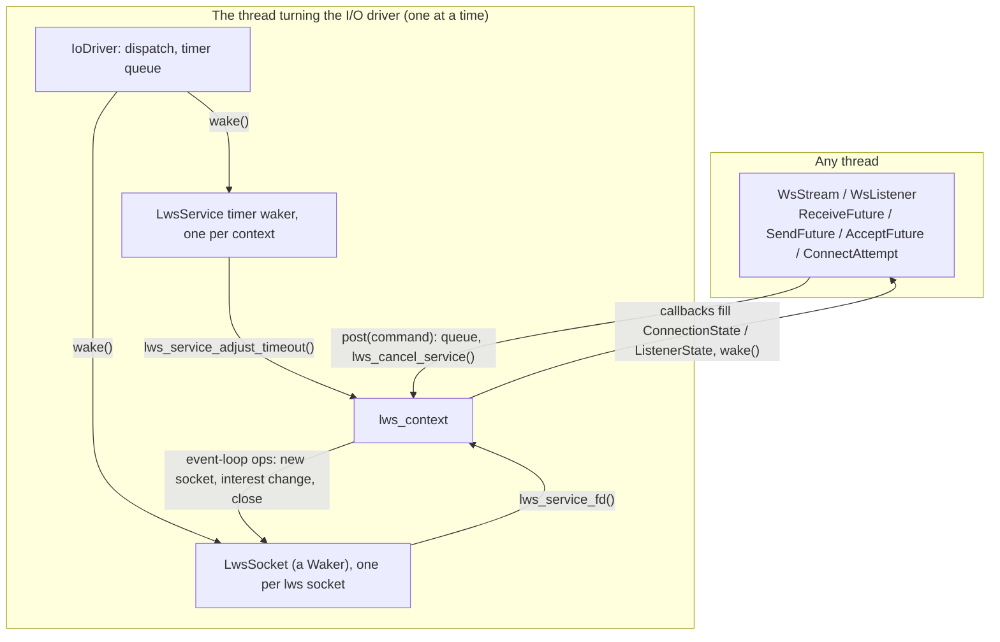
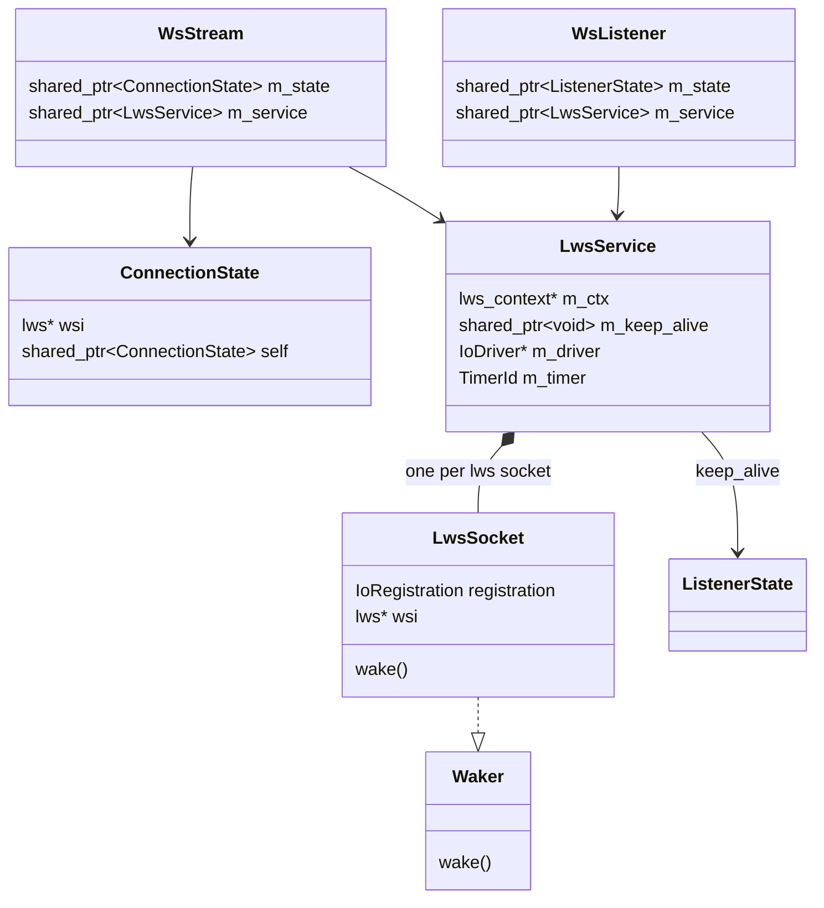
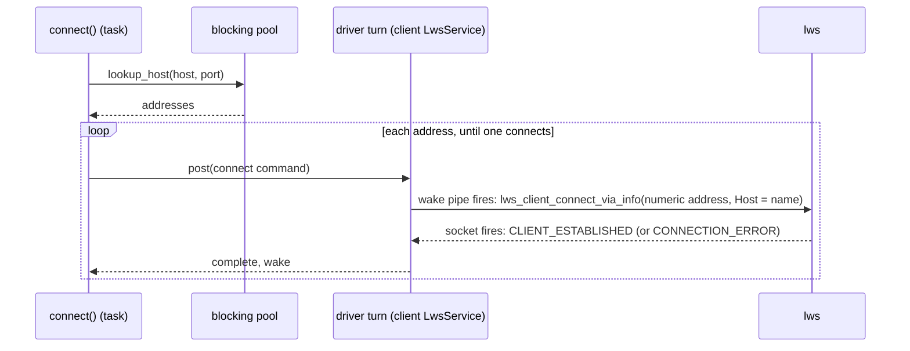
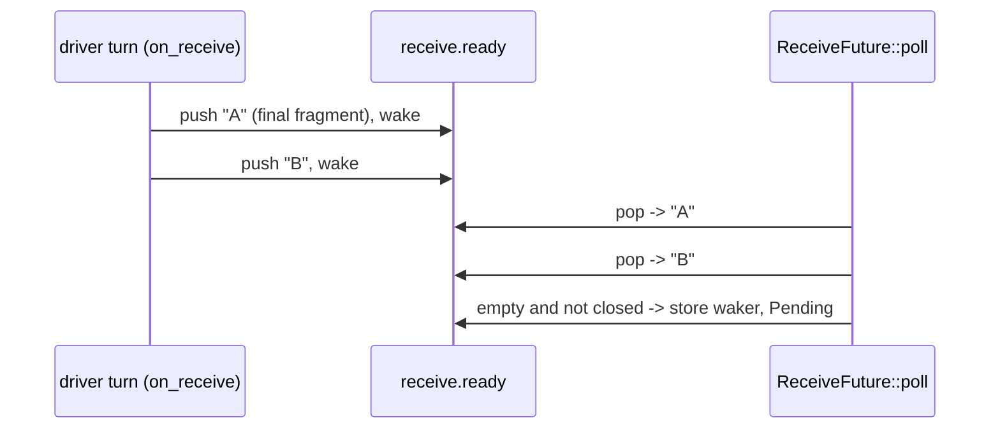

# WebSocket Stream

`WsStream` and `WsListener` are an async WebSocket client and server built on
[libwebsockets](https://libwebsockets.org/) (lws). lws has no thread of its own: each of
its sockets is registered with the [I/O Driver](io_driver.md), and the socket's waker
calls into lws from whichever executor thread is turning the driver. Every lws call is
made inside that turn, and futures are woken from the lws callbacks there.

Desktop only. `ws_stream.h` and `ws_listener.h` are excluded from the Pico install.

---

## Goals

- **No thread of its own.** lws is driven by the executor threads that turn the I/O
  driver, like every other socket. WebSockets therefore need a `Runtime` whose executor
  turns the driver: `connect()` and `bind()` throw `std::logic_error` otherwise, as
  registering any fd does.
- **Same connect and bind behaviour as TCP.** Host names resolve through
  [`lookup_host()`](file_io.md#lookup_host), each address is tried in turn, and errors
  are `std::system_error` with a real errno.
- **Errors at the call site.** `connect()` and `bind()` throw; a bind failure is
  reported by `bind()` itself.
- **Safe to drop.** Dropping a stream, a listener or any pending future, on any thread,
  closes or abandons cleanly. A dropped `receive()` loses no message.

## Non-goals

- **Owned buffers for `send()`** (see the TODO under [API](#api)).
- **Explicit ping/pong.** lws answers pings itself.
- **TLS listeners.** `wss://` works for clients only.
- **Calling lws from the caller's thread.** `send()`, `connect()` and close queue a
  command for the thread turning the driver. See the PERF note under [Send](#send).

---

## API

```cpp
#include <coro/io/ws_stream.h>
#include <coro/io/ws_listener.h>

// Client
WsStream ws = co_await coro::WsStream::connect("ws://example.com/chat");
co_await ws.send("hello");                                   // text frame
WsStream::Message msg = co_await ws.receive();
std::string_view text = msg.as_text();

// Server
WsListener listener = co_await coro::WsListener::bind("", 9001);   // all interfaces
while (true) {
    WsStream peer = co_await listener.accept();
    spawn(serve(std::move(peer))).detach();
}
```

### `WsStream`

| Method | Returns | Output |
|---|---|---|
| `static connect(url)`, `connect(url, options)` | `Coro<WsStream>` | the stream, once the opening handshake completes |
| `receive()` | `ReceiveFuture` | the oldest queued `Message` |
| `send(span, opcode = Binary)`, `send(string_view)` | `SendFuture` | `void`, once `lws_write()` has taken the frame |

- **URL:** `ws://host[:port]/path` or `wss://host[:port]/path`; default ports 80 and
  443. Anything else throws `std::invalid_argument`.
- **`WsStream::Options`:** `frame_mode` (`Full` assembles whole messages; `Partial`
  returns each fragment, with `Message::is_final` on the last), `subprotocols` to
  advertise (none by default, which accepts any server), and `max_message_size`
  (0 = unlimited).
- **`Message`:** `data` (bytes), `is_text`, `is_final`; `as_text()` throws
  `std::logic_error` on a binary frame.
- **Errors**, all `std::system_error` at `co_await`:
    - `connect`: `dns_error_category()` if the host doesn't resolve; otherwise the last
      address's failure (see the FIXME below).
    - `receive`: `EMSGSIZE` for a message over `max_message_size` (the connection stays
      usable); a closed connection throws once the queued messages are drained.
    - `send`: `ENOTCONN` if the connection closed first, `EIO` if `lws_write` failed.
- **Moved-from streams:** `receive()` and `send()` throw `std::logic_error`.
- **Concurrency:** at most one `receive()` and one `send()` in flight at a time, as for
  `TcpStream`. The two may be in different tasks: one task may receive while another
  sends. Two receives at once are an error: there is one waker slot, so one of them may
  never be woken.
- **Threads and runtimes:** a stream may be used from a task of any `Runtime`, and from
  a thread outside any `Runtime` with `blocking_wait()`. Its connection is serviced by
  the `Runtime` that called `connect()` (or `bind()`, for an accepted stream): nothing
  is sent or received unless that one is turning its driver, and when it is destroyed
  the connection is closed. `connect()` and `bind()` themselves need a current
  `Runtime` and throw `std::logic_error` without one.
- **Sharing:** `WsStream` is move-only, with no split or clone. Tasks that share one
  share a reference to it (or a `std::shared_ptr`), and must not move or destroy it
  while another is calling `send()` or `receive()`. A future already returned stays
  valid: it holds the connection itself.
- **Drop and move-assign** post a graceful close (Close frame, then the peer's echo),
  from any thread.

!!! note "NOTE: several sends at once work today, but are not part of the contract"
    A `send()` started while another is in flight is queued behind it, and the two are
    written in the order they were first polled (see [Send](#send)). That is how the
    code behaves, not something the API promises: a later version may make it an
    error. To send from several tasks, give one task the stream and feed it through a
    channel.

!!! tip "TODO: `send()` still borrows a span"
    `send` takes a `std::span`/`std::string_view` that must outlive the await, unlike the
    owned-buffer API of `TcpStream` and `File`. Move it to a `ByteBuffer` parameter
    (moved in, returned with the result) when the WebSocket API is next touched.

### `WsListener`

| Method | Returns | Output |
|---|---|---|
| `static bind(host, port)`, `bind(host, port, options)` | `Coro<WsListener>` | the listener; its socket is bound before this returns |
| `accept()` | `AcceptFuture` | the next `WsStream` whose handshake completed |

- **Host:** empty listens on every interface. Otherwise it's resolved with
  `lookup_host()`, and the first address that binds is used. Errors: `dns_error_category()`,
  or the last address's bind errno (`EADDRINUSE`, `EADDRNOTAVAIL`, ...).
- **`WsListener::Options`:** `frame_mode`, `max_frame_size` (lws's per-connection rx
  buffer), `max_message_size`, `subprotocols` to advertise, and two upgrade hooks:
    - `process_request(const WsUpgradeRequest&)`: inspect the path, headers and offered
      subprotocols; return a `WsUpgradeRejection` to refuse. lws closes the TCP
      connection; the status code is not sent.
    - `select_subprotocol(offered)`: return the chosen name, or empty to refuse.
- **Drop and move-assign** reject new upgrades and close connections still queued for
  `accept()`. Streams already accepted keep working (see
  [Lifetimes](#lifetimes)).

`connect` and `bind` each have two overloads rather than a defaulted `Options options = {}`
argument: GCC rejects that default because `Options` is a nested class with member
initializers.

---

## lws on the I/O driver



!!! danger "WARNING: every lws call runs inside the driver's turn"
    lws does no locking of its own: a context is safe only while one thread at a time
    calls into it. The driver's turn is that guarantee, since only one thread holds it.
    A future's `poll()` or destructor must never call lws; it posts a command. The
    exceptions are `lws_create_context()`, which runs on the calling thread before any
    socket is registered, and `lws_cancel_service()`, which lws allows from any thread.

    Which thread holds the turn changes from one turn to the next. That is fine for lws
    as Conan builds it: it keeps no thread-local state, the package is built with
    `LWS_MAX_SMP` 1 so no code looks up the calling thread, and its one "wrong thread"
    assertion is compiled only in debug builds and only when the event loop supplies a
    `foreign_thread` op, which ours does not.

!!! note "NOTE: all of a runtime's WebSocket work runs on one thread at a time"
    Whichever thread holds the turn does every read, write, frame and callback for every
    WebSocket of that runtime, and TLS encryption for `wss://` with them. Nothing else
    is dispatched meanwhile: TCP, UDP and timers on the same runtime wait for it.

    For a handful of connections this doesn't matter. For heavy traffic, `wss://`
    above all, it is a ceiling that more worker threads don't raise. Measure before
    relying on it; [What was considered and left](#what-was-considered-and-left) and
    [Without lws](#without-lws) are the ways out.

Every other primitive's waker is its task: the driver wakes it and the task does the I/O
when it is next polled. lws has to be called when its socket is ready, by one thread at a
time, so its wakers do the work themselves, inside `wake()`. The driver side of this is
[Level-triggered registrations](io_driver.md#level-triggered-registrations).
`detail::ws::LwsService` (`src/io/ws_service.{h,cpp}`, private) owns one `lws_context`
and the wakers that drive it.

### Sockets

The context is created with a custom event loop
(`lws_context_creation_info::event_lib_custom`), which needs no lws build option. lws
calls its ops whenever its set of sockets changes:

| lws op | When | `LwsService` does |
|---|---|---|
| `init_vhost_listen_wsi`, `sock_accept` | a socket was created or accepted | records it in the service's table |
| `io`, start | lws starts wanting to read or write it | the first time, allocates an `LwsSocket` and registers the fd, level-triggered; after that, `IoRegistration::set_interest()` |
| `io`, stop | lws stops wanting one direction | `IoRegistration::set_interest()` |
| `io`, stop both | lws took the socket out of its poll set, which it does before closing the fd | drops the `LwsSocket`, which deregisters |
| `destroy_wsi` | lws frees the socket's `lws*` | forgets the table entry |

!!! note "NOTE: `wsi_logical_close` is left unset"
    It looks like the op for "about to close", but in lws 4.3.5 an event loop that sets
    it without also completing the close itself leaves lws's wake pipe unfreed at
    context destroy. lws stops both directions before it closes an fd on every path,
    and that is the signal used.

An `LwsSocket` (`LwsService::Socket` in the code) is the socket's `IoRegistration`, its
`lws*`, and the `Waker` set on that registration. Its `wake()` calls `take_ready()` and passes the result to
`lws_service_fd()`, which does the reads and writes and runs the protocol callbacks.

- **One allocation per socket.** The `LwsSocket` is allocated when lws first asks to
  hear about the socket and freed when lws closes it. Nothing is allocated per event, per `send()` or
  per `receive()`: the registration keeps the waker for as long as it lives.
- **It is not part of `ConnectionState`,** although for a connection the two live about
  as long. lws has the socket before the handshake that creates a server connection's
  state, and the listening socket and the wake pipe have no connection at all.
- **Level-triggered,** because lws expects `poll()` semantics: it does not always read a
  socket until `EAGAIN`, so an edge-triggered event could be the last one it ever gets.
- **Ownership.** The service's table of sockets holds each `LwsSocket`; the driver holds
  it weakly and upgrades it for the length of `wake()`. So lws closing a socket from
  inside its own event is safe, and an event for a socket closed earlier in the same
  batch finds no waker.

### Commands

`post()` is the only way in from outside the turn, and works as lws intends for a
foreign thread: it queues a command and calls `lws_cancel_service()`, which writes to
the context's wake pipe. The pipe is one more `LwsSocket`. When it fires,
`lws_service_fd()` drains it and lws calls the protocol callback with
`LWS_CALLBACK_EVENT_WAIT_CANCELLED`, where the service runs the queued commands in
posting order.

The wake is sent once per batch: only a `post()` that finds the queue empty calls
`lws_cancel_service()`. The callback takes the whole queue under the same mutex, so a
queue that holds a command always has a wake on its way.

Posting and running a command allocate nothing. A command is a function pointer and a
`shared_ptr` to what it acts on (a send or a close passes the connection's state), not
a `std::function`, which may allocate for what it captures. The queue and the batch
being run are two vectors that swap their storage each time.

!!! note "NOTE: a command waits for someone to turn the driver"
    A posted command runs at once if a worker is parked in the driver, otherwise at a
    busy worker's next periodic turn (every 61 task polls) or when a worker runs out of
    work. This is the same latency every other socket's readiness has; see the note
    under [Who turns the driver](io_driver.md#who-turns-the-driver).

### Timers

lws keeps its own timers (connect and handshake timeouts, keepalive). They go on the
driver's timer queue through one more waker, allocated once per context:

- After every call into lws (a socket's `wake()` or the timer's), the service calls
  `lws_service_adjust_timeout()`. That fires lws's due timers and returns how long lws
  can wait.
- If that is sooner than the driver timer currently armed, the service replaces it
  (`cancel_timer()`, `add_timer()`). A later deadline is left alone: the timer then
  fires early for lws, finds nothing due, and arms the next one. So most events don't
  touch the timer queue.
- A wait of zero means lws holds work that no socket event will announce, such as
  received TLS data it has already buffered. The service runs it at once
  (`_lws_plat_service_forced_tsi()`, the call lws's own event-loop backends use) and
  asks again, up to four times. If lws still isn't idle it arms a 1 ms timer, so the
  rest of the turn isn't held up.

### Contexts

- **Server:** each `WsListener::bind()` creates its own service with a listening
  context. `lws_create_context()` runs on the calling thread, so a bind failure is
  reported by `bind()` itself. The ops called during creation only record the sockets.
  They are registered by the first turn after the context is attached, which a timer
  due at once brings about. Registering from `bind()`'s thread could lose a race with
  `IoDriver::shutdown()`; a turn and the shutdown exclude each other.
- **Client:** every `WsStream::connect()` on a `Runtime` shares one client context,
  created by the first of them (see [Client contexts](#client-contexts)).
- **Creating and destroying are serialized across the process** by one mutex. lws
  keeps some state for the whole process without a lock (a count of the contexts that
  asked for the SSL global init), and contexts are created and destroyed on the
  threads of whichever runtimes use them.
- **Every context has its own lws log context** (`info.log_cx`), with the same levels
  and sink as the process-wide default. lws counts, in a log context and with no lock,
  each context, vhost and connection that uses it. Contexts sharing the default would
  race on that count whenever two runtimes opened or closed a connection at once,
  which the mutex above does not cover.
- **lws allocates through a plain `realloc()`/`free()`**, installed with
  `lws_set_allocator()` before the first context is created. lws's default adds every
  allocation to one counter for the whole process, with no lock, which contexts on two
  runtimes raced on. The allocator is a setting of the whole process: in a program
  that also uses lws itself, `lws_get_allocated_heap()` stops counting, and an
  allocator the program installed earlier is replaced.
- The service belongs to the `Runtime` that `connect()` or `bind()` was called on. A
  stream may be used from a task of another runtime or from `blocking_wait()` on another
  thread, as a socket may, but it is that first runtime's threads that drive it.
- lws is built without its libuv event-lib backend (`with_libuv=False` in
  `conanfile.py`).

!!! note "NOTE: one fd table per context"
    lws sizes each context's fd table from the process's fd limit, so each listener,
    each runtime's client context, and the anchor cost that much memory. Negligible for a handful of
    listeners; revisit if a program binds many.

### Lifetimes



- **`shared_ptr<LwsService>` is held by `WsStream`, `WsListener` and their futures,**
  and for a client service by the registry of client contexts too. Callback state
  (`ConnectionState`, `ListenerState`) and posted commands never hold it, so a
  listener's context goes when the last handle does (see [Destroy](#destroy)).
  Destroying the context closes every connection still on it.
- **Accepted streams hold their listener's service.** So the listening context, and its
  bound port, live until the listener and the last stream it accepted are gone. Until
  then new connections fail the upgrade: the server callback checks
  `ListenerState::closed` in `FILTER_PROTOCOL_CONNECTION` and `ESTABLISHED`.
- **`self`.** While lws holds a raw pointer to a `ConnectionState` (the client wsi's user
  pointer, or the server's per-session slot), the state keeps itself alive through its
  `self` member. `close_connection()` clears it last, when lws reports the connection
  gone (`CLOSED`, a connect error, or `WSI_DESTROY`); it is idempotent.
- **`keep_alive`** holds what `lws_context_creation_info` points into (the protocols
  table and `ListenerState`) until after the context is destroyed.
- **`m_ctx` and `m_driver`** are cleared when the context is destroyed. A command
  posted after that is dropped.

### Destroy

Dropping the last handle to a listener's service never blocks. `lws_context_destroy()` is
an lws call, so it has to run inside the turn. What `bind()` returns is a handle: when
its last copy goes, the service marks itself for destruction, takes a reference to
itself, and wakes the context (`lws_cancel_service()`). The next turn services the wake
pipe, and once lws has returned from that call the service destroys the context, which
closes the remaining connections and the listening socket. `lws_context_destroy()` is
never called from inside `lws_service_fd()`.

So the port is released shortly after the drop, not before it returns. Code that drops a
listener and at once binds the same port again can get `EADDRINUSE`. If nothing turns
the driver (a `Runtime(1)` outside `block_on()`), the context waits for the next turn or
for [shutdown](#runtime-shutdown).

A client context is not destroyed this way: it lives until its runtime shuts down.

`listen()` takes an `on_destroyed` function, which the service runs right after
`lws_context_destroy()`, whichever path destroyed the context. `WsListener` uses it to
mark itself closed and wake a waiting `accept()`.

!!! note "NOTE: why not `LWS_CALLBACK_PROTOCOL_DESTROY`"
    lws sends it only for a vhost whose protocols it has initialized, which it does
    when the context is first serviced, not when it is created. A listener whose
    runtime shut down before a turn had serviced it was never told, and `accept()` on
    it from another runtime waited for good. The service knows when it destroys its
    own context, so it says so itself.

    Connections need no such hook. lws reports each one it closes during the destroy
    (`CLOSED` or `WSI_DESTROY`), including a client connection it holds without a
    socket between two connect attempts.

!!! tip "TODO: an awaitable close for listeners"
    A caller that needs the port back at a known point could await a
    `WsListener::close()` that completes once the context is gone. Add it when something
    needs it; a destructor that waits is not the answer.

### Runtime shutdown

`IoDriver::shutdown()` wakes every registration and every timer, with the turn held, and
those include lws's. The executor's threads have stopped by then. The first of a
context's wakers to see `IoDriver::is_shut_down()` destroys the context, as
[Destroy](#destroy) does, for a listener's and a client's alike:

- The commands still queued are dropped; each acts on a connection that is about to be
  closed anyway.
- lws reports every connection closed, so a waiter from outside the runtime is woken
  and its `receive()` or `send()` fails as for any closed connection.
- A listener is marked closed through `on_destroyed`, so `accept()` fails.

The service's remaining wakers then do nothing. A `WsStream` or `WsListener` that
outlives its `Runtime` stays valid: it is closed, and its later commands, its
destructor's included, are dropped.

### Client contexts

Each `Runtime` that connects has one client context:

- The first `connect()` on a runtime creates it and attaches it to that runtime's
  driver. Later connects on the same runtime share it. If creating one fails, the next
  `connect()` tries again.
- It is destroyed when the runtime shuts down, not when its last stream is dropped:
  creating a client context loads the system's CA certificates, which is too slow to
  repeat for every burst of connections.
- A registry (a mutex and a list) finds a driver's context. Entries whose context has
  been destroyed are dropped the next time anyone connects.

Beside these there is one **anchor**: an lws context created before the first client
context, never attached to a driver, never serviced, and never destroyed.

!!! danger "WARNING: the anchor context must stay"
    lws 4.5.3 to 4.5.8 count the contexts created with
    `LWS_SERVER_OPTION_DO_SSL_GLOBAL_INIT` and call `OPENSSL_cleanup()` when the last
    one is destroyed. `OPENSSL_cleanup()` can't be undone: every later digest in the
    process fails, and with it every later client context, in
    `lws_context_init_client_ssl()`, with nothing more specific logged and nothing in
    OpenSSL's error queue. Threads have nothing to do with it.

    The anchor is created with that option and holds the count above zero. It costs two
    descriptors, an fd table, and an `SSL_CTX` with no certificates loaded
    (`LWS_SERVER_OPTION_DISABLE_OS_CA_CERTS`). It is reachable from a static, so leak
    checkers don't report it.

    lws 4.3.5, 4.4.x and 4.5.0 to 4.5.2 don't call `OPENSSL_cleanup()`, and lws `main`
    has the counter without the call; none of them need the anchor, and none are
    harmed by it. `test_lws_context_recreate` checks the arrangement against lws alone.

    This was first seen as "a client context can't be recreated" under ASan in the
    Ubuntu 24.04 container, which resolves lws to 4.5.8 while a host with 4.3.5 in its
    Conan cache does not show it. An earlier design kept client contexts for the life of
    the process and handed them from one runtime's driver to the next to avoid it.

Listener contexts don't ask for the SSL global init, so they neither need the anchor
nor count towards it.

---

## Connection state

All per-connection state is one `detail::ws::ConnectionState`, shared by the futures (on
whichever thread polls or drops them) and the lws callbacks (on the thread turning the
driver). Each operation has its own sub-state and mutex:

| Sub-state | Guards | Shared with |
|---|---|---|
| `ConnectSubState` | `waker`, `complete`, `cancelled`, `error`, lws's `reason` text | `ConnectAttempt` |
| `ReceiveSubState` | the message being assembled, `ready` queue, `waker` | `ReceiveFuture` |
| `send_queue` (own mutex) | the `SendNode`s waiting for WRITEABLE, the one being written (`send_in_flight`), and each such node's `frame`, `complete`, `error`, `waker` | `SendFuture`, close path |

`wsi`, `self` and `closing` are touched only inside the driver's turn, which is what
keeps them and lws's own state single-threaded; the mutexes guard only what the futures
share with the callbacks. `closed` is an atomic
that only goes false to true; each reader re-checks it under the sub-state mutex that
`close_connection()` takes before waking.

Wakers are stored as `Weak<Waker>`, as the driver stores them: the executor's task list
owns a waiting task, and a task that has gone is simply not woken. They are fired with
`detail::ws::wake()` outside the mutex.

lws fires one protocol callback for every event on every connection. The client
(`protocol_cb`) and server (`server_protocol_cb`) callbacks share the logic that matters:

| Event | Client / server reason | Does |
|---|---|---|
| Handshake done | `CLIENT_ESTABLISHED` / `ESTABLISHED` | completes the connect; the server queues the stream for `accept()` |
| Data | `CLIENT_RECEIVE` / `RECEIVE` | `on_receive()` |
| Writable | `CLIENT_WRITEABLE` / `SERVER_WRITEABLE` | `on_writeable()` |
| Gone | `CLIENT_CONNECTION_ERROR`, `CLIENT_CLOSED` / `CLOSED`, and `WSI_DESTROY` | `close_connection()` |

---

## Connect



`connect()` is a `Coro`. It parses the URL, resolves the host, then awaits a private
leaf future, `WsStream::ConnectAttempt`, per address. The attempt connects to the numeric
address, but the Host header and TLS SNI carry the name from the URL. The last error is
rethrown if no address connects, as in `TcpStream::connect`.

- **Cancellation.** Dropping a `ConnectAttempt` sets `cancelled`. The posted connect
  command checks it first. If the handshake still completes, ESTABLISHED sees
  `cancelled` and closes the connection. If the attempt is dropped after the connection
  was established but before it was taken, its destructor posts the close.
- **lws's reason in errors.** lws reports why a context or a connection failed only
  as text. A connect failure's text, and the error and warning lines lws logs on the
  calling thread during `lws_create_context()`, are appended to the exception's
  `what()`. Lines logged anywhere else are dropped.

!!! warning "FIXME: connect errors are a stand-in `ECONNREFUSED`"
    lws reports a client connection failure as `LWS_CALLBACK_CLIENT_CONNECTION_ERROR`
    with only a text reason, not an errno. Every failed connect is reported as
    `ECONNREFUSED`, with lws's text in `what()`. A timeout, an unreachable host and a
    failed handshake all look like a refusal.

!!! tip "TODO: no IPv6 in this lws build"
    The Conan lws package is built without `LWS_WITH_IPV6`. `connect()` skips IPv6
    addresses, recording `EAFNOSUPPORT`, and `bind()` skips IPv6 candidates. Enable the
    option, then drop the skips.

## Bind

`bind()` resolves the host, then calls `LwsService::listen()` for each candidate address
with `LWS_SERVER_OPTION_FAIL_UPON_UNABLE_TO_BIND`, so a missing interface fails at once
instead of being retried later.

lws doesn't keep `errno` when its bind fails. After a failed `lws_create_context()`,
`bind()` probes the same address with a plain `sys::tcp_listen` and reports that errno,
or `EIO` if the probe succeeds. Race (benign): the port can change hands between the two
binds, which changes only the error reported.

---

## Receive

Incoming messages are queued on `ReceiveSubState::ready` as they arrive, whether or not a
`receive()` is pending, and each `receive()` pops the oldest. So messages that arrive back
to back stay separate, and dropping a `ReceiveFuture` (the losing branch of a `select()`
or `timeout()`) loses nothing.



- In `Full` mode fragments are assembled in `buffer` and queued once the final one
  arrives. In `Partial` mode each fragment is queued as its own entry.
- A message larger than `max_message_size` is queued as a single `EMSGSIZE` entry, which
  `receive()` throws. The rest of that message is discarded; the connection stays usable.
- When the connection closes, `receive()` still returns the queued messages first, then
  throws.

!!! warning "FIXME: the receive queue is unbounded"
    rx flow control isn't applied, so a peer that sends faster than the application
    receives grows `ready` without limit.

## Send

lws only allows `lws_write()` from inside a WRITEABLE callback, so a send takes one extra
hop compared to `TcpStream::write()`:

1. The first `SendFuture::poll` copies the data into a frame of its own, with the
   `LWS_PRE` bytes of headroom `lws_write()` needs, on the sender's thread and with no
   lock held. Then, under `send_queue_mutex`, it checks `closed` and links its
   `SendNode` into the queue. It posts `lws_callback_on_writable()`.
2. WRITEABLE (`on_writeable`), under the mutex, pops the front node, takes its frame
   and records the node as `send_in_flight`. It releases the mutex and calls
   `lws_write()`. Under the mutex again it completes the node, if it is still
   recorded. If more nodes remain it asks for another WRITEABLE.
3. The next poll sees `complete` and returns, or throws its errno.

The `SendNode` is a member of the `SendFuture`, in an intrusive list, as a waiting
sender of a [channel](channels.md) is. A send therefore allocates only its frame. The
caller's span is not read after the first poll.

Dropping a `SendFuture` takes the mutex, unlinks the node and clears `send_in_flight`
if it names this node. A send still queued is then not sent. One being written is: the
turn owns the frame by then, and finds nobody to report to.

A `SendFuture` must not be moved once it has been polled, since the queue points at
the node inside it.

!!! tip "PERF: one copy and one allocation per send"
    `lws_write()` needs `LWS_PRE` bytes of headroom before the payload, so every send
    copies its data into a frame it allocates. An owned-buffer `send()` could reserve
    the headroom itself. Short of that, the frames could come from one ring buffer per
    connection instead of the heap.

!!! tip "PERF: every send waits for a turn"
    A send is queued, the wake pipe is written, and the frame is written by whichever
    thread turns next, even when the sending thread could have done it. `TcpStream` and
    `UdpSocket` try the syscall first and only wait on `EAGAIN`. The equivalent here is
    for the caller to take the turn (`try_turn`) and make the lws calls itself, falling
    back to the queue when another thread holds it. Not designed yet.

## Close

`~WsStream` and move assignment post a close. The command sets `closing` and asks for
WRITEABLE; `on_writeable` sees `closing`, calls `lws_close_reason()` and returns -1, since
lws only starts a close from inside a protocol callback. When lws reports the connection
gone, `close_connection()`:

1. fails a pending connect,
2. sets `closed` and wakes the receiver,
3. fails every queued send with `ENOTCONN` (under `send_queue_mutex`),
4. clears the lws pointer to the state and drops `self`.

If the stream held the last reference to a listener's service, the destructor also
posts the destroy of that service's context (see [Destroy](#destroy)), which closes the
remaining connections abruptly.

---

## Races

- **Wakes and the executor's lifetime.** lws callbacks run only inside a turn, which an
  executor thread makes, or from `IoDriver::shutdown()`, which `Runtime::shutdown()`
  calls while its executor still exists. So a callback can't wake a task of its own
  runtime after that runtime's executor has gone. A waker that belongs to *another*
  runtime is the general case in
  [io_driver.md](io_driver.md#runtime-integration) ("wakes into a destroyed executor").
- **Cancel vs. destroy.** `lws_cancel_service()` must not overlap
  `lws_context_destroy()`. `post()` queues and cancels with the service mutex held; the
  destroy takes `m_ctx` under that mutex first, after which a post is dropped.
- **Last handle dropped vs. shutdown.** Both want to destroy a listener's context. A
  requested destroy and the shutdown path both run with the turn held, and whichever
  runs first takes `m_ctx`; the other finds it gone. A drop that comes after the
  shutdown finds no context and does nothing.
- **Attach vs. shutdown.** `bind()` or `connect()` can attach a context just as its
  driver shuts down. Attaching only queues a timer; `add_timer()` throws if the
  shutdown came first, and otherwise the shutdown wakes that timer, which destroys the
  context.
- **A stale wake after the context is destroyed.** `shutdown()` collects its wakers
  before waking them, so one can fire after the first of them destroyed the context.
  The wakers are marked dead then.
- **Two contexts created or destroyed at once.** On different runtimes' threads; see
  [Contexts](#contexts). One process-wide mutex is held across `lws_create_context()`
  and `lws_context_destroy()`. It is taken after the client registry's mutex, and the
  callbacks lws makes while it is held only record, deregister and wake.
- **A new driver at a destroyed driver's address.** The registry finds a context by
  its driver's address. A context is destroyed, and its driver pointer cleared, during
  that driver's shutdown, and the registry drops such entries before it searches.
- **Event for a socket lws has closed.** One callback can close another connection whose
  event is later in the same batch. Its `LwsSocket` is already dropped, so the driver's
  weak waker fails to upgrade and the event is skipped; the registration itself is freed
  at the start of the next turn, as for
  [any other](io_driver.md#registration-lifetime-and-stale-events).
- **Arming a timer from inside the turn (benign).** `add_timer()` during dispatch can
  find the turning thread still recorded as waiting and unpark it. The next turn then
  returns at once, having nothing to do.
- **A send queued as the connection closes.** `SendFuture::poll` checks `closed` and
  links its node under `send_queue_mutex`. The close path sets `closed` and then fails
  the queue under that mutex, so a send can't be queued after the queue was failed.
- **A send dropped while it is being written.** `on_writeable` does not hold
  `send_queue_mutex` across `lws_write()`, so the `SendFuture` and its node may go
  away meanwhile. It reaches the node afterwards only through `send_in_flight`, under
  the mutex, which `~SendFuture` clears under the same mutex.
- **Connect cancelled mid-handshake.** See [Connect](#connect).
- **Bind errno probe.** See [Bind](#bind).
- **Listener dropped during a handshake.** A connection already past
  `FILTER_PROTOCOL_CONNECTION` is refused at ESTABLISHED, which also checks `closed`.

---

## Possible changes

A review of the design after it was implemented and its tests passed, under
ThreadSanitizer too. The core holds up: level-triggered registrations, wakers that call
lws inline, and the turn as lws's lock. Three things came out of it and are done: the
service reports its own context's destruction ([Destroy](#destroy)), client contexts
belong to their runtime instead of a process-wide pool
([Client contexts](#client-contexts)), and `post()` wakes once per batch
([Commands](#commands)).

!!! note "NOTE: what a `send()` still costs"
    Inherent to driving lws from a poller: at most one wake, two interest changes
    (`epoll_ctl`) around the writable callback, and the write.

### What was considered and left

- **One context per runtime, a vhost per listener.** One wake pipe, one timer and one fd
  table instead of one each per listener. But a listener would then be closed with
  lws's vhost destroy, which is deferred and less used than context destroy: more lws
  internals to trust, not fewer.
- **Running a command inline when the caller can take the turn.** A `send()` would reach
  lws without waiting for a turn, which matters most on `Runtime(1)`. It adds a second
  way into lws beside the wakers. Only if a benchmark asks for it.
- **A shutdown hook on `IoDriver`,** in place of every waker checking
  `is_shut_down()`. It would remove the step that registers the sockets in the first
  turn. What is there works, so this is tidiness only.

### Without lws

Decided against for now, and worth reconsidering if what follows changes.

Nearly all the difficulty in this design is adapting a library that wants its own loop
and its own thread. WebSocket framing over `TcpStream` is on the order of a thousand
lines: the upgrade handshake, masking, fragmentation, ping/pong and the close
handshake. Each connection would then be an ordinary task, so connections run in
parallel across the workers, nothing runs with the turn held, and a slow receiver
applies backpressure through the socket, which fixes the unbounded receive queue. It
would also run on Pico, where lws does not.

The work to match what `WsStream` does today is small. What decided it is what lws
leaves room for later:

| lws provides | To do it natively |
|---|---|
| TLS (`wss://`), used by the client today | A `TlsStream` over `TcpStream`, with WebSockets on top of either. Substantial and security-sensitive, though plain TCP would gain it too. No `wss://` until it exists. |
| WebSockets over HTTP/2 (RFC 8441), compiled into the Conan build | A whole HTTP/2 stack: HPACK, stream multiplexing, flow control. Rarely required, since the upgrade falls back to HTTP/1.1, but there is no cheap answer behind something that only speaks h2. |
| A parser hardened by years of hostile input | Fuzzing, the Autobahn conformance suite, and limits on lengths and fragmentation, kept up for as long as a listener faces the internet. |
| An HTTP server on the same port (health checks, a REST endpoint, static files) | Growing the upgrade parser into a small HTTP server. Open-ended if the requirements grow. |
| Compression (`permessage-deflate`) and client proxies (HTTP `CONNECT`, SOCKS5), as build options | A few hundred lines each. All three are switched off in the Conan build today, so nothing would be lost now. |

Everything else is easy either way: custom headers, subprotocol negotiation, basic auth,
keepalive, UTF-8 validation, Unix-domain sockets.

The reasons, then:

- **The integration is paid for.** It is implemented and passes its tests, under
  ThreadSanitizer too. Keeping lws costs maintenance; replacing it costs a parser to
  write and harden, and a TLS layer.
- **lws keeps the upgrade routes short.** Each feature in the table is a build option
  or a call away, not a project.
- **A better desktop implementation is valued above microcontroller support** for now,
  and Pico is the one thing only a native implementation offers.
- **Two implementations is never ideal.** A native client for Pico alone, beside lws on
  the desktop, would be possible without touching this design, but it means carrying
  both.

!!! note "NOTE: the routes through lws are not free either"
    Each still goes through the custom event loop and the turn. A listener with TLS
    would ask for the SSL global init, which the anchor already covers (see
    [Client contexts](#client-contexts)); and TLS is where the turn-held cost becomes
    real.

What would reopen the question:

- WebSockets on Pico become a requirement.
- The turn-held cost shows up in measurements and the changes above don't remove it.
- A `TlsStream` gets built for another reason, which removes the largest item from the
  table.
- lws becomes a burden: a version that breaks the assumptions under
  [Open points](#open-points), or more surprises like the one behind the anchor.

---

## Open points

- **Other lws versions.** `conanfile.py` accepts `>=4.5.8 <4.6`. It used to accept
  `>=4.3.5 <5`, which resolved to 4.3.5 on one machine and 4.5.8 on another. What this
  design relies on was read in both and is the same: no thread affinity, the event-loop
  ops and where lws calls them, the wake pipe and `LWS_CALLBACK_EVENT_WAIT_CANCELLED`,
  `lws_service_adjust_timeout()` and `_lws_plat_service_forced_tsi()`. Read it again
  before moving to another minor version; the SSL teardown changed in a patch release.
- **lws never closes an fd it still polls.** The registration is dropped when lws stops
  both directions, and `IoRegistration` asserts in debug builds if its fd was closed
  first. Read from the close paths in 4.3.5 and 4.5.8 (which also takes its wake pipe
  out of the poll set before closing it), and no test has tripped the assert; a path
  that closes first would.

---

## Tests

`test/io/test_ws_stream.cpp` (`test_ws_stream`). Each test uses its own port in
30201–30299, and accepts are bounded by a timeout so a lost connection fails instead of
hanging. `test/io/test_lws_context_recreate.cpp` uses lws alone: with an anchor context
alive, a client context is created and destroyed three times.

| Test | Checks |
|---|---|
| `WsStreamTest.TextRoundTripsBothWays` | Text both ways. |
| `WsStreamTest.BinaryMessageIsNotText` | `is_text` false; `as_text()` throws. |
| `WsStreamTest.BackToBackMessagesStaySeparate`, `...OnClient` | Two quick sends arrive as two messages, on either end. |
| `WsStreamTest.DroppedReceiveLosesNothing` | A `receive()` dropped by a timeout; the next one gets the message. |
| `WsStreamTest.OversizedMessageThrowsAndConnectionRecovers` | `EMSGSIZE`, then the next message arrives. |
| `WsStreamTest.SendAndReceiveInSeparateTasks`, `...OnSingleThreadRuntime` | Each end has one task that only sends and one that only receives, on four threads and on one. |
| `WsStreamTest.ReceivePendingWhileAnotherTaskSends` | A `receive()` pending through 200 sends by another task on the same stream is still woken by the reply. |
| `WsStreamTest.PeerCloseEndsSenderAndReceiverTasks` | The peer closes: the task in `receive()` and the task sending both get the error. |
| `WsStreamTest.SendAndReceiveInSeparateRuntimes` | A stream's sender in the runtime that services it, its receiver in another runtime on another thread. |
| `WsStreamTest.QueuedMessagesDeliveredBeforeCloseThrows` | Messages queued before a close are received first. |
| `WsStreamTest.ConnectByName` | `ws://localhost:…` reaches a listener on 127.0.0.1, even if `::1` is tried first. |
| `WsStreamTest.ConnectRefusedThrowsSystemError` | Nothing listening: `connection_refused`. |
| `WsStreamTest.ConnectToUnresolvableNameThrowsDnsError` | `nonexistent.invalid` fails in `dns_error_category()`. |
| `WsStreamTest.MalformedUrlThrowsInvalidArgument` | `http://` URL. |
| `WsStreamTest.DroppedConnectIsHarmless` | A connect dropped by a 1 ms timeout; the next connect round-trips. |
| `WsStreamTest.RuntimeShutdownWithOpenStreams` | A detached task blocked in `receive()` at `Runtime` destruction: no hang, no crash. |
| `WsStreamTest.ConnectWithoutDriverThrowsLogicError` | `CurrentThreadExecutor` + `PollingParker`: `connect()` and `bind()` throw `std::logic_error`. |
| `WsStreamTest.RoundTripOnSingleThreadRuntime` | `Runtime(1)`: client and server on the one thread that also turns the driver. |
| `WsStreamTest.StreamOutlivingRuntimeIsClosed` | Streams and a listener moved out of `block_on()` and used after the `Runtime` is destroyed: `receive()` and `accept()` fail, and the destructors return. |
| `WsStreamTest.AcceptAfterRuntimeOfUnusedListenerIsClosed` | A `Runtime(1)` destroyed right after `bind()`: `accept()` from another runtime throws instead of waiting. |
| `WsStreamTest.ClientContextPerRuntimeInTurn` | Connect, destroy the `Runtime` with the connection still open, connect on a new one: the second client context is created after the first was destroyed. |
| `WsStreamTest.TwoRuntimesConnectAtOnce` | Two live runtimes each with a client stream. |
| `WsStreamTest.UsedFromAnotherRuntime` | A round trip from a second runtime's task, on a connection the first runtime services. |
| `WsStreamTest.SendFromOutsideTheRuntime` | `blocking_wait()` of a send and a receive on a thread the runtime doesn't own, while its workers are parked. |
| `WsListenerTest.StreamsSurviveListenerDrop` | Both directions still work after the listener drops. |
| `WsListenerTest.DroppedListenerRejectsNewConnections` | A new connect fails while an accepted stream keeps the port. |
| `WsListenerTest.PortReleasedWhenLastStreamDrops` | Rebinding the port succeeds soon after everything is dropped (the bind is retried until a deadline). |
| `WsListenerTest.LastHandleDroppedOnAnotherThread` | The last stream dropped on a thread outside the runtime: the drop returns at once and the port is released by the runtime's next turn. |
| `WsListenerTest.BindAddressInUseThrowsEaddrinuse` | The probed errno. |
| `WsListenerTest.BindUnresolvableNameThrowsDnsError` | DNS errors propagate from `bind`. |
| `WsListenerTest.EmptyHostBindsAllInterfaces` | `bind("", port)` accepts on loopback. |

---

## Files

| File | Contents |
|---|---|
| `include/coro/io/ws_stream.h`, `src/io/ws_stream.cpp` | `WsStream`, `ConnectionState` and sub-states, the client callback, `on_receive`, `on_writeable`, `close_connection` |
| `include/coro/io/ws_listener.h`, `src/io/ws_listener.cpp` | `WsListener`, `WsUpgradeRequest`, `ListenerState`, the server callback |
| `src/io/ws_service.h`, `src/io/ws_service.cpp` | `LwsService` and `LwsSocket` (private): the custom event loop ops, the wakers, the command queue, the client contexts and the anchor |
| `test/io/test_lws_context_recreate.cpp` | The anchor arrangement, against lws alone |
| `test/io/test_ws_stream.cpp` | Tests |
| `examples/io/ws_echo_client.cpp`, `ws_echo_server.cpp` | Examples |
