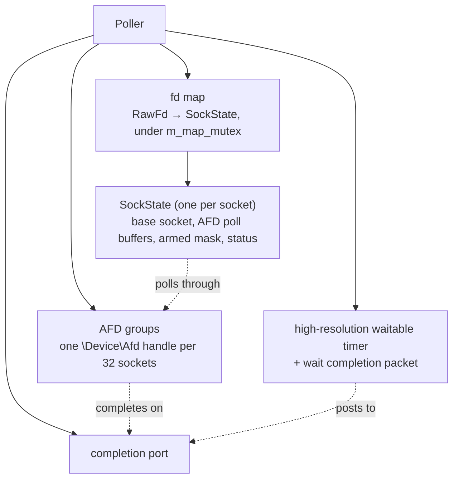
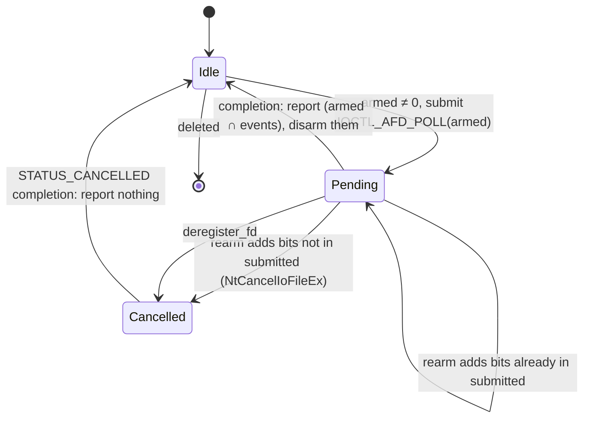
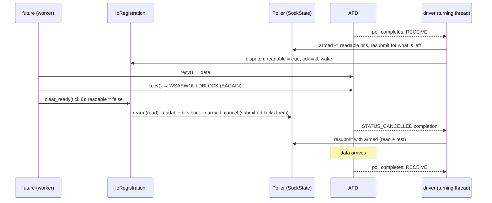

# Windows Port

The port of coro to Windows, built with MSVC (Visual Studio 2026, C++23). It runs the
same `Runtime`, executors, [`IoDriver`](io_driver.md), timer queue and socket types as
the Linux build. The difference is the driver's `sys` layer: a readiness `Poller` built
on an I/O completion port and the AFD driver (mio's and wepoll's approach), plus
Winsock and Win32 versions of the socket, DNS and file seams.

## Scope

| Supported | Not supported |
|---|---|
| Every executor, `Runtime`, the blocking pool | `Pipe` (no readiness for Windows pipes; needs overlapped I/O; see [Pipes](#pipes)) |
| `IoDriver` on an IOCP/AFD `sys::Poller` | `signal()`, `signal_stream()` (no POSIX signals; `ctrl_c()`, `shutdown_requested()` and `windows::console_event()` instead) |
| `TcpStream`, `TcpListener`, `UdpSocket` | `sys/notify.h` (only the Pico ISR primitives use it) |
| `sleep_for`, `timeout`, `IntervalTimer`, sub-millisecond | UDP GSO/GRO (Windows USO/URO); reports `ENOTSUP` |
| `File` (Win32, on the blocking pool) | MinGW, clang-cl, Windows before 10 |
| `lookup_host` (`GetAddrInfoW`, on the blocking pool) | |
| `WsStream`, `WsListener` (libwebsockets, level-triggered registrations) | |
| Fibers (Win32 fibers; see `fiber.md`, "Windows backend") | |
| `ctrl_c()`, `shutdown_requested()`, `windows::console_event()` (console control events; see `signal_handling.md`, "Windows") | |

Code above `sys` is shared with the POSIX build. The few places where it accounts for
Windows are described in [Shared code](#shared-code) and [WebSockets](#websockets).

!!! tip "TODO: notify objects"
    Nothing on Windows uses `sys/notify.h`. A notify object would be a `Poller`-owned
    object signalled with `PostQueuedCompletionStatus()`. `RawFd` would then need to tell
    such objects apart from sockets, for example with a tag bit, because socket handles
    are multiples of 4. A loopback socket can't stand in for one: the notify contract has
    no read-back, and an AFD poll re-armed over an unread datagram reports it again at
    once. Console events need no notify object; they reach the driver as loopback
    datagrams (`signal_handling.md`, "Why not the completion port").

## Summary

| Question | Design |
|---|---|
| Readiness source | IOCP plus `IOCTL_AFD_POLL` on `\Device\Afd`, modelled on mio's `sys/windows/selector.rs` and `afd.rs` |
| Edge-triggered delivery | Emulated: a direction reported once is left out of later polls until a consumer sees would-block and calls `Poller::rearm()` |
| `RawFd` | `std::uintptr_t` (a `SOCKET`, or a file's handle object); `kInvalidFd` is all ones, which is both `INVALID_SOCKET` and `INVALID_HANDLE_VALUE` |
| Error values | The seams keep returning errno values, translated from WSA and Win32 codes; exceptions use `std::generic_category()` |
| Poll timeout | A high-resolution waitable timer posted to the port: about 0.5 ms resolution, never early |
| Selecting the backend | `CORO_SYS_WINDOWS`, which `poller.h` defines from `_WIN32` (unless `CORO_SYS_LWIP`), so a program and the library always agree. No CMake flag |
| Undocumented NT calls | Declared in one private header, `src/detail/sys/windows/nt.h`, and looked up in `ntdll.dll` at first use, so nothing beyond `ws2_32` is linked. Windows 10 and later only |

---

## Shared code

### `Poller::rearm()`

AFD polls are one-shot. If the `Poller` re-armed every direction after each completion,
it would be level-triggered: a socket with unread data and no reader would complete on
every turn and an idle driver would spin. mio solves this by leaving a reported
direction out of later polls until the I/O source sees `WouldBlock`, when its `do_io()`
re-registers. coro's equivalent of that moment is `IoRegistration::clear_ready()`, which
calls one `Poller` function shared by every backend:

```cpp
class Poller {
public:
    /// Re-enables reporting of `interest` on `fd`, after a consumer of an
    /// edge-triggered registration saw would-block. A backend whose OS delivers edges
    /// itself does nothing. Never throws: a failure to re-arm is reported as an error
    /// event on the fd, so its waiter retries and sees the error from its syscall.
#ifdef CORO_SYS_WINDOWS
    void rearm(RawFd fd, Interest interest) noexcept;
#else
    void rearm(RawFd, Interest) noexcept {}
#endif
};
```

`clear_ready()` calls it once it has actually cleared the direction, after releasing the
`ScheduledIo` mutex:

```cpp
void IoRegistration::clear_ready(IoReadyEvent event) {
    {
        std::lock_guard lock(m_io->m_mutex);
        if (m_io->m_tick != event.tick) return;   // newer readiness: nothing to re-arm yet
        (event.direction == IoDirection::Read ? m_io->m_readable : m_io->m_writable) = false;
    }
    // After the clear: an event from the re-armed poll then sets the flag again. An AFD
    // poll reports the socket's state when it is submitted, so data that arrived
    // between the EAGAIN and this call completes it at once. Nothing is lost.
    m_driver->m_poller.rearm(m_fd, event.direction == IoDirection::Read
                                       ? sys::Interest::read() : sys::Interest::write());
}
```

When the tick has changed, `clear_ready()` returns without clearing. The caller's loop in
`poll_io()` then retries its operation. Either the retry succeeds, or it fails with
would-block again and the next `clear_ready()` clears and re-arms. The waiter-list form
of `poll_ready()` goes through the same `clear_ready()`.

The cost on Linux and Pico is nothing, because the call is an empty inline function.

### Error categories

`detail::socket_error()`, `File::open()`, `File::sync_all()`, and the WebSocket and Pipe
errors wrap an errno value in `std::generic_category()`, not `std::system_category()`.
On glibc the system category holds errno values, but on MSVC it holds Win32 error codes,
so `ECONNREFUSED` (107) would print as an unrelated Win32 message and compare unequal to
`std::errc::connection_refused`. On Linux both categories map errno values to the same
conditions, so the choice makes no difference there. The POSIX seams use
`std::system_category()` for the errors they throw themselves; the Windows seams throw in
the generic category.

### Build guards and fibers

- `io/pipe.h` holds an `#error` under `_WIN32`, so including it fails with a clear
  message rather than a missing `<unistd.h>`. `io/signal.h` declares `signal()` and
  `signal_stream()` on POSIX only, `windows::console_event()` on Windows only, and
  `ctrl_c()` and `shutdown_requested()` on both.
- Fibers have a Windows backend, `fiber_context_windows.cpp`, on Win32 fibers: see
  `fiber.md`, "Windows backend". The fiber thread-locals sit behind out-of-line
  accessors in `fiber.cpp` (`fiber.md`, "Thread-locals and worker migration"), because
  MSVC, like other compilers, may cache a thread-local's address across a fiber switch
  that migrates the fiber to another thread.

---

## The IOCP/AFD `Poller`

### Why AFD

Windows has no readiness API that fits the `sys` contract:

- `WSAPoll()` is O(n) per wait and can't be changed while another thread waits in it.
- `select()` has the same problems and caps the socket count.
- `WSAEventSelect()` allows 64 events per wait.

IOCP scales, but it reports completed operations, not readiness. `IOCTL_AFD_POLL` closes
that gap. It is the request `select()` itself sends to the AFD driver, and when it is
sent as an overlapped request on a handle bound to a completion port it completes on
that port once the socket becomes ready. mio, wepoll and libuv's `uv_poll` all use it.
It is undocumented, but it has been stable since Windows Vista, and tokio's Windows
support depends on it.

### Objects



- **The completion port** is the only thing `poll()` waits on. Four kinds of packet
  arrive, told apart by completion key: AFD completions (`kAfdKey`, overlapped pointer =
  the `SockState`), wakes (`kWakeKey`, overlapped pointer = the waker's event key), the
  timeout timer (`kTimerKey`), and a submission another thread could not make
  (`kErrorKey`, overlapped pointer = the `SockState`; see
  [`poll()`](#poll)).
- **AFD groups.** An AFD poll is sent to a handle opened on `\Device\Afd\Coro`. The
  text after `Afd\` is ignored and only names the helper. Each handle is bound to the
  port with `kAfdKey` and marked `FILE_SKIP_SET_EVENT_ON_HANDLE`. Like mio and wepoll, a
  handle serves at most 32 sockets, and a new one is opened when every handle is full.
  A handle is closed when its last `SockState` is freed, which is after that state's
  last poll has completed.
- **`SockState`**, one per registered socket (mio's `SockState`), held by
  `std::shared_ptr`:

```cpp
struct SockState {                    // src/detail/sys/windows/poller_iocp.cpp
    std::mutex      mutex;
    IO_STATUS_BLOCK iosb;             // written by the kernel while a poll is pending
    AfdPollInfo     poll_info;        //   (status Pending or Cancelled)
    AfdHandle*      afd;              // the group this socket polls through
    SOCKET          base;             // SIO_BASE_HANDLE of the registered socket
    void*           key;              // ScheduledIo*, returned in each Event
    ULONG           interest;         // AFD bits of the registered Interest
    ULONG           armed;            // interest minus directions reported since rearm
    ULONG           submitted;        // bits of the poll in flight (0 when Idle)
    PollStatus      status;           // Idle, Pending, Cancelled
    bool            level;            // Trigger::Level: never disarm
    bool            deleted;          // deregistered; report nothing
    std::shared_ptr<SockState> in_flight;  // itself, while the kernel holds its address
    std::shared_ptr<SockState> error_ref;  // itself, while a kErrorKey packet is queued
    // and, touched only by the polling thread: which poll() built its Event, where in
    // the output, and which poll() last resubmitted it (level-triggered)
};
```

- **The base socket.** A layered service provider can wrap a socket, so AFD is sent the
  base provider's handle from `WSAIoctl(SIO_BASE_HANDLE)`. If that fails, it falls back
  to `SIO_BSP_HANDLE_SELECT`, `SIO_BSP_HANDLE_POLL`, then `SIO_BSP_HANDLE`, as mio does.

`RawFd` is what the primitives store and close. The fd map lets `deregister_fd(fd)` and
`rearm(fd, ...)` find the state without changing the `sys` signatures every backend
shares.

!!! tip "PERF: the fd map lookup on every re-arm"
    `rearm()` takes `m_map_mutex` for a hash lookup on every would-block. Next to the AFD
    request it usually triggers, that is small. If it shows up in a profile, have
    `register_fd()` return an opaque per-registration pointer that `IoRegistration`
    stores and passes back. That changes the seam for every backend.

### Readiness bits

| `Interest` | AFD bits requested |
|---|---|
| `readable` | `POLL_RECEIVE`, `POLL_ACCEPT`, `POLL_DISCONNECT` |
| `writable` | `POLL_SEND` |
| always | `POLL_ABORT`, `POLL_CONNECT_FAIL`, `POLL_LOCAL_CLOSE` |

| AFD bit reported | `Event` field |
|---|---|
| `POLL_RECEIVE`, `POLL_ACCEPT` | `readable` |
| `POLL_DISCONNECT` (peer's FIN) | `readable`, `hup` |
| `POLL_SEND` | `writable` |
| `POLL_ABORT` (reset) | `error`, `hup` |
| `POLL_CONNECT_FAIL`, or a failed `NTSTATUS` | `error` |
| `POLL_LOCAL_CLOSE` | none: the socket was closed before it was deregistered; the state is marked deleted |

`IoDriver::dispatch()` already treats `error` and `hup` as ready in both directions, so
a pending connect sees `POLL_CONNECT_FAIL` and its `tcp_try_finish_connect()` reads the
failure from `SO_ERROR`.

### Edge emulation

The heart of the backend is the `armed` mask:

- **Report, then disarm.** When a poll completes, the reported bits are masked with
  `armed`, turned into an `Event`, and removed from `armed`, unless the registration is
  level-triggered. A direction that has been reported is no longer polled for.
- **Re-arm on would-block.** `rearm(fd, interest)` adds the direction's bits, and the
  always-on bits, back to `armed`.
- **Keep a poll in flight for whatever is armed.** After any change to `armed`, and
  after every completion, the state is brought in line (mio's `update()`):



Whenever a state returns to `Idle`, the thread that processed the completion resubmits
it if `armed` is not empty and the state is not deleted. That is always the polling
thread, before `poll()` returns. A cancelled poll is resubmitted with the newly armed
bits. As in mio, a socket has at most one poll in flight, and it is never replaced in
place: a re-arm that widens the mask cancels the poll, and the polling thread submits the
wider one when the cancellation completes.



Each would-block on Windows can therefore cost a cancel, a resubmission and an extra
completion. mio pays the same. Hitting would-block is already the slow path, and on
every platform it ends in a wait.

!!! tip "PERF: one AFD poll per direction"
    coro keeps one outstanding poll per socket, as mio does. If profiling shows the cancel
    and resubmit on re-arm costing something, one poll per direction (with
    `exclusive = FALSE`) would avoid the cancel, at the cost of two `SockState` buffers
    per socket.

!!! danger "WARNING: never reach AFD readiness from above `sys`"
    Everything above `sys` must keep following the edge contract: wait only after
    would-block, and clear readiness through `clear_ready()`. A primitive that waited
    without first seeing would-block would hang on Windows: its direction is disarmed
    and nothing re-arms it. On Linux the same bug is only latent.

### Level-triggered registrations

A `Trigger::Level` registration never disarms, and `rearm()` ignores it. Its poll is
resubmitted with the full interest after a completion, and a socket that stays ready
completes again at once. To keep to one report per `poll()`, the contract epoll gives, a
level poll is resubmitted at most once per `poll()`: a second completion in the same
call is merged into the event already built, and its resubmission is held over to the
start of the next `poll()`. `set_interest()` reaches `reregister_fd()`, which replaces
`interest` and `armed` and cancels the poll in flight if it asks for anything else.

### Registration from any thread

`register_fd()`, `reregister_fd()`, `rearm()` and `deregister_fd()` submit and cancel
AFD polls directly on the calling thread, under the `SockState`'s mutex. A completion
lands on the port and ends a `poll()` blocked on another thread, so no wake is needed.
mio defers submissions to the polling thread through an update queue. That batches
them, but it adds a queue, a wake and a turn of latency to every registration, and coro
doesn't need it:

- **Thread-agnostic I/O.** Since Windows Vista, I/O issued on a handle bound to a
  completion port is not cancelled when the issuing thread exits. A blocking-pool or
  worker thread may submit a poll and then exit. The AFD handles are bound to the port
  before any poll is sent through them.
- **Lock order.** A `SockState`'s mutex may be held while the fd map's, the in-flight
  count's or the AFD group list's mutex is taken, never the reverse. The fd map's mutex
  is only held to find, insert or erase an entry.
- **Failed submissions.** A submission the kernel refuses produces no completion. On the
  polling thread it becomes an error event at once. On another thread (`rearm()`,
  `reregister_fd()`), which can't append to `poll()`'s output, it posts a `kErrorKey`
  packet, and the next `poll()` reports the error. The waiter retries its syscall, which
  reports the real error.

### Deregistration and the life of a `SockState`

`deregister_fd(fd)` removes the map entry, then under the state's mutex sets `deleted`
and cancels a pending poll. It returns false if `fd` was not in the map, which is what
`IoDriver::deregister()`'s debug assertion checks.

The `SockState` itself lives as long as the kernel can still write to it. Submitting a
poll hands one reference to the kernel, passed through the overlapped pointer
(`ApcContext`) and recovered by `poll()` when the completion is dequeued. A cancelled
poll's completion can arrive several turns later. `IoDriver`'s pending-release rule
cannot cover that, so the `Poller` doesn't depend on it:

- **Keys.** `poll()` builds an `Event` only under the state's mutex and only while
  `deleted` is false. Once `deregister_fd()` returns, no later `poll()` reports the key,
  which is the guarantee epoll gives. An event already built by a `poll()` racing with the
  deregistration is covered by the driver's pending release, as on Linux.
- **Memory.** The `IO_STATUS_BLOCK` and `AfdPollInfo` that the kernel writes are inside
  the `SockState`. The kernel's reference keeps them alive until the completion of the
  final, possibly cancelled, poll has been dequeued.

!!! danger "WARNING: deregister before closing"
    The rule in `io_driver.md` still applies. A socket closed while registered completes
    its poll with `POLL_LOCAL_CLOSE`. The backend survives it: it marks the state
    deleted and removes the map entry. But a socket that reuses the handle value before
    that completion is processed finds the stale entry and fails to register, and the
    late `deregister_fd()` returns false, which `IoDriver::deregister()` asserts on.

### `poll()`

```cpp
void Poller::poll(std::vector<Event>& out, std::optional<std::chrono::nanoseconds> timeout);
```

1. Resubmits the level-triggered polls the previous `poll()` held over.
2. Arms the timeout (see below) when it is positive. `nullopt` waits `INFINITE`, and zero
   or less waits 0.
3. `GetQueuedCompletionStatusEx()` for up to 256 entries, non-alertable.
4. Disarms the timeout if its packet did not arrive.
5. For each entry, by completion key:
    - `kWakeKey`: appends `Event{key}` for the `PollWaker`.
    - `kTimerKey`: nothing. A stale timer packet from an earlier `poll()` is also
      ignored.
    - `kAfdKey`: takes back the kernel's reference to the `SockState`, and under its
      mutex sets `Idle`, reports what is due, and resubmits if `armed` is not empty.
    - `kErrorKey`: reports an error event for the state.
6. **Collects resubmitted polls.** A poll resubmitted for a socket that is ready already
   (the other direction became ready while the first was being reported) has completed
   by the time the submission returns. Up to four more zero-timeout dequeues pick these
   up, so this `poll()` reports them and not the next. Without this, a fresh
   registration with both directions ready would be reported in two turns where epoll
   reports it in one.
7. **Waits again if nothing was reported.** Packets that report nothing (a cancelled
   poll's completion, a stale timer, a completion masked to nothing) do not end a timed
   or unbounded wait: `poll()` waits again for the rest of the timeout, as epoll would
   not have woken at all.

**One event per socket per call.** Every report for a socket within one `poll()` call,
from the main dequeue and the collection passes, is merged into a single `Event` (the
`SockState` remembers where its event is in the output). `IoDriver::turn()` then
dispatches each socket once and counts it once, as with epoll.

`poll()` is called by one thread at a time, which `IoDriver` already enforces, so the
timer, its packet and the held-over list need no lock.

### `PollWaker`

```cpp
void PollWaker::wake() noexcept;   // PostQueuedCompletionStatus(port, 0, kWakeKey, key), once
void PollWaker::reset() noexcept;  // allows the next wake() to post again
```

A posted packet waits in the port until a `poll()` dequeues it, which gives the sticky
semantics `unpark()` needs. So that repeated unparks don't queue one packet each, the
waker keeps a "posted" flag under a mutex. `wake()` posts only if the flag is clear, and
`reset()` clears it. A wake that lands between the dequeue and `reset()` is absorbed,
exactly as on the eventfd. The polling thread is awake at that point and re-checks its
queues before it polls again.

### Sub-millisecond timeouts

`GetQueuedCompletionStatusEx()` takes whole milliseconds, and a plain wait has the
system tick's resolution, 15.6 ms unless some process raised it. Instead, a positive
timeout is handled by a timer whose expiry ends the wait:

- One **high-resolution waitable timer** per `Poller`
  (`CreateWaitableTimerExW(..., CREATE_WAITABLE_TIMER_HIGH_RESOLUTION, ...)`, Windows 10
  1803 and later).
- One **wait completion packet** (`NtCreateWaitCompletionPacket`). Before each timed
  wait, `NtAssociateWaitCompletionPacket` binds it to the timer and the port with
  `kTimerKey`, so the timer's expiry posts a packet that ends the wait.
- **The timed wait:** `SetWaitableTimer()` with the timeout rounded up to 100 ns, then the
  association, then `GetQueuedCompletionStatusEx()` with the timeout rounded up to
  milliseconds, plus one. The timer ends the wait first. The millisecond bound only
  matters if the timer's packet never comes. If something else ended the wait,
  `NtCancelWaitCompletionPacket(packet, TRUE)` removes the packet whether or not it was
  already queued, and `CancelWaitableTimer()` stops the timer. A packet that slips
  through anyway is ignored by a later `poll()`.
- **Fallback.** If the association fails (the packet is still queued from a cancel that
  lost the race), or the timer or packet could not be created, that wait relies on its
  millisecond timeout alone. It is coarser but never early.

The resolution this gives is the hardware timer's, about 0.5 ms on current machines. It
is better than milliseconds but not as fine as Linux. Waits are never shorter than asked,
so a timer never fires early. `TimerQueue::begin_wait()` already rounds up, and
`fire_expired()` checks the clock.

!!! note "NOTE: no process-wide timer resolution change"
    `timeBeginPeriod(1)` would also sharpen a plain wait, but it changes the whole
    process's tick and its power use. The waitable timer affects only this wait.

### Destruction

`~Poller()` cancels every poll still in flight and drains the port, with
`GetQueuedCompletionStatusEx()` and a short timeout, until the in-flight count reaches
zero. Then it closes the AFD handles, the timer, the wait packet and the port. Closing an
AFD handle with polls outstanding would leave the kernel writing into `SockState`s that
the drain would otherwise have freed. If the count has not reached zero after ten
seconds, the destructor leaks everything rather than free memory the kernel may still
write. By the time it runs, `IoDriver` has torn down its `PollWaker`, and every
`IoRegistration` has deregistered (see the warning on `IoDriver`).

---

## The Winsock seams

`src/detail/sys/windows/`:

| File | Implements |
|---|---|
| `nt.h` | `ntdll` entry points (`NtDeviceIoControlFile`, `NtCancelIoFileEx`, `NtCreateFile`, `NtCreateWaitCompletionPacket`, `NtAssociateWaitCompletionPacket`, `NtCancelWaitCompletionPacket`, `RtlNtStatusToDosError`), looked up once by `nt()`; AFD structs and constants |
| `win.h`, `win.cpp` | The Windows headers in the right order; one-time `WSAStartup`; `wsa_to_errno()`, `win32_to_errno()`; UTF-8 ⇄ UTF-16; `nt()` |
| `poller_iocp.cpp` | `Poller`, `PollWaker`, the AFD groups |
| `sockaddr_windows.h` | `SocketAddress` ⇄ `sockaddr_storage` (the same layout as `sockaddr_posix.h`, from `<ws2tcpip.h>`) |
| `socket_windows.cpp`, `tcp_windows.cpp`, `udp_windows.cpp` | The socket seams |
| `dns_windows.cpp` | `resolve_host()`, `dns_category()` |
| `file_windows.cpp` | The file seam |

### Sockets

- **Startup.** Every function that creates a socket or resolves a name first calls
  `winsock_init()`, a function-local static that runs `WSAStartup(2.2)` once.
  `WSACleanup()` is never called, because sockets may still be closing during static
  destruction.
- **Creation.** `WSASocketW(af, type, proto, nullptr, 0, WSA_FLAG_OVERLAPPED |
  WSA_FLAG_NO_HANDLE_INHERIT)`, which is close-on-exec, then `ioctlsocket(FIONBIO)`. An
  accepted socket inherits non-blocking mode from its listener, and
  `SetHandleInformation()` clears its inherit flag.
- **Errors.** `WSAGetLastError()` is translated to errno: `WSAEWOULDBLOCK` → `EAGAIN`,
  `WSAECONNREFUSED` → `ECONNREFUSED`, and so on for each WSA code with a POSIX
  equivalent. A send on a connection that is gone (`WSAESHUTDOWN`, `WSAECONNABORTED`)
  becomes `EPIPE`, and a receive that finds it aborted becomes `ECONNRESET`, as POSIX
  reports them. A code with no equivalent becomes `EIO`. MSVC's `<errno.h>` defines every POSIX name the seams use, including
  `EWOULDBLOCK` and `ECANCELED`.
- **Sizes.** Winsock lengths are `int`, so a send or receive is clamped to `INT_MAX`
  bytes. A short count is already allowed.

### TCP

| POSIX | Windows |
|---|---|
| `connect()` returns `EINPROGRESS` | returns `WSAEWOULDBLOCK`, read the same way |
| `tcp_try_finish_connect()`: `SO_ERROR`, then `getpeername()` → `ENOTCONN` means "in progress" | `SO_ERROR`, then `SO_CONNECT_TIME`: all ones means "in progress". Not `getpeername()`, which on Windows succeeds while an IPv6 handshake is still running, so a connect that is about to be refused would read as connected |
| `SO_REUSEADDR` on listeners | `SO_EXCLUSIVEADDRUSE` instead. On Windows `SO_REUSEADDR` lets another socket take over a bound port, and binding past `TIME_WAIT` needs no option |
| `MSG_NOSIGNAL` | not needed: there is no `SIGPIPE` |
| `accept4()`; skip `ECONNABORTED`, `EPROTO`, `EINTR` | `accept()`; skip `WSAECONNRESET`, `WSAECONNABORTED` |

!!! note "NOTE: a non-blocking send takes all of a large buffer at once"
    Winsock accepts a whole non-blocking `send()` whenever the socket's send buffer has
    any room left, however large the send (AFD buffers it past `SO_SNDBUF`). Only the
    next send finds the buffer full and waits. Nothing in coro depends on where the
    first wait comes; `TcpStreamTest.WriteWaitsUntilPeerReads` writes until one waits.

!!! note "NOTE: refused connections are slow on Windows"
    Windows retries a SYN that was answered with a reset, so `ECONNREFUSED` can take a
    couple of seconds to arrive, even on loopback, where Linux reports it at once. Tests
    of refused connects need a timeout that allows for it.

### UDP

- **`SIO_UDP_CONNRESET` off.** Windows reports an ICMP "port unreachable" for an earlier
  send as a `WSAECONNRESET` on the next `recvfrom()`, even on an unconnected socket.
  Linux reports it only on connected sockets. `udp_open()` disables it with
  `WSAIoctl(SIO_UDP_CONNRESET, FALSE)`.
- **Truncation.** A datagram longer than the buffer fails with `WSAEMSGSIZE`, though the
  buffer is filled. `udp_try_recv()` returns `size`, which is what POSIX `recvfrom()`
  returns without `MSG_TRUNC`.
- **GSO/GRO.** `udp_set_segment_size()` and `udp_set_gro()` throw `ENOTSUP`, as on any
  non-Linux backend, and `udp_try_recv_segments()` reports one segment.
- **Dual-stack.** Windows defaults `IPV6_V6ONLY` to on and Linux to off. `udp_open()`
  and the TCP seams set it explicitly on IPv6 sockets, so that binding `[::]` means the
  same on both.
- **`send_to()` on a connected socket.** Windows, like Linux, sends to the explicit
  destination, not the connected peer (see `udp_socket.md`, "Known limitations").
  `UdpSocketTest.SendToStillWorksAfterConnectToDifferentPeer` checks it.

!!! tip "TODO: UDP segmentation offload on Windows"
    Windows 10 2004 and later have `UDP_SEND_MSG_SIZE` (USO) and
    `UDP_RECV_MAX_COALESCED_SIZE` (URO), which correspond to `UDP_SEGMENT` and `UDP_GRO`.

### DNS

`resolve_host()` converts the host name from UTF-8 to UTF-16 and calls
`GetAddrInfoW()`, so non-ASCII names do not go through the ANSI code page. It runs on the
blocking pool, as on POSIX (`kResolverBlocks = true`). Its failure codes are WSA codes
(`EAI_*` are aliases of them). `dns_category()` formats them with `FormatMessageW`,
because `gai_strerrorA()` returns a static buffer and isn't thread-safe.

### Files

`File` runs every operation on the blocking pool, as on POSIX. Windows has no `pread()`:
`ReadFile()` with an offset in its `OVERLAPPED` also moves the file pointer of a
synchronous handle. So the seam's `RawFd` for a file is a pointer to a small object of
the backend's own, which no other layer looks inside:

```cpp
struct WinFile {          // file_windows.cpp; RawFd is its address
    HANDLE     handle;
    bool       append;
    std::mutex mutex;     // guards position
    int64_t    position;  // the "file position" for offset < 0
};
```

- Every read and write passes an explicit offset: the caller's, or `position`, which is
  advanced under the mutex. Writes in append mode use the `0xFFFFFFFF'FFFFFFFF` offset
  (append at end of file), and `position` then moves to the new end.
- `file_open()` converts the path to UTF-16 and calls `CreateFileW()` with
  `FILE_SHARE_READ | FILE_SHARE_WRITE | FILE_SHARE_DELETE`, which is closest to POSIX
  sharing. `create`, `truncate` and `create` + `truncate` map to `OPEN_ALWAYS`,
  `TRUNCATE_EXISTING` and `CREATE_ALWAYS`.
- `file_sync()` is `FlushFileBuffers()`. `file_close()` closes the handle and frees the
  object.
- Win32 errors become errno through `win32_to_errno()`: `ERROR_FILE_NOT_FOUND` and
  `ERROR_PATH_NOT_FOUND` → `ENOENT`, `ERROR_ACCESS_DENIED` → `EACCES`,
  `ERROR_FILE_EXISTS` → `EEXIST`, `ERROR_DISK_FULL` → `ENOSPC`, and so on. A read
  failing with `ERROR_HANDLE_EOF` returns 0.

!!! note "NOTE: a file's `RawFd` is never a socket"
    It only ever reaches the file seam. Nothing registers it with the `Poller`, and
    `close_socket()` must never see it.

---

## Pipes

!!! tip "TODO: pipes on Windows"
    `Pipe` is POSIX-only. Child processes are the likely first user of a Windows
    equivalent.

Windows pipes differ from POSIX ones in two ways:

- **The model.** A named pipe (`\\.\pipe\name`) is server/client: one instance per
  client, like an accepted socket, optionally duplex or message-framed. That is a
  listener/stream API (tokio's `windows::named_pipe::NamedPipeServer` /
  `NamedPipeClient`), not `Pipe::open(path, mode)`. So `Pipe` stays POSIX-only, as
  tokio's `unix::pipe` is, and Windows would get a separate Windows-only type.
- **The I/O.** AFD polls don't work on pipe handles. Only overlapped I/O completes on
  the port, so a pipe needs a new kind of object in the `Poller`: its own completion
  key, and a way for `RawFd` to tell it from a socket (the tag bit a notify object
  would need too).

There are three ways to fit that to coro:

- **mio/tokio: overlapped I/O through internal buffers.** The pipe object owns a read
  buffer and a write buffer, keeps an overlapped `ReadFile` outstanding into the first,
  and reports "readable" when it completes. A read copies out of it; a write copies
  into the second and starts an overlapped `WriteFile`. Readiness above the poller as
  for sockets, at the cost of a copy each way and two buffers per pipe.
- **libuv: zero-byte reads.** An overlapped `ReadFile` of length 0 completes when data
  arrives, without pinning any buffer. Then a plain `ReadFile` takes what is there
  (`PeekNamedPipe` says how much) and completes at once. That is a readiness
  notification for reads, which matches `IoRegistration` with no copy and no internal
  read buffer. Writes are real overlapped operations. coro's write futures already own
  their buffer, so it can stay pinned until the completion. A dropped write needs
  `CancelIoEx`, and the buffer has to be held until that cancellation completes,
  as the poller's `in_flight` reference does for an AFD poll. For a handle opened
  without `FILE_FLAG_OVERLAPPED` (e.g. a child's stdio from `CreatePipe`), libuv runs
  the zero-byte read on a thread instead.
- **tokio's child stdio: the blocking pool.** `tokio::process` on Windows does each
  stdio read and write on the blocking pool, as coro's `File` does everywhere. No
  `Poller` change at all, and enough for child processes. It doesn't give a named-pipe
  server.

The blocking pool is the cheapest start for child-process stdio. Of the two that give
async named pipes, libuv's zero-byte read is closer to coro's readiness model and avoids
mio's copies.

---

## WebSockets

The libwebsockets integration ([WebSocket Stream](websocket_stream.md)) is the same as
on Linux. lws runs on its custom event-loop ops (`event_lib_custom`), so its
own Windows service loop, which waits in `WSAPoll()`, never runs. Each socket it reports
becomes a level-triggered registration on the IOCP/AFD `Poller`, which makes WebSockets
the one real user of [level-triggered registrations](#level-triggered-registrations) on
Windows.

What lws 4.5 does differently on Windows, and why it doesn't matter here:

| lws on Windows | Effect on coro |
|---|---|
| `lws_sockfd_type` is `SOCKET` | Converts to `RawFd` (`std::uintptr_t`) directly. A `static_assert` in `ws_service.cpp` checks the types match |
| The wake pipe behind `lws_cancel_service()` is two loopback UDP sockets (`windows-pipe.c`), not a pipe or a WSA event | It is reported through the ops and registered like any other socket, so `post()` and `LWS_CALLBACK_EVENT_WAIT_CANCELLED` work as on Linux |
| `_lws_plat_service_forced_tsi()` has its own Windows version | It services only fds whose `revents` are already set, and never blocks, so `after_lws()` is the same as on Linux |
| Listening sockets get `SO_EXCLUSIVEADDRUSE` (`roles/http/server/server.c`), not `SO_REUSEADDR`, unless the vhost sets `LWS_SERVER_OPTION_ALLOW_LISTEN_SHARE` | coro doesn't set it, so a `WsListener`'s port is exclusive like a `TcpListener`'s, and `bind_errno()`'s probe through `tcp_listen()` meets the same rule lws does |
| Its own loop fakes `POLLOUT` before each `WSAPoll()` for sockets that aren't blocked on sending | That loop doesn't run. lws gets real writability from AFD, which is what it receives on Linux from epoll |

Portable details in the WebSocket code:

- `Entry::fd` starts as `sys::kInvalidFd`, and `sync_registration()` tests
  `fd == sys::kInvalidFd`. An unsigned `RawFd` is never negative, so `fd < 0` would not
  work.
- `ws_stream.cpp` gets `inet_ntop()` from `<ws2tcpip.h>` on Windows, and from
  `<arpa/inet.h>` and `<netinet/in.h>` elsewhere.
- Its `std::system_error`s use `std::generic_category()`, as in
  [Error categories](#error-categories).

---

## Build

- **Sources.** `CMakeLists.txt` picks `src/detail/sys/windows/*.cpp` under `WIN32` and
  the POSIX files otherwise, and `fiber_context_windows.cpp` instead of
  `fiber_context_posix.cpp`. It leaves out `io/pipe.cpp`; `io/signal.cpp` is built on
  both, over `signal_posix.cpp` or `signal_windows.cpp`.
  libwebsockets comes from Conan as on Linux. The
  libcap check in `cmake/deps/libwebsockets.cmake` finds no `LWS_HAVE_LIBCAP` and links
  nothing extra.
- **Definitions and links.** `WIN32_LEAN_AND_MEAN`, `NOMINMAX` and `_WIN32_WINNT=0x0A00`
  are private to the library. It links `ws2_32` only (PUBLIC, and in the Conan
  package's `system_libs`). No public header includes `<windows.h>`: `poller.h` keeps a
  pointer to the private `IocpPoller`, and `RawFd` is an integer.
- **Compiler.** `/permissive-`, `/Zc:__cplusplus`, `/utf-8`, `/EHsc` and `/W4`. The C++
  standard comes from the Conan profile, as on Linux.
- **CMake.** The Windows profile takes CMake 4.2 or later from Conan for every package
  and for coro (`[tool_requires]`): earlier versions don't know Visual Studio 2026, and
  the one Visual Studio installs may be one of them.
- **Conan.** On Windows coro is always a static library. It has no export macros, so a
  DLL would export nothing. The recipe has no `shared` option there, and the test
  recipe mirrors that and doesn't require `libunicorn`.
- **gperftools.** On by default, as on Linux. On Windows gperftools builds only
  `tcmalloc_minimal` (no profilers), which is all coro uses. It replaces `malloc` by
  patching the C runtime at startup rather than at link time, and the linker drops a
  static tcmalloc that nothing references, so each executable is linked with
  `/INCLUDE:__tcmalloc` (CMake `INTERFACE` link option, and the package's
  `exelinkflags`). `asan-msvc` turns it off: tcmalloc and ASan would both replace the
  allocator.
- **CI.** The `windows` job in `.github/workflows/tests.yml` runs on GitHub's
  `windows-2025-vs2026` runner (Visual Studio 2026, Ninja), with
  `docker/profiles/windows2025` as the default Conan profile, and runs the same
  `ci/run-tests.sh` as the Linux jobs under Git Bash. It runs plain and under
  AddressSanitizer (`docker/profiles/asan-msvc`: MSVC has ASan alone, no UBSan, no
  leak detection, no ThreadSanitizer). Under ASan the tests find the ASan runtime DLL
  through a `PATH` entry `test/cmake/coro_test.cmake` gives each test.
- **Tests.** `test/CMakeLists.txt` builds only the `DESKTOP` tests on Windows: the Pico
  configuration on the host (stubbed SDK, host lwIP, the ARM emulator) is POSIX-only.
  `NO_WINDOWS` in `tests.cmake` leaves out the pipe and notify tests. The signal tests
  run on Windows through `test/signal_test_util.h`.
  Tests that drive the Poller or the IoDriver with raw sockets use
  `test/socket_test_util.h`:
    - `SocketPair` is an AF_UNIX socketpair on POSIX and a loopback TCP connection with
      `TCP_NODELAY` on Windows.
    - `UdpLoopback` is a UDP socket on 127.0.0.1.
    - Byte I/O goes through the `sys` seams.
    - `write_byte_and_settle()` waits, on Windows, until the byte has reached the peer
      (`WSAPoll`), so a zero-timeout turn right after it sees the readiness, as on a
      socketpair.

---

## Tests

The `Poller.*`, `PollWaker.*`, `IoDriver.*`, `IoWaiter.*`, `TimerQueue.*` and socket
tests run on every platform with the helper above, and are the contract.
`Poller.IsEdgeTriggered` drains to EAGAIN and calls `rearm()` before it expects the next
edge, as the contract requires; epoll would deliver the edge without the `rearm()`, the
AFD backend would not. The tests below cover the Windows backend in particular. The
`Poller` and `PollWaker` ones are under `#ifdef CORO_SYS_WINDOWS` at the end of
`test_poller.cpp`:

| Test | Checks |
|---|---|
| `Poller.ReportedDirectionStaysQuietUntilRearm` | After one readable event, more data produces no event until `rearm(read)`; then one does |
| `Poller.RearmWithDataAlreadyPresentReportsAtOnce` | Data that arrived before `rearm()` is reported by the next `poll()`: no lost edge |
| `Poller.RearmReEnablesOnlyThatDirection` | Re-arming one direction (each a cancel and a wider resubmission) reports that one and not the other |
| `Poller.DeregisterWithPollInFlightReportsNothing` | Deregistering a socket with a pending poll: the cancelled completion produces no event |
| `Poller.DestroyWithPollsInFlight` | `~Poller()` with registered and cancelled sockets drains every outstanding poll (under Application Verifier or ASan) |
| `Poller.RegisterFromExitedThread` | A poll submitted by a thread that has since exited still completes |
| `Poller.ManySocketsSpanAfdGroups` | More than 32 sockets each get their own events |
| `Poller.ResetConnectionReportsErrorAndHup` | A peer's RST is reported as `error` and `hup` |
| `Poller.SubMillisecondTimeoutIsPrecise` | 300 µs waits are never early, and their median is under 3 ms (a millisecond wait would round to the 15.6 ms tick) |
| `PollWaker.RepeatedWakesPostOnePacket` | Many `wake()` calls before a `poll()` produce one wake event, and none after `reset()` |
| `IoDriver.WouldBlockRearmsTheDirection` | End to end, on every platform: a reader that drains to EAGAIN is woken by the next datagram, three times over |
| `UdpSocketTest.IcmpUnreachableIsNotAReceiveError` | A send to a closed port does not fail the next receive (`SIO_UDP_CONNRESET`) |

---

## Races

- **Re-arm against a completion.** A worker calls `rearm()` while the polling thread
  processes a completion for the same socket. Both work under the `SockState` mutex. If
  the completion is processed first, it disarms what it reported and resubmits, and
  `rearm()` then widens `armed` and cancels if needed. If `rearm()` runs first, the
  completion reports against the widened mask. Either way, a direction re-armed after
  would-block is polled for from then on.
- **Re-arm against new data.** Data that arrives after the would-block but before the
  poll is resubmitted is not lost: an AFD poll reports the socket's state when it is
  submitted.
- **Cancel against completion.** `NtCancelIoFileEx()` returns `STATUS_NOT_FOUND` when
  the poll had already completed. Its packet is still on its way and is processed
  normally, with `deleted` or the new `armed` mask deciding what is reported.
- **Deregister against `poll()`.** See
  [Deregistration and the life of a `SockState`](#deregistration-and-the-life-of-a-sockstate):
  the state's mutex orders building the event against setting `deleted`.
- **A stale timer packet.** A cancel of the wait packet that loses to its expiry leaves
  a `kTimerKey` packet for a later `poll()`, which ignores it and keeps waiting. That
  `poll()`'s association fails while the packet is still queued, so its wait falls back
  to milliseconds.
- **Wake against reset.** See [`PollWaker`](#pollwaker).

## Behaviour of undocumented calls

The backend relies on these properties of undocumented NT calls. None is documented, so
each has a test that would fail if a Windows release changed it:

- An AFD poll reports the socket's state at submission:
  `RearmWithDataAlreadyPresentReportsAtOnce`.
- A poll that is ready when submitted queues its packet before the call returns: the
  collection passes, and the IoDriver tests that count events per turn.
- `NtCancelWaitCompletionPacket(TRUE)` removes a queued packet:
  `SubMillisecondTimeoutIsPrecise`, which would degrade to milliseconds otherwise.

A failure in one of these tests points at the property, not at coro's logic.
